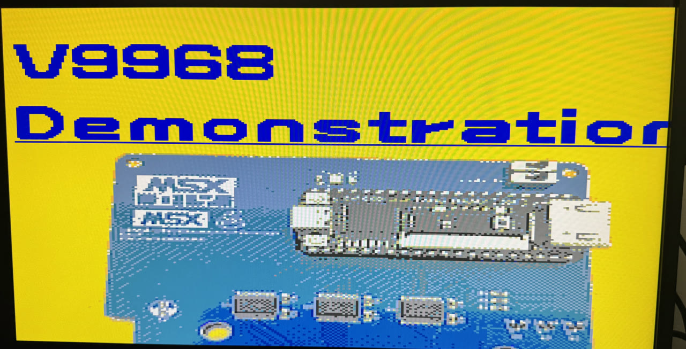

<p align="center"></p>

<p align="center"><b>MSXimus Z — un MSX2+ completo en la OMDAZZ ZYNQ MINI (XC7Z020)</b></p>
<p align="center">
  
  
  
</p>

<p align="center">🇬🇧 <a href="README.md">English version</a></p>

<p align="center"></p>
<p align="center"><i>La demo oficial del V9968 de HRA!, en el MSXimus.</i></p>

**No hace falta un MSX: es un MSX.** Se le enchufa una pantalla HDMI y un teclado USB, se ponen los juegos en una microSD y a encender.

MSXimus Z es la **línea Zynq del [MSXimus](https://github.com/Papipapito/MSXimus)**, el MSX2+ con el VDP V9968 que nació en la Tang Console 60K. El XC7Z020 son dos chips en uno, y el MSXimus Z usa las dos mitades:

- El **PL** (una FPGA de la clase del Artix-7) lleva el MSX entero: el Z80, el V9968, los chips de sonido, la megaram, los mappers y toda la E/S.
- El **PS** (dos Cortex-A9 con 512 MB de DDR3) corre un programa pequeño sin sistema operativo, el **companion**: sirve la microSD al MSX, atiende el USB (teclado, mandos, ratón, disquetera), el puerto Ethernet, el panel F12 y la OLED, guarda los ajustes en la QSPI, toca la música WaveGame y **actualiza la placa por la red**.

La memoria del MSX también vive en la DDR3: la RAM del Z80, la VRAM, la megaram de 8 MB, el pack de BIOS y la tabla de ondas del OPL4. Sobra sitio.

Este repositorio contiene el core (`fpga/`) y el companion (`fpga/zynq/arm/`) del MSXimus Z. El menú de arranque y los packs de BIOS llevan ROMs con copyright y no se publican; el firmware del ESP32 tampoco está aquí: vive en el repositorio único del ESP, [`Papipapito/ESP32-for-FPGA`](https://github.com/Papipapito/ESP32-for-FPGA) (rama `c6`): véase *Cómo compilarlo*.

## Qué lleva

| | |
|---|---|
| **CPU** | Z80 a 3,58 MHz con **turbo real a 5,37 MHz** (F11). No se identifica como turbo R y no tiene R800 |
| **Vídeo** | El **[V9968](https://github.com/hra1129/V9968_Cartridge)** de HRA! (generación C): sprites multicolor escalables, 16 por línea, 256 KB de VRAM, comandos rápidos. Y un **V9990** (tiny9990 de [buppu3](https://github.com/buppu3)) en los puertos 60h-6Fh con su propia imagen: **Pausa** conmuta el HDMI entre los dos. HDMI 720p, bordes como un monitor de tubo, scanlines opcionales, y pantalla completa en 16:9 o en **4:3 con Scale3x** (F12 → V) |
| **3D** | **[geo3d](https://github.com/alexmoncks/V9968_Cartridge)** de Alex Moncks: un coprocesador 3D en los puertos 9Dh/9Fh que transforma, recorta, sombrea y dibuja él mismo las caras con el motor de comandos del V9968: unos 200 cuadros sombreados por segundo |
| **Audio** | Dos PSG, SCC y un segundo SCC en el slot 1, OPLL (MSX-MUSIC, IKAOPLL), MSX-Audio Y8950 con ADPCM y el **MoonSound completo** (OPL4 FM + tabla de ondas, la YRW801 en la DDR3). Música **WaveGame**, un **mezclador por fuente** con nota de prueba y estéreo de verdad canal a canal en todos los chips |
| **Cartuchos** | Una **megaram de 8 MB**: Konami, Konami-SCC, ASCII8, ASCII16, NEO-8, NEO-16, Plain 0000h y **ASCII16-X**. El menú lee el mapper de la firma de la propia ROM ([convención de MSXgl](https://aoineko.org/msxgl/index.php?title=ROM_type_signature)). La SRAM de los cartuchos y el Game Master 2 de Konami se guardan en la tarjeta |
| **Almacenamiento** | Nextor en la microSD de **TF2**, leída por DMA a 1600 KB/s. Imágenes `.dsk`, una **cinta virtual** que carga TSX y CAS como la de verdad y una **disquetera USB de 3,5"** como unidad de verdad (experimental) |
| **Entrada** | Teclado USB, mandos HID genéricos y XInput (Xbox 360 y receptores que se presentan como tal) y ratón, por un hub si hace falta |
| **Red** | **Ethernet** en J3 (el companion hace de ESP32 del MSX: UNAPI, File-Hunter, hget, **TLS**) o **WiFi** con un ESP32-S3 en el CAM1. Buscar y bajar ROMs, discos y cintas desde el propio menú |
| **En pantalla** | El **panel F12**, en color: temperatura, tensiones, tarjeta SD, dispositivos USB por tipo, Z80 y turbo, modo de pantalla, VDP activo, red. Y la **OLED** de la placa como pantallita de estado permanente |
| **Escritorio** | Lanza un juego o un disco dentro de una **ventana** del escritorio del V9990 (teclas V y B del menú): reloj, «Now playing» y una tarjeta del sistema con IP, temperatura, tiempo encendido y USB. La hora viene de la red (NTP, horario de verano europeo) |
| **Perfiles** | Otros sistemas para el PL, guardados en una microSD en **TF1** y bajados desde la placa (F12 → P → S): **Música** (YM2151 y SN76489), **Dual** (una segunda máquina MSX2+), **Turbo R** (R800 y Z80 con cambio en caliente, OPL4, mapper de 2 MB) y **Turbo R V9990** (ROM NEO-16 de hasta 16 MB). No van en la release de GitHub: la placa los baja siempre de msx.barcelona |
| **Actualizaciones** | **Por la red**, por cable o por WiFi: F12 → U. Dos ranuras en la QSPI, un manifiesto firmado y la imagen de fábrica siempre a una tecla |
| **Idiomas** | Menús, Ajustes y panel **en castellano o en inglés**, con Nextor 2.1.4 o Nextor 3: cuatro variantes a elegir |

El menú de arranque: RETURN lanza, ESC arranca MSX-DOS/Nextor, **S** Ajustes, **W** WiFi, **F** File-Hunter, **H** ayuda. Manteniendo **S** durante el logo se entra en Ajustes aunque el menú esté apagado.

## Lo que hace falta

| | Qué | Notas |
|---|---|---|
| **Obligatorio** | **OMDAZZ ZYNQ MINI** (XC7Z020-CLG400) | 512 MB de DDR3, QSPI de 16 MB, dos ranuras microSD, USB host, HDMI, Ethernet, OLED. Todo lo que usa el MSXimus Z viene en la placa |
| **Obligatorio** | Una **microSD** para **TF2** | La tarjeta del MSX: ROMs, discos, carpetas WaveGame. Particiones FAT16 para que el menú pueda escribir (partidas, descargas). La mejor forma de prepararla: [MSX SD Maker](https://github.com/Papipapito/SD_Maker) |
| **Obligatorio** | Cable HDMI y alimentación por USB-C | |
| Recomendado | Teclado USB | |
| Opcional | Una **microSD** para **TF1** | Guarda los **perfiles** del sistema (F12 → P) y, con SW1 en SD, puede arrancar el PS. El MSX no la ve. La prepara la propia placa |
| Opcional | Mando USB (HID), ratón USB, disquetera USB de 3,5" | Por un hub USB plano, varios a la vez. Mandos HID genéricos y XInput (Xbox 360 y receptores que se presentan como tal) |
| Opcional | **Cable Ethernet** en **J3** | La red sin comprar nada más. J2 es del PL y no se usa |
| Opcional | **Waveshare ESP32-S3-LCD-1.69** en el **CAM1** | WiFi, con pantalla de estado. Cuatro hilos, alimentada por su propio USB-C |
| Solo una vez | **Vivado 2019.2** y el JTAG de la placa | Para grabar la primera imagen en la QSPI. Las siguientes llegan por la red |

El interruptor de arranque **SW1**: **ON-ON = JTAG**, **ON-OFF = QSPI** (el uso normal), **OFF-OFF = SD** (TF1). Solo se lee al dar la corriente: el reset de la placa (PS_SRST) no lo relee.

## Instalación

Toda la máquina es **un solo fichero**, un `BOOT.bin`: FSBL, bitstream, companion, pack de BIOS y tabla de ondas del OPL4 juntos. La [release de GitHub](https://github.com/Papipapito/MSXimus_Z/releases/latest) trae cuatro, uno por variante, y el bitstream solo para cargarlo por JTAG:

| Fichero | Menús | Nextor |
|---|---|---|
| `BOOT_Z1.4.3_nextor214.bin` | Castellano | **2** (el estable, el que quieres) |
| `BOOT_Z1.4.3_nextor214-en.bin` | Inglés | 2 |
| `BOOT_Z1.4.3_nextor3.bin` | Castellano | 3 |
| `BOOT_Z1.4.3_nextor3-en.bin` | Inglés | 3 |

Los perfiles **Música**, **Dual**, **Turbo R** y **Turbo R V9990** se bajan desde la placa: F12 → P → S.

La variante se puede cambiar después desde la página de actualización (F12 → U, flechas), así que la elección no es definitiva.

### En la QSPI (lo recomendado, una vez)

Así la placa arranca sola y se puede actualizar sola.

1. Clona este repositorio y copia el `fsbl.elf` de la release en `fpga/zynq/arm/fsbl/`: Vivado lo usa de ayudante para grabar la flash. También se puede compilar con `fpga/zynq/arm/fsbl/build.sh`.
2. Apaga, pon **SW1 en ON-ON** (JTAG), conecta el USB del JTAG de la placa, enciende y arranca `hw_server`.
3. Desde `fpga/zynq`:

   ```
   vivado -mode batch -source tools/qspi_program.tcl -tclargs program w25q128fv-qspi-x4-single BOOT_Z1.4.3_nextor214.bin
   ```

   Borra, graba y verifica, y acaba con `PROGRAM_OK`.
4. Apaga, pon **SW1 en ON-OFF** (QSPI) y enciende.

Esa es la **imagen de fábrica** (ranura A). Las actualizaciones por red no la tocan nunca, así que siempre se puede volver a ella.

Si Vivado no ve el JTAG de la placa, hay que cambiar el `FTD2XX.dll` de Vivado por uno que conozca el FTDI de la placa.

### Desde una microSD en TF1 (sin Vivado)

Copia la imagen en la raíz de una microSD en FAT32, renómbrala exactamente `BOOT.bin`, ponla en **TF1**, **SW1 en OFF-OFF** y enciende. Sirve para probar una imagen sin grabar nada; la actualización por red necesita la instalación en la QSPI.

### La tarjeta del MSX (TF2)

La mejor forma de prepararla es **[MSX SD Maker](https://github.com/Papipapito/SD_Maker)**, un programa para Windows con su propio repositorio: particiones FAT16 con la disposición del FDISK de Nextor, el sistema, las utilidades y un `AUTOEXEC.BAT` que monta todas las particiones. Trae el contenido de la tarjeta y la prepara él. El detalle, en [`docs/manual/03-tarjeta-sd.md`](docs/manual/03-tarjeta-sd.md).

## Actualizar por la red

Pulsa **F12** y luego **U**. La placa busca la última versión, enseña sus notas, su tamaño y la comprobación de la firma, y con **I** la baja, la graba y la relee. **R** reinicia con ella.

- **Por cable o por WiFi.** Con un cable en J3 tarda segundos. Sin él, el companion toma prestada la ESP32-S3 del CAM1 mientras dura la búsqueda o la descarga (el MSX se queda sin WiFi ese rato) y una imagen tarda 3-4 minutos.
- **Desde [msx.barcelona](https://msx.barcelona)**, por TLS. El certificado solo lo valida la S3 (por WiFi); por cable el TLS cifra pero no lo verifica. Lo que protege la actualización en los dos casos es la firma ECDSA del manifiesto. Antes busca, por difusión UDP, un servidor de desarrollo en la red local (`fpga/zynq/ota/ota_servidor.py`).
- **Los arreglos llegan solo por aquí.** GitHub lleva las versiones grandes; se instala esa y con F12 → U se llega a la última.
- **Dos ranuras.** La actualización va a la **ranura B**; la A, la de fábrica, no se toca nunca. Una B nueva se prueba una vez y se confirma cuando el MSX lee su tarjeta. Si no arranca, apagar y encender: vuelve la A y lo dice.
- **Firmada.** El manifiesto va firmado con ECDSA P-256 y lleva el SHA-256 de cada imagen; la placa no instala nada que no cuadre.
- **La variante**: en la página de actualización, izquierda/derecha elige Nextor 2.1.4 o 3, arriba/abajo castellano o inglés. Cambiar de Nextor pide el `NEXTOR.SYS` de ese Nextor en la tarjeta (MSX SD Maker lo pone).
- **Volver a la de fábrica**: **F** dos veces y **R**.

Todo lo demás, en [`docs/manual/12-actualizar.md`](docs/manual/12-actualizar.md) (cómo se usa) y [`docs/tecnica/11-actualizacion.md`](docs/tecnica/11-actualizacion.md) (cómo funciona).

## El panel F12

**F12** congela el MSX y dibuja el panel sobre la imagen, en el idioma del menú. F12 otra vez y el juego sigue exactamente donde estaba.

```
  MSXimus Z                          Z1.4.3
  Sistema
    Temperatura    52,3°C  máx 55
    Tensiones (V)  1,00 · 1,80 · 1,00
    Encendida      00:12:41
  Tarjeta SD
    15193 MB
  USB
    3 dispositivos   1 teclado · 1 mando · 1 hub
  MSX
    Z80 5,37 MHz turbo
    SCREEN 5 · vídeo V9968
    OPL4 YRW801 OK
  Red
    192.168.2.105
  [U] Actualizar   [F12] Salir
  El MSX está en pausa.
```

La OLED de J4 enseña en todo momento la versión, la IP, el VDP activo y el turbo.

## La red: Ethernet o WiFi

**Ethernet (J3).** El companion habla con el MSX el [protocolo UNAPI del ESP32 de ducasp](https://github.com/ducasp/ESP32-UNAPI-Firmware), así que el driver UNAPI del pack, la tecla **W**, el **File-Hunter**, hget y cualquier programa UNAPI van por el cable sin cambiar nada del lado del MSX. Con TLS; la IP la da el router por DHCP.

**WiFi (CAM1).** Una **Waveshare ESP32-S3-LCD-1.69** con el firmware de [`Papipapito/ESP32-for-FPGA`](https://github.com/Papipapito/ESP32-for-FPGA) (rama `c6`). Se usa el cable SH1.0 de 12 hilos de la placa (el 1 = el extremo lejos del USB-C):

| Cable de la S3 | Señal | CAM1 |
|---|---|---|
| negro, 1 | GPIO18 — indicador de turbo | **30** |
| rojo, 2 | GPIO17 — RX del ESP | **28** |
| verde, 3 | GPIO16 — TX del ESP | **26** |
| morado, 11 | GND | **38** |

El azul (3,3 V) y el gris (5 V) quedan sin conectar: la S3 se alimenta por su propio USB-C. La masa es obligatoria. Con los dos puestos, **manda el cable** mientras tenga enlace.

Compilar y grabar la S3: el firmware no se publica ya compilado. Se compila desde el repositorio del ESP [`Papipapito/ESP32-for-FPGA`](https://github.com/Papipapito/ESP32-for-FPGA) (rama `c6`) con `arduino-cli` (`-DESP32_S3_LCD169`), según su [README](https://github.com/Papipapito/ESP32-for-FPGA/blob/c6/README.md), y se sube **solo la app, a `0x10000`** (nunca la imagen fusionada a `0x0`) por el USB-C de la S3 al PC. Lleva 16 autoridades de certificación de Mozilla, así que la S3 valida el certificado del servidor de actualizaciones. La red WiFi se configura desde el MSX con la tecla **W**.

## Las demos de geo3d

La ROM de demos de Alex Moncks (`GEO3D_98.ROM`, siete demos) y su extensión de BASIC (`G3BASIC.ROM`, con sus programas `.BAS` de ejemplo) se compilan desde [su repositorio](https://github.com/alexmoncks/V9968_Cartridge). Compiladas con la firma de tipo de ROM, el menú las lanza con su mapper; si no, hay que poner `[ASCII16]` en el nombre del fichero. MIT.

Más demos de geo3d y del V9968: [kanon-ai/V9968_Geo3D_SampleDemo](https://github.com/kanon-ai/V9968_Geo3D_SampleDemo) y [kanon-ai/V9968_SampleDemo](https://github.com/kanon-ai/V9968_SampleDemo). El software escrito para el interfaz de registros anterior del V9968 (generación B: DEVCON, TECH DEMO) necesita antes un `OUT (9Ch),0`: lo explica [`docs/manual/09-video.md`](docs/manual/09-video.md).

## Cómo se construye

**Lo que se puede compilar desde este repositorio:** el **bitstream** (Vivado 2019.2) y el **companion y el FSBL** (toolchain ARM GNU 14.2, `arm-none-eabi`; sin SDK ni Vitis, basta xsdb). Los bancos de pruebas corren en WSL (Ubuntu-24.04).

**Lo que no:** el **menú de arranque y los packs de BIOS**. El fuente del menú está aquí (`bios/`), pero ensamblarlo y montar un pack necesita las ROM de sistema del MSX, que llevan copyright y viven en un repositorio privado: esos dos pasos no se reproducen desde aquí. Quien quiera un `BOOT.bin` propio saca el pack de BIOS de uno publicado (es una partición del fichero) y compila el resto.

```bash
# 1. Bitstream (~15 min)            -> fpga/zynq/msximus_zynq.bit
cd fpga/zynq && vivado -mode batch -source build.tcl -tclargs bit
# 2. Companion y FSBL               -> companion.elf, fsbl.elf
fpga/zynq/arm/get_tinyusb.sh        # una vez (también get_minimp3.sh y get_mbedtls.sh)
fpga/zynq/arm/companion/build.sh
fpga/zynq/arm/fsbl/build.sh
# 3. El pack de BIOS y las ondas, sacados de un BOOT.bin de la release
python fpga/zynq/arm/boot/extraer_de_boot.py BOOT_Z1.4.3_nextor214-en.bin /tmp/publicado
# 4. Tu BOOT.bin                    -> fpga/zynq/arm/boot/BOOT.bin
OTA_VERSION=dev fpga/zynq/arm/boot/make_boot.sh /tmp/publicado/pack.bin /tmp/publicado/yrw801.rom
```

La YRW801 (la tabla de ondas del OPL4, 2 MB) se puede sustituir por un fichero de 2 MB a ceros: la parte wave del OPL4 queda muda, nada se bloquea y el panel F12 avisa de que la ROM no coincide (`fpga/zynq/arm/companion/yrw801.c`). Las rutas de las herramientas se cambian con las variables `XILINX_VIVADO`, `XILINX_EMBEDDEDSW`, `ARM_TC` y `BOOTGEN`.

`fpga/zynq/top_zynq.v` se edita a mano; `tools/make_top_zynq.py` está desfasado y no hay que ejecutarlo. Desarrollo por JTAG sin grabar nada: `BOOT_PROXY=1 xsdb tools/boot.tcl [pack] [bit]`. El resto, incluido cómo se ensambla el menú, está en [`docs/tecnica/07-construccion.md`](docs/tecnica/07-construccion.md) (el menú de arranque y los packs de BIOS no se publican).

## Estado

**La Z1.4.3 es la versión de GitHub y la última** (09/11/2026): la misma que ofrece la actualización por red (msx.barcelona). Se instala y con F12 → U se sigue al día. Ajustes sigue enseñando «Z1.4.1» (el PL no ha cambiado desde entonces); la versión del sistema, «Z1.4.3», sale en la cabecera del panel F12 y en la OLED.

## Documentación

[`docs/INDICE.md`](docs/INDICE.md) reúne dos documentos:

- Una **[guía rápida](docs/manual/00-guia-rapida.md)** y un **manual de usuario** de doce capítulos: qué es, instalación, tarjetas SD, menú, ROMs y mappers, MSX-DOS y Nextor, red, audio, vídeo, problemas, cinta y actualizar.
- Una **referencia técnica** de trece: arquitectura, puertos de E/S, mapas de memoria, pack de BIOS, V9968, SD y DMA, construcción, verificación, changelog, cinta, actualización por red, companion, y V9990 con geo3d.

## Mapa del repositorio

```
fpga/top.v            El núcleo del MSXimus para las placas Tang (el de la Zynq es fpga/zynq/top_zynq.v)
fpga/src, v9968, v9990, geo3d, ikaopll, jtopl, opl3, opl4wave, ...   RTL del core
fpga/zynq/            Lo propio de la Zynq
  top_zynq.v          El nivel superior (a mano)
  build.tcl           Proyecto de Vivado (block design del PS7)
  memory_axi.v        RAM del Z80 en la DDR (caché 64 KB)   v9968_axi_backend.v  VRAM en la DDR
  dbg_mailbox_axi.v   Buzón PL<->ARM                        sd_axi_proxy.v       la SD del MSX servida por el ARM
  arm/companion/      El companion (USB, SD, OSD, OLED, Ethernet, OTA, enlace con la S3, WaveGame, cinta)
  arm/fsbl/           FSBL con el salto a la ranura B       arm/boot/make_boot.sh   monta el BOOT.bin
  ota/                Servidor, firma y publicación de las actualizaciones
  tools/              Herramientas de xsdb (arranque, teclas, pantalla, telemetría, QSPI...)
bios/                 Menú de arranque de 32 KB (asmsx) y herramientas de packs (los packs, en el repo privado de BIOS)
(el firmware del ESP32 no está aquí: github.com/Papipapito/ESP32-for-FPGA, rama c6)
docs/                 Manual de usuario y referencia técnica
```

## Últimas versiones

- **Z1.4.3** (09/11, en GitHub y por la red): la microSD de **TF1** pasa a ser solo la tarjeta de los **perfiles** y el MSX ya no la ve (deja de ser la unidad B: de Nextor: los datos que tuviera hay que copiarlos antes a TF2); la placa prepara la tarjeta sola (F12 → P), con salvaguardas, y baja los perfiles por su cuenta; **`.dsk` de varios discos** (un fichero de N × 720 KB se monta como N unidades de Nextor) y tipo «Multidisco» en el menú; `NEXTOR.EMU` se reutiliza en las particiones FAT16 en lugar de perder un cluster por montaje; **Nextor 3.0 final**; el firmware del ESP32-S3 vive ya en su propio repositorio. Reúne la Z1.4.1 y la Z1.4.2, que no llegaron a publicarse por separado: la Z1.4.1 trajo el perfil **Turbo R V9990** (NEO-16 de hasta 16 MB), arregló las ROM de 4 MB o más lanzadas desde el menú en el perfil Turbo R e hizo arrancar *Illusion City* en `.DSK` en los dos perfiles Turbo R.
- **Z1.4.0** (04/11, en GitHub y por la red): los **perfiles** (Música, Dual y Turbo R, que se bajan desde la placa: F12 → P → S), sprites del V9968 en SCREEN 10, 11 y 12, geo3d también en 8Dh/8Fh, los registros del PSG legibles por A2h y un cuelgue del USB arreglado.
- **Z1.3.1** (30/10, solo por la actualización por red): escritorio vivo en el V9990 con el juego en la ventana (teclas V y B, para ROMs y también para discos `.dsk`): barra superior con la hora, tarjeta «NOW PLAYING» con el nombre del juego y tarjeta «SYSTEM» con la IP (cable o WiFi), temperatura, tiempo encendido, turbo de la CPU y USB; la hora viene de la red (SNTP por cable, NTP por la WiFi de la S3, horario de verano europeo) y, sin red, del reloj en hardware del gestor de ventanas (el RTC del MSX); las ROM con disco dentro (DSK2ROM, como *Sonyc*) ya arrancan, sin Nextor; la ventana conserva 8 puntos de borde a cada lado, así que los juegos que mueven la imagen con R#18 (*Sonyc*) ya no salen cortados; el V9968 a pantalla completa en **4:3 con Scale3x** (F12, la tecla V alterna 16:9 / 4:3; los modos de 512 puntos salen sin filtro); la máquina **ya no se identifica como turbo R** (solo queda el temporizador del sistema, puertos E6h/E7h, para las demos de geo3d); RETURN cambia la opción en Ajustes, igual que ESPACIO; la pantalla de pruebas (T) enseña bien la versión del core; la ventana V cabe en pantalla (las tarjetas del escritorio en modo V son más estrechas, de 19 caracteres, y WiFi/LAN va en la cabecera SYSTEM).
- **Z1.3.0** (30/10, en GitHub y por la red): una sola salida HDMI para el V9968 y el V9990, compuestos píxel a píxel y a 60 Hz exactos en todos los modos (se acaba el parpadeo de los monitores que rechazaban los 59,92 Hz); el V9968 en una ventana dentro del escritorio del V9990 (teclas V y B al lanzar una ROM), con gestor de ventanas por hardware (marco, puntero y arrastre con el ratón USB); B5 y B7 en el V9990; canal beta en la actualización por red (tecla B en F12 → U); la OLED y el panel F12 dicen V9991 con la ventana; Ajustes enseña la versión en decimal.
- **Z1.2.13** (28/10, en GitHub y por la red): el File Hunter acepta ROMs de hasta 8 MB; los drivers de Nextor (2.1.4 y 3) son la versión 3.5.4 y enseñan la microSD de TF1 como dispositivo 2 (Nextor le da letra propia; particiones FAT12/FAT16 de hasta 4 GB; se detecta al encender o reiniciar); el entrelazado (IL + EO) del V9990 es estable, sin líneas de imagen arriba y sin píxeles de la línea siguiente por el borde derecho en color directo (las imágenes de color directo se mueven 1-2 píxeles a la derecha). Problema conocido: el panel F12 no se ve mientras el HDMI muestra el V9990 (pulsa Pausa para volver al V9968, donde F12 funciona); se arreglará con el rediseño del puente de vídeo.
- **Z1.2.12** (27/10, solo por la actualización por red): el V9990 va en PAL a 50 Hz (*Xybots* y *Sol Negro* ya no van un 20 % rápidos), se arreglan el CMMC/CMMM de *Chase H.Q.* y el orden de bytes a 16 bpp, los colores YJK/YUV salen bien y un byte de P#2 escrito sin mirar TR se retiene en vez de perderse; el wave del OPL4 se interpola entre muestras y los temporizadores del FM son exactos; el reloj sigue el RTC nuevo de OCM (fecha válida tras un arranque en frío); geo3d v2.0 (hasta 1.023 vértices y caras); y el menú detecta el mapper de *Xybots* (ASCII16) sin etiqueta.
- **Z1.2.11** (21/10, solo por la actualización por red): el V9990 reinicia la cuenta de líneas del plano cuando se escribe R#17/R#21 a mitad de pantalla, como el chip y openMSX (el split de *Xybots* de DiHalt Studio ya no enseña el atlas de letras abajo); el menú deja el slot 3 como tras un arranque en frío al lanzar una ROM (*Sol Negro* para V9990 encontraba la ROM del menú en vez de la RAM y se quedaba en azul); y leer G de la paleta del V9990 por P#1 ya no devuelve B.

Todas las versiones, con lo que trae cada una: [`docs/tecnica/09-changelog.md`](docs/tecnica/09-changelog.md).

## Licencia

**GPLv3**, obra derivada del [MSXimus](https://github.com/Papipapito/MSXimus) y, a través de él, del [MSXnano](https://github.com/Papipapito/MSXnano). Ver [LICENSE](LICENSE) y [UPSTREAM.md](UPSTREAM.md) para la atribución y la IP de terceros.

El **V9968** es de Takayuki Hara y va con su propia licencia, tipo BSD pero **no comercial**: se puede redistribuir con sus avisos y publicar gratis, **pero no vender**. Esa condición se hereda, así que **este proyecto no está a la venta**.

Los packs de BIOS y las imágenes `BOOT.bin` llevan las ROMs de sistema del MSX, como el resto de la familia MSXimus. **geo3d** es MIT (Alex Moncks), **tiny9990** BSD-3 (buppu3), **IKAOPLL** BSD-2 (Raki). El logo del MSXimus es del proyecto.

---

# Gracias

### El core y su linaje

- **[jabadiagm](https://github.com/jabadiagm)** — MSXgoauldSD, el Goa'uld, origen de todo este linaje (goauld → MSXnano → MSXimus), y el envoltorio del IKAOPLL.
- **El linaje OCM-PLD / ESE Artists' Factory** — Kunihiko Ohnaka, KdL y todos los que llevan dos décadas manteniendo vivo el MSX2+ en FPGA.

### Vídeo y 3D

- **[Takayuki Hara — HRA!](https://github.com/hra1129)** — el **V9968**, sus demos y los bancos de pruebas con los que se ha validado.
- **[Alex Moncks](https://github.com/alexmoncks)** — **geo3d**, el coprocesador 3D, y sus demos.
- **[buppu3](https://github.com/buppu3)** — tiny9990, el V9990.
- **[kanon-ai](https://github.com/kanon-ai)** — las demos de muestra de geo3d y del V9968.
- **[Albert Herranz — herraa1](https://github.com/herraa1)** — el cartucho V9968 y el material de referencia.

### Audio

- **[Jose Tejada — jotego](https://github.com/jotego)** — jtopl2 (FM del Y8950) y jt10_adpcmb.
- **[Raki — ika-musume](https://github.com/ika-musume)** — IKAOPLL, el YM2413 reconstruido desde el dado.
- **[Greg Taylor — gtaylormb](https://github.com/gtaylormb)** — opl3_fpga, con `afifo.v` de **Dan Gisselquist (ZipCPU)**.
- **srg320** — YMF278B.sv, el motor PCM del OPL4, con su permiso expreso.
- **Jeroen Taverne** — el protocolo WaveGame.
- **El equipo de MAME** y **Aaron Giles** (ymfm) — las referencias.

### La placa, la red y las herramientas

- **[ducasp](https://github.com/ducasp)** — el firmware UNAPI del ESP y su protocolo.
- **[TinyUSB](https://github.com/hathach/tinyusb)**, **lwIP** y **Mbed TLS** — el USB host, la pila de red y el TLS del companion.
- **[nand2mario](https://github.com/nand2mario)** — `usb_hid_host` y la plantilla de vídeo 720p.
- **hdl-util (Sameer Puri)** — el empaquetador HDMI.
- **aoineko (Guillaume Blanchard)** — MSXgl y la firma de tipo de ROM.
- **El equipo de [openMSX](https://openmsx.org)** — la referencia con la que se decide qué está bien y qué mal.
- **[File-Hunter](https://www.file-hunter.com)** — el archivo del que baja el menú.
- **USB2SLOT — Thomas Wiesner ([MSXRetroThings](https://github.com/TommyGermanyRetro/MSXRetroThings))** — regaló la PCB para las pruebas de slot USB del MSXimus Z. Es una función en pruebas, todavía sin integrar. Software MIT, hardware CERN-OHL-S-2.0.
- **Yamaha** — los chips originales que este proyecto emula con cariño.

### Y

- **Claude (Anthropic)** — **coautor del código**: el porte a la Zynq, el companion, la actualización por red, los bancos y muchas horas de depuración con simulación y telemetría.

---

<p align="center"><i>Para la comunidad MSX. Que dure otros cuarenta años.</i></p>
