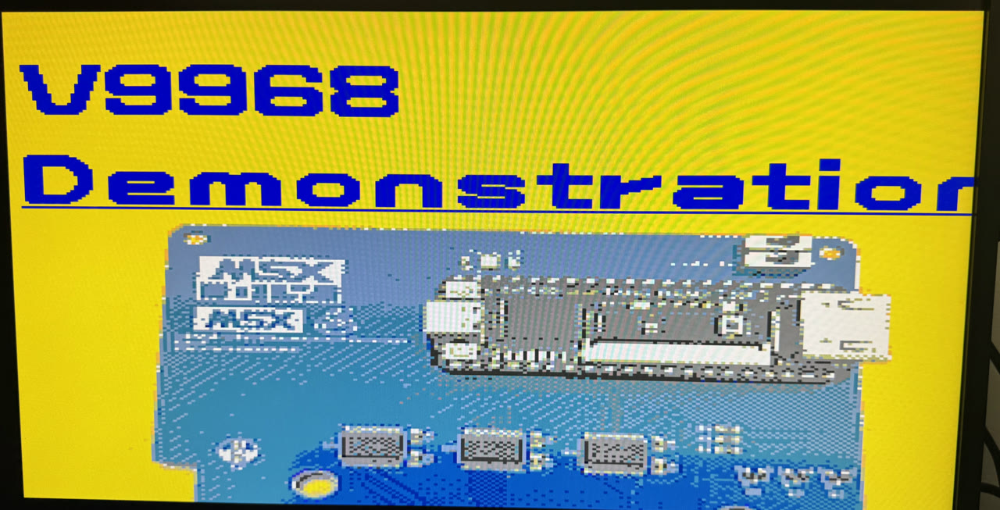

<p align="center"></p>

<p align="center"><b>MSXimus Z — a complete MSX2+ on the OMDAZZ ZYNQ MINI (XC7Z020)</b></p>
<p align="center">
  
  
  
</p>

<p align="center">🇪🇸 <a href="README.es.md">Versión en castellano</a></p>

<p align="center"></p>
<p align="center"><i>HRA!'s official V9968 demo, running on the MSXimus.</i></p>

**No MSX needed: it is an MSX.** Plug in an HDMI screen and a USB keyboard, put your games on a microSD card, power it up.

MSXimus Z is the **Zynq line of the [MSXimus](https://github.com/Papipapito/MSXimus)**, the MSX2+ with the V9968 VDP that was born on the Tang Console 60K. The XC7Z020 is two chips in one, and the MSXimus Z uses both halves:

- The **PL** (an Artix-7 class FPGA) runs the whole MSX: the Z80, the V9968, the sound chips, the megaram, the mappers and all the I/O.
- The **PS** (two Cortex-A9 cores with 512 MB of DDR3) runs a small bare-metal program, the **companion**: it serves the microSD card to the MSX, handles USB (keyboard, gamepads, mouse, floppy drive), the Ethernet port, the F12 panel and the OLED, keeps the settings in the QSPI flash, plays the WaveGame music and **updates the board over the network**.

The MSX's memory lives in the DDR3 too — the Z80's RAM, the VRAM, the 8 MB megaram, the BIOS pack and the OPL4 wavetable. There is room to spare.

This repository holds the core (`fpga/`) and the companion (`fpga/zynq/arm/`) of the MSXimus Z. The boot menu and the BIOS packs carry copyrighted ROMs and are not published; neither is the ESP32 firmware, which lives in the single ESP repository, [`Papipapito/ESP32-for-FPGA`](https://github.com/Papipapito/ESP32-for-FPGA) (branch `c6`): see *Building it*.

## What's inside

| | |
|---|---|
| **CPU** | Z80 at 3.58 MHz with a real **5.37 MHz turbo** (F11). It does not identify as a turbo R and has no R800 |
| **Video** | **[V9968](https://github.com/hra1129/V9968_Cartridge)** by HRA! (generation C): multicolor scalable sprites, 16 per line, 256 KB VRAM, fast commands. Plus a **V9990** (tiny9990 by [buppu3](https://github.com/buppu3)) at ports 60h-6Fh with its own picture: **Pause** switches the HDMI between the two. HDMI 720p, monitor-like borders, optional scanlines, and full screen at 16:9 or **4:3 with Scale3x** (F12 → V) |
| **3D** | **[geo3d](https://github.com/alexmoncks/V9968_Cartridge)** by Alex Moncks: a 3D coprocessor at ports 9Dh/9Fh that transforms, clips, shades and draws the faces itself through the V9968's command engine — ~200 shaded frames per second |
| **Audio** | Two PSGs, SCC and a second SCC in slot 1, OPLL (MSX-MUSIC, IKAOPLL), MSX-Audio Y8950 with ADPCM, and the **full MoonSound** (OPL4 FM + wavetable, YRW801 in DDR3). **WaveGame** music, a **per-source mixer** with a test tone, and true stereo channel by channel on every chip |
| **Cartridges** | An **8 MB megaram**: Konami, Konami-SCC, ASCII8, ASCII16, NEO-8, NEO-16, Plain 0000h and **ASCII16-X**. The menu reads the mapper from the ROM's own signature ([MSXgl convention](https://aoineko.org/msxgl/index.php?title=ROM_type_signature)). Cartridge SRAM and Konami's Game Master 2 are saved to the card |
| **Storage** | Nextor on the microSD in **TF2**, read by DMA at 1600 KB/s. `.dsk` images, a **virtual tape** that loads TSX and CAS like the real thing, and a **USB 3.5" floppy drive** as a real drive (experimental) |
| **Input** | USB keyboard, generic HID and XInput (Xbox 360 and receivers that present as one) gamepads, and mouse, through a hub if needed |
| **Network** | **Ethernet** on J3 (the companion behaves as the MSX's ESP32: UNAPI, File-Hunter, hget, **TLS**) or **WiFi** with an ESP32-S3 on CAM1. Search and download ROMs, disks and tapes straight from the menu |
| **On screen** | The **F12 panel**, in colour: temperature, voltages, SD card, USB devices by type, Z80 and turbo, screen mode, active VDP, network. And the board's **OLED** as a permanent status display |
| **Desktop** | Launch a game or a disk into a **window** on the V9990 desktop (keys V and B in the menu): clock, "Now playing" and a system card with IP, temperature, uptime and USB. The clock comes from the network (NTP, European summer time) |
| **Profiles** | Other systems for the PL, kept on a microSD in **TF1** and downloaded from the board (F12 → P → S): **Music** (YM2151 and SN76489), **Dual** (a second MSX2+ machine), **Turbo R** (R800 and Z80 with hot switching, OPL4, 2 MB mapper) and **Turbo R V9990** (NEO-16 ROMs up to 16 MB). They are not in the GitHub release: the board always downloads them from msx.barcelona |
| **Updates** | **Over the network**, by cable or WiFi: F12 → U. Two slots in the QSPI, a signed manifest, and the factory image always one key away |
| **Languages** | Menus, Settings and panel **in Spanish or in English**, with Nextor 2.1.4 or Nextor 3: four variants to choose from |

The boot menu: RETURN launches, ESC boots MSX-DOS/Nextor, **S** Settings, **W** WiFi, **F** File-Hunter, **H** help. Holding **S** during the logo opens Settings even with the menu turned off.

## What you need

| | What | Notes |
|---|---|---|
| **Required** | **OMDAZZ ZYNQ MINI** (XC7Z020-CLG400) | 512 MB DDR3, 16 MB QSPI, two microSD slots, USB host, HDMI, Ethernet, OLED. Everything the MSXimus Z uses is on the board |
| **Required** | 5 V USB-C power and an **HDMI** display | 720p output, with audio |
| **Required** | **USB keyboard** and a USB-C to USB-A adapter (or a USB-C hub) for the **P3** connector | Needed to install (it is all done from the F12 panel) and to use the MSX |
| **Required** | A **microSD** for **TF1**, 1 GB or larger | Carries the `BOOT.bin` to install; afterwards it holds the system **profiles** (F12 → P). The MSX does not see it. The board prepares it itself |
| **Required** | A **microSD** for **TF2** | The MSX's card: ROMs, disks, WaveGame folders. FAT16 partitions so the menu can write (saves, downloads). [MSX SD Maker](https://github.com/Papipapito/SD_Maker) prepares it best |
| **Required** | A **PC with a microSD reader** | To prepare TF1 with **MSXimusZboot** (Windows and macOS, in the release) and TF2 with MSX SD Maker (Windows) |
| Recommended | **Network**: Ethernet cable on **J3** with Internet access | For the latest version (F12 → U), the profiles (F12 → P → S) and File-Hunter. The router assigns the IP. Without a network it works the same but stays on the installed version. J2 belongs to the PL and is not used |
| Recommended | A heatsink on the chip | About 55 °C with it, about 80 without |
| Optional | **Waveshare ESP32-S3-LCD-1.69** on **CAM1** | WiFi instead of the cable, with a status screen. Four wires, powered by its own USB-C |
| Optional | USB gamepad (HID), USB mouse, USB 3.5" floppy drive | Through a plain USB hub, several at once. Generic HID and XInput (Xbox 360 and receivers that present as one) gamepads work |
| Not needed any more | Vivado 2019.2 and the board's JTAG | Installation is done from the microSD (Z1.4.4 or later). Vivado is for development or for installing over JTAG |

Boot mode switch **SW1**: **ON-ON = JTAG**, **ON-OFF = QSPI** (normal use), **OFF-OFF = SD** (TF1). It is only read at power-on: the board reset (PS_SRST) does not re-read it.

## Getting started

The whole machine is **one file**, a `BOOT.bin`: FSBL, bitstream, companion, BIOS pack and OPL4 wavetable together. The [GitHub release](https://github.com/Papipapito/MSXimus_Z/releases/latest) has four, one per variant, plus **MSXimusZboot**, the program that prepares the install card with them (Windows and macOS):

| File | Menus | Nextor |
|---|---|---|
| `BOOT_Z1.4.9_nextor214-en.bin` | English | **2.1.4** (stable — the one you want) |
| `BOOT_Z1.4.9_nextor214.bin` | Spanish | 2 |
| `BOOT_Z1.4.9_nextor3-en.bin` | English | 3 |
| `BOOT_Z1.4.9_nextor3.bin` | Spanish | 3 |

The **Music**, **Dual**, **Turbo R** and **Turbo R V9990** profiles are downloaded from the board: F12 → P → S.

You can change variant later from the update page (F12 → U, arrow keys), so the choice is not final.

### Step by step, without Vivado (Z1.4.4 or later)

About ten minutes. Every step in detail, what the screen shows and what to do if something fails: [`docs/manual/02-instalacion.md`](docs/manual/02-instalacion.md#puesta-en-funcionamiento-paso-a-paso) (Spanish).

**1. On the PC: the install card**

1. Download **MSXimusZboot** from the release (`MSXimusZboot.exe` on Windows, the macOS `.zip` on an Apple Silicon Mac) and open it.
2. Choose the TF1 microSD, the version (the official one from msx.barcelona, signature checked) and the variant (if unsure, Nextor 2.1.4 in English).
3. **Prepare the card**: it formats it, copies the `BOOT.bin`, checks it and shows the steps below.

By hand works too: format the microSD as **FAT32** (or FAT16), copy the release's `BOOT_*.bin` to the card's **root** and rename it to exactly **`BOOT.bin`** (mind Windows' hidden extensions: it must not end up as `BOOT.bin.bin`).

**2. Boot from the SD**

4. With the power off: the card in **TF1** (the slot to the left of the HDMI connector, [photo](docs/manual/capturas/tf1-ranura.jpg)), the MSX's card in **TF2** if you already have it, **SW1 to OFF-OFF** (SD), HDMI, the keyboard on **P3** and the network cable on **J3**.
5. Power on: the logo and the menu come up, loaded from the card.

**3. Write it to the QSPI**

6. **F12 → U**: the page is *BOOT.bin on the SD* (bottom right shows `SD`).
7. **A** reads the file and checks it is for this board: it shows its version and size.
8. **A, A** (twice in a row) writes it to **slot A**, the factory image: *Read*, *Erase*, *Write*, *Verify*, about a minute. Do not power off; if the power goes, the SD still boots and you repeat it.

**4. Boot from the QSPI**

9. Power off, **SW1 to ON-OFF** (QSPI) and power on: it boots on its own. **F12 → U** says "slot A · factory".

**5. Bring it up to date**

10. **F12 → P** prepares TF1 for the profiles: it erases the whole card, `BOOT.bin` included (it is in the QSPI now), after confirming with **B** and **Enter**.
11. **F12 → U** looks for the latest version: **I** installs it to slot B and **R** restarts into it.
12. **F12 → P → S** downloads the profiles.

Updates never touch slot A: it is the way back (F12 → U, **F** twice and **R**).

### With Vivado (JTAG)

The other way to write the factory image, and the only one with a `BOOT.bin` older than Z1.4.4.


1. Clone this repository and build `fsbl.elf` with `fpga/zynq/arm/fsbl/build.sh` (or copy it from the Z1.4.4 release to `fpga/zynq/arm/fsbl/`; it has not changed since): Vivado uses it as a helper to write the flash.
2. Power off, set **SW1 to ON-ON** (JTAG), connect the board's JTAG USB, power on and start `hw_server`.
3. From `fpga/zynq`:

   ```
   vivado -mode batch -source tools/qspi_program.tcl -tclargs program w25q128fv-qspi-x4-single BOOT_Z1.4.9_nextor214-en.bin
   ```

   It erases, writes and verifies, and ends with `PROGRAM_OK`.
4. Power off, set **SW1 to ON-OFF** (QSPI), power on.

This is the **factory image** (slot A). Network updates never touch it, so it is always there to go back to.

If Vivado does not see the board's JTAG, the `FTD2XX.dll` in Vivado has to be replaced with one that knows the board's FTDI chip.

### Just trying an image, without writing it

Copy the image to the root of a FAT32 or FAT16 microSD, rename it to exactly `BOOT.bin`, put it in **TF1**, set **SW1 to OFF-OFF** and power on: the board boots from the card without touching the QSPI. Network updates need the QSPI install.

### The MSX's card (TF2)

The best way to prepare it is **[MSX SD Maker](https://github.com/Papipapito/SD_Maker)**, a Windows program with its own repository: FAT16 partitions laid out like Nextor's FDISK, the system, the utilities and an `AUTOEXEC.BAT` that maps every partition. It brings the card's content and prepares the card itself. Details in [`docs/manual/03-tarjeta-sd.md`](docs/manual/03-tarjeta-sd.md).

## Updating over the network

Press **F12** and then **U**. The board looks for the latest version, shows its notes, its size and the signature check, and with **I** downloads it, writes it and reads it back. **R** reboots into it.

- **By cable or by WiFi.** With a cable on J3 it takes seconds. Without one, the companion borrows the ESP32-S3 on CAM1 for as long as the search or the download lasts (the MSX is without WiFi meanwhile) and an image takes 3-4 minutes.
- **From [msx.barcelona](https://msx.barcelona)**, over TLS. Only the S3 validates the certificate (over WiFi); over the cable TLS encrypts but does not verify it. What protects the update in both cases is the manifest's ECDSA signature. A development server on the local network (`fpga/zynq/ota/ota_servidor.py`) is found first, by UDP broadcast.
- **Fixes only come this way.** GitHub carries the big versions; install that one and F12 → U takes you to the latest.
- **Two slots.** The update goes to **slot B**; slot A, the factory image, is never touched. A new B is tried once and confirmed when the MSX reads its SD card. If it does not boot, power off and on: slot A comes back and says so.
- **Signed.** The manifest is signed with ECDSA P-256 and carries the SHA-256 of every image; the board installs nothing that does not match.
- **The variant**: on the update page, left/right picks Nextor 2.1.4 or 3, up/down Spanish or English. Changing Nextor needs that Nextor's `NEXTOR.SYS` on the card (MSX SD Maker puts it there).
- **Back to factory**: **F** twice and **R**.

The full story is in [`docs/manual/12-actualizar.md`](docs/manual/12-actualizar.md) (how to use it) and [`docs/tecnica/11-actualizacion.md`](docs/tecnica/11-actualizacion.md) (how it works), in Spanish.

## The F12 panel

**F12** freezes the MSX and draws the panel over the picture, in the menu's language. F12 again and the game carries on exactly where it was.

```
  MSXimus Z                          Z1.4.9
  System
    Temperature   52.3°C  max 55
    Voltages (V)  1.00 · 1.80 · 1.00
    Uptime        00:12:41
  SD card
    15193 MB
  USB
    3 devices   1 keyboard · 1 gamepad · 1 hub
  MSX
    Z80 5.37 MHz turbo
    SCREEN 5 · video V9968
    OPL4 YRW801 OK
  Network
    192.168.2.105
  [U] Update   [F12] Exit
  The MSX is paused.
```

The OLED on J4 shows the version, the IP, the active VDP and the turbo at all times.

## Network: Ethernet or WiFi

**Ethernet (J3).** The companion speaks [ducasp's ESP32 UNAPI protocol](https://github.com/ducasp/ESP32-UNAPI-Firmware) to the MSX, so the UNAPI driver in the BIOS pack, the **W** key, **File-Hunter**, hget and any UNAPI program work over the cable without changing anything on the MSX side. TLS included; DHCP from your router.

**WiFi (CAM1).** A **Waveshare ESP32-S3-LCD-1.69** with the firmware from [`Papipapito/ESP32-for-FPGA`](https://github.com/Papipapito/ESP32-for-FPGA) (rama `c6`). It uses the board's 12-wire SH1.0 cable (pin 1 = the end away from the USB-C):

| S3 cable | Signal | CAM1 |
|---|---|---|
| black, 1 | GPIO18 — turbo indicator | **30** |
| red, 2 | GPIO17 — RX of the ESP | **28** |
| green, 3 | GPIO16 — TX of the ESP | **26** |
| purple, 11 | GND | **38** |

Blue (3.3 V) and grey (5 V) stay unconnected: the S3 is powered by its own USB-C. The ground is mandatory. With both, **the cable wins** while it has a link.

Building and flashing the S3: the firmware is not published precompiled. Build it from the ESP repository [`Papipapito/ESP32-for-FPGA`](https://github.com/Papipapito/ESP32-for-FPGA) (rama `c6`) with `arduino-cli` (`-DESP32_S3_LCD169`), as its [README](https://github.com/Papipapito/ESP32-for-FPGA/blob/c6/README.md) describes, and upload **only the app, at `0x10000`** (never the merged image at `0x0`), over the S3's own USB-C to the PC. It carries 16 certificate authorities from Mozilla, so the S3 validates the update server's certificate. The WiFi network is configured from the MSX with the **W** key.

## geo3d demos

Alex Moncks's demo ROM (`GEO3D_98.ROM`, seven demos) and his BASIC extension (`G3BASIC.ROM`, with its sample `.BAS` programs) are built from [his repository](https://github.com/alexmoncks/V9968_Cartridge). Built with the ROM type signature, the menu launches them with the right mapper; otherwise add `[ASCII16]` to the file name. MIT.

More geo3d and V9968 demos: [kanon-ai/V9968_Geo3D_SampleDemo](https://github.com/kanon-ai/V9968_Geo3D_SampleDemo) and [kanon-ai/V9968_SampleDemo](https://github.com/kanon-ai/V9968_SampleDemo). Software written for the earlier V9968 register interface (generation B: DEVCON, TECH DEMO) needs an `OUT (9Ch),0` first — see [`docs/manual/09-video.md`](docs/manual/09-video.md).

## Building it

**What can be built from this repository:** the **bitstream** (Vivado 2019.2) and the **companion and the FSBL** (ARM GNU toolchain 14.2, `arm-none-eabi`; no SDK or Vitis, xsdb is enough). The benches run on WSL (Ubuntu-24.04).

**What cannot:** the **boot menu and the BIOS packs**. The source of the menu is here (`bios/`), but assembling it and mounting a pack needs the MSX system ROMs, which carry copyright and live in a private repository, so those two steps are not reproducible from here. Whoever wants a `BOOT.bin` of their own takes the BIOS pack out of a published one (it is a partition of the file) and builds the rest.

```bash
# 1. Bitstream (~15 min)            -> fpga/zynq/msximus_zynq.bit
cd fpga/zynq && vivado -mode batch -source build.tcl -tclargs bit
# 2. Companion and FSBL             -> companion.elf, fsbl.elf
fpga/zynq/arm/get_tinyusb.sh        # once (also get_minimp3.sh and get_mbedtls.sh)
fpga/zynq/arm/companion/build.sh
fpga/zynq/arm/fsbl/build.sh
# 3. The BIOS pack and the wavetable, taken from a BOOT.bin of the release
python fpga/zynq/arm/boot/extraer_de_boot.py BOOT_Z1.4.9_nextor214-en.bin /tmp/publicado
# 4. Your BOOT.bin                  -> fpga/zynq/arm/boot/BOOT.bin
OTA_VERSION=dev fpga/zynq/arm/boot/make_boot.sh /tmp/publicado/pack.bin /tmp/publicado/yrw801.rom
```

The YRW801 (the OPL4 wavetable, 2 MB) can be replaced by a file of 2 MB of zeros: the OPL4 wave part goes silent, nothing hangs, and the F12 panel reports the ROM as not matching (`fpga/zynq/arm/companion/yrw801.c`). The tool paths can be changed with the variables `XILINX_VIVADO`, `XILINX_EMBEDDEDSW`, `ARM_TC` and `BOOTGEN`.

`fpga/zynq/top_zynq.v` is edited by hand; `tools/make_top_zynq.py` is out of date and must not be run. Development over JTAG without writing anything: `BOOT_PROXY=1 xsdb tools/boot.tcl [pack] [bit]`. Everything else, including how the menu is assembled, is in [`docs/tecnica/07-construccion.md`](docs/tecnica/07-construccion.md) (the boot menu and the BIOS packs are not published).

## Status

**Z1.4.9 is the version on GitHub and the latest** (13/11/2026): the same one the network update (msx.barcelona) offers. It installs from the microSD itself, without Vivado (MSXimusZboot prepares the card), and F12 → U keeps you up to date. Settings, the F12 panel header and the OLED show the system version.

## Documentation

[`docs/INDICE.md`](docs/INDICE.md) holds two documents, in Spanish:

- A **[quick start guide (Spanish)](docs/manual/00-guia-rapida.md)** and a **user manual** in twelve chapters: what it is, installation, SD cards, menu, ROMs and mappers, MSX-DOS and Nextor, network, audio, video, troubleshooting, tape and updating.
- A **technical reference** in thirteen: architecture, I/O ports, memory maps, BIOS pack, V9968, SD and DMA, building, verification, changelog, tape, network update, companion, and V9990 with geo3d.

## Repository layout

```
fpga/top.v            The MSXimus core for the Tang boards (the Zynq one is fpga/zynq/top_zynq.v)
fpga/src, v9968, v9990, geo3d, ikaopll, jtopl, opl3, opl4wave, ...   Core RTL
fpga/zynq/            Zynq specific
  top_zynq.v          The top level (edited by hand)
  build.tcl           Vivado project (PS7 block design)
  memory_axi.v        Z80 RAM in DDR (64 KB cache)    v9968_axi_backend.v  VRAM in DDR
  dbg_mailbox_axi.v   PL<->ARM mailbox                sd_axi_proxy.v       the MSX's SD served by the ARM
  arm/companion/      The companion (USB, SD, OSD, OLED, Ethernet, OTA, S3 link, WaveGame, tape)
  arm/fsbl/           FSBL with the A/B slot hook     arm/boot/make_boot.sh   builds BOOT.bin
  ota/                Update server, signing and publishing
  tools/              xsdb tools (boot, keys, screen, telemetry, QSPI...)
(the boot menu and the BIOS packs are not published; the ESP32 firmware is in github.com/Papipapito/ESP32-for-FPGA, branch c6)
docs/                 User manual and technical reference
```

## Latest versions

- **Z1.4.9** (13/11, on GitHub and over the network): gathers the Z1.4.5 to Z1.4.9 betas. **V9968**: HRA!'s fixes from v0.94 to v0.98 (the *Dragon Quest II* logo, sprites with CC = 1, *Dragon Slayer*, the sprite R#23 latch and LMCM) and a sprite cache for the VRAM in DDR (*Space Manbow* no longer smears its sprites). **V9990**: openMSX's November fixes, and USB with an up-to-date TinyUSB. **Turbo R**: the R800 no longer oversleeps after a long HALT (the *Ghosts'n Goblins* V9990 scroll in the TRV profile) and the F12 panel says which CPU is in charge. **Profiles**: in the server view, U and B cut a running search short, with a 2-minute limit and also when booted from SD, and profile 1 is called "Standard". **Menu**: Settings shows the system version, "GM2" only appears with Slot 1 = Game Master 2 and "V/B" only with a V9990. The install card is prepared by **MSXimusZboot** (Windows and macOS), in the release. After updating, download the profiles again (F12 → P → S).
- **Z1.4.4** (10/11, on GitHub and over the network): **installing no longer needs Vivado**. With SW1 on SD, the board writes the `BOOT.bin` from a FAT32 or FAT16 microSD in TF1 into its own QSPI (F12 → U, A, A, A) and, if it cannot use the card, it says what it found on it. Requirements and step-by-step getting started above and in [chapter 02 of the manual](docs/manual/02-instalacion.md#puesta-en-funcionamiento-paso-a-paso) (Spanish). A profile only loads with the system of its own series: after updating, download the profiles again (F12 → P → S).
- **Z1.4.3** (09/11, on GitHub and over the network): the microSD in **TF1** is now only the card of the **profiles** and the MSX no longer sees it (it is no longer Nextor's drive B: copy any data on it to TF2 first); the board prepares the card itself (F12 → P), with safeguards, and downloads the profiles by itself; **multi-disk `.dsk`** (an N × 720 KB file mounts as N Nextor drives) and the "Multidisk" type in the menu; `NEXTOR.EMU` is reused in FAT16 partitions instead of losing a cluster per mount; **Nextor 3.0 final**; the ESP32-S3 firmware now lives in its own repository. It brings together Z1.4.1 and Z1.4.2, which were never published on their own: Z1.4.1 added the **Turbo R V9990** profile (NEO-16 up to 16 MB), fixed the 4 MB or larger ROMs launched from the menu in the Turbo R profile and made Illusion City in `.DSK` boot on both Turbo R profiles.
- **Z1.4.0** (04/11, on GitHub and over the network): the **profiles** (Music, Dual and Turbo R, downloaded from the board: F12 → P → S), V9968 sprites in SCREEN 10, 11 and 12, geo3d also at 8Dh/8Fh, the PSG registers readable at A2h and a USB hang fixed.
- **Z1.3.1** (30/10, network update only): a live desktop on the V9990 with the game in the window (keys V and B, for ROMs and also for `.dsk` disks): a top bar with the clock, a "Now playing" card with the game's name and a "System" card with the IP (cable or WiFi), temperature, uptime, CPU turbo and USB; the clock comes from the network (SNTP by cable, NTP over the S3's WiFi, European summer time) and, with no network, from the window manager's hardware clock (the MSX's RTC); ROMs with a disk inside (DSK2ROM, such as *Sonyc*) now boot, without Nextor; the window keeps 8 dots of border on each side, so games that shift the picture with R#18 (*Sonyc*) are no longer cut; the V9968 at full screen in **4:3 with Scale3x** (F12, key V toggles 16:9 / 4:3; the 512-dot modes go unfiltered); the machine **no longer identifies as a turbo R** (only the system timer, ports E6h/E7h, stays for geo3d's demos); RETURN changes the option in Settings, like SPACE; the test screen (T) shows the core version properly; the V window fits the screen (the desktop cards in V mode are narrower, 19 characters, and WiFi/LAN goes in the SYSTEM header).
- **Z1.3.0** (30/10, on GitHub and over the network): a single HDMI output for the V9968 and the V9990, composed pixel by pixel and at exactly 60 Hz in every mode (no more flicker on monitors that refused 59.92 Hz); the V9968 in a window on the V9990 desktop (keys V and B when launching a ROM), with a hardware window manager (frame, pointer and dragging with the USB mouse); B5 and B7 on the V9990; a beta channel in the network update (key B in F12 → U); the OLED and the F12 panel say V9991 with the window; the version in Settings is printed in decimal.
- **Z1.2.13** (28/10, on GitHub and over the network): the File Hunter accepts ROMs up to 8 MB; the Nextor drivers (2.1.4 and 3) are version 3.5.4 and show the microSD in TF1 as device 2 (Nextor gives it its own drive letter; FAT12/FAT16 partitions up to 4 GB; detected at power-on or reset); the V9990 interlaced mode (IL + EO) is stable, with no image lines at the top and no pixels of the next line on the right edge in direct colour (direct-colour images move 1-2 pixels to the right). Known issue: the F12 panel is not shown while the HDMI displays the V9990 (press Pause to go back to the V9968, where F12 works); it will be fixed with the redesign of the video bridge.
- **Z1.2.12** (27/10, network update only): the V9990 runs PAL at 50 Hz (Xybots and Sol Negro no longer 20 % fast), Chase H.Q.'s CMMC/CMMM and the 16 bpp byte order are fixed, YJK/YUV colours are right and a P#2 byte written without checking TR is held instead of lost; the OPL4 wave is interpolated between samples and the FM timers are exact; the clock follows OCM's new RTC (valid date after a cold boot); geo3d v2.0 (up to 1,023 vertices and faces); and the menu detects Xybots' mapper (ASCII16) without a tag.
- **Z1.2.11** (21/10, network update only): the V9990 restarts a plane's line count when R#17/R#21 is written mid-screen, like the chip and openMSX (DiHalt Studio's *Xybots* split screen no longer shows the font atlas at the bottom); the menu leaves slot 3 as after a cold boot when it launches a ROM (*Sol Negro* for V9990 found the menu ROM instead of RAM and hung on a blue screen); and reading G from the V9990 palette through P#1 no longer returns B.

Every version and what it brings: [`docs/tecnica/09-changelog.md`](docs/tecnica/09-changelog.md).

## License

**GPLv3**, a derivative of [MSXimus](https://github.com/Papipapito/MSXimus) and through it of [MSXnano](https://github.com/Papipapito/MSXnano). See [LICENSE](LICENSE) and [UPSTREAM.md](UPSTREAM.md) for the attribution and the third-party IP.

The **V9968** belongs to Takayuki Hara and comes under his own BSD-like but **non-commercial** license: it may be redistributed with its notices intact and published for free, **but not sold**. That condition is inherited, so **this project is not for sale**.

The BIOS packs and the `BOOT.bin` images carry the MSX system ROMs, as the rest of the MSXimus family does. **geo3d** is MIT (Alex Moncks), **tiny9990** BSD-3 (buppu3), **IKAOPLL** BSD-2 (Raki). The MSXimus logo belongs to the project.

---

# Thanks

### The core and its lineage

- **[jabadiagm](https://github.com/jabadiagm)** — MSXgoauldSD, the Goa'uld, origin of this whole lineage (goauld → MSXnano → MSXimus), and the IKAOPLL wrapper.
- **OCM-PLD / ESE Artists' Factory lineage** — Kunihiko Ohnaka, KdL and everyone who has kept the FPGA MSX2+ alive for two decades.

### Video and 3D

- **[Takayuki Hara — HRA!](https://github.com/hra1129)** — the **V9968**, its demos and the test suite it was validated against.
- **[Alex Moncks](https://github.com/alexmoncks)** — **geo3d**, the 3D coprocessor, and its demos.
- **[buppu3](https://github.com/buppu3)** — tiny9990, the V9990.
- **[kanon-ai](https://github.com/kanon-ai)** — the geo3d and V9968 sample demos.
- **[Albert Herranz — herraa1](https://github.com/herraa1)** — the V9968 cartridge and the reference material.

### Audio

- **[Jose Tejada — jotego](https://github.com/jotego)** — jtopl2 (Y8950 FM) and jt10_adpcmb.
- **[Raki — ika-musume](https://github.com/ika-musume)** — IKAOPLL, the YM2413 rebuilt from the die.
- **[Greg Taylor — gtaylormb](https://github.com/gtaylormb)** — opl3_fpga, with `afifo.v` by **Dan Gisselquist (ZipCPU)**.
- **srg320** — YMF278B.sv, the OPL4's PCM engine, with express permission.
- **Jeroen Taverne** — the WaveGame protocol.
- **MAME team** and **Aaron Giles** (ymfm) — the references.

### The board, the network and the tools

- **[ducasp](https://github.com/ducasp)** — the ESP UNAPI firmware and protocol.
- **[TinyUSB](https://github.com/hathach/tinyusb)**, **lwIP** and **Mbed TLS** — the companion's USB host, network stack and TLS.
- **[nand2mario](https://github.com/nand2mario)** — `usb_hid_host` and the 720p video template.
- **hdl-util (Sameer Puri)** — the HDMI packer.
- **aoineko (Guillaume Blanchard)** — MSXgl and the ROM type signature.
- **The [openMSX](https://openmsx.org) team** — the reference against which right and wrong get decided.
- **[File-Hunter](https://www.file-hunter.com)** — the archive the menu downloads from.
- **USB2SLOT — Thomas Wiesner ([MSXRetroThings](https://github.com/TommyGermanyRetro/MSXRetroThings))** — gave the PCB for the MSXimus Z USB slot tests. This feature is in testing and not integrated yet. Software MIT, hardware CERN-OHL-S-2.0.
- **Yamaha** — the original chips this project emulates with love.

### And

- **Claude (Anthropic)** — **code co-author**: the Zynq port, the companion, the network update, the benches, and a good many hours of debugging on simulation and telemetry.

---

<p align="center"><i>For the MSX community. May it last another forty years.</i></p>
