# Guía rápida del MSXimus Z

Cómo se usa el MSXimus Z (Z1.3.1) el primer día: qué conectar, qué se ve al encender, qué hace cada pantalla del menú y qué teclas tiene. Frases cortas y solo lo que hace falta. El detalle de cada cosa está en los capítulos del manual, enlazados en cada apartado y al final.

## 1. Primeros pasos

### Qué conectar

| Conector | Qué va |
|---|---|
| **HDMI** | Al televisor o monitor. Sale siempre 720p a 60 Hz, con el audio |
| **USB-C P3** (USB host) | Teclado. Ratón y mando, si se quieren. Con un hub, todos a la vez. Hace falta un adaptador USB-C a USB-A |
| **TF2** | La microSD del MSX, con la imagen que prepara [MSX SD Maker](https://github.com/Papipapito/SD_Maker): ROMs, discos, Nextor, la carpeta `FHUNT` |
| **TF1** | La tarjeta de **perfiles**: el MSX no la ve (la prepara la propia placa, [capítulo 03](03-tarjeta-sd.md)). Si se arranca de SD (SW1 en OFF-OFF), el `BOOT.bin` va en su primera partición FAT32 |
| **J3** | Cable de red (opcional) |
| **SW1** | En **ON-OFF** (QSPI) para el uso normal. Se lee solo al dar corriente |

Las tarjetas se preparan según el [capítulo 03](03-tarjeta-sd.md). El `BOOT.bin`, SW1 y las conexiones están en el [capítulo 02](02-instalacion.md).

### Encender

1. Corriente (USB-C de 5 V).
2. Unos segundos con la pantalla negra: la placa carga el core y la tarjeta.
3. Sale el **logo del MSXimus**. Dura unos tres segundos. Durante el logo, tres teclas hacen algo: **S** (Ajustes), **W** (WiFi) y **T** (pruebas).
4. Después aparece el **navegador de la SD**, la pantalla principal.

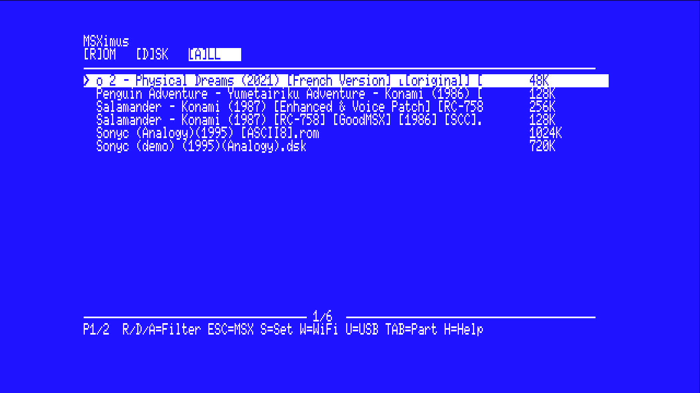

Si en Ajustes está *Menú al arrancar* en Off, no sale el navegador y arranca MSX-DOS directamente. Para volver a verlo: mantener **S** durante el logo, poner *Menú al arrancar* en On y *Save & Restart*.

Sin tarjeta en TF2, el menú dice *«No se detecta la tarjeta SD.»*. RETURN o ESC arrancan el sistema igualmente. Si se mete la tarjeta después, hay que pulsar el botón de reset del MSX (K2).

## 2. Las pantallas del menú

### 2.1. El navegador de la SD

Lista las carpetas, las ROM (`.ROM`), los discos (`.DSK`), las cintas (`.TSX`, `.CAS`) y la música (`.WAV`, `.MP3`). 18 entradas por página, hasta 112 por carpeta (si hay más, el contador lleva un `+`). Arriba, las pestañas `[R]OM [D]SK [A]LL`. Abajo, el contador `seleccionado/total` y el pie de teclas.

| Tecla | Acción |
|---|---|
| **Arriba / Abajo** | Mover la selección |
| **Izquierda / Derecha** | Una página atrás / adelante |
| **RETURN** | Entrar en la carpeta, o abrir la pantalla de lanzar (ROM o disco). Una cinta se lanza directamente |
| **BACKSPACE** | Carpeta anterior |
| **/** | Buscar por nombre: se escribe un trozo, RETURN salta a la siguiente coincidencia, ESC cancela |
| **TAB** | Cambiar de partición |
| **R / D / A** | Filtrar: solo ROM, solo discos, todo |
| **S** | Ajustes |
| **W** | Configuración WiFi |
| **T** | Menú de pruebas |
| **F** | File-Hunter (buscar y descargar) |
| **U** | Disquetera USB: monta el disquete como A: |
| **P / N** | Música: tocar la carpeta, pausa / pista siguiente |
| **H** | Ayuda |
| **ESC** | Arrancar el sistema (MSX-DOS / Nextor) |
| Mando USB | Direcciones = cursores, botón A = RETURN, botón B = BACKSPACE |

Más en el [capítulo 04](04-menu.md).

### 2.2. Lanzar una ROM

RETURN sobre una ROM abre **Lanzar ROM**: nombre, tamaño, mapper y, si procede, SRAM o GM2. El menú detecta el mapper solo. Si dice `? (desconocido)`, se elige con **M**.

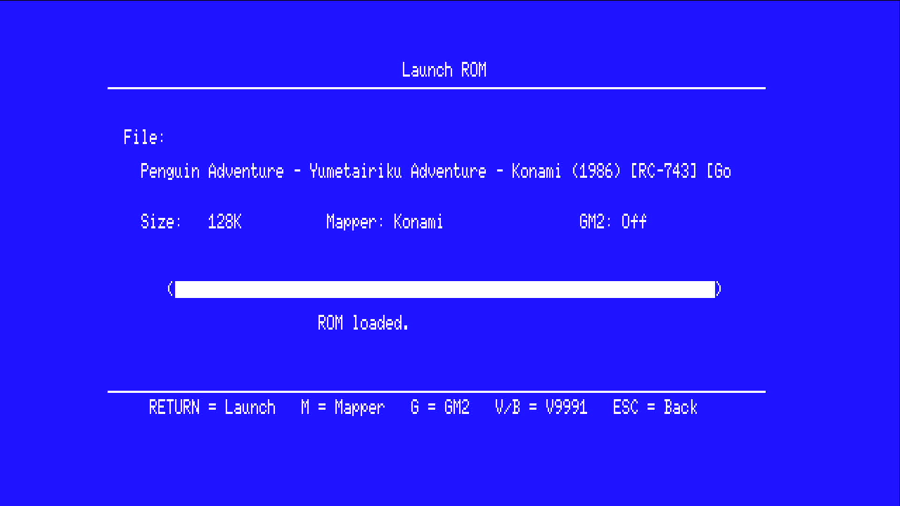

| Tecla | Acción |
|---|---|
| **RETURN** | Cargar y lanzar la ROM |
| **M** | Cambiar el mapper (Plain, Konami, Konami-SCC, ASCII8, ASCII16, NEO-8, NEO-16, Plain 0000h, ASCII16-X) |
| **S** | SRAM de cartucho On/Off (solo ASCII8 y ASCII16) |
| **G** | Game Master 2 On/Off (solo Konami y Konami-SCC) |
| **V** | Lanzar dentro de una **ventana** con el escritorio del V9990 (juego a ×0,75) |
| **B** | Lo mismo, con la ventana más pequeña (juego a ×0,5) |
| **ESC** | Volver sin lanzar |

Las ventanas V y B se explican en el [apartado 5](#5-ventanas-con-escritorio-v-y-b). Los mappers y la SRAM, en el [capítulo 05](05-roms-mappers.md). Para guardar una partida con SRAM hay que reiniciar con K2, no apagar.

### 2.3. Lanzar un disco

RETURN sobre un `.DSK` abre **Lanzar disco**. El disco se monta como unidad A: hasta el siguiente reinicio. El fichero tiene que estar en clusters consecutivos; si el menú dice *«DSK fragmentado»*, se vuelve a copiar a la tarjeta desde el PC.

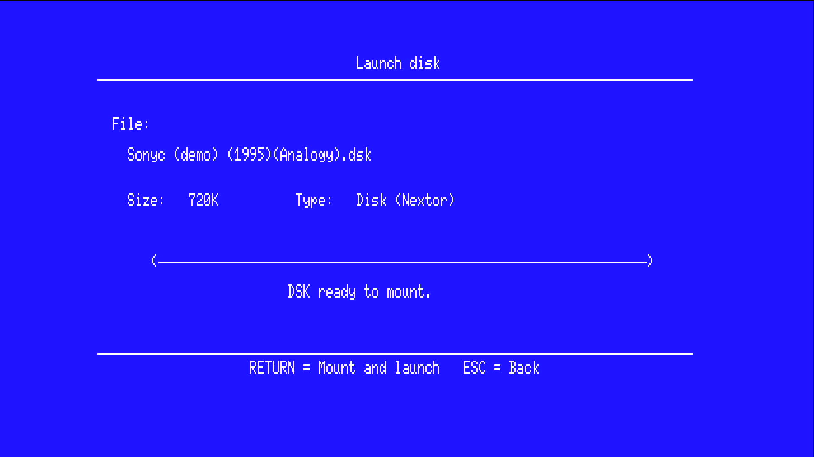

| Tecla | Acción |
|---|---|
| **RETURN** | Montar y lanzar |
| **V** | Montar y lanzar en la ventana (×0,75) |
| **B** | Montar y lanzar en la ventana (×0,5) |
| **ESC** | Volver |

Con una disquetera USB, **U** en el navegador hace lo mismo con el disquete. Más en el [capítulo 06](06-msxdos-nextor.md).

### 2.4. Ajustes (tecla S)

La pantalla **Ajustes** tiene una sola página y se sale con ESC **sin guardar**. Nada se guarda hasta *Save & Restart*.

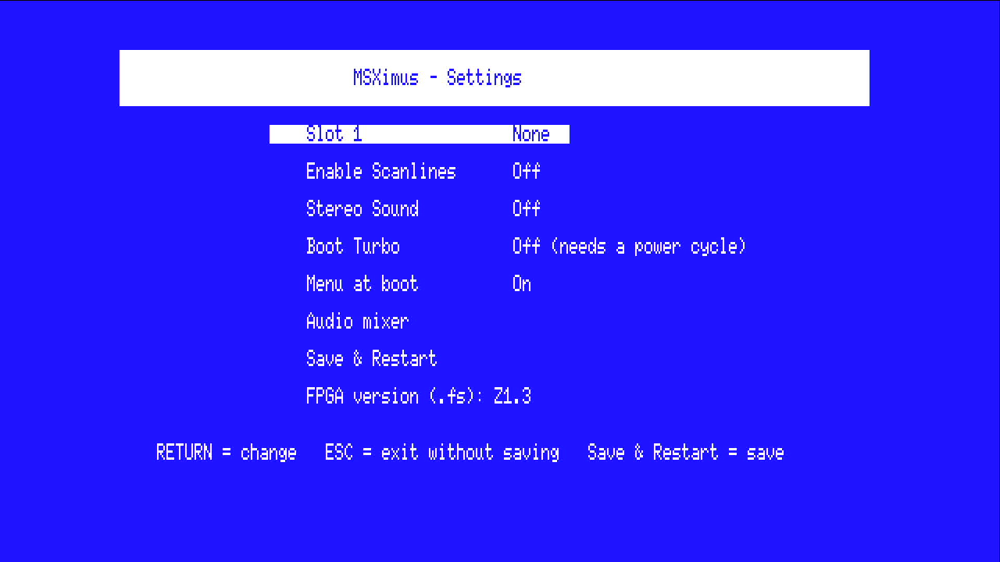

| Opción | Valores | Para qué |
|---|---|---|
| **Slot 1** | Nada / 2o SCC / Game Master 2 | Qué hay en el slot 1 del MSX |
| **Enable Scanlines** | On / Off | Líneas de barrido en la HDMI |
| **Stereo Sound** | On / Off | Sonido estéreo o mono |
| **Boot Turbo** | On / Off | Arrancar a 5,37 MHz. Solo entra tras apagar y encender |
| **Menú al arrancar** | On / Off | Navegador al encender, o MSX-DOS directo |
| **Mezclador de audio** | | Abre la página del mezclador |
| **Save & Restart** | | Guarda todo en la QSPI y reinicia el MSX |

Debajo sale la versión del core (`Z1.3.1`).

| Tecla | Acción |
|---|---|
| **Arriba / Abajo** | Mover entre opciones |
| **ESPACIO** | Cambiar el valor, abrir el mezclador o guardar y reiniciar |
| **ESC** | Salir al navegador sin guardar |

#### Mezclador de audio

Ocho filas: *Ganancia maestra* (x1 a x8, de fábrica x5) y siete canales de 0/8 a 8/8 (PSG, SCC, OPLL, MSX-AUDIO, OPL4 FM, OPL4 wave, WaveGame). Cada cambio toca una nota en ese chip.

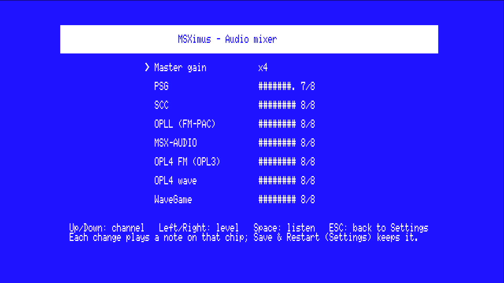

| Tecla | Acción |
|---|---|
| **Arriba / Abajo** | Elegir el canal |
| **Izquierda / Derecha** | Bajar / subir el nivel |
| **ESPACIO** | Volver a oír la nota |
| **ESC** (o RETURN) | Volver a Ajustes |

Los niveles se guardan con *Save & Restart*, en Ajustes. Más en el [capítulo 08](08-audio.md).

### 2.5. Ayuda (tecla H)

Una pantalla con las teclas del navegador. Cualquier tecla vuelve.

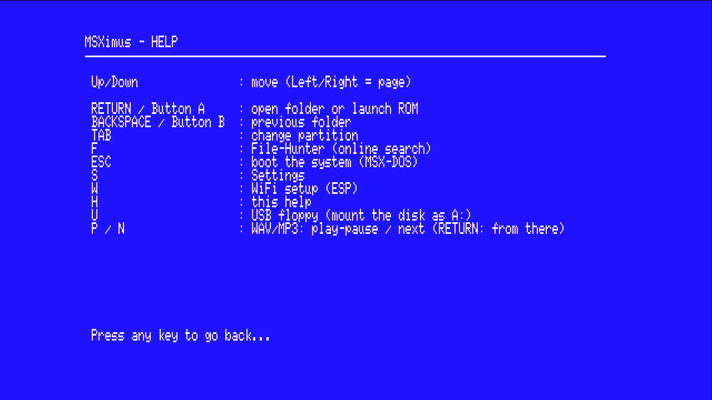

### 2.6. File-Hunter (tecla F)

Busca ROM, discos y cintas en internet y los descarga a la carpeta `FHUNT` de la tarjeta. Hace falta red (cable en J3, o WiFi configurada con **W**), la tarjeta en FAT16 y la carpeta `FHUNT` creada (`MKDIR FHUNT` desde MSX-DOS).

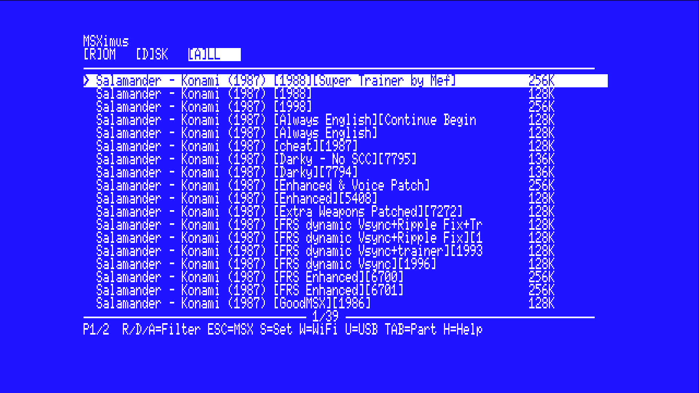

| Tecla | Acción |
|---|---|
| **F** | Abrir el campo de búsqueda (hasta 20 caracteres) |
| **RETURN** (en el campo) | Buscar |
| **RETURN** (en la lista) | Descargar el resultado y lanzarlo |
| **F** (en la lista) | Otra búsqueda |
| **ESC / BACKSPACE** | Salir de File-Hunter |
| **ESC** (en el campo) | Cancelar |

Si el fichero ya existe con el mismo tamaño, no se baja otra vez. Si existe con otro tamaño, pregunta *«Sobreescribir? (S/N)»*. Hasta 8 MB por ROM. Más en el [capítulo 07](07-wifi-file-hunter.md).

### 2.7. Cintas

Los `.TSX` y los `.CAS` salen en el navegador con su etiqueta (`TSX 86K`). RETURN la lanza: el MSX arranca en BASIC limpio, teclea solo la orden de carga y la cinta corre mientras el motor está en marcha. Mientras hay una cinta puesta, Nextor no está: vuelve al reiniciar la placa entera (PS_SRST) o al apagar y encender. File-Hunter (**F**) también baja cintas. Más en el [capítulo 11](11-cinta.md).

### 2.8. WiFi (tecla W) y pruebas (tecla T)

**W** abre el *Wi-Fi Setup* del módulo ESP32-S3: elegir la red y la contraseña, y el reloj. Hay que hacerlo sin el cable de red puesto. ESC vuelve.

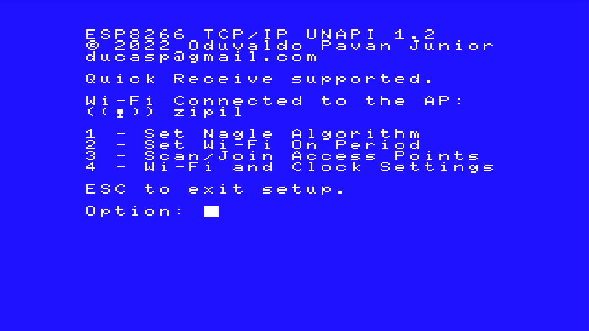

**T** abre el menú de pruebas: **1** velocidad de la SD, **2** sonido, **3** Game Master 2, **4** VDP, **ESC** seguir.

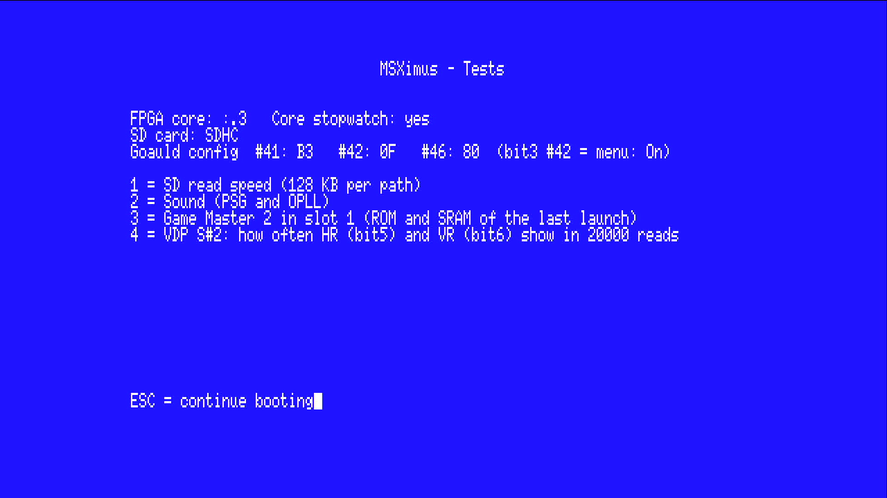

## 3. El panel F12

**F12** congela el MSX y dibuja encima un panel de estado. Con F12 otra vez se cierra y el juego sigue donde estaba. Funciona también con el V9990 en pantalla. El panel está en el idioma del menú instalado.

### 3.1. Página de información

Se refresca cada segundo.

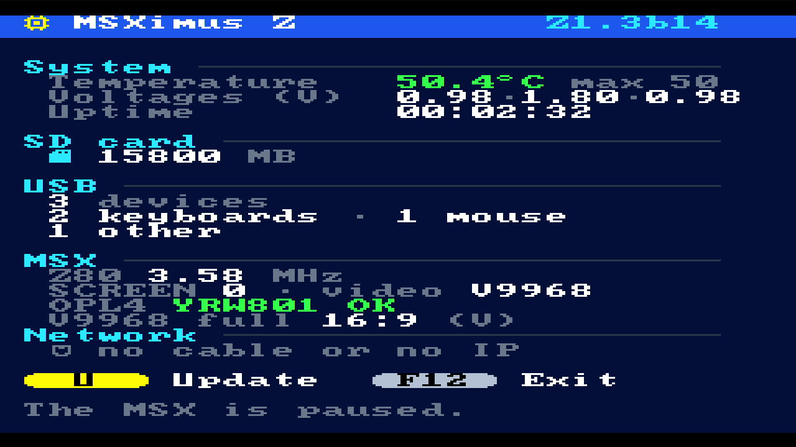

| Bloque | Qué dice |
|---|---|
| Cabecera | `MSXimus Z` y la versión (`Z1.3.1`) |
| Sistema | Temperatura del chip (verde hasta 60 °C, amarillo hasta 75, rojo más), su máximo, tensiones internas y tiempo encendido |
| Tarjeta SD | La de TF2: tamaño en MB y errores, o `sin tarjeta` |
| USB | Cuántos dispositivos y de qué tipo |
| MSX | Z80 a 3,58 o 5,37 MHz (`turbo`), SCREEN actual, el vídeo en la HDMI (`V9968`, `V9990` o `V9991` con ventana) y el estado de la ROM de ondas del MoonSound (`YRW801 OK`) |
| V9968 completo | `16:9` o `4:3 Scale3x` |
| Red | La IP del cable o, sin cable, `WiFi` y la IP de la ESP32-S3. Sin ninguna: `sin cable o sin IP` |

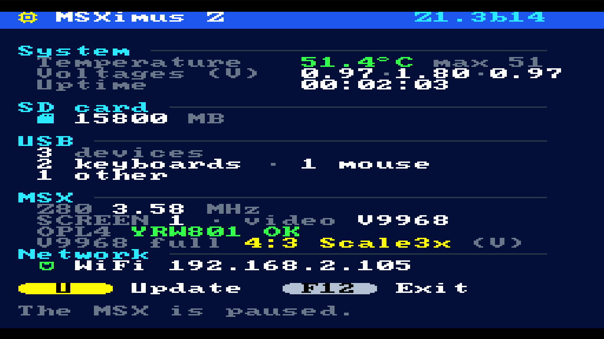

| Tecla | Acción |
|---|---|
| **V** | Alternar 16:9 / 4:3 Scale3x en el V9968 a pantalla completa (se guarda) |
| **U** | Abrir la página de actualización |
| **F12** | Cerrar el panel |

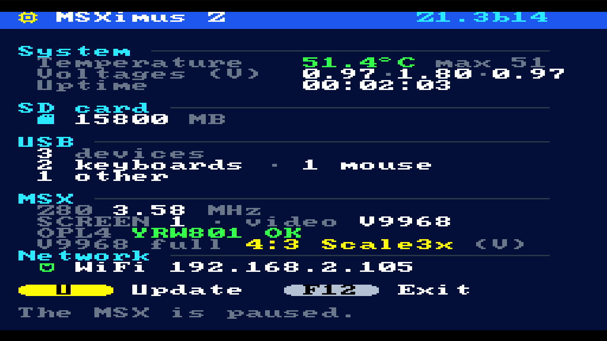

### 3.2. Página de actualización (U)

Actualiza la placa por la red, sin PC. Necesita la instalación en la QSPI (SW1 en ON-OFF) y red (cable o WiFi). La página enseña la versión instalada, la que ofrece el servidor, el canal, las variantes y el estado.

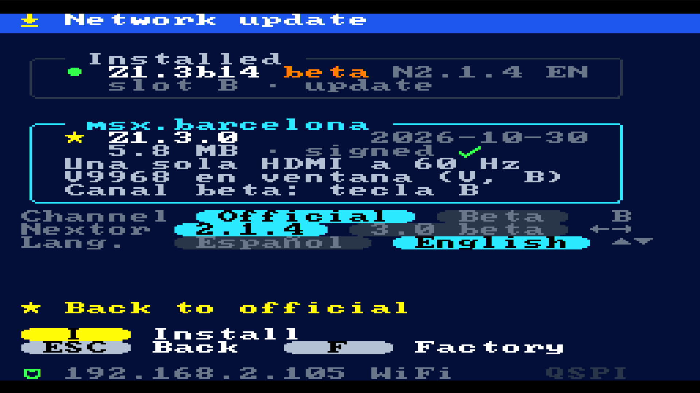

Con el canal beta elegido (tecla **B**), la misma página muestra la última beta:

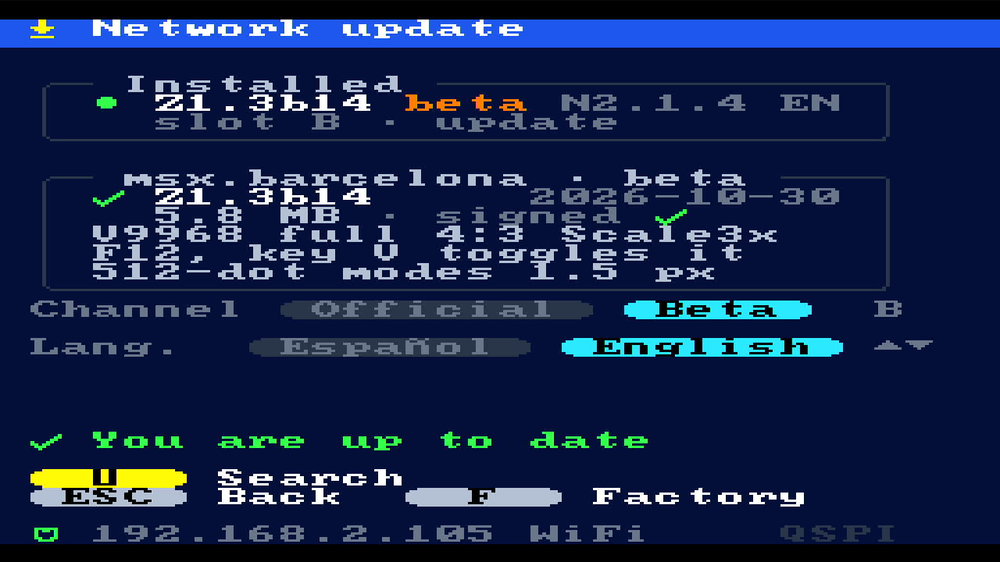

| Tecla | Acción |
|---|---|
| **U** | Buscar la última versión (o reintentar tras un error) |
| **I** | Instalar la que enseña la página |
| **R** | Reiniciar en la imagen nueva (la ranura B). Si está sin probar, es la prueba |
| **Izquierda / Derecha** o **N** | Elegir Nextor 2 o Nextor 3 |
| **Arriba / Abajo** o **L** | Elegir castellano o inglés |
| **B** | Cambiar de canal, *Oficial* o *Beta*, y buscar en él |
| **F**, **F** | Volver a la imagen de fábrica (la segunda F confirma; después **R**) |
| **ESC** | Volver a la página de información. Una descarga en marcha sigue |
| **F12** | Cerrar el panel |

Pasos: **F12**, **U**, **I**, esperar (*Bajar, Borrar, Grabar, Verif*), **R**. No apagar mientras graba. Si la imagen nueva no arranca, apagar y encender vuelve a la de fábrica. Cambiar de Nextor pide su `NEXTOR.SYS` en la tarjeta de TF2. El canal beta ofrece una sola variante (Nextor 2.1.4, menús en inglés) y puede fallar. Más en el [capítulo 12](12-actualizar.md).

## 4. Modos de vídeo

### Pantalla completa

El V9968 llena la pantalla. En el panel F12, **V** elige:

- **16:9** (de fábrica): la imagen llena los 1280 píxeles de ancho. Cada punto del MSX son 4 × 3 píxeles.
- **4:3 Scale3x**: como una tele de tubo, con barras negras a los lados. Cada punto son 3 × 3 píxeles y las diagonales salen suavizadas. Los modos de 512 puntos (SCREEN 6, 7 y texto de 80 columnas) salen sin filtro.

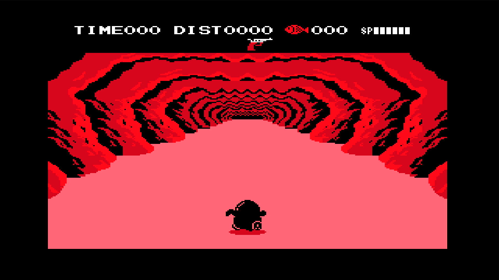

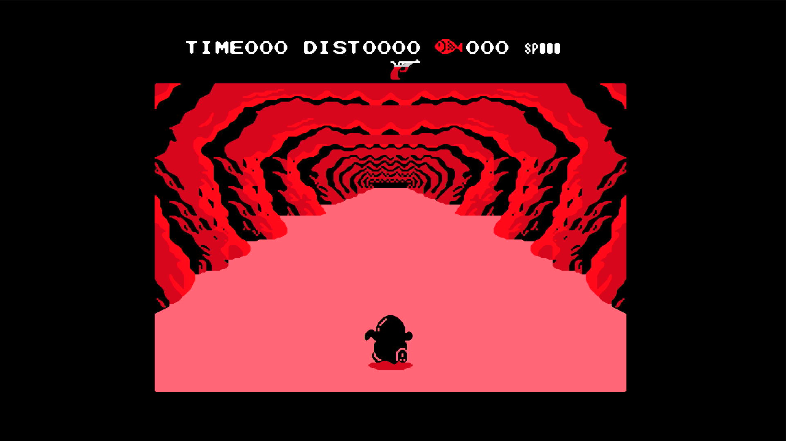

Las scanlines se activan en Ajustes (*Enable Scanlines*) y valen para el modo 16:9.

### V9968 y V9990

La máquina tiene dos chips de vídeo y una sola HDMI.

- Al arrancar se ve el **V9968**, el de todo el software MSX.
- Cuando un programa enciende la pantalla del V9990, la HDMI pasa sola al V9990 y se queda ahí.
- **Pausa** cambia a mano entre los dos. Desarma el cambio automático hasta el siguiente reset.
- El **reset del MSX** (K2) vuelve al V9968.

Más en el [capítulo 09](09-video.md).

## 5. Ventanas con escritorio: V y B

Al lanzar una ROM o un disco con **V** o **B**, el V9990 enseña un escritorio y el juego corre dentro de una ventana. El escritorio muestra:

- una barra superior con el nombre de la máquina, la versión y la **hora** (de la red, si hay);
- **NOW PLAYING**, con el nombre del juego;
- **SYSTEM**: IP, temperatura, tiempo encendido, turbo y dispositivos USB.

| Tecla | Escritorio | Juego |
|---|---|---|
| **V** | 640 × 400 | Entero, ×0,75 (912 × 477 px con el margen) |
| **B** | 1024 × 212 | Entero, ×0,5 (512 × 318 px) |

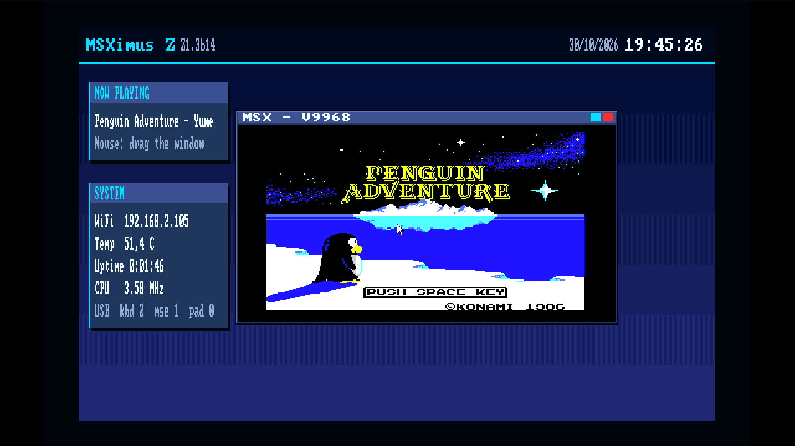

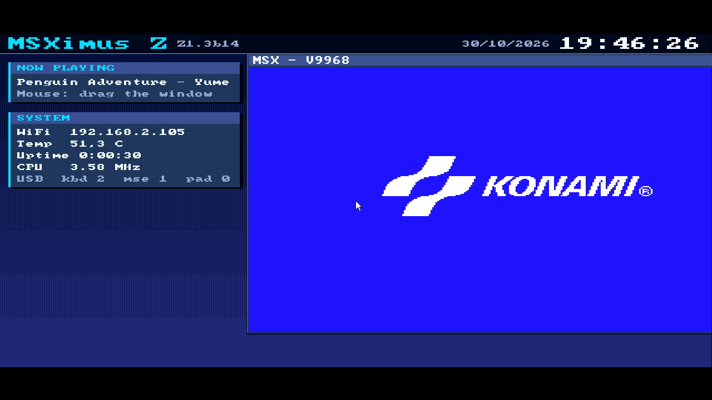

- Con el **ratón** se arrastra la ventana por el escritorio, mientras el juego corre.
- **Pausa** pasa al V9968 a pantalla completa. Otra vez, vuelve a la ventana.
- El **reset del MSX** borra el escritorio.

## 6. Teclas rápidas

| Tecla | Dónde | Qué hace |
|---|---|---|
| **F11** | Siempre | Turbo del Z80, 3,58 / 5,37 MHz. No se guarda. Para guardarlo: *Boot Turbo* en Ajustes |
| **F12** | Siempre | Abrir / cerrar el panel (congela el MSX) |
| **Pausa** | Siempre | Cambiar la HDMI entre V9968 y V9990 (o entre ventana y V9968 completo) |
| **V** | Panel F12, información | 16:9 / 4:3 Scale3x |
| **U** | Panel F12, información | Página de actualización |
| **ESC** | Navegador | Arrancar MSX-DOS / Nextor |
| **ESC** | Ajustes, lanzar, panel de actualización | Volver (en Ajustes, sin guardar) |
| **S / W / T** | Durante el logo | Ajustes / WiFi / pruebas. Mantener S entra en Ajustes aunque el menú esté en Off |
| **R / D / A** | Navegador | Filtros ROM / DSK / todo |
| **/** | Navegador | Buscar por nombre |
| **F** | Navegador | File-Hunter |
| **H** | Navegador | Ayuda |
| **V / B** | Lanzar ROM o disco | Lanzar en ventana |
| **K2** (botón) | Placa | Reset del MSX: vuelve al menú, la DDR3 se conserva |
| **K3** (botón) | Placa | Mantenido al arrancar, inhibe el *Boot Turbo* |
| **PS_SRST** (botón) | Placa | Reset de la placa entera |

## 7. Si algo no va

El [capítulo 10](10-problemas.md) lista los síntomas, la causa probable y qué hacer.

## 8. Capítulos del manual

| Capítulo | Tema |
|---|---|
| [01. Qué es el MSXimus Z](01-que-es.md) | La placa y lo que trae |
| [02. Instalación](02-instalacion.md) | `BOOT.bin`, SW1, conexiones, primer arranque |
| [03. Las tarjetas SD](03-tarjeta-sd.md) | TF2 (la del MSX) y TF1 (los perfiles), formato y contenido |
| [04. El menú de arranque](04-menu.md) | Todas las pantallas y teclas, con detalle |
| [05. ROMs y mappers](05-roms-mappers.md) | Mappers, SRAM, Game Master 2 |
| [06. MSX-DOS y Nextor](06-msxdos-nextor.md) | Discos, Nextor, disquetera USB |
| [07. La red](07-wifi-file-hunter.md) | Ethernet, WiFi, File-Hunter |
| [08. Audio](08-audio.md) | Chips, mezclador, WaveGame, música |
| [09. Vídeo](09-video.md) | HDMI, V9968, V9990, panel F12, OLED |
| [10. Problemas frecuentes](10-problemas.md) | Por síntoma |
| [11. Cinta virtual](11-cinta.md) | TSX y CAS |
| [12. Actualizar por la red](12-actualizar.md) | F12, U, canales, ranuras |
