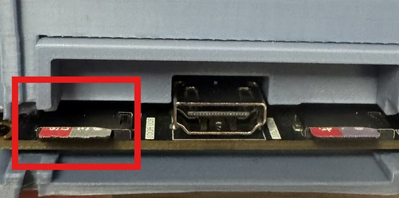

# 02. Instalación

Qué hay que grabar en la ZYNQ MINI y con qué herramienta. Toda la máquina viaja en un único fichero, `BOOT.bin`, que se graba una vez en la memoria QSPI de la placa o se deja en una microSD en la ranura TF1. No hay nada más que grabar: el bitstream, el programa del procesador, el pack de BIOS y la tabla de ondas del MoonSound van todos dentro. Una vez en la QSPI, las versiones siguientes llegan por la red ([capítulo 12](12-actualizar.md)). La red por cable no necesita nada más que el cable; la pieza opcional para la WiFi, la ESP32-S3 de Waveshare, tiene su propio procedimiento en la sección 8.

## Puesta en funcionamiento, paso a paso

Lo que hay que hacer con una placa nueva, de la caja a jugar, sin Vivado. Son unos diez minutos, más lo que tarde en prepararse la tarjeta del MSX. Hace falta un `BOOT.bin` de la **Z1.4.4 o posterior**; con uno anterior, la imagen se graba con Vivado (sección 4.2).

### Antes de empezar

| Qué | Para qué |
|---|---|
| La placa **ZYNQ MINI**, mejor con un disipador sobre el chip | Sin disipador trabaja a unos 80 °C; con él, a unos 55 |
| Alimentación de **5 V por USB-C** | |
| Una pantalla con **HDMI** y su cable | Sale a 720p, con el audio |
| Un **teclado USB** y un adaptador de USB-C a USB-A (o un hub USB-C) para el conector **P3** | La instalación se hace desde el panel F12; y el MSX, claro, se usa con él |
| Una **microSD para TF1**, de 1 GB o más | Primero lleva el `BOOT.bin` para instalar; después la placa la convierte en la tarjeta de los perfiles, que pide 1 GB o más |
| Una **microSD para TF2** | La del MSX: juegos, discos, Nextor. Se prepara con [MSX SD Maker](https://github.com/Papipapito/SD_Maker) ([capítulo 03](03-tarjeta-sd.md)) |
| Un **PC con lector de microSD** | Para copiar el `BOOT.bin` a TF1 y preparar TF2 (MSX SD Maker es para Windows) |
| **Red**: un cable Ethernet en **J3** con salida a Internet (la IP la da el router), o la WiFi de la ESP32-S3 (sección 8) | Para dejarla en la última versión y bajar los perfiles. Sin red el MSX funciona igual, pero se queda en la versión instalada y sin perfiles |

No hace falta Vivado. En el PC, **MSXimusZboot** (Windows y macOS, va en la release) prepara la tarjeta de instalación y MSX SD Maker la del MSX. La de instalación también se puede hacer a mano con el explorador de archivos.

### 1. Preparar la tarjeta de instalación (en el PC)

1. De la [release de GitHub](https://github.com/Papipapito/MSXimus_Z/releases/latest) baja **MSXimusZboot**: `MSXimusZboot.exe` para Windows o el `.zip` de macOS (Mac con Apple Silicon). En Windows pide permiso de administrador al abrirse y, en el Mac, la contraseña al escribir la tarjeta. Si el sistema avisa de que no conoce al desarrollador: en Windows, *Más información* → *Ejecutar de todas formas*; en el Mac, botón derecho → *Abrir*.
2. Mete la microSD de TF1 en el lector y elígela en la lista. Solo salen lectores SD y memorias USB, nunca el disco del sistema.
3. Elige la versión y la variante. El programa lee los mismos manifiestos firmados de msx.barcelona que la placa y comprueba su firma; la versión oficial es la de la release. Si dudas de la variante, Nextor 2.1.4 en castellano (sección 2, *Las cuatro variantes*): se puede cambiar después desde la placa. También acepta un `BOOT_*.bin` bajado de la release.
4. **Preparar la tarjeta**: baja el `BOOT.bin`, lo comprueba con su SHA-256, formatea la tarjeta (FAT32, o FAT16 en las de hasta 2 GB), lo copia a la raíz y lo relee todo. Al acabar enseña los pasos en la placa, los mismos de abajo.

A mano, sin el programa: baja de la release **uno** de los `BOOT_*.bin` y formatea la microSD de TF1 en **FAT32** (o FAT16). En Windows: botón derecho sobre la unidad, *Formatear*, sistema de archivos *FAT32*; Windows no ofrece FAT32 en tarjetas de más de 32 GB. Copia el fichero a la **raíz** de la tarjeta y renómbralo exactamente **`BOOT.bin`**. Ojo con las extensiones ocultas de Windows: si queda `BOOT.bin.bin`, la placa no lo encuentra (en el Explorador, *Vista* → *Mostrar* → *Extensiones de nombre de archivo*). Expulsa la tarjeta antes de sacarla.

Si ya tienes la tarjeta del MSX hecha con MSX SD Maker, tenla a mano; si no, se puede preparar al final.

### 2. Montar y arrancar desde la SD

5. Con la placa **sin corriente**, la tarjeta del paso anterior en **TF1**: mirando la placa por el lado del HDMI, la ranura de su izquierda (marcada en rojo en la foto). La del MSX, si la tienes, en **TF2**, la de la derecha.

   

6. **SW1 en OFF-OFF**: arranque desde la SD. SW1 solo se lee al dar la corriente.
7. El HDMI a la pantalla, el teclado en **P3** y, si tienes, el cable de red en **J3**.
8. Dale corriente. A los pocos segundos salen el logo del MSXimus y el menú (o el aviso de que no hay tarjeta, si TF2 está vacía o no está). Es la versión del `BOOT.bin` de la tarjeta, cargada desde ella: todavía no se ha grabado nada.

Si la pantalla se queda negra y la OLED apagada, la placa no ha encontrado el `BOOT.bin`: mira el nombre (paso 3), que esté en la raíz, que la tarjeta esté en TF1 y no en TF2, y SW1.

### 3. Grabarlo en la QSPI

9. Pulsa **F12** y luego **U**. Con la placa arrancada desde la SD, la página se llama *BOOT.bin de la SD*: arriba, en *Instalada*, pone «arranque desde la SD», y abajo a la derecha, `SD`.
10. Pulsa **A**. La placa lee el `BOOT.bin` de TF1 y comprueba que es una imagen de esta placa; en unos segundos enseña su versión, su tamaño (unos 6 MB) y su variante, con el aviso *Reemplaza la de fábrica*.
11. Pulsa **A dos veces seguidas** (otra tecla entre medias anula la primera). Empieza la grabación de la **ranura A** de la QSPI, la imagen de fábrica: *Leer*, *Borrar*, *Grabar* y *Verif*, con una barra de progreso. Tarda alrededor de un minuto. **No apagues la placa** mientras tanto. Si se va la luz no pasa nada grave: la tarjeta sigue arrancando y se repite desde el paso 9. **ESC** oculta la página y la grabación sigue.
12. Al acabar, la página dice *Grabada en la ranura A* y *Apaga y pon SW1 en QSPI*.

### 4. Arrancar desde la QSPI

13. Quita la corriente, pon **SW1 en ON-OFF** (QSPI) y vuelve a darla. La placa arranca sola de la QSPI, ya sin depender de la tarjeta.
14. Compruébalo: **F12 → U** pone ahora, en *Instalada*, la versión con «ranura A · de fábrica». A partir de aquí SW1 se queda siempre en ON-OFF.

### 5. Dejarla al día

15. **Preparar TF1 para los perfiles.** El panel F12 avisa *TF1 nueva: P la prepara*. Pulsa **F12 → P**: como la tarjeta tiene datos (el `BOOT.bin`), pide confirmación, **B** y luego **Intro**. La placa la borra entera (el `BOOT.bin` ya no hace falta: está en la QSPI) y la deja con una partición FAT32 de 128 MiB y otra para los perfiles ([capítulo 03](03-tarjeta-sd.md)).
16. **Última versión.** Con red, **F12 → U** busca la última versión publicada. Si hay una nueva, **I** la baja, la graba en la **ranura B** y la comprueba, y **R** reinicia con ella; si dice *Estás al día*, no hay nada que hacer. La ranura A, la que acabas de grabar, no la toca ninguna actualización: es la vuelta atrás ([capítulo 12](12-actualizar.md)).
17. **Perfiles.** **F12 → P → S** baja los perfiles (Música, Dual, Turbo R y Turbo R V9990) a TF1.
18. **La tarjeta del MSX.** Si no la tenías, prepárala con MSX SD Maker, ponla en **TF2** y pulsa el botón de reset del MSX (**K2**), o apaga y enciende.

Listo: el MSX arranca al dar la corriente y se actualiza con **F12 → U**. El primer día con el menú lo cuenta la [guía rápida](00-guia-rapida.md).

### Si algo falla

| Lo que pasa | Por qué y qué hacer |
|---|---|
| Pantalla negra con SW1 en SD | No encuentra el `BOOT.bin`: nombre exacto `BOOT.bin` (no `BOOT.bin.bin`), en la raíz, tarjeta en TF1, FAT32 o FAT16. SW1 se lee solo al dar la corriente |
| *No hay tarjeta en la TF1* | La tarjeta no está bien metida, o está en TF2 |
| *La TF1 no es FAT16 ni FAT32* | Está en exFAT, NTFS o sin formato. La línea de debajo dice lo que encontró (`Sin MBR: exFAT`, `Sector 0 sin 55AA`...). Formatéala en FAT32 |
| *No hay BOOT.bin en la TF1* | El fichero no está en la raíz o se llama de otra forma |
| *No es para esta placa* o *BOOT.bin no válido* | No es un `BOOT.bin` del MSXimus Z o la descarga está mal: bájalo otra vez (GitHub enseña el SHA-256 de cada fichero de la release) |
| *BOOT.bin de tamaño raro* | No es un `BOOT.bin`: miden unos 6 MB (entre 4 KB y 8 MB) |
| Se fue la luz mientras grababa | Arranca otra vez con SW1 en SD y repite desde el paso 9 |
| En F12 → U sale la página de la red, no la de la SD | La placa arrancó de la QSPI: SW1 en OFF-OFF y apagar y encender. Una placa ya instalada no necesita esto: se actualiza por la red |
| En la página de la SD, U, I y R no hacen nada | Es lo normal: desde la SD solo se graba la ranura A |

Grabar la imagen con Vivado por JTAG sigue siendo posible y deja lo mismo: sección 4.2.

## 1. La placa

La OMDAZZ **ZYNQ MINI** lleva un XC7Z020: dos Cortex-A9 (el PS) y una FPGA Artix-7 (el PL) en el mismo chip, con 512 MB de DDR3 colgando del PS. El MSX corre en el PL; el procesador hace de *companion*: sirve la tarjeta, el USB, la red, la OLED, el panel F12, los ajustes, las actualizaciones y la música WaveGame. Lo que hay que localizar en la placa antes de empezar:

| | Para qué |
|---|---|
| **SW1** | El modo de arranque: JTAG, QSPI o SD. Sección 3 |
| **TF1** | Ranura microSD de los perfiles; con SW1 en SD, además, lleva el `BOOT.bin` (sección 5). El MSX no la ve. A la izquierda del HDMI (foto en la *Puesta en funcionamiento*, paso 5) |
| **TF2** | La microSD **del MSX**: ROMs, discos, carpetas WaveGame. Es la que ven el menú y Nextor |
| **HDMI** | Al televisor o monitor. Salida 720p |
| **J3** | El conector Ethernet (RJ45) del procesador: la red por cable. J2 es del PL y no se usa |
| **USB host** | El conector USB-C **P3**: teclado, ratón, mandos y disquetera; con un hub, varios a la vez. Sección 7 |
| **J4** | Conector para una OLED de 0,96" (SSD1306, 128×64, monocroma). Opcional |
| **CAM1** | Header de 2×20 donde se pincha la ESP32-S3 de la WiFi. Opcional |
| **Botones** | El reset de la placa (PS_SRST) y los dos botones de usuario del PL (K2, el reset del MSX, y K3). Tabla de la sección 7 |
| **JTAG** | Solo para grabar la QSPI la primera vez y para desarrollo; hace falta Vivado |
| **U15** | La QSPI: un Winbond W25Q128 de 16 MB. Ahí vive el `BOOT.bin` y, en su último sector, los ajustes |

Todo el header CAM1 es de 3,3 V estrictos.

## 2. El BOOT.bin

Una sola imagen, que el arranque del PS (el FSBL) lee de la QSPI o de TF1 y reparte por la placa en este orden:

| Partición | Qué es | Dónde va |
|---|---|---|
| `fsbl.elf` | El arranque de primera etapa: relojes, MIO y entrenamiento de la DDR3 | Lo ejecuta el PS |
| `msximus_zynq.bit` | El core: el MSX en el PL | El PL |
| `companion.elf` | El programa del ARM: tarjeta, USB, red, OSD, OLED, QSPI, actualizaciones, WaveGame | Core 0 del PS |
| `zeros.bin` | 64 KB a cero sobre el buzón PL↔ARM: el MSX espera en reset hasta que el companion está listo | DDR 0x1FF00000 |
| `pack.bin` | El pack de BIOS, 512 KB | DDR 0x10F00000 |
| `yrw801.rom` | La ROM de ondas del MoonSound, 2 MB | DDR 0x0F000000 |
| `ota_info.bin` | 256 bytes de texto con la identidad de la imagen (versión, serie, variante, idioma y placa), que la actualización por red compara con la publicada | DDR 0x00E10000 |

El FSBL carga las siete particiones y salta al companion; el companion inicializa TF2, el USB, la red y la OLED, lee los ajustes de la QSPI, los siembra en el core y suelta el MSX. En el lado del PL no hay ninguna memoria no volátil: el pack y las ondas se cargan en la DDR en cada arranque. Un `BOOT.bin` mide unos 6 MB (6.377.024 bytes los de la Z1.4.9).

### Las cuatro variantes

Hay un `BOOT.bin` por variante: lo único que cambia entre ellos es el pack de BIOS (y con él, el idioma). Se elige una al grabar, pero no es definitiva: la variante se cambia después desde F12 → U ([capítulo 12](12-actualizar.md)).

| Fichero | Menús, Ajustes y panel | Nextor |
|---|---|---|
| `BOOT_Z1.4.9_nextor214.bin` | Castellano | **2.1.4**, el estable, el que quieres |
| `BOOT_Z1.4.9_nextor214-en.bin` | Inglés | 2.1.4 |
| `BOOT_Z1.4.9_nextor3.bin` | Castellano | 3 |
| `BOOT_Z1.4.9_nextor3-en.bin` | Inglés | 3 |

### De dónde sale

La release `Z1.4.9` de GitHub trae los cuatro `BOOT_Z1.4.9_*.bin` listos para grabar y **MSXimusZboot** (Windows y macOS), el programa que prepara con ellos la tarjeta de instalación. El bitstream suelto y el `fsbl.elf` ya no van en la release: solo hacen falta para cargar por JTAG en desarrollo, y se compilan (o se toman de la release `Z1.4.4`; el FSBL no ha cambiado desde entonces). Los arreglos menores no llegan a GitHub: salen solo por la actualización por red. Si sale una versión posterior solo por la red, se graba la de GitHub y luego **F12 → U** la actualiza ([capítulo 12](12-actualizar.md)). Se baja el `BOOT_*.bin` de la variante elegida y ya está; en la QSPI se graba tal cual (sección 4) y para el arranque por SD se copia a la tarjeta con el nombre `BOOT.bin` (sección 5).

Quien prefiera montarlo (con sus propias ROMs en el pack, o con un core compilado) tiene un script de bash:

```bash
OTA_VERSION=Z1.4.9 OTA_SERIE=2026111301 fpga/zynq/arm/boot/make_boot.sh [pack.bin] [yrw801.rom]
```

Busca `fpga/zynq/arm/fsbl/fsbl.elf`, `fpga/zynq/arm/companion/companion.elf` y `fpga/zynq/msximus_zynq.bit`; el pack por defecto es el de Nextor 2.1.4 en castellano y la ROM de ondas por defecto `yrw801.rom`, los dos de `packs/zynq/` del repositorio privado de BIOS `Papipapito/bios-msxnano-msximus`, que se clona como carpeta hermana de este repositorio (o donde diga la variable de entorno `MSXIMUS_BIOS_PRIV`). La ROM de ondas se copia a `arm/boot/` para el `.bif`. Llama al `bootgen` de Vivado 2019.2 y deja `BOOT.bin` en `fpga/zynq/arm/boot/`. `OTA_VERSION` y `OTA_SERIE` (un entero creciente, tipo AAAAMMDDNN) rellenan el `ota_info`; sin ellas la imagen se identifica como `dev` con serie 0. La variante y el idioma los deduce el script del propio pack. Los ficheros `.elf` y `.bit` no se versionan: salen de compilar ([capítulo 07 de la referencia técnica](../tecnica/07-construccion.md)). El `fsbl.elf` tampoco va en la release de GitHub: quien graba la QSPI lo compila (sección 4).

### El pack de BIOS

Los mismos packs del MSXimus, generados con `bios/tools/hacer_packs.py` en `packs/zynq/` del repositorio privado de BIOS (llevan ROMs con copyright y no están en este repositorio):

| Pack | Nextor | Menús |
|---|---|---|
| `packs/zynq/msximus/nextor-2.1.4/pack_bios_msximus.bin` | **2.1.4**, el estable, el que quieres | Castellano |
| `packs/zynq/msximus/nextor-2.1.4/pack_bios_msximus_en.bin` | 2.1.4 | Inglés |
| `packs/zynq/msximus/nextor-3.0.0/pack_bios_msximus_nextor3.bin` | **3** | Castellano |
| `packs/zynq/msximus/nextor-3.0.0/pack_bios_msximus_en_nextor3.bin` | 3 | Inglés |

Miden 512 KB justos; dentro van las ROMs de la máquina, el menú de 32 KB, el logo y Nextor. El [capítulo 04 de la referencia técnica](../tecnica/04-pack-bios.md) describe qué lleva y en qué orden. Quien prefiera montar el pack con sus propias ROMs tiene el [Pack Builder del MSXnano](https://github.com/Papipapito/MSXnano). Los ajustes no van en el pack: viven en la QSPI (sección 10).

### La tabla de ondas

`yrw801.rom` es la ROM de ondas del OPL4 (MoonSound), 2 MB. `make_boot.sh` la exige porque va dentro del `BOOT.bin`; la toma de `packs/zynq/roms/` del repositorio privado de BIOS. Quien construye sin acceso a él necesita su propia ROM de ondas y sus propias ROM de sistema para montar el pack con las herramientas de `bios/`, o usar los `BOOT.bin` publicados. No cambia entre versiones.

## 3. SW1: el modo de arranque

Dos interruptores. Se leen **solo al dar corriente**: el reset de la placa (PS_SRST) no los relee, y cambiar SW1 con la placa encendida no hace nada hasta apagar y encender.

| SW1 | Modo | Cuándo |
|---|---|---|
| **ON-ON** | JTAG | Para grabar la QSPI y para desarrollo con Vivado y xsdb |
| **ON-OFF** | QSPI | El uso normal: arranca sola, sin tarjeta en TF1 |
| **OFF-OFF** | SD | Arranca del `BOOT.bin` de la microSD de TF1 |

Con SW1 en SD **ni se graba la QSPI por JTAG ni funciona el arranque por JTAG**: se cuelgan. Para cualquier cosa por el cable JTAG, SW1 en JTAG o en QSPI. (La propia placa arrancada desde SD sí puede grabar su ranura A, sin Vivado: sección 4.1.)

## 4. Grabar el BOOT.bin en la QSPI

La instalación definitiva: la placa arranca sola al enchufarla, sin tarjeta en TF1 y sin PC, y se actualiza por la red. Hace falta una sola vez, y se puede hacer **desde la propia SD, sin Vivado** (4.1) o **con Vivado por JTAG** (4.2). El resultado es el mismo: la imagen de fábrica (ranura A) en la QSPI.

### 4.1 Desde la propia SD, sin Vivado (Z1.4.4 o posterior)

La placa arrancada desde SD graba ella misma la ranura A de la QSPI con el `BOOT.bin` de la tarjeta. El procedimiento entero, paso a paso, con lo que se ve en pantalla y qué hacer si algo falla, está al principio de este capítulo: *Puesta en funcionamiento, paso a paso*. En resumen: `BOOT.bin` en la raíz de una FAT32 o FAT16 en TF1, SW1 en SD, **F12 → U**, **A** para leerlo, **A, A** para grabarlo, y SW1 en QSPI.

Con la placa arrancada desde SD las teclas de la red de esa página no hacen nada: la actualización por la red graba la ranura B, y desde SD esa ranura no arranca. Los errores salen en la misma página: *No hay tarjeta en la TF1*, *La TF1 no es FAT16 ni FAT32* (debajo dice lo que encontró en la tarjeta), *No hay BOOT.bin en la TF1*, *BOOT.bin de tamaño raro*, *No es para esta placa* y *BOOT.bin no válido*. Grabar la A desde la SD borra también el registro de la ranura B: una B instalada antes deja de arrancar y se vuelve a bajar por la red cuando haga falta. El detalle, en la [referencia técnica](../tecnica/11-actualizacion.md), sección 11.

### 4.2 Con Vivado (JTAG)

**Herramientas**: Vivado 2019.2 con su `hw_server`, el JTAG por USB de la placa y el árbol del repositorio con `fpga/zynq/arm/fsbl/fsbl.elf`. Vivado usa nuestro FSBL como ayudante: lo baja por JTAG y le va pasando el fichero por trozos, así que no hace falta el SDK.

**El `fsbl.elf`** venía en la release de GitHub hasta la `Z1.4.4`, y desde la Z1.4.9 ya no va en ella: se compila (abajo) o se toma de la release `Z1.4.4` y se copia en `fpga/zynq/arm/fsbl/`. No ha cambiado desde entonces: es el mismo FSBL que va dentro de los `BOOT.bin` de la Z1.4.9.

**Compilarlo** es la alternativa. Hace falta un bash (el de Git for Windows vale), la toolchain **Arm GNU 14.2** (`arm-none-eabi-gcc`) y el árbol `data/embeddedsw` de Vivado 2019.2, de donde salen las fuentes del `zynq_fsbl`; el resto (el `ps7_init`, el driver del PCAP y el gancho del salto a la ranura B) ya está en `fpga/zynq/arm/fsbl/`:

```
bash fpga/zynq/arm/fsbl/build.sh
```

Termina con `BUILD_OK` y deja `fsbl.elf` en esa carpeta. Las dos rutas de instalación están al principio de `build.sh` (`C:\Program Files (x86)\Arm GNU Toolchain arm-none-eabi\14.2 rel1` y `D:\Xilinx\Vivado\2019.2`): si las tuyas son otras, se cambian ahí. Si Vivado no ve el JTAG de la placa, es el `FTD2XX.dll`: hay que sustituirlo por uno que reconozca el FTDI de la placa, como cuenta el README.

1. Apaga la placa, pon **SW1 en ON-ON** (JTAG) y enciéndela. Arranca `hw_server`.
2. Desde `fpga/zynq`, con el `BOOT_*.bin` de la variante elegida (o el que se haya montado):

   ```
   vivado -mode batch -source tools/qspi_program.tcl -tclargs program w25q128fv-qspi-x4-single BOOT_Z1.4.9_nextor214.bin
   ```

   `w25q128fv-qspi-x4-single` es el nombre que Vivado da al Winbond W25Q128 de U15; si una placa lleva otra flash, la cabecera del script lista los nombres de las Micron y Spansion equivalentes. El script borra, graba y verifica desde el offset 0 y acaba con `PROGRAM_OK`.

3. Apaga la placa, pon **SW1 en ON-OFF** (QSPI), saca cualquier tarjeta de TF1 que lleve un `BOOT.bin` y enciende.

Esa imagen es la **de fábrica**: la actualización por red graba las nuevas en otra zona de la QSPI y nunca la toca, así que siempre se puede volver a ella ([capítulo 12](12-actualizar.md)).

Cosas que pasan:

- **El verify se queda colgado.** Matar Vivado y repetir la grabación.
- **"No ve la placa".** El JTAG en otro puerto USB, o desenchufar y volver a enchufar, y reiniciar `hw_server`.
- **Con SW1 en SD no graba.** Comprobar el interruptor antes de buscar otra causa.
- El script tiene un modo `backup` para leer los 16 MB antes de pisarlos, pero Vivado 2019.2 no consigue leer la flash de esta placa; no cuentes con él.
- Los ajustes viven en el último sector de la QSPI (0xFFF000), fuera del rango del `BOOT.bin`. El script solo borra y graba el rango del fichero, así que los ajustes **sobreviven** a regrabar. Si al arrancar se han perdido, el core usa los de fábrica y el siguiente Save & Restart los vuelve a escribir.

## 5. Arrancar desde la SD de TF1

Sin grabar nada y sin Vivado: para probar un `BOOT.bin` sin tocar la QSPI, o en una placa donde no se quiera grabar. Es también el primer paso de la sección 4.1, que sí lo graba en la QSPI.

1. Una microSD con una partición **FAT32 o FAT16** y el fichero en la raíz, llamado exactamente `BOOT.bin` (el `BOOT_*.bin` de la variante elegida, renombrado).
2. La tarjeta en **TF1**, SW1 en **OFF-OFF** (SD), y encender.

Es el mismo fichero que se graba en la QSPI. La actualización por red necesita la instalación en la QSPI (sección 4): con el arranque por SD no sirve. Si esa tarjeta es también la de los perfiles (la prepara la propia placa, [capítulo 03](03-tarjeta-sd.md)), el `BOOT.bin` va en su primera partición, que es FAT32; arrancando desde ella la placa no la prepara ni la borra.

## 6. Las dos ranuras microSD

- **TF2** es la tarjeta del MSX, en FAT16 o FAT32. El core no la toca directamente: el companion la sirve al PL por un buzón en la DDR, con DMA de lectura a 1600 KB/s. Se puede cambiar en caliente: sin tarjeta, el companion la busca cada medio segundo, y un acceso que falla la reinicializa. El MSX arranca aunque TF2 esté vacía; el menú dirá que no hay tarjeta.
- **TF1** guarda los **perfiles** del sistema y, con SW1 en SD, es también la del arranque del PS. **El MSX no la ve**: ni el menú, ni WaveGame, ni la cinta, ni Nextor (hasta la Z1.4.2 era la segunda unidad de Nextor). Quien tuviera datos en esa tarjeta como unidad B: (desde la Z1.2.13) deja de verlos con la Z1.4.3: la placa ya no la presenta al MSX. Hay que copiarlos antes a TF2 o a un PC; al preparar la tarjeta la placa avisa de que tiene datos de MSX-DOS y la borra entera. La placa prepara la tarjeta sola, F12 → P: ver el [capítulo 03](03-tarjeta-sd.md), sección 2.

El [capítulo 03](03-tarjeta-sd.md) explica cómo preparar las tarjetas: qué poner y dónde. El contenido base de la de TF2 (AUTOEXEC, utilidades, WiFi, File-Hunter) lo trae [MSX SD Maker](https://github.com/Papipapito/SD_Maker), que además prepara la tarjeta.

## 7. HDMI, USB, OLED y botones

**HDMI.** A un televisor o monitor. La salida es 720p; el [capítulo 09](09-video.md) cuenta las scanlines, los 50/60 Hz y el panel F12.

**USB host.** El del PS, con un PHY USB3320C, en el conector USB-C **P3**: hace falta un adaptador de USB-C a USB-A o un hub USB-C, mejor alimentado si va a llevar varios dispositivos. Teclado y ratón por protocolo boot; mandos HID genéricos, del estilo "SNES USB", por su descriptor; mandos XInput (Xbox 360 y receptores que se presentan como tal); y una disquetera USB de 3,5". Con un hub caben varios a la vez. **F11** conmuta el turbo y **F12** abre el panel de estado (OSD), que congela el MSX mientras está abierto y es desde donde se actualiza por la red (**U**). Un hub con puerto Ethernet (RTL8153) se queda a medias en la enumeración: mejor un hub plano.

**Alimentación.** La placa se alimenta a 5 V por USB-C. Cuál de los conectores es el de alimentación lo dice la documentación de tu placa: P3 es el USB host del PS.

**Ethernet.** Un cable de red en **J3** y nada más: la IP la da el router por DHCP y el MSX ve la red como un ESP32 UNAPI (sección 8).

**OLED.** El conector J4 admite un módulo OLED de 0,96" de 30 pines con controlador SSD1306, 128×64 monocromo. La conduce el companion, no el PL (cuatro hilos SPI por GPIO del PS), así que cambiar lo que enseña no exige recompilar la FPGA. Enseña, refrescado cada segundo: la versión, la temperatura del chip, el tamaño de la tarjeta de TF2, cuántos teclados, ratones y mandos hay montados, la IP, el VDP activo (V9968 o V9990), el tiempo encendido y la velocidad de la CPU (3,58 o 5,37 MHz). Es opcional y monocroma: los módulos de color no valen.

**Botones.** Tres, con funciones distintas:

| Botón (rótulo según el RTL) | Pin | Función |
|---|---|---|
| **K2** | M19 (`key_s1_n`) | **El botón de reset del MSX (K2).** Reinicia el Z80 y los chips; el companion sigue sirviendo la tarjeta y la DDR3 (RAM, megaram) se conserva. Es el que vuelve al menú, detecta una tarjeta nueva y hace que se guarden las partidas. No relee SW1 ni toca el companion |
| **K3** | M20 (`key_s2_n`) | Mantenido al soltar el MSX en el arranque, **inhibe el Boot Turbo**: la máquina arranca a 3,58 MHz aunque el ajuste esté en On |
| **El reset de la placa (PS_SRST)** | Dedicado del PS (no es un pin del PL) | Reinicia el procesador entero: vuelve a pasar por el FSBL, el companion y la configuración del PL, como apagar y encender sin tocar el cable. No relee SW1. Va bien desde SD y desde QSPI |

Los rótulos K2 y K3 son los del RTL (`top_zynq.v`); la serigrafía de tu placa puede llamarlos de otra forma.

En el resto del manual, «el botón de reset del MSX (K2)» es el primero de la tabla y «el reset de la placa (PS_SRST)» el tercero. No hay ajustes de fábrica por botón: si el bloque de ajustes de la QSPI no es válido, el core arranca con los de fábrica por su cuenta.

**Temperatura.** Con un disipador sobre el chip trabaja a unos 55 °C; sin él, a 80. Conviene ponérselo.

## 8. La red

El MSX tiene una pila TCP/IP UNAPI como la de cualquier cartucho de red, con TLS, y con ella el menú busca y descarga ROMs, discos y cintas con File-Hunter (tecla **F**) y se configura la WiFi (tecla **W**): [capítulo 07](07-wifi-file-hunter.md). Hay dos caminos, y el MSX no nota la diferencia.

### Ethernet por J3 (sin hardware extra)

Un cable en el conector **J3**. El companion habla con el MSX el mismo protocolo UNAPI del ESP32 de ducasp, así que el driver del pack, la tecla **W**, File-Hunter, hget y cualquier programa UNAPI van por el cable sin cambiar nada; en la tecla **W** aparece una red «Ethernet» siempre conectada. Es lo más cómodo: no hay que cablear ni grabar nada. La actualización por red también es mucho más rápida por cable.

### WiFi: la Waveshare ESP32-S3-LCD-1.69 en CAM1 (opcional)

Para quien no tiene cable. El módulo oficial es la **Waveshare ESP32-S3-LCD-1.69** (un ESP32-S3 con 16 MB de flash, 8 MB de PSRAM y una pantalla de 240×280). Con el cable de red conectado manda el cable; sin él, manda la WiFi.

#### Dónde está CAM1

Header de 2×20. Los pines 1 y 2 están en el extremo izquierdo, los impares en la fila exterior. Referencias para contar: **37 y 38 son GND**, 39 y 40 son 3,3 V, y **el pin 2 es el VCC5 del USB-C de la placa: no se usa**. Las tres señales del ESP van en los pines 26, 28 y 30, todos en la fila par.

#### Cableado

Cuatro hilos: tres señales y la masa. Se usa el cable SH1.0 de 12 hilos que trae la placa de Waveshare (la posición 1 es el extremo del conector lejos del USB-C):

| CAM1 | Señal en el core | Cable de la S3 (posición, color) | GPIO de la S3 |
|---|---|---|---|
| **26** (W16) | `esp_rx_i`: entra al core | 3, verde | **GPIO16** (TX del ESP) |
| **28** (R18) | `esp_tx_o`: sale del core | 2, rojo | **GPIO17** (RX del ESP) |
| **30** (P19) | `esp_turbo_o`: indicador de turbo | 1, negro | **GPIO18** |
| **38** (o 37) | GND | 11, morado | **GND** |

- **TX y RX van cruzados**: lo que el ESP transmite entra por el 26 y lo que el core transmite sale por el 28.
- **La masa es obligatoria.** El módulo se alimenta por su propio USB-C, desde una fuente aparte, y si solo comparte las señales sin el GND no habla.
- **Sin conectar** las posiciones 4 a 10 y 12 del cable, y sobre todo el azul (3,3 V, salida del regulador de la S3) y el gris (5 V, el VBUS de su USB-C). Nunca unir los 3,3 V de los dos lados ni sacar los 5 V del pin 2 del CAM1.
- La UART va a 870968 baudios reales (27 MHz entre 31 en el core); el firmware se configura a 859372 y la diferencia entra en tolerancia.

#### El firmware

Vive en su propio repositorio, [`Papipapito/ESP32-for-FPGA`](https://github.com/Papipapito/ESP32-for-FPGA) (rama `c6`) (deriva del firmware UNAPI de ducasp). Se compila y se graba siempre por línea de órdenes, con el módulo conectado por su USB-C al PC (en el PC sale como *Dispositivo serie USB*):

El firmware no se publica ya compilado: se compila desde ese repositorio según su README (versión del core de Arduino, nombre de la carpeta del sketch y órdenes exactas). Con `arduino-cli`:

  ```
  arduino-cli compile --upload -p COMx --fqbn "esp32:esp32:esp32s3:USBMode=hwcdc,CDCOnBoot=default,UploadMode=default,FlashMode=qio,FlashSize=16M,PSRAM=opi,PartitionScheme=app3M_fat9M_16MB" --build-property "compiler.cpp.extra_flags=-DESP32_S3 -DESP32_S3_LCD169" esp32
  ```

  El esquema de partición no es opcional: los certificados TLS viven en FFat y con otro esquema el firmware no cabe. La primera compilación construye el core de Arduino entero y tarda más de 25 minutos; las siguientes, un par. El README y `ESP32BOARDS.h` de ese repositorio tienen el detalle. Para actualizar una S3 ya montada se graba solo la app (`ESP32-UNAPI-Firmware.ino.bin`) a `0x10000`, nunca la imagen fusionada a `0x0`.

Con el módulo cableado y con firmware, su pantalla enseña el estado (red, turbo, reloj) y la red WiFi se configura desde el MSX con la tecla **W** del menú ([capítulo 07](07-wifi-file-hunter.md)). El firmware también compila para otros módulos ESP32 (selección en `ESP32BOARDS.h`, en el repositorio del ESP), pero el soportado en esta placa es el de Waveshare.

## 9. El primer arranque

1. HDMI al televisor, teclado en el USB, la tarjeta de juegos en **TF2**, y si se quiere, el cable de red en **J3**.
2. SW1 en **QSPI** con el `BOOT.bin` grabado, o en **SD** con el `BOOT.bin` en una tarjeta en TF1.
3. Corriente.

El FSBL carga el core y el companion; el companion prepara la tarjeta, el USB, la red y la OLED, lee los ajustes de la QSPI y suelta el MSX: logo y, en una placa recién grabada, el navegador de la tarjeta. Al pulsar **S** en el menú, Ajustes muestra la versión del sistema («Z1.4.9»); la cabecera del panel **F12** y la OLED enseñan la misma.

Los ajustes de fábrica: menú al arrancar activado, turbo de arranque apagado, ganancia ×5 y los siete canales del mezclador a 8/8. Quien prefiera que arranque directamente en el MSX, como un ordenador de siempre: **S** durante el logo, desmarcar **Menú al arrancar** y **Save & Restart**. Ese primer Save & Restart escribe el bloque de ajustes en la QSPI; a partir de ahí sobrevive a los apagados. Con el menú apagado, **manteniendo S durante el logo** se entra en Ajustes igualmente. El [capítulo 04](04-menu.md) cuenta el menú entero.

Si algo no cuadra:

| Síntoma | Causa probable |
|---|---|
| Pantalla negra, nada en la OLED | SW1 en un modo sin nada que arrancar (QSPI vacía, o SD sin `BOOT.bin` en TF1), o se cambió SW1 sin apagar y encender |
| Negra con SW1 en SD | La tarjeta de TF1 no tiene una partición FAT32 o FAT16 con el fichero llamado exactamente `BOOT.bin` en la raíz |
| "Sin tarjeta" en el menú | La del MSX es TF2, no TF1 |
| El teclado no responde | Comprobar el hub; probar sin él |

El [capítulo 10](10-problemas.md) recoge el resto de síntomas.

## 10. Actualizar

Lo normal es **por la red**: con la placa instalada en la QSPI, **F12** y luego **U** busca la última versión, enseña sus notas y la baja, la graba en la ranura B y la relee, y también es desde esa página donde se cambia de variante (Nextor y idioma). La imagen de fábrica grabada en la sección 4 no se toca nunca y siempre se puede volver a ella. El procedimiento completo, con sus teclas, lo cuenta el [capítulo 12](12-actualizar.md).

Regrabar por JTAG (sección 4.2) o sustituir el `BOOT.bin` de la tarjeta de TF1 (sección 5) sigue valiendo para instalar una versión concreta o una compilada por uno mismo. Ojo con la ranura B: regrabar por JTAG solo graba el rango del fichero, y si hay una ranura B confirmada el FSBL sigue saltando a ella. Para quedarse con lo recién grabado, después de regrabar: **F12 → U → F, F, R** (borra el registro de la B y reinicia en la A). Regrabar la ranura A desde la SD (sección 4.1) ya borra ese registro. La tabla de ondas no cambia entre versiones.

Los ajustes van aparte, en el bloque `MSXC` del último sector de la QSPI (0xFFF000): config, turbo de arranque, ganancia y los niveles del mezclador. Un bloque inválido se rechaza y el core arranca con los de fábrica. Por JTAG se pueden mirar y sembrar con `tools/cfg.tcl show|set|mix`.

Para desarrollo hay un camino que no graba nada: con SW1 en JTAG y `hw_server` en marcha, `BOOT_PROXY=1 xsdb.bat tools/boot.tcl [pack] [bit]` carga el pack y las ondas en la DDR, arranca el companion, programa el PL y suelta el MSX. Lo cuenta la referencia técnica.
