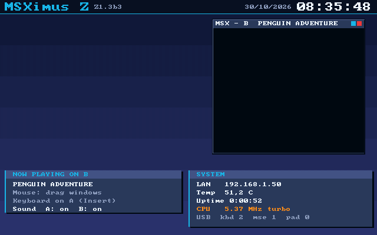
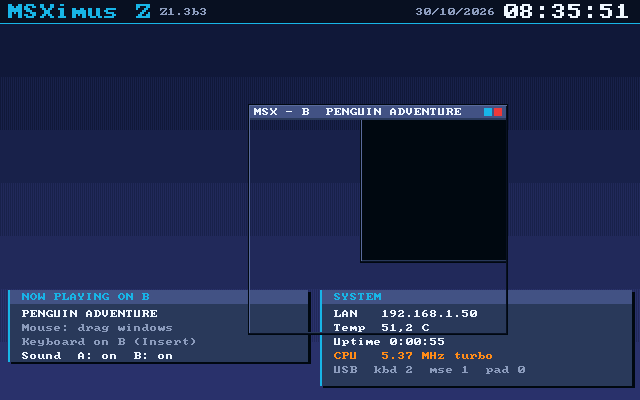

# 14. El perfil Dual: dos MSX a la vez (prueba de concepto)

El perfil **Dual** (`build.tcl … bit dual`, capítulo [07](07-construccion.md)) es el mismo sistema sin geo3d y sin el OPL4, y con una **segunda máquina MSX2+** entera, la **B**, en el PL: su Z80, su V9968 con su caché de VRAM, su PSG, su RAM, su cartucho y su RTC. El **V9990 se queda**, con el escritorio que pinta el ARM: la imagen de B es un **rectángulo dentro del frame buffer del V9990** y A sigue en la ventana del gestor de ventanas, como en el estándar. Es una **prueba de concepto**: B arranca el MSX BASIC o un cartucho, que se le mete por JTAG (`tools/dual_rom.tcl`) o **desde el menú de A** (tecla **D** de «Lanzar ROM», apartado 11), y se maneja desde el panel F12 «Máquina B» (apartado 12) o por JTAG; el teclado va a la ventana donde se hace clic (o con Insert) y no tiene audio más allá de su PSG; **desde la Z1.3.2b9 tiene disco**: Nextor 2.1.4 propio y la misma tarjeta de TF2 que A, con una *dueña* de la escritura (apartado 14). Desde la Z1.3.2b6 la **tecla D solo existe con este perfil** (el menú lo sabe por el bit 7 del puerto `#45`) y pinta un **escritorio de dos columnas**, A a la izquierda y B a la derecha, las dos ventanas arrastrables con el ratón (apartado 13). **Desde la Z1.3.2b8 la D lanza la ROM en A** (como RETURN y V) con ese escritorio y deja a B corriendo como **segunda máquina** (sin cartucho, MSX BASIC, en la b8; **con MSX-DOS desde la b9**, apartado 14); lo de antes (la ROM a B) es **Shift+D** (apartado 11). Y el sonido de cada máquina se **silencia por separado**: el cuadradito cian de la barra de cada ventana, o las teclas A y B del panel F12 (apartado 3.3). Estudio de partida: la beta dual (estudio interno, no publicado). Fuentes: `fpga/zynq/msx_b.v` (la máquina), `fpga/video720/bwin_fb.v` (su imagen en el frame buffer), `fpga/zynq/axi_arb2w.v` (el árbitro de los HP), el rectángulo que se salta `fpga/video720/v9990_fb.v`, los ganchos de `top_zynq.v` bajo `ENABLE_DUAL`, `tools/dual_rom.tcl` y, en el companion, `arm/companion/dual.c` (el cartucho que manda el menú y el panel) con `bios/src/v9991.asm` (`dual_key`, la tecla D).

*(Hubo una primera versión del perfil sin el V9990, en la que B usaba el lector del V9990 para ocupar la pantalla entera; no llegó a publicarse; sus cifras: LUT 41.930, BRAM 108, WNS +0,719 ns. El autor pidió el cambio de plan —V9990 dentro, OPL4 fuera— el 31/10/2026.)*

## 1. Qué cambia respecto al estándar

| | Estándar | Dual |
|---|---|---|
| V9990 (60h-6Fh), su cliente de VRAM, el inyector del ARM, el escritorio vivo (teclas V y B del menú) | sí | **igual** |
| geo3d (9Dh/9Fh/8Dh/8Fh) | sí | **fuera** |
| OPL4: motor PCM (`opl4_pcm`), FM OPL3 (`opl4fm`) y memoria de ondas del PS (`wave_axi`, YRW801) | sí | **fuera** (`ENABLE_OPL4FM` y `ENABLE_OPL4_WAVE` sin definir en el Dual: 7Eh/7Fh, C4h-C7h y 34h-37h leen FFh y la mezcla del OPL4 es 0). El Y8950 (C0h/C1h), el OPLL, el SCC ×2 y los PSG ×2 se quedan |
| Máquina B (`msx_b.v`) | – | **nueva**: Z80, V9968, PSG, RAM, cartucho, RTC |
| Imagen de B | – | rectángulo de **256 × 212 puntos** dentro del frame buffer del V9990 (`bwin_fb`, por el `S_AXI_GP0` que deja libre el OPL4); el escritor del V9990 se salta ese rectángulo |
| Tecla Pausa | conmuta V9968/V9990 | **igual** |
| Foco del teclado | – | la tecla **Insert** alterna el teclado entre A y B; el **clic** en una ventana le da el foco; el ARM lo puede pedir y leer (apartado 3.2) |
| Posición de B | – | punto a punto (bit 7 de la palabra de control y segunda palabra, apartado 3.2) |
| Puerto `#45`, bit 7 | 0 | **1**: el menú de A sabe que es el Dual (la tecla D y su leyenda solo salen con él) |
| Escritorio de dos columnas (tecla D) | – | A a ×0,5 a la izquierda, B a la derecha, las dos arrastrables con el ratón (apartado 13). D = la ROM en A y B de segunda máquina; Shift+D = la ROM a B (apartado 11) |
| Silencio por máquina (Z1.3.2b8) | – | A y B se silencian por separado: clic en el cuadradito cian de cada barra o teclas A y B del panel F12; 4 bits de la segunda palabra y 2 de la telemetría (apartado 3.3) |
| VRAM de B | – | `0x10380000` (256 KB, entre la del V9990 y su frame buffer) |

El build estándar no cambia: `build.tcl` sin segundo argumento emite exactamente las mismas órdenes de Vivado y las síntesis dan los mismos `util_synth*.rpt` (apartado 9). Los módulos compartidos que se tocaron lo hicieron con parámetros de valor por defecto igual al comportamiento anterior (`memory_axi` y `v9968_axi_backend`: `TAG_BITS`, `ID_PFX`; `v9990_fb` y `msx2hdmi_v9990`: `SKIP`/`SKIP_RECT` = 0, puertos `skip_*` y `wslot_o` sin uso; `dbg_mailbox_axi`: la salida `b_ctl`).

## 2. Qué se ve

- **B parada** (al cargar el perfil, o `dual_rom.tcl parar`): el sistema de siempre, con el V9990 y su escritorio. Los LEDs `led_z[2]` y `led_z[3]` (antes los disparos del joystick 1) están apagados.
- **B corriendo** (`dual_rom.tcl soltar`): `led_z[2]` encendido. B se ve como un **rectángulo de 256 × 212 puntos dentro del escritorio del V9990** (por defecto en la esquina inferior izquierda de un B5, columna 192 y fila 188; a ×2 en horizontal y ×1,5 en vertical son 512 × 318 píxeles de los 1280 × 720). Para ver el escritorio: el menú de A, al lanzar una ROM con la tecla **V** (o **B**), pinta el escritorio del V9990 y pone la imagen de A en su ventana (arrastrable con el ratón USB); la tecla **Pausa** muestra el V9990 a pantalla completa. Con A a pantalla completa (modo 0) B no se ve.
- **Teclado**: lo recibe una máquina cada vez. **Insert** (HID 0x49) alterna A y B (B_CTL[2] = 1 lo fuerza a B); `led_z[3]` encendido = el teclado está en B. A no ve ninguna tecla mientras el foco está en B, salvo F11, F12 y Pausa, que lee el top directo. El ratón sigue siendo de A (puerto 2) y mueve la ventana; **un clic dentro de una ventana le da el foco del teclado** (en el escritorio de dos columnas, apartado 13) y la barra de título de la ventana sin foco se apaga.
- **Sonido**: el PSG de B suma, mono, a la mezcla de A (entra por el canal del PSG, con su nivel del mezclador y la ganancia maestra). No hay FM, SCC ni OPL4 en B, ni OPL4 en A. **Z1.3.2b8**: cada máquina se puede silenciar sola (apartado 3.3): A = su PSG, SCC, OPLL, MSX-AUDIO, el WaveGame (la música del menú) y el monitor de la cinta; B = su PSG.

## 3. Cómo se controla B

Una palabra de 32 bits del buzón: `MBOX V9_BASE+4 = 0x1FFB0004`, la mitad alta del beat de control del V9990 que el PL ya leía cada ronda (`dbg_mailbox_axi.v`, estado `S_V9CD`) y que el companion no toca (escribe `V9_CTL` de 32 bits en `V9_BASE+0`). La DDR arranca con basura, así que **solo vale con la clave `D0A1h` en [31:16]**; sin ella B sigue parada y todos los bits cuentan como 0.

| Bit | Significado |
|---|---|
| 0 | B corre (a 0: reset y el rectángulo vuelve a ser del escritorio) |
| 1 | Hay cartucho en el slot 1 (a 0 el slot está vacío: la DDR tiene basura y la BIOS la tomaría por un cartucho) |
| 2 | El teclado va a B (si no, la tecla Insert alterna) |
| 4:3 | Mapper del cartucho: 0 Konami 4, 1 ASCII8, 2 Konami SCC (sin sonido), 3 ASCII16 |
| 5 | Cartucho lineal desde 0000h: enseña la imagen de la DDR tal cual (la dirección del bus es el desplazamiento), sin bancos y con las escrituras ignoradas. **Es también el modo «plano»** (apartado 3.1): lineal con una imagen de 64 KB con la ROM en su página y FFh en el resto |
| 6 | Sin el rectángulo de B: el V9990 pinta todo su frame buffer |
| 7 | **Posición fina** (Z1.3.2b6): la columna y la fila salen de la segunda palabra (apartado 3.2) y `[11:8]`/`[15:12]` no cuentan |
| 11:8 | Columna del rectángulo en el frame buffer: 0 = 192, n = 32 × n (de 32 a 480) |
| 15:12 | Fila: 0 = 188, n = 12 × n (de 12 a 180). Un B5 mide 640 × 400 |

**Quién escribe la palabra.** Tres caminos, que se pueden mezclar porque cada uno lee la palabra antes de cambiar sus bits: `tools/dual_rom.tcl` (xsdb, para pruebas), el **menú de A** (la tecla D manda el cartucho; apartado 11) y el **panel F12** (apartado 12). Los dos últimos son del companion (`dual.c`) y **solo con el perfil `DUAL` cargado desde la TF1** (`mxpf_id_activo()`; un Dual cargado por JTAG con `xsdb` no se reconoce, y entonces valen solo las órdenes de `dual_rom.tcl`). El companion **pone la palabra a cero** al arrancar y cada vez que recarga el PL (`dual_init` desde `main()` y `pl_resembra`): la DDR sobrevive a un reinicio del PS y a un PCAP, y un Dual recién cargado que leyera una palabra vieja con la clave válida arrancaría B solo (y con el bit 2 puesto dejaría el teclado de A sin respuesta).

`fpga/zynq/tools/dual_rom.tcl` (xsdb, core 1 del ARM, no toca el MSX) lo maneja: `estado`, `soltar`, `parar`, `reset`, `cargar <rom> [plain|plain0|plain1|plain2|konami4|ascii8|scc|ascii16] [lineal]` (para B, escribe la ROM —hasta 2 MB— en `0x0C400000`, la declara y la suelta; sin decir mapper elige solo, como el menú de A: **plana** hasta 32 KB, con la página que dice su cabecera, y `konami4` si es mayor; apartado 3.1), `sincartucho`, `foco a|b`, `ventana on|off|<col> <fila>`, `pantalla` (vuelca la pantalla de texto de B leyendo su VRAM) y `vram_limpiar`. `tools/dual_rom_prueba.py` genera un cartucho de 16 KB con un contador en pantalla. La telemetría de B sale en `MBOX+0x64` (`{PC de la última M1[31:16], escrituras al VDP[15:0]}`) y `MBOX+0x60` (`{fotogramas del V9968 de B[31:16], A8h[15:8], fallos de caché[7:0]}`), que `estado` lee (en el Dual sustituyen a la telemetría del V9990 de esas dos palabras).

### 3.1. El cartucho plano (Z1.3.2b4-3)

Una ROM de 8-32 KB no lleva mapper: su cabecera `AB` dice en qué página vive y la BIOS de B la busca ahí como en un MSX real (recorre cada slot mirando `AB` en 4000h y en 8000h y llama al INIT con **solo esa página** seleccionada en el slot). Una ROM de página 2 (*Stop the Express*: 16 KB, `AB` en +0, INIT = BFF0h) tiene que estar en **8000h-BFFFh con la página 1 vacía**. Con Konami 4 (el mapper por defecto de `cargar` hasta Z1.3.2b4-2) los bancos reinician a 0, 1, 2, 3: la ROM de 16 KB queda en 4000h-7FFFh y 8000h-BFFFh lee los bancos 2 y 3, el FFh de relleno (no queda reflejada); la BIOS encuentra `AB` en 4000h, llama a BFF0h y ejecuta FFh (RST 38h): B se pierde. Con `lineal` queda en 0000h y la BIOS no la ve; con `ascii16` el juego no llegaba a su pantalla.

**No hay un bit nuevo en el RTL**: el modo plano es el lineal de `megaram_scc` (B_CTL[5] = 1, mapper 0), que ya enseña la imagen tal cual y cuyas escrituras no llegan nunca a la DDR (no hay SRAM ni modo de escritura habilitados; los registros de banco de Konami 4 existen pero con `map_linear` la dirección no pasa por ellos), junto con una **imagen de 64 KB que compone `dual_rom.tcl`** en `0x0C400000`: FFh hasta la página de la ROM, la ROM y FFh hasta los 64 KB (el resto del slot 1, incluida la página 3, lee FFh). El bitstream es el mismo que ya estaba probado en placa. La página la decide la cabecera, con la misma lógica que el menú de A (`lin0_detect` y `mir16_calc` de `bios/src`):

| ROM | Dónde queda |
|---|---|
| ≤ 16 KB, `AB` en +0 con INIT (si es 0: STATEMENT, DEVICE, TEXT) en 8000h-BFFFh | 8000h-BFFFh, la página 1 vacía (ROM de página 2) |
| ≤ 16 KB, `AB` en +0 con ese puntero en 4000h-7FFFh o sin punteros | 4000h-7FFFh (8 KB: 4000h-5FFFh) |
| 17-32 KB, `AB` en +0 | 4000h-BFFFh |
| 17-32 KB, `AB` en +4000h y no en +0, con INIT en 4000h-7FFFh («Plain 0000h» del menú) | desde 0000h |
| ≤ 32 KB sin cabecera `AB` | 4000h (la BIOS no la arrancará sola) |
| > 32 KB | sin elección automática: `konami4`, como antes |

`plain` fuerza el modo plano (la página, por la cabecera) y `plain0`, `plain1`, `plain2` lo fuerzan en 0000h, 4000h u 8000h; pedir un mapper o `lineal` quita la elección automática (la ROM desde 0000h y FFh hasta los 64 KB, como antes). Un mapper o `lineal` junto a `plain` es un error, igual que una ROM plana de más de 32 KB o que no cabe en 0000h-BFFFh.

### 3.2. La posición fina, el foco y la telemetría (Z1.3.2b6)

Para el escritorio de dos columnas (apartado 13) la imagen de B se coloca **punto a punto** y el ARM puede pedir el foco del teclado y ver el puntero del ratón. Todo bajo `PERFIL_DUAL`: el estándar y la Música no cambian.

**La segunda palabra de control**, `MBOX V9_BASE+8 = 0x1FFB0008`: el buzón lee ahora **dos beats** de `V9_BASE` en la ronda (`ARLEN = 1` en el Dual, estados `S_V9CD` y `S_V9CE` de `dbg_mailbox_axi.v`; el estándar sigue con uno). Solo vale con la clave válida en la primera palabra **y** el bit 7 (posición fina) a 1; sin eso es basura de la DDR y no se mira.

| Bits | Significado |
|---|---|
| 9:0 | Columna de la imagen de B, en puntos del frame buffer: cualquiera (el PL recorta a 896; en un B5 de 640 puntos hasta 384, en un B7 hasta 768) |
| 18:10 | Fila: cualquiera (el PL recorta a 268; en un B5 hasta 188) |
| 20 | **Petición de foco**: cada cambio de este bit es una petición |
| 21 | La petición: 1 = el teclado a B, 0 = a A |
| 22 | **Petición de silencio de A** (Z1.3.2b8): cada cambio de este bit es una petición |
| 23 | El valor: 1 = silenciar A, 0 = dejarla sonar |
| 24 | **Petición de silencio de B**: cada cambio de este bit es una petición |
| 25 | El valor: 1 = silenciar B, 0 = dejarla sonar |

El PL sigue la cuenta de peticiones (`b_freq_seen`) mientras el bit 7 está apagado, así que lo que hubiera en la DDR no cuenta como una petición: el ARM escribe la segunda palabra, espera 3 ms, enciende el bit 7 y 3 ms después hace su primera petición (foco A). Una petición fija el flip-flop del foco (`b_focus_k`); **Insert sigue alternándolo** (una pulsación y una petición no se pierden: gana la última) y una B parada lo pone a 0, como siempre. Con el bit 7 a 0 todo es como antes (columna y fila gruesas de `B_CTL[15:8]`).

**La telemetría `MBOX+0xD0`** (palabra 18 del volcado, 64 bits; el volcado pasa de 18 a 19 palabras en el Dual): la captura el top en `clk_54m` cuando ve conmutar `t_tgl`, que el compositor cambia **en la línea 300** de cada cuadro; el gestor de ventanas solo cambia sus registros junto a la línea 721, así que a la altura de la captura el dato lleva 421 líneas quieto y no hace falta más sincronización (`tb_v9991_wm_dual.sv` lo comprueba: de la línea 250 a la 350 ningún `t_*` cambia).

| Bits | Contenido |
|---|---|
| 10:0 | `px`: el puntero, en píxeles de la HDMI (0-1279) |
| 20:11 | `py` (0-719) |
| 21 | Botón izquierdo (tal como lo vio el último cuadro) |
| 22 | El gestor está arrastrando A |
| 23 | El gestor de ventanas está en pantalla (R#55 con WM y el V9990 mostrado: con Pausa o A a pantalla completa vale 0) |
| 34:24 | `x` de la esquina de la ventana de A (px) |
| 44:35 | `y` de la esquina de la ventana de A |
| 45 | El teclado está en B (`b_focus`, el real: Insert, la petición del ARM o `B_CTL[2]`) |
| 46 | B corre |
| 47 | **A está en silencio** (Z1.3.2b8, el estado real de `dual_mute.v`) |
| 48 | **B está en silencio** (Z1.3.2b8) |
| 63:49 | Cuenta de muestras (una por cuadro; 15 bits desde la b8, antes 16 en `[63:48]`): el ARM atiende solo las nuevas |

**Quién es el Dual para el Z80.** El PL del Dual devuelve el **bit 7 a 1 en el puerto `#45`** (`config5`: en el resto de cores lee `{7'b0, arrancar en turbo}`, y el menú solo mira el bit 0 de ahí). El menú lo lee, tras `OUT (#40),#48` como con los demás puertos de configuración, antes de pintar el pie de «Lanzar ROM» y antes de aceptar la tecla D (apartado 11); con el estándar, la Música y las Tang ese bit es 0 y nada cambia.

### 3.3. El silencio por máquina (Z1.3.2b8)

Lo pidió el autor: «una forma de hacer mute a una u otra ventana». El mezclador (#44) no podía: el PSG de B entra **sumado al canal del PSG de A** (`psgL_ac = psg1l_ac + psg2l_ac + b_psg_ac` en `top_zynq.v`) y cada canal pasa por su atenuador, así que callar el PSG callaba las dos.

**Protocolo** (`fpga/zynq/dual_mute.v`, solo con `ENABLE_DUAL`): bits 22 a 25 de la segunda palabra (apartado 3.2). Es el protocolo del foco: un bit que **cambia** es una petición y el de al lado lleva el valor. Solo valen con la posición fina encendida (con ella apagada la palabra puede ser basura de la DDR y solo se sigue la cuenta de peticiones). **Se quitan solos con B parada** (`running = 0`: la parada de B, un reset de A —`rstb_n = sys_rst_n & run`— o un PL recién cargado): ni una B parada ni una A reiniciada dejan una máquina muda sin que se vea. El estado real sale en la telemetría (bits 47 y 48), y el ARM parte siempre de él, como con el foco.

**Qué calla** (puertas en `top_zynq.v`; `a_mute_27` y `b_mute_27` son los dos estados registrados en `clk_27m`, el dominio del mezclador; los relojes 54 y 27 son síncronos entre sí y no hace falta más que un registro):
- **B**: el PSG de B (`b_psg_ac`) fuera de la suma del PSG.
- **A**: sus dos PSG (`psg1*_ac`, `psg2*_ac`, después del bloqueador de continua, que sigue integrando), y los atenuadores del mezclador del SCC, el OPLL, el MSX-AUDIO y el WaveGame a nivel 0 (`mk_scc`, `mk_opll`, `mk_y895`, `mk_wg`: el nivel que ha puesto el usuario no se toca, solo se enmascara), y el monitor de la cinta (`tp_snd_27`). El OPL4 no existe en el Dual. El PSG de B sigue sumando con su nivel del mezclador y la ganancia maestra de siempre.
Al activar o desactivar hay un escalón (no hay rampa: costaría área, quedan 3 slices).

**Cómo se ve y se maneja** (apartados 12 y 13): clic en el **cuadradito cian** de la barra de cada ventana (el de A lo pinta el gestor de ventanas y el companion sabe dónde está por la telemetría; el de B lo pinta `v99desk.c`; los dos quedan **grises y huecos** en silencio —el de A desde la Z1.3.2b9, con la entrada `mute_a` del gestor—), la línea *Sonido  A: si  B: no* de la tarjeta y las teclas **A** y **B** del panel F12. Cada escritorio nuevo (D, Shift+D, V, B) empieza con las dos máquinas sonando.

## 4. La máquina B (`msx_b.v`)

Un MSX2+ mínimo que **no comparte estado con A**: solo comparte lo de solo lectura (BIOS y SUB-ROM del pack, en la DDR), la cadencia de 3,58 MHz (los pulsos de habilitación de A), el teclado USB (con foco) y la salida HDMI.

| Slot | Contenido |
|---|---|
| 0 | BIOS de 32 KB (BIOS y BASIC; pack de A, DDR `0x10F60000`, solo lectura). Sin subslots |
| 1 | El cartucho: `megaram_scc` (el módulo de A, sin SRAM ni NEO) con el mapper de B_CTL[4:3]; hasta 2 MB en `0x0C400000` (con A21 = 1, `0x0C200000`: ASCII16 de más de 2 MB). Las ROM de hasta 32 KB van **planas** (lineal con una imagen de 64 KB, apartado 3.1) |
| 2 | Vacío |
| 3-0 | Mapper de RAM de 2 MB (registros FCh-FFh, 16 KB por página; reinicio 3,2,1,0), `0x0C000000` |
| 3-1 | SUB-ROM de 16 KB en la página 0 (pack de A, `0x10F68000`). La página 1 (en A, FM-BIOS y menú) lee **C9h (RET)** en todo el rango, ver abajo |

Puertos: A0h-A2h PSG (el registro 14 lee FFh: no hay joystick), A8h-ABh PPI (slots, fila del teclado, bit set/reset del puerto C), 98h-9Bh V9968 (sin los espejos 88h-8Ch ni el puerto 9Ch), B4h-B5h RTC propio, FCh-FFh mapper. Todo lo demás lee FFh y se ignora. Sin turbo, sin disco, sin Nextor, sin menú, sin WiFi.

- **El menú de A en B**: la SUB-ROM de la BIOS del pack llama, durante el arranque, a `0066h` de la ROM principal (el NMI), cuyo hook `H.NMI` (`FDD6h`) hace un `CALSLT` al slot 3-1 en `7A00h`: en A es la entrada del menú de arranque, que vive en las páginas 1 y 2 del slot 3-1 (capítulo [04](04-pack-bios.md)) y decide si enseña el menú o el logo. B no tiene menú ni logo (llaman a puertos y slots de A: la config 4xh, el slot 0-3, el companion). Con la página 1 vacía (FFh) B ejecutaba `RST 38h` en cadena desde `7A00h` y se quedaba para siempre en la rutina de interrupción de la BIOS (se vio en la simulación con la BIOS real, a los ~345 ms de Z80 a 13,5 MHz, con solo 2 escrituras al VDP); con `C9h` en toda la página 1 el hook vuelve en el acto y la BIOS arranca directa al BASIC. El banco de la BIOS lo comprueba (`--sub`) y una emulación del mapa de B con la BIOS del pack llega a escribir «MSX BASIC version 3.0 / Copyright 1988 by Microsoft / 28815 Bytes free» al VDP.
- **Z80**: el `G80a` de A con su misma FSM de esperas (una espera en cada escritura de RAM, cada fallo de caché y cada ciclo de E/S que no sea del VDP) y el freno de una espera por M1, sobre los pulsos de 3,58 MHz de A. Sale de reset 0,6 ms después del resto (A tarda ~116 ms por sus `reset1..3`): el V9968 y la caché de la RAM ya están listos cuando la BIOS escribe el primer puerto.
- **Reset**: `rstb_n = bus_reset_n de A & B_CTL[0]`. Un reset de A (S1, F12 → reiniciar, «Save & Restart») reinicia también B. **Parada ordenada**: al bajar `rstb_n` el Z80 y el VDP de B se paran ya, pero el reset de `memory_axi` (que suelta AWVALID/WVALID/ARVALID) lo aplica `axi_rst_drain` solo cuando el maestro AXI de la RAM no tiene nada a medias (`memory_axi.idle`) y lo suelta al volver `rstb_n`; si no, un corte a mitad de una escritura deja colgado al árbitro del HP2 y, con él, al buzón del ARM (apartado 8.1). El maestro de VRAM de B (`v9968_axi_backend`) no se resetea con B (usa el reset del sistema), así que no hay nada que drenar ahí.
- **RAM**: `memory_axi` (el módulo de A) con una caché de **4 KB** (`LINES_LOG = 8`; A lleva 64 KB y 17 BRAM) y dos ventanas: bit 23 de `ram_addr` = 0 la zona de B (`RAM_BASE = 0x0C000000`), 1 la ventana de A (`EXT_BASE = 0x10800000`: de ahí salen la BIOS en `0xF60000` y la SUB-ROM en `0xF68000`). B nunca escribe en la ventana de A (el banco lo vigila).
- **Vídeo**: V9968 y caché de VRAM (`v9968_vram_shim`, dos `v9968_sdram_bridge` y `v9968_axi_backend`) copias de los de A, con el shim en `VRAM_OFF = 0x380000`. El doblador del V9968 saca 480 líneas; el adaptador se queda con **una de cada dos** (la cuenta de líneas se pone a 0 en el VS y salta en cada HS: cada línea nativa sale dos veces seguidas) y entrega 5 bits por color, HS/VS/DE y un pixel por `ce` (640 px, 240 líneas) a `bwin_fb`.
- **Teclado**: otra matriz `usb_keyboard_msx` alimentada con el bitmap HID filtrado por el foco. La de A recibe `kbd_a` (el mismo bitmap, vacío si el foco es B).
- **Sonido**: `a+b+c` del PSG ×16 (el nivel de un lado del PSG de A a tope), mono, con el bloqueador de continua de A, sin el filtro `psg_filter` (se ahorran ~640 LUT y 730 FF): suena con algo más de alias en los tonos muy agudos.

## 5. La imagen de B en el escritorio del V9990

**Por qué así.** El escritorio del ARM es un frame del V9990 en la DDR (`v9990_fb`: 3 slots de 480 filas × 2.304 B, RGB555 de 16 bits por píxel, con el bit 15 de transparencia; un escritor y un lector). Dar a B su propio camino de vídeo con un lector más (anillo de líneas en BRAM + escalador, como `msx2hdmi_v9968`/`msx2hdmi_v9990`, 16-18 BRAM) **no cabe**: con V9990 dentro y OPL4 fuera la build deja 136,5 de los 140 tiles de BRAM (apartado 9) y el lector más pequeño que se podría hacer —la mitad del anillo, 8 líneas— costaría unos 9 tiles más (145,5 > 140). La alternativa, sin BRAM nueva, es escribir la imagen de B **dentro** del frame buffer del V9990 y dejar que su lector y el compositor la muestren con el resto.

**Cómo.**

- `bwin_fb` (`fpga/video720/bwin_fb.v`, a `clk_86`, una instancia, 340 LUT, 144 FF, **0 BRAM**: los dos buffers de línea son LUTRAM) captura el vídeo de B, se queda con las líneas 14 a 225 de las que llevan imagen (el mismo recorte SRCY = 14, SRCH = 212 que la ventana de A) y con 256 de cada 640 píxeles (uno de cada 2,5 con el patrón 3,2,3,2: los 256 puntos de un modo de 256), los empaqueta a RGB555 con el bit 15 a 0 (opaco) y escribe cada línea en 8 ráfagas AXI3 de 16 palabras a `FB_BASE + slot × 0x110000 + (y0 + línea) × 2304 + 2 × x0` (con la posición fina de la Z1.3.2b6, 9 ráfagas alineadas desde `x0 & ~31` y `x0` cualquiera: apartado 13.4). El slot es el que **está escribiendo el V9990** en ese momento (`wslot_o` del escritor): se publicará al acabar el frame del V9990, con el rectángulo dentro.
- El escritor del V9990 (`v9990_fb` con `SKIP = 1`) no puede pisarlo: en las palabras de ese rectángulo manda **`WSTRB = 0`** (la ráfaga y sus datos salen igual, la DDR no cambia). Son las filas `skip_y0 .. skip_y1 - 1` y las palabras `skip_wx0 .. skip_wx1 - 1` de cada una (2 píxeles por palabra); la comparación es por palabra (`w_burst`, `w_beat`) y no parte ráfagas. Es lógica de unos pocos LUT.
- Va por el **`S_AXI_GP0`** (32 bits, a `clk_86`, el reloj del frame buffer): el que usaba la memoria de ondas del OPL4, libre sin él. No pasa por ningún árbitro ni compite con la VRAM del V9990 ni con los frame buffers del GP1.
- El rectángulo, su posición (`B_CTL[15:8]`, o la fina del apartado 3.2) y su apagado (`B_CTL[6]`) están en el apartado 3. Con B parada, o con el bit 6, `skip_en` = 0 y el escritor del V9990 pinta todo.

**Qué cuesta.** B y el V9990 **no están enganchados**: el rectángulo de un slot junta líneas de dos cuadros de B, separadas por una costura que rueda despacio (los dos van a ~60 Hz) en vez de un tearing de pantalla entera. La imagen no se filtra al decimar: el texto de 80 columnas de B (640 px de ancho) sale ilegible; los modos de 256 puntos, los de 40 columnas y los juegos salen bien. El rectángulo vale para cualquier modo del V9990 (una ROM de V9990 a pantalla completa también tendría su agujero con B corriendo; `ventana off` lo evita) y su posición por defecto es la de un B5; con el B7 hay que elegirla.

## 6. La DDR

Lo único nuevo (el resto del mapa del [capítulo 03](03-mapas-memoria.md) no cambia):

| Dirección | Tamaño | Contenido | Cliente |
|---|---|---|---|
| `0x0C000000` | 8 MB (usa 6) | Zona de B: mapper `+0x000000`, cartucho con A21 = 1 `+0x200000`, con A21 = 0 `+0x400000` | `memory_axi` de B (HP2) |
| `0x10380000` | 256 KB | VRAM de B (detrás de los 512 KB de la del V9990, `0x10300000`, y antes de su frame buffer) | `v9968_axi_backend` de B (HP0) |
| `0x10400000` | 3 × 0x110000 | Frame buffer del V9990, con el rectángulo de B | `v9990_fb` en `msx2hdmi_v9990` (GP1, escribe todo menos el rectángulo) y `bwin_fb` (GP0, escribe el rectángulo) |
| `0x10F60000`, `0x10F68000` | 32 KB, 16 KB | BIOS y SUB-ROM de A, **leídas** por B | `memory_axi` de B (HP2) |
| `0x1FFB0004` | 4 B | Palabra de control de B (clave `D0A1h`) | `dbg_mailbox_axi` (HP2) |
| `0x1FFB0008` | 4 B | Segunda palabra de control (Z1.3.2b6): posición fina de B y petición de foco; (Z1.3.2b8) peticiones de silencio de A y de B; solo vale con el bit 7 de la primera | `dbg_mailbox_axi` (HP2) |
| `0x1FF000D0` | 8 B | Telemetría del ratón, la ventana de A y el foco (Z1.3.2b6, apartado 3.2; palabra 18 del volcado del buzón) | PL → ARM (`dbg_mailbox_axi`) |

`0x0C000000-0x0C7FFFFF` no lo usa ni el companion ni el FSBL (comprobado en `lscript.ld`, `mmu.c` y las herramientas), ni cae dentro de la imagen de disco (`0x11000000`). Las zonas del OPL4 (`0x0F000000`, la YRW801, y `0x0F200000`, su RAM de muestras) quedan sin usar en el Dual.

## 7. El reparto de puertos AXI

| Puerto | Reloj | Estándar | Dual |
|---|---|---|---|
| HP0 | `FCLK0` | VRAM de A | VRAM de A y VRAM de B detrás de `axi_arb2w` (A prioritaria, ID bit 5 = 0; B = 1) |
| HP1 | `clk_54m` | RAM de A | igual |
| HP2 | `clk_54m` | buzón | buzón (prioritario, IDs < 8) y RAM de B (IDs 32-63) detrás de `axi_arb2w` |
| HP3 | `clk_27m` | proxy de SD | igual |
| GP0 | `clk_wave375` | ROM de ondas del OPL4 | **`bwin_fb` a `clk_86`** (la imagen de B en el frame buffer del V9990) |
| GP1 | `clk_86` | VRAM del V9990 (prioritaria) y los dos frame buffers | igual |
| ACP | – | sin usar | sin usar |

`axi_arb2w` es `axi_arb2` con el ancho de datos parametrizable (64 bits en los HP): lecturas de los dos maestros en vuelo a la vez, rutadas por el bit 5 del ID de R y de B; escrituras de una transacción entera cada vez. Para que los IDs no se mezclen, `memory_axi` y `v9968_axi_backend` etiquetan sus lecturas con `TAG_BITS` bits rotatorios más un prefijo fijo (`ID_PFX`): A con 5 bits y prefijo 0, B con 5 bits y prefijo 32 (**las instancias del top deben llevarlo explícito**: con el valor por defecto, 6 bits, la mitad de las lecturas de A volvían a B; `tb/check_ids.py` lo comprueba). Cada árbitro del top lleva `W_TMO = 2048`: si el dueño de una ráfaga de escritura desaparece, la cierra con beats de `WSTRB = 0` en lugar de quedarse esperando. El bloque de la PS (`bd_ps7.tcl`) no cambia; en el top, el `GP0_ACLK` pasa de `clk_wave375` a `clk_86` bajo `ENABLE_DUAL`.

## 8. Verificación

| Banco | Qué cubre |
|---|---|
| `tb/run_msx_b.sh` → `tb_msx_b.sv` (xsim de Vivado 2019.2: el Z80 es el `G80a` en VHDL, no vale Icarus ni Verilator) | B arranca leyendo su «BIOS» de un modelo de DDR por el maestro AXI de la RAM y ejecuta el programa de `tb/b_prog.py`: slot 0, RAM del mapper (slot 3-0 y registro FFFFh), el mapper (segmentos), PSG (escritura y relectura, tono en la salida), V9968 (escribe 16 bytes en la VRAM de B, por el backend AXI, y los lee de vuelta), RTC. `--sub`: la SUB-ROM del slot 3-1 desde una rutina copiada a RAM, y su página 1 (C9h). `--cart`: el cartucho del slot 1 con Konami 4 (cabecera AB, patrón, banco 1 en 6000h y cambio de banco). `--plain`: el cartucho plano de `dual_rom.tcl` (lineal con la imagen de 64 KB y una ROM de 16 KB en 8000h-BFFFh): `AB`, patrón y último byte en la página 2 del slot 1, las escrituras donde Konami 4 pondría sus registros (6000h, 8000h, A000h) no cambian nada y la página 1 lee FFh (`TB_OK`; con `--plain --cart`, que mira el layout de Konami 4, `TB_FAIL` en el punto 11). `--irq`: R#1 = 60h, la interrupción del V9968 llega al Z80 (IM 1) con una rutina como la de la BIOS (lee S#0, cuenta aparte si F estaba a 1, falla si hay interrupciones espurias) y el vídeo que sale son fotogramas de **240 líneas de 640 px**. En todas: ninguna escritura de B fuera de su zona ni de su VRAM, ninguna a la ventana de A. `--rerun`: B se para y se arranca de nuevo a mitad del programa con un AW de su RAM en el aire: el reset de `memory_axi` espera a su `idle` (~1 µs) y B acaba el programa. `--bios <pack>`: la BIOS y la SUB-ROM de un pack de verdad (ver abajo) |
| `tb/run_bwin.sh` → `tb_bwin.v` (Icarus) | `bwin_fb` y un `v9990_fb` con `SKIP = 1` (frames de 640 × 400 como un escritorio B5) escribiendo a la vez, a través de `axi_arb2` con ID_BIT 3, en una DDR de mentira de 3 slots: 8 frames. En el slot publicado, **fuera del rectángulo** (201.728 píxeles) son los del V9990 y **dentro** (54.272 = 256 × 212) los de B decimados 2,5:1 y recortados, con 0 errores; el escritor del V9990 marcó 217.088 palabras con `WSTRB = 0` (128 × 212 × 8 frames) y ninguna escritura salió del frame buffer. **Posición fina** (Z1.3.2b6): `+X0=` `+Y0=` (por defecto 192/188), una pasada por posición y en paralelo: 192/188, 362/48, 361/48, 31/7, 33/100, 0/0, 383/188, 384/100 y 1/187 (pares, impares y extremos), píxel a píxel contra el V9990 (con las palabras de los bordes compartidas), `TB_OK` en las nueve; el escritor del V9990 solo marca como `WSTRB = 0` las palabras enteras del rectángulo (128, o 127 con `x0` impar) |
| `tb/emu_b.py` (Python con `pip install z80`, en WSL) | El mapa de memoria y de E/S de B en un emulador Z80 con un V9968 de juguete: ejecuta la BIOS del pack en segundos y dice si llega a escribir «MSX BASIC» al VDP. Con `--vacio` reproduce el fallo de la página 1 del slot 3-1. Con `--cart=<imagen de 64 KB>` pone un cartucho lineal en el slot 1 (solo lectura), con una VRAM de juguete y el teclado (`--tecla=N` pulsa la barra espaciadora), y con `--png=` dibuja la pantalla (SCREEN 1 o 2, sin sprites). No mide tiempos |
| `tb/run_emu_cart.sh <pack> <rom>` (Git Bash con `tclsh`, y WSL con `z80`) | De punta a punta sin placa: `tools/dual_rom.tcl cargar` en un `tclsh` con `tb/xsdb_stub.tcl` (una xsdb de mentira que guarda la memoria y vuelca la zona del cartucho) y la imagen que sale, en el slot 1 de `emu_b.py` con la BIOS del pack |
| `tb/check_dual_rom.py` (con `tclsh`) | La elección automática de `dual_rom.tcl cargar` con ROMs sintéticas (cabecera en +0 o +4000h, 8/16/24/32/64/128 KB, punteros en página 1 o 2, `plain*`, mapper pedido, errores): la imagen de 64 KB y la palabra de control. 24 comprobaciones, `CHECK_OK` |
| `arm/companion/tests/dual_host/run_host_dual.sh` (WSL, `gcc`, AddressSanitizer y UBSan) | **El companion** (apartados 11 y 12): `dual.c`, `wavegame.c` (el receptor de las tramas del 93h y la FAT de la TF2 con el nombre largo y el tamaño) y `osd_dib.c`/`osd_info.c` tal cual, contra una TF2 FAT16 hecha por `gen_fat16.py` y la DDR en sus direcciones reales (`mmap`: la megaram de A en `0x10C00000`, el cartucho de B en `0x0C400000`, la palabra en `0x1FFB0004`). **Las mismas 24 comprobaciones de `check_dual_rom.py` contra el C** (`dual_plan` + `dual_aplica`: imagen y palabra de control); el menú (cada MAPPER_ID, los que B no admite, el tope de 2 MB, la ROM que no está, otro perfil que no es el Dual, B que corría y se para antes de escribir, el foco del teclado y la ventana sin tocar, las tramas `'W','I'`/`'Q'`/`'G'` que siguen yendo a los perfiles, una trama a medias); el panel (cada tecla, los dos idiomas, 30 columnas, la página de información con y sin el Dual). 257 comprobaciones, 0 fallos en la Z1.3.2b8 (`t_b8`: `'V','A'` a `v99desk_inicio(10)`, la D sola con B parada —sin cartucho y con el teclado de A— y con B corriendo —no se toca—, la barra de B «BASIC» o el nombre del cartucho, los clics en los cuadraditos cian de A y de B con sus márgenes y sin tocar foco ni arrastre, con B parada y con la Pausa no cuentan, el estado real de la telemetría manda, V/B quitan los silencios antes de apagar la posición fina, las teclas A y B del panel, la línea *Sonido* en los dos idiomas); 203 en la Z1.3.2b6 (`t_escritorio`: `dual_escritorio` con 5, 7 y 9 —la segunda palabra se escribe antes de encender la posición fina—, el foco por clic en A y en B, el clic fuera, el arrastre punto a punto con sus topes, la imagen de B que espera a que el marco esté publicado, B parada, sin gestor de ventanas, Insert que cambia el foco y la muestra repetida); `DUAL_VOLCADO=<carpeta>` vuelca las páginas para `tools/osd_render.py` |
| `arm/companion/tb_v99desk/host.c` + `render.py` (WSL, `gcc`; Python con `Pillow`) | **El escritorio de dos columnas dibujado**: `v99desk.c` tal cual (`-DV99_HOST`) genera las entradas del anillo (`host 200 hex 9 1 mueve`: el marco de B en su sitio, arrastrado a (250, 120) y soltado) y `render.py` las ejecuta en un modelo mínimo del V9990 (R#, VRAM, paleta, LMMV) y saca un PNG por momento; las capturas de la 13 salen de ahí (no es el core: no prueba el LMMV de verdad, solo lo que se pide). V (5) y B (7) generan las mismas entradas que antes (mismo `md5`); con `10` (D sola) y `silencio` saca el escritorio con el juego en A y los dos sonidos en silencio (`docs/img/dual_dos_columnas_silencio.png`, `_juego_en_a.png`) |
| `tb/run_mbox_dual.sh` → `tb_mbox_dual.v` (Icarus, `-DPERFIL_DUAL`) | `dbg_mailbox_axi` con el control de B en dos beats (`b_ctl` es la mitad alta del primero, `b_ctl2` la baja del segundo, también tras reescribirlas), la telemetría `+0xD0` y que las escrituras del buzón no salen de sus zonas (`+0x40..+0xD7` y la traza): `TB_OK`; `tb_mbox_wg` (estándar) sigue en `TB_OK` |
| `tb/run_v9991_wm_dual.sh` → `tb_v9991_wm_dual.sv` (Icarus, `-DPERFIL_DUAL`) | El gestor de ventanas del Dual: la barra de A azul con el foco y del color del cuerpo sin él (el resto del marco igual), la telemetría (puntero, botón, arrastre, gestor activo, esquina de A) al encender, con el puntero en la barra, pulsando, arrastrando (+100, +50) y soltando, una conmutación de `t_tgl` por cuadro y ningún `t_*` cambia de la línea 250 a la 350; (Z1.3.2b9) el cuadradito cian de A cian y, con `mute_a`, hueco y gris con y sin foco, y los clics en su zona (y 2 px de margen) que no arrastran frente a los de justo fuera, que sí: `TB_OK`. `tb_v9991_wm` (estándar, con los colores del b3 que le faltaban) en `TB_OK` |
| `tb/emu_menu_dual.py` (WSL, `pip install z80`; antes `bios/build.sh msximus msximus_en`) | **El menú real** ensamblado (`bios/out/*/menu_main.z80` y su `.sym`) en un emulador Z80 con la BIOS de mentira: D y d desde la cadena de teclas llegan a `dual_key` (y M, S, G, V y B siguen donde estaban), la trama de 14 bytes del 93h con cada MAPPER_ID y las variables que hay, a continuación `'V','5'` + el nombre (24 como mucho) + 0, entre las dos más de 3.000 OUT al V9990 (el anillo de 32 entradas no desborda), el veneno del «AB» de la megaram de A después de todo lo del 93h con unos 40 ms de Z80 entre medias (a 4 T por instrucción, la cota baja), que acaba en `browse` con la pila como entró, y el pie de teclas en sus tres variantes y dos idiomas (texto, fila, columna, centrado y que cabe en 80 columnas). **Z1.3.2b8**: la D sola llega a `launch_rom` pasando por `v9991_key` (mismo veto) con `'V','A'` + el nombre y el mismo escritorio (R#55-R#62), **sin** trama de B ni veneno de la megaram; Shift+D (SNSMAT fila 6, bit 0 a 0) hace lo de la b6 (`'W','0'+MAPPER_ID…`, `'V','D'`, veneno); una ROM vetada vuelve a la cadena de teclas con A = 0 y sin pintar nada; sin el Dual no mira ni el SHIFT. 498 comprobaciones, `EMU_OK`. **Z1.3.2b6**: el mensaje es `'V','D'` y los registros R#55-R#62 del escritorio de dos columnas (B6, WX 22, WY 48); **sin el Dual** (el `#45` sin el bit 7, y solo tras `OUT (#40),#48`) la tecla D vuelve a la cadena de teclas sin tocar el 93h, el V9990 ni la megaram, y el pie sale sin «D = Dual» y centrado 6 columnas más a la derecha. 348 comprobaciones, `EMU_OK` |
| `tb/run_dual_mute.sh` → `tb_dual_mute.v` (Icarus) | **El silencio por máquina** (Z1.3.2b8, `dual_mute.v`) con un modelo de las puertas del audio de `top_zynq.v` (el mismo orden de operaciones y el `mixk` de verdad): al principio todo suena (A + B); la petición de silencio de A deja solo el PSG de B (con su atenuador del PSG); la de B deja A entera; las dos a la vez, 0; quitarlos devuelve el sonido; una petición sin cambio del bit de petición no hace nada; sin la posición fina la basura de la DDR ni silencia ni cuenta como petición al encenderla; con B parada los silencios se quitan solos y la petición que llega no vale; `a_mute` y `a_mute_27` coinciden. 23 comprobaciones, `TB_OK`; con la parada de B sin quitar los silencios o con la posición fina ignorada el banco falla (6 y 10 errores) |
| `tb/run_arb2w.sh` (Icarus; llama a los tres siguientes) | **`tb_arb2w.v`**: `axi_arb2w` con los dos maestros reales (backend de VRAM y `memory_axi`) contra un esclavo que intercala lecturas y encola las respuestas de escritura: 500 operaciones al azar por maestro, 3 semillas, `TB_OK`. Más los escenarios de la placa, **que deben salir mal** o bien según el caso: el backend de A con 6 bits de etiqueta (`-DA_TAGBITS=6`: `TB_FAIL`, lecturas de A que devuelven `ffff`), el reset de golpe de la RAM de B a mitad de una escritura (`+rst_cut`: `TB_FAIL`, A sin completar nada) y el mismo reset ordenado con `axi_rst_drain` (`+rst_drain`, 10 paradas: `TB_OK`). **`tb/check_ids.py`**: que `u_vddr3` en `top_zynq.v`, `mem_b` y `u_vram` en `msx_b.v` y el buzón usan los IDs que el árbitro espera (falla sobre la instancia vieja). **`tb/run_arb2w_rnd.sh` → `tb_arb2w_rnd.v`**: dos maestros AXI3 sintéticos con 4 lecturas en vuelo cada uno (IDs distintos, ráfagas de 1 a 4 beats) y escrituras con su B pendiente, y un esclavo que devuelve las lecturas **fuera de orden entre IDs** (hasta 8 a la vez, beats intercalados) y las B desordenadas; el dato de cada dirección es un hash, así que un beat ajeno no pasa; compara la memoria del esclavo con la copia de cada maestro. Escenarios: base, A con 6 bits (falla), `+drain` (B se para 20 veces con `axi_rst_drain`), `+cut_aw` (AW retirado sin aceptar), `+cut_w` (corte a mitad de ráfaga: `DEADLOCK` sin el vaciado), `+cut_drain`, y los mismos con `W_TMO = 2048` (`cut_w` pasa; 0 vaciados en tráfico normal) |
| Regresión de lo compartido | `run_msx2hdmi_v9990.sh` (B1, B5, B7), `run_msx2hdmi_v9968_win.sh` y `run_gp1_chain.sh` (los dos frame buffers con los dos árbitros del GP1 y el cliente de VRAM): `TB_OK`. `tb_memory_axi`, `tb_mbox_wg` y `tools/v9968_sim/run_t2zynq_vl.sh` (módulos que el Dual toca con parámetros por defecto): sin errores en la sesión anterior |

La BIOS del pack de verdad en el RTL (`tb_msx_b.sv --bios <pack> 800`, Z80 a 13,5 MHz, unos 13 ms simulados por minuto de pared): B comprueba la RAM (~340 ms simulados, ~1,3 s a 3,58 MHz), pasa la llamada al menú por el NMI (con el RET) y entra en el vaciado de la VRAM con comandos del VDP, donde seguía a los 800 ms simulados (sin atasco visible, sin escrituras fuera de su zona). El texto de MSX BASIC **no se alcanzó** en el RTL; con `emu_b.py` sí.

El script de xsdb se probó en un `tclsh` con `xsdb` simulado (el flujo de órdenes y las palabras escritas). **El conjunto (el perfil cargado en placa, B corriendo detrás del `top_zynq.v` y su rectángulo en un escritorio de verdad) no se ha simulado ni probado en placa**: sí cada pieza por separado (apartados anteriores) y el build completo con todas las restricciones cumplidas.

### 8.1. La primera prueba en placa (1/11/2026): dos fallos y sus arreglos

La 2.ª versión del perfil cargó desde la TF1 y B arrancó (`soltar` → a los ~10 s `pantalla` da «MSX BASIC version 3.0 / 28815 Bytes free / Ok», 34.262 escrituras al VDP y fotogramas subiendo). Dos fallos, los dos en el reparto de los puertos HP, reproducidos en simulación y arreglados:

**1. La imagen de A salía con glitches** (menú de 80 columnas: letras y trozos de nombres que faltan, barras blancas horizontales de decenas de caracteres, huecos en la leyenda). **Causa**: el `v9968_axi_backend` de A (`u_vddr3`, HP0) se quedó en `top_zynq.v` con los valores por defecto, **6 bits de etiqueta** (IDs 0-63), cuando el perfil necesita 5 bits y prefijo 0 (A usa los IDs 0-31 y B los 32-63: `axi_arb2w` rutea R y B por el **bit 5** del ID). La mitad de las lecturas de A (las de ID ≥ 32) volvían por el canal de B: A no recibía su R, esperaba el watchdog del backend (0,87 ms) y completaba la lectura **en falso con FFFFh** (las barras blancas; mientras tanto el VDP de A parado), y el backend de B las descartaba como rezagadas (si el ID coincidiese con el que espera, tomaría el dato de A). Los bancos de entonces instanciaban el backend de A con 5 bits (los del módulo, no los del top), así que no lo veían. **Arreglo**: `u_vddr3` con `.TAG_BITS(5), .ID_PFX(6'd0)` bajo `ENABLE_DUAL`. **Evidencia** (`tb/run_arb2w.sh`): con 6 bits el banco de módulos reales da `ERROR A: lectura 001f20 = ffff (esperado d0ab)` y el árbitro avisa de `A usa ARID 53 (bit 5 a 1)`; con el banco de maestros sintéticos, `R de un ID que no es mio` en B y la lectura de A que nunca vuelve; con 5 bits, 0 errores en 3 semillas. `tb/check_ids.py` comprueba las instancias del top y de `msx_b.v` (y que el buzón usa IDs < 32); falla sobre la instancia vieja.

**2. Tras `dual_rom.tcl parar` (B a reset con B corriendo) el sistema se colgó** al pulsar teclas en A. **Causa**: el reset de B (`bus_reset_n` de `memory_axi`) **soltaba `AWVALID`/`WVALID`/`ARVALID` de golpe** aunque B tuviera una escritura a medias en el HP2. `axi_arb2w` atiende **una transacción de escritura entera cada vez**: si el dueño (B) desaparece entre el AW y el último W, el árbitro se queda en esa fase esperando para siempre y **el otro maestro del HP2, el buzón del ARM, ya no puede escribir**: su FSM (que también lee los anillos del ARM, el teclado de `key.tcl` incluido) se para y el sistema parece colgado. La ventana es corta (los ciclos en que un AW/W de B está presentado y sin terminar) y por eso no sale en cada parada, pero es cuestión de tiempo. **Evidencia** (`tb/run_arb2w.sh`): `+rst_cut` (reset de golpe de la RAM de B a mitad de una escritura) deja a A sin completar nada (`A 0 B 0`, tiempo agotado) y el banco sintético `+cut_w` da `DEADLOCK: sin progreso 20000 ciclos`; con AW retirado sin aceptar, el árbitro viejo también dejaba a A sin escrituras mientras B seguía en reset (`A bloqueado: solo 1 escrituras en 3000 ciclos`). **Arreglo** (tres capas):

- **Parada ordenada de B** (`axi_rst_drain.v`, instanciado en `msx_b.v`): al bajar `run` (o el reset de A) el Z80 y el VDP de B se paran **ya**, pero el reset de `memory_axi` solo se **aplica** cuando el maestro lleva 16 ciclos seguidos sin nada a medias (`memory_axi.idle`: ni AW/W/AR sin aceptar ni una línea por llegar), y se suelta en cuanto vuelve `run`. En la simulación de B (`run_msx_b.sh --rerun`) la parada con el AWVALID de la RAM alto espera ~1 µs a `idle` y el reset llega con los tres VALID a 0; B acaba el programa igual.
- **`axi_arb2w`, fase de dirección**: si el dueño retira el AW sin que lo hayan aceptado, el árbitro se suelta (antes se quedaba esperándolo).
- **`axi_arb2w`, fase de datos** (`W_TMO = 2048` en los dos árbitros del top): si el dueño de una ráfaga se queda 2.048 ciclos sin presentar `WVALID`, el árbitro **cierra la ráfaga** con beats de `WSTRB = 0` hasta `WLAST` y se queda libre. Con tráfico normal no se dispara nunca (0 vaciados en los bancos); con el corte a mitad de ráfaga (`+cut_w`) el árbitro se recupera y A sigue (con `W_TMO = 0` el banco reproduce el cuelgue).

Si alguna de las dos causas (o las dos) fue la que colgó la placa no se puede asegurar sin repetir la prueba: las dos son ciertas en simulación. Para repetirla: con B parada el menú de A tiene que verse limpio (el fallo 1 no depende de B, por construcción: las lecturas con ID ≥ 32 de A se pierden con B parada o corriendo), y `soltar`/`parar` varias veces seguidas no debe colgar nada.

### 8.2. La segunda prueba en placa (1/11/2026): *Stop the Express*

Con el perfil arreglado todo lo del apartado 8.1 va bien. Un juego de verdad no arrancaba en B: *Stop the Express* (Hudson, 1985), ROM de 16 KB con `AB` en +0 e INIT = BFF0h, es decir, **una ROM de página 2** (vive en 8000h-BFFFh). Con `cargar … konami4` (el valor por defecto) la BIOS encontraba `AB` en 4000h, llamaba a BFF0h (que leía FFh) y B se perdía; con `lineal` la ROM quedaba en 0000h y B se quedaba en BASIC; con `ascii16` había ~27.000 escrituras al VDP y la pantalla azul. **Causa**: no había ningún modo que dejara una ROM plana donde la pone su cabecera con el resto del slot vacío (apartado 3.1). **Arreglo**: el modo plano, que no toca el RTL, y `cargar` que lo elige solo.

**Evidencia** (todo sin placa):
- `tb/run_emu_cart.sh` (la imagen que compone el script real en `emu_b.py` con la BIOS del pack de la Zynq): el PC entra por primera vez en el cartucho en la instrucción 1.387.569, en **BFF0h**, y el juego corre desde ahí (en 30 millones de instrucciones, 11,8 millones desde sus páginas y 2,37 MB escritos a la VRAM); dibujada la VRAM de juguete (SCREEN 2, `--png`) es la pantalla de demostración del juego («CAN YOU STOP THE TRAIN», el tren, los personajes, el marcador) y, pulsando la barra espaciadora a los 6 millones de instrucciones, el juego pasa a la partida (la pantalla cambia: marcador con TIM 192 y sin el cartel de demostración).
- Los layouts de antes, en la misma emulación: la ROM en 4000h con FFh en 8000h (lo que daba Konami 4) para en la instrucción 1.387.568 con **RST 38h en BFF0h** (el INIT llamado sobre una página que lee FFh: la causa del síntoma de la placa); la ROM en 0000h (`lineal`), el PC no entra nunca en el cartucho y B queda en BASIC.
- `tb/run_msx_b.sh --plain` (RTL real, `msx_b.v` + `megaram_scc` + `memory_axi` y el modelo de DDR): `TB_OK` (33 s de pared); `--cart` (Konami 4) sigue en `TB_OK`.
- `tb/check_dual_rom.py`: `CHECK_OK` (24 comprobaciones).
- Es la emulación de B con un VDP de juguete: **no está probado en placa**; sí lo está lo que no ha cambiado (el modo lineal del cartucho, que en placa dio «B se queda en BASIC», lo esperado con la ROM en 0000h).

## 9. Cifras

Vivado 2019.2, XC7Z020-2, `build.tcl … bit dual` (≈ 30-55 min), frente al estándar de la beta b4 (`util_impl.rpt` y `timing.rpt` de su build) y al Dual de la primera versión (sin V9990, con OPL4). «Dual (b5)» es el perfil con los arreglos del apartado 8.1 y la tecla D probada en placa (el que se probó el 1/11 sin los arreglos daba 45.412 LUT, 38.161 FF, 15 DSP y +0,700 / +0,029 ns); «Dual b6» es el del apartado 13, medido el 2/11/2026, y **«Dual b8»** el de la Z1.3.2b8 (silencio por máquina, apartado 3.3), medido el 1/11/2026 (serie 2026110104):

| | Estándar (beta b4) | Dual 1.ª versión | Dual (b5, probada en placa con la tecla D) | Dual b6 | **Dual b8** |
|---|---|---|---|---|---|
| Slices | 13.282 (99,86 %) | 13.262 (99,71 %) | 13.293 (99,95 %) | 13.297 (99,98 %) | **13.278 (99,83 %)** |
| LUT | 45.162 (84,89 %) | 41.930 (78,82 %) | 45.522 (85,57 %) | 45.628 (85,77 %) | **44.985 (84,56 %)** |
| FF | 36.737 | 35.947 | 38.202 | 38.355 | **38.332** |
| BRAM (tiles) | 131 | 108 | 136,5 (97,50 %) | 136,5 (97,50 %) (RAMB36 124, RAMB18 25) | **136,5 (97,50 %)** (igual) |
| DSP | 29 | 22 | 17 | 15 | **29** |
| WNS / WHS | +0,507 / +0,036 ns | +0,719 / +0,034 | +0,440 / +0,036 ns | +0,541 / +0,035 ns | **+0,563 / +0,036 ns**, todo cumplido |
| Relojes más ajustados | – | – | `pD_86` +0,440; `FCLK0` +0,486; `mA_54` +1,064; `mC_74` +1,938 | `pD_86` +0,986; `FCLK0` +0,541; `mA_54` +1,399; `mC_74` +1,888 | `pD_86` +0,563; `FCLK0` +0,629; `mA_54` +1,035; `mC_74` +1,225 |

**Z1.3.2b8 frente a la b6** (síntesis, `util_synth_hier_dual.rpt`; implementación en `files/dual/reports/`, la b6 en `files/dual/b6/`): el silencio por máquina son `dual_mute.v` (6 FF y unos pocos LUT: dos registros de petición, dos de estado y los dos de `clk_27m`) y las puertas del audio de `top_zynq.v`. La síntesis bajó de 46.574 a **45.919 LUT** (38.360 → 38.337 FF) y de 15 a **29 DSP**: con el atenuador de cada canal del mezclador enmascarado por `a_mute_27` Vivado infiere ahora en DSP48 14 de los multiplicadores `mixk` del mezclador (`mixk1`…`mixk20` en el informe de síntesis; en la b6 solo 2, el resto salían en LUT), lo que devuelve unos 650 LUT. Es una decisión de la síntesis, no del cambio: el recuento de DSP del Dual pasa de 15 a 29 de 220. Implementado: **44.985 LUT** (−643), 38.332 FF, **13.278 slices (99,83 %)**: quedan **22** libres (con la b6, 3). 0 BRAM más. La temporización cumple con holgura parecida (WNS +0,541 → +0,563 ns; el más ajustado sigue siendo `pD_86`, +0,986 → +0,563 ns, el reloj de `bwin_fb` y del V9990). El resultado es de esta síntesis y de esta tirada de colocación: con otro cambio cualquiera Vivado puede volver a inferir los multiplicadores en LUT y los slices al 99,98 %. Construcción de 25 min (con 1 reintento: la primera se quedó colgada por falta de memoria virtual de Windows, no por el diseño).

**Z1.3.2b6 frente a la b5** (síntesis, `util_synth_hier_dual.rpt`): +152 LUT y +153 FF en la síntesis (46.422 → 46.574 LUT, 38.207 → 38.360 FF), 0 BRAM y 2 DSP menos (17 → 15: los dos que la síntesis infería en la lógica del top, que ya no aparecen): `bwin_fb` 337 / 144 → 365 / 184 LUT / FF (el desplazamiento fino y los `WSTRB` por mitad), `dbg_mailbox_axi` 1.542 / 1.033 → 1.608 / 1.055 (el segundo beat y la palabra de telemetría), `v9991_compose` 1.248 / 808 → 1.219 / 811, la lógica del top (posición, foco, captura de la telemetría) 1.766 / 2.067 → 1.896 / 2.152; el resto, ruido de la síntesis (`msx_b` −42 LUT, `msx2hdmi_v9990` −11). Implementado: **+106 LUT, +153 FF y 4 slices más: quedan 3 libres de 13.300 (99,98 %)**; la temporización mejora (WNS +0,440 → +0,541 ns; `pD_86`, el reloj de `bwin_fb` y del V9990, +0,440 → +0,986). Construcción de 27 min

Qué entra y qué sale (síntesis, LUT / FF / tiles de BRAM; `util_synth_hier_dual.rpt`): sale geo3d 3.843 / 3.203 / 10, el OPL4 (`opl4_pcm` 4.028 / 3.179 / 1,5 y `opl4fm` 1.267 / 911 / 2,5, 4 DSP) y `wave_axi`; entra `msx_b` 9.530 / 8.784 / 19,5, `bwin_fb` 337 / 144 / 0 (365 / 184 / 0 en la b6), dos árbitros `axi_arb2w` de ~80 LUT cada uno (con el vaciado de ráfagas) y `axi_rst_drain`; el V9990 (`v9990_zynq` 8.337 / 5.784 / 32,5 y el inyector del ARM 113 / 108) se queda. Dentro de B (profundidad 2): V9968 `u_vdp` 3.718 LUT / 5,5 tiles, caché de VRAM `u_shim` 2.888 / 11, Z80 `cpu` 1.397, `mem_b` (RAM, 4 KB de caché) 421 / 2,5, backend de VRAM 418, PSG 252, RTC 160 / 0,5.

**La decisión con datos**: la cuenta previa (Dual 1.ª versión + V9990 − OPL4 = ~44.970 LUT y 136,5 tiles) acertó en BRAM (136,5) y se pasó 440 LUT por `bwin_fb`, los árbitros y el reparto de la síntesis. Con 136,5 de 140 tiles un tercer lector (≥ 9 tiles aun recortado) **no cabe**; escribir el rectángulo en el frame buffer del V9990 sí, sin BRAM nueva. Los slices están al 99,95 % en la b5 y **al 99,98 % en la b6 (3 libres de 13.300)** (en el estándar, al 99,86 %) y el timing cierra con holgura parecida o mejor (+0,541 ns); el estándar sigue sin cambiar: `util_synth.rpt` y `util_synth_hier.rpt` de la síntesis estándar hecha tras los cambios de la b6 (`build.tcl synth`, 11 min) son **idénticos línea a línea** (salvo la fecha) a los de antes (los de la beta), y las órdenes de Vivado que emite `build.tcl` (sin segundo argumento y con `musica`) también (build.tcl no se ha tocado). **Tras la b8**, otra síntesis estándar (`build.tcl synth`, 11 min, 1/11/2026): `util_synth.rpt` y `util_synth_hier.rpt` **idénticos línea a línea** (salvo la fecha) a los de antes (el top solo gana cuatro cables `mk_*` que valen lo mismo que `mix_lvl`). La Música no se ha vuelto a sintetizar: sus fuentes compartidas (compositor, gestor de ventanas, buzón, top) solo cambian bajo `PERFIL_DUAL`/`ENABLE_DUAL`, salvo esos cuatro cables.

## 10. Límites y riesgos

- Probado en placa el 1/11/2026 (apartado 8.1): la carga del perfil, B con MSX BASIC, su rectángulo en el escritorio, el teclado y el reparto de los puertos HP tras los arreglos; y los juegos de B (*Magical Tree* en 4000h, *Stop the Express* en 8000h) con `dual_rom.tcl`. **Probado en placa con la b5 (1/11)**: la tecla D manda el juego a B (*Gradius* corre en B). **Sin probar en placa** el panel F12 (apartado 12) ni nada de la Z1.3.2b6: la tecla D solo con el Dual, el escritorio de dos columnas, el arrastre de las dos ventanas, el foco con el clic y la posición fina de B (apartado 13); de todo eso hay solo simulación, el companion en el PC, el menú en un emulador Z80 y la compilación. Con la BIOS de verdad el RTL no llegó al texto de MSX BASIC en 800 ms simulados (apartado 8).
- La imagen de B es un rectángulo de 256 × 212 puntos de un frame buffer que no controla B: una costura que rueda por el tearing entre los dos relojes, el texto de 80 columnas ilegible, la posición por defecto pensada para un B5 (en B7 hay que moverla con `ventana <col> <fila>`) y el hueco en las ROM de V9990 a pantalla completa (`ventana off`).
- Para ver B hace falta el V9990 en pantalla: el escritorio del menú (teclas V y B al lanzar una ROM) o Pausa. Con A a pantalla completa no se ve.
- B tiene Nextor 2.1.4 y la tarjeta de TF2 (apartado 14) pero ni WiFi ni turbo (la TF1 no es de nadie del MSX); no hay sonido de B más que su PSG; el joystick de B no existe; el ratón es de A. Sin OPL4 en el sistema (MoonSound, MBWave, VGMPlay del OPL4: no).
- La caché de la RAM de B es de 4 KB: B corre algo más lenta que A en código con mucho salto (cada fallo son ~180-300 ns de DDR más el árbitro). La BIOS de B tarda unos 2-3 s en llegar al texto (~1,3 s de comprobar la RAM).
- Los slices están al 99,95 %: cualquier añadido grande vuelve a ser un problema de enrutado, y la BRAM al 97,5 %.
- **Z1.3.2b8, sin probar en placa**: el silencio por máquina (en simulación, el companion en el PC y la compilación; la síntesis y el bitstream sí están construidos), la D sola con B de segunda máquina y los nombres de los perfiles. Silenciar o activar produce un **escalón** (clic) y no hay rampa. El cuadradito cian de **A** no cambiaba de aspecto en la b8 (lo pinta el gestor de ventanas del PL): el estado de A se leía en la tarjeta *Sonido* y en el panel. **Z1.3.2b9, sin construir para el Dual ni probar en placa**: el cuadradito de A sale hueco y gris en silencio y un clic en él no arrastra la ventana (`v9991_wm.sv`, `v9991_compose.sv`, `top_zynq.v`; bancos en `TB_OK`); el perfil Dual hay que reconstruirlo para tenerlo. Su síntesis con esos fuentes sale sin errores (45.940 LUT, 38.332 FF, 136,5 de 140 BRAM, frente a 45.919 / 38.337 / 136,5 de la b8); la implementación no se ha lanzado. El silencio de A solo existe con B corriendo y con la posición fina encendida (escritorio de dos columnas): con B parada no hay silencio por máquina (se quita solo, a propósito).
- **La ventana grande para A (x0,75) no cabe**: el gestor ofrece x0,75 con R#55 = BE (768 × 477 px de la HDMI más su marco: 776 × 505), y con B al lado (marco de 520 × 346 px) son 1.296 px de 1.280. Sin tocar B (256 × 212 puntos fijos en `bwin_fb`) no hay manera; A y B se quedan como en la b6 (A a ×0,5, 608 × 318 px).
- HP0 y HP2 pasan por un árbitro (A tiene prioridad): la latencia de la VRAM de A y del buzón sube lo que dure una ráfaga de B en vuelo. Si algún juego de A va peor con B corriendo, probar con B parada (`dual_rom.tcl parar`).
- El perfil lleva la serie de la beta sobre la que se construyó (`2026103103`): cada beta nueva obliga a reconstruirlo.
- Una ROM de más de 2 MB no cabe en B (A21 = 0); sin SRAM de cartucho, ni NEO, ni ASCII16-X, ni sonido SCC en B. Una ROM de 32 KB o menos va plana (sin bancos): una de 32 KB que dependa de un mapper por escrituras a ROM no funcionaría (pedirle `konami4`, `ascii8`… a `cargar`).

## 11. La tecla D del menú: la ROM en A con B de segunda máquina (Shift+D: la ROM a B)

En la pantalla **Lanzar ROM** del navegador (capítulo [04 del manual](../manual/04-menu.md)), RETURN carga la ROM en la megaram de A y la lanza. **D** (o d) hace lo mismo que **V** (lanzar la ROM con el escritorio de V9990) pero con el **escritorio de dos columnas** y deja a **B** corriendo sin cartucho (apartado 11.1); **Shift + D** (SHIFT leído de la matriz, no de la letra: con las mayúsculas fijadas la D sola daría `D`) es lo que hacía la D hasta la Z1.3.2b7: la carga igual pero **la manda a la máquina B**, A vuelve al navegador sin reiniciarse y el juego corre en B. El pie del menú dice `D = Dual` y no anuncia Shift+D (la fila de 80 columnas va llena: 79 caracteres).

Lo que sigue (hasta el apartado 11.1) describe **Shift+D**, el camino de la ROM a B. **Solo con el perfil Dual** (Z1.3.2b6): el menú lee el bit 7 del puerto `#45` (`dual_here`, `v9991.asm`: `OUT (#40),#48` / `IN A,(#45)` / `RLA`; el PL del Dual lo devuelve a 1 y el estándar, la Música y las Tang a 0). Sin él, el pie no anuncia `D = Dual` (y se centra 6 columnas más a la derecha) y la tecla D no hace nada: `dual_key` vuelve a la cadena de teclas con el retorno del `call z` intacto. El panel F12 sigue diciendo «B solo existe en el perfil Dual» (en la página Perfiles, que es donde se carga) si el PL es el Dual pero el companion no lo cargó de la TF1.

**Z80 (`bios/src`, solo MSXimus Z).** `dual_key` (`v9991.asm`, página 1) hace tres cosas, **en este orden**:

1. `wg_dual_msg` (`e7_rutinas.asm`, junto a `wg_query_msg`): la trama del 93h.
2. `v9991_prep` con la tecla V: pinta el escritorio del V9990 en B5 (640 × 400, el que el rectángulo de B espera, columna 192 y fila 188), pone la ventana de A y manda por el 93h `'V','5'` + el nombre de la ROM (hasta 24 caracteres) + 0 al companion (`v99desk`, rama beta), que pinta su panel.
3. `jp meg_disarm_esc`: el camino de ESC. **Envenena el «AB» de la megaram de A** (los dos primeros bytes de la ROM, `00 00`; si no, la BIOS del siguiente arranque tomaría la ROM de A por un cartucho puesto) y vuelve a `browse`.

El orden no es casual (con `'V','D'` en vez de `'V','5'` desde la b6). La trama va **antes** del escritorio porque el 93h es un anillo de 32 entradas que el companion vacía cada ~1 ms: los 14 bytes de la trama y los de `V5` + nombre (hasta 27) no caben juntos, y el escritorio (rellenos LMMV del V9990 y 40 o 50 caracteres) tarda decenas de ms. Y el veneno va **después** porque el companion copia la ROM desde su principio: si el veneno llegara antes de que empiece, B recibiría `00 00` donde iba el «AB». Entre el fin de la trama y el veneno hay **unos 40 ms de Z80 como cota baja** (a 4 T por instrucción; las esperas del V9990 lo alargan) y el companion tarda ~1 ms en atender (el bucle de `main()` da una vuelta por milisegundo).

**La trama del 93h** (14 bytes; `OUT (93h),A` byte a byte; `otir` para los 12 últimos):

| Bytes | Contenido |
|---|---|
| 0 | `'W'` (57h) |
| 1 | **`'0' + MAPPER_ID`**: 30h-39h. El mapper que ha dejado el menú (`MAPPER_ID`, el que se ve en la fila «Mapper:» de la pantalla, con M o por detección): 0 Plain, 2 Konami, 3 Konami-SCC, 4 ASCII8, 5 ASCII16, 6 NEO-8, 7 NEO-16, 8 Plain 0000h, 9 ASCII16-X (el 1 no existe) |
| 2-5 | `PART_LBA`, LBA de la partición FAT de la TF2 (little-endian) |
| 6-9 | `CUR_CLUS`, primer cluster de la carpeta que mira el navegador (0 = la raíz de una FAT16) |
| 10-13 | `FILE_CLUS`, primer cluster del fichero elegido |

Es la trama de `'W','G'` (lanzar en A), `'W','Q'` (etiqueta de perfil), `'W','I'` (instalar un `.MXP`)... con otro segundo byte: **`wavegame.c`** (`wg_msg_byte`) acepta un dígito como segundo byte y, al llegar al byte 14, llama a `dual_pide(mapper, part, dir, file)`, que solo anota la petición. El tamaño de la ROM no viaja: el companion lo saca de la FAT por el primer cluster (apartado siguiente), lo que cuesta cero bytes de Z80 en un menú al que le quedaban 46 en la página 1.

**Companion (`dual.c`, `dual_poll` desde el bucle principal, justo detrás de `pext_poll`).** Para no bloquear `wg_poll` con lo que tarda, la petición se atiende en la vuelta siguiente:

1. Si el perfil que corre no es `DUAL` (`mxpf_id_activo()`): el panel F12 abre la página Perfiles con «B solo existe en el perfil Dual.» y no se toca nada.
2. `fat_nombre` (`wavegame.c`, la misma búsqueda de la etiqueta `[P:ID]`: lee con un sector propio y no molesta a la música del menú ni a la FAT montada) da el **nombre largo** y, desde esta versión, el **tamaño** (`fat_nombre_tam`). Si el cluster no está en la carpeta: «No encuentro la ROM en la TF2.»
3. **El mapper del menú → lo que se le pide a B** (las opciones de `dual_rom.tcl cargar`):

   | MAPPER_ID del menú | En B |
   |---|---|
   | 0 Plain | sin decir mapper: hasta 32 KB **plana**, en la página que dice su cabecera (apartado 3.1); más de 32 KB, `konami4` |
   | 2 Konami | `konami4` (B_CTL[4:3] = 0) |
   | 3 Konami-SCC | `scc` (2; sin sonido SCC en B) |
   | 4 ASCII8 | `ascii8` (1) |
   | 5 ASCII16 | `ascii16` (3) |
   | 8 Plain 0000h | `lineal`: la ROM desde 0000h con FFh hasta los 64 KB |
   | 6 NEO-8, 7 NEO-16, 9 ASCII16-X, otro | **no existen en B**: «B no admite este mapper (NEO, ASCII16-X).» y B sigue como estaba |

   Una ROM de más de 2 MB no cabe (el cartucho de B es de 2 MB, A21 = 0): «La ROM no cabe en B (máximo 2 MB).» La SRAM y el Game Master 2 del menú (S y G) no existen en B y se ignoran.
4. `dual_plan` (la parte pura, la misma lógica que `rom_plana_pagina` y `cargar` de `dual_rom.tcl`) decide página, mapper y lineal; `dual_aplica` hace lo que el script: **parar B** (`B_CTL[0]` a 0 y 30 ms para que el PL, que lee la palabra cada ~1 ms, la ponga en reset), **componer la imagen** en `0x0C400000` leyendo de la megaram de A, declarar el cartucho (`ctl_bits(0x3B, cartucho | mapper << 3 | lineal)`: no toca el **teclado** —bit 2—, la **ventana** —bit 6— ni su posición —15:8—), 10 ms y **soltar B**. Con la imagen plana, `dual_compone` escribe FFh hasta la página, la ROM y FFh hasta los 64 KB; con mapper, la ROM desde el principio y FFh hasta el siguiente múltiplo de 64 KB.
5. Recuerda nombre, tamaño y página para el panel (apartado 12) y lo cuenta en el log serie (`dual: <nombre> a B, <n> B, mapper <m>, plana en <dir>`).

**Dónde está la ROM.** El menú la carga **linealmente desde el segmento 0 de la megaram** (`load_rom`, `LOAD_SEG` = 0, en modo SCC), y los segmentos 0-255 (A21 = 0, los 2 MB bajos) son `ram_addr` `0x400000` + el offset del fichero (`top_zynq.v`: `{megaram_addr[22], ~A22 & ~A21, A21, A20:0}`), es decir **DDR `0x10800000 + 0x400000 = 0x10C00000`**, el mismo desplazamiento que en el cartucho de B (`0x0C000000 + 0x400000`). La escritura de `memory_axi` es *write-through* de un solo golpe AXI (*fire & forget*), así que cuando el menú pregunta la ROM entera ya está en la DDR; el ARM la lee **sin caché** (todo lo que no es código, el MP3, el heap de TLS y la zona de la OTA es *strongly-ordered*, `mmu.c`): no hay nada que invalidar ni limpiar, solo un `dsb` tras escribir. Copiar 2 MB palabra a palabra por memoria *strongly-ordered* son ~0,5 M lecturas y escrituras (~100-250 ms por estimación, **sin medir**); durante la copia el companion no atiende a nadie más (el MSX de A está parado en `browse`).

**Riesgo conocido.** Si el companion tardara en atender más que lo que dura el escritorio (decenas de ms: una descarga TLS en curso, una actualización por red...), el veneno llegaría antes que la copia y B recibiría `00 00` en el «AB»: arrancaría el BASIC sin el cartucho. La salida es pulsar D otra vez (la carga de la ROM repone el «AB»).

**Z1.3.2b6 en el menú.** La tecla D ya no pinta el escritorio de la V: `v9991_prep` con la tecla `'d'` usa `v9k_desk_dual` (el B5 provisional de la V con R#55 = B6 —×0,5 con gestor—, WX = 22 y WY = 48: A a la izquierda) y avisa con `'V','D'` + nombre (`wg_msg_byte` → `v99desk_inicio(9, …)`). `dual_key` empieza por `dual_here` y hace `pop hl` del retorno del `call z, dual_key` que usa la cadena de teclas (`menu_main.asm`, mismo tamaño que el `jp z` de antes: la página 2 sigue con 83/85 B libres). El pie (`gm2_footer`) es un trozo más: `V/B = V9991   `, `D = Dual   ` (solo con el Dual) y `ESC = …`. **Espacio libre en la página 1 tras la b6: castellano 38 B (antes 117), inglés 247 B (antes 326)**; código en `#A000` sin cambios (83 y 85 B); `#C000` 24 y 164 B; MSXnano, sin cambios.

**Espacio del menú (b5).** Para meter la tecla (y su leyenda en las tres variantes del pie de teclas) hubo que reducir las cadenas: el pie pasa de tres cadenas enteras a **trozos** (lo común de delante, `S = SRAM` / `G = GM2` / nada, lo común de detrás: `gm2.asm`, `gm2_footer`) y queda «`RETURN = Lanzar   M = Mapper   S = SRAM   V/B = V9991   D = Dual   ESC = Volver`» (79 caracteres, centrado en las 80 columnas). Libres antes → después: castellano, página 1 **46 → 117 B** y código en `#A000` 88 → 83 B; inglés, 259 → 326 B y 90 → 85 B; MSXnano, sin cambios (59 B en `#A000`, 2 B en `#E800`).

### 11.1. La D sola: el juego en A, B de segunda máquina (Z1.3.2b8)

Lo pidió el autor: «al pulsar D, que se lance la máquina A y la B quede como segunda: muchas veces la A será para jugar o música y la B la que usen para el BASIC o lo que no use música, solo máquina base» (A es la completa: SCC, FM, PSG; B es un MSX2+ base con solo PSG).

**Z80** (`bios/src/v9991.asm`): `dual_key` mira `dual_here` (sin el Dual vuelve sin tocar nada, ni siquiera el SHIFT), lee la **fila 6 de la matriz** por la BIOS (`SNSMAT`, `#0141`: bit 0 = SHIFT, a nivel bajo) y, sin SHIFT, hace el mismo camino que V (`init_veto`, `launch_rom`: mismo mapper, SRAM y Game Master 2). **Z1.3.2b9**: el escritorio y el `"V","A"` ya no salen de `dual_key` sino de `launch_rom`, **después** de `srm_launch` y `gm2_launch` (`V9K_LATE = 'a'`; apartado 14.4: A crea o carga el `.SRM` mientras aún es la dueña de la SD). `v9991_prep` con `'a'` (y con `'d'` para Shift+D) usa el descriptor `v9k_desk_dual` y avisa `'V', 'A'` + el nombre de la ROM de A (Shift+D: `'V','D'`). Una ROM vetada vuelve a la cadena de teclas con A = 0 (ni `'v'` ni `'b'`) sin pintar ni mandar nada. **No hay trama `'W','0'+…`, no hay copia de la ROM ni veneno del «AB»**: la ROM se queda en la megaram de A y se lanza. Espacio en la página 1: castellano 38 → **18 B**, inglés 247 → **227 B** (+20 B: la lectura del SHIFT, la llamada y la selección de `'a'`/`'d'`); código en `#A000`, `#C000` y `#E800` sin cambios.

**Companion** (`wavegame.c` → `v99desk_inicio(10, nombre)` → `dual_escritorio(10)`): el layout 10 es el 9 con `a_juega`. `dual_escritorio` escribe la segunda palabra con B en su sitio, enciende la posición fina, pide el foco A y los dos sonidos activos y, con `a_juega`, **arranca B** (`b_arranca`). **En la b8**: si ya corría **se deja como está**; si estaba parada se le **quita el cartucho** (`B_CTL[1]` = 0: el de una sesión anterior ya no vale), el **teclado forzado a B** (`B_CTL[2]`: el teclado empieza en A, el juego) y se suelta, así que arranca el MSX BASIC. **Desde la b9** arranca Nextor-B (MSX-DOS) con la SD (apartado 14.4); sin el perfil Dual o si Nextor-B no se puede preparar, lo de la b8. La ventana de B, si se había ocultado desde el panel (`V`), se queda como estaba.

**Lo que se ve**: la tarjeta de la izquierda dice *JUGANDO* (*NOW PLAYING*) con el nombre de la ROM de A (con Shift+D sigue diciendo *JUGANDO EN B*), y la barra de B, *MSX - B  BASIC* o lo que corra (`dual_b_etiqueta`: «BASIC» sin cartucho, el nombre del cartucho que mandó el menú, «cartucho» si lo puso xsdb); se repinta con el marco (al mover, cambiar el foco o el silencio de B), no al quitar el cartucho desde el panel. El tamaño de las ventanas no cambia (apartado 10: A a ×0,75 no cabe).

## 12. El panel F12 «Máquina B»

Con el perfil Dual cargado desde la TF1, la página de información del panel F12 (tecla **B**: botón «Máquina B» en la fila 26) abre la página de la máquina B (`dual_pagina`, `dual_tecla`; `osd.c` la reparte como la de perfiles). **El MSX de A queda en pausa mientras el panel está abierto (lo congela el overlay) y B sigue corriendo** (sus pulsos de 3,58 MHz no pasan por `iosys_frz`). El panel se repinta con lo que ve la palabra de control (también si la cambia `dual_rom.tcl`).

| Fila | Muestra |
|---|---|
| Estado | **Corre** (verde) o **Parada** (naranja): `B_CTL[0]` con la clave válida |
| Teclado | **A · Insert alterna** (libre) o **en B (forzado)**: `B_CTL[2]` |
| Ventana | **visible** u **oculta**: `B_CTL[6]` (el rectángulo de B en el escritorio del V9990) |
| Sonido | *A sí · B sí*: el estado real de los silencios (telemetría 47 y 48); en naranja *no* lo que está en silencio y *parada* si B no corre (Z1.3.2b8) |
| Cartucho | **ninguno · MSX BASIC**, o el nombre largo (cortado con «…» a 27 caracteres) y debajo mapper, dónde queda si es plana (`8000h-BFFFh`) y tamaño. El nombre solo lo tiene el cartucho que mandó el menú: uno puesto con `dual_rom.tcl` sale como «puesto por JTAG» y con el mapper que dice la palabra (el companion compara el mapper de la palabra con el que puso el menú, y `dual_init` olvida el nombre al recargar el PL) |
| Aviso | el resultado de la última tecla o el error de la última ROM que mandó el menú (la página se abre sola con él: B solo existe en el perfil Dual, el mapper no vale, no cabe...) |

| Tecla | Qué hace |
|---|---|
| **S** | **Soltar** B (`B_CTL[0]` = 1; si la palabra no era válida la pone con la clave). B arranca la BIOS (MSX BASIC) o el cartucho |
| **P** | **Parar** B (reset; 30 ms de espera) |
| **R** | **Reiniciar**: parar y soltar. La BIOS vuelve a empezar; la RAM de B no se limpia |
| **C** | **Quitar el cartucho** (parar, `B_CTL[1]` = 0, soltar): B arranca el BASIC |
| **T** | **Teclado forzado a B** (`B_CTL[2]` = 1) / otra vez, libre |
| **V** | **Ventana de B** oculta (`B_CTL[6]` = 1: el V9990 pinta todo su frame buffer) / visible |
| **A** / **B** | **Silenciar / activar el sonido de A / de B** (Z1.3.2b8, apartado 3.3). Parten del estado real de la telemetría. Con B parada o sin el escritorio de dos columnas (la posición fina apagada: V o B del menú, o el perfil recién cargado) el panel lo dice y no pide nada |
| **ESC** | Volver a la página de información |

**Distribución de la página** (28 filas × 30 columnas): estado en las filas 3-7 (la 7 es *Sonido*), cartucho en las 9-11, el aviso desde la 13 y los botones en las filas pares 16-26: S y P, R, C, **T y V en la misma fila** (*Teclado*, *Ventana*), **A y B** (*Mudo A*, *Mudo B* / *Mute A*, *Mute B*: con las pastillas de cinco columnas no caben dos *Sonido A*) y ESC. `T` y `V` se acortaron de *Teclado A/B* y *Ventana de B*.

**El foco del teclado y la tecla Insert.** El PL lleva su propio biestable del foco (`b_focus_k`, que alterna con cada flanco de Insert y se pone a 0 con B en reset). **Desde la Z1.3.2b6 el ARM puede fijarlo y leerlo** (segunda palabra y telemetría, apartado 3.2), pero el panel F12 sigue sin usarlo: el panel no dice «teclado en A» sino «A · Insert alterna»: **libre** quiere decir que manda Insert, y quien lo dejó en B con Insert lo seguirá teniendo en B aunque el panel diga «libre» (se sale con Insert, o parando B). **T** fuerza B con el bit 2, que gana a todo, y otra T lo suelta; no modela Insert (un modelo que ignorase los resets de A, que también ponen `b_focus_k` a 0, habría mentido). Con el panel abierto las teclas USB son del panel (`osd_teclas`), no de A ni de B.

**Quién sabe que corre el Dual.** `mxpf_id_activo()` devuelve `DUAL` solo si el companion cargó el perfil de la TF1 (por el panel de Perfiles, el perfil al arrancar o la etiqueta `[P:DUAL]` de una ROM). Un `dual.bit` cargado por JTAG no lo declara: ni el botón del panel ni la tecla D del menú lo reconocen, y B se maneja con `dual_rom.tcl`.

## 13. El escritorio de dos columnas (tecla D, Z1.3.2b6)

La tecla D del menú (solo con este perfil: apartado 3.2) pinta ahora un escritorio pensado para dos máquinas: **A a la izquierda a ×0,5 y B a la derecha**, las dos enteras y sin taparse, las dos **arrastrables con el ratón** y con **foco** del teclado. La V y la B del menú siguen como estaban (`v99desk.c` genera para ellas exactamente las mismas entradas que antes: comparado byte a byte con el compilado anterior).

**Geometría** (V9990 en B5: 640 × 400 puntos; en la HDMI de 1280 × 720 un punto mide 2 px de ancho y 1,5 de alto y la imagen ocupa las filas 60-659; la barra de arriba, el reloj del gestor y el borde negro quedan como en la V):

| Qué | Puntos del B5 | Píxeles de la HDMI |
|---|---|---|
| A: contenido, ×0,5 con 8 puntos de borde (R#55 = B6, WX = 22, WY = 48: `v9k_wregs_dual`) | 304 × 212 | (44, 132), 608 × 318 |
| A: marco del gestor por hardware (4 px a los lados y abajo, 24 arriba) | | (40, 108), 616 × 346 |
| B: imagen de `bwin_fb` (por defecto en 362, 48) | 256 × 212 | (724, 132), 512 × 318 |
| B: marco que pinta el ARM (2 puntos a los lados, 16 filas arriba, 3 abajo) | (360, 32), 260 × 231 | (720, 108), 520 × 346 |
| Tarjetas *JUGANDO EN B* y *SISTEMA* | (8, 290) 300 × 72 y (320, 290) 312 × 96 | franja de abajo, debajo de las dos ventanas |

608 + 520 = 1.128 ≤ 1.280: las dos ventanas caben con una separación de 64 px y 40 px de margen a cada lado.

**El orden de lo que pasa al pulsar D** (apartado 11): el Z80 manda la trama de la ROM, pinta el escritorio provisional (`v9k_desk_dual`: el B5 de la V con los registros R#55-R#62 de A en su sitio) y avisa con `'V','D'` + nombre; el companion (`wg_msg_byte` → `v99desk_inicio(9, nombre)` → `dual_escritorio(9)`) escribe la segunda palabra con la posición por defecto, enciende la posición fina, pide el foco A y pone en marcha el dibujo del escritorio (`layout 9`) y la atención al ratón.

El escritorio de lo que genera `v99desk.c` (el V9990 de la VRAM, sin la ventana de A —que pone el hardware encima— ni la imagen de B —que escribe el PL—; la de la izquierda es la ventana de B en su sitio por defecto y la de la derecha, en pleno arrastre, con el marco azul del foco y el fondo restaurado donde estaba; dibujado con `tb_v99desk/render.py`, un modelo mínimo del V9990 y no el core):  

### 13.1. Lo que pinta el ARM: el marco de B

`v99desk.c` (layout 9) repinta el escritorio entero como el de la V (paleta propia, degradado, barra con la hora) y pone las dos tarjetas en la franja de abajo (24 caracteres por línea; *JUGANDO EN B* —o *JUGANDO* con la D sola de la b8— lleva el nombre del juego, el ratón, *Teclado en A/B (Insert)* y, desde la b8, la línea *Sonido  A: si  B: no*, en naranja si algo está en silencio; la fuente del escritorio es ASCII, sin «í»). Alrededor de la imagen de B pinta, con los mismos rellenos LMMV de siempre, el **marco con el aspecto del de A**: contorno, biselado claro a la izquierda y arriba y oscuro a la derecha y abajo, barra de título (azul con el foco, del color del cuerpo sin él: como la de A), «MSX - B» y el nombre del juego (hasta 18 caracteres), un botón rojo y otro cian. **El cian es el sonido de B** (Z1.3.2b8): gris y hueco (un cuadrado `P_TENUE` de 8 × 8 puntos con otro del color de la barra de 4 × 4 dentro) mientras B está en silencio. La imagen en sí no es de la VRAM: la escribe el PL en el frame buffer del V9990 (apartado 5), y por debajo de ella la VRAM guarda un negro que solo se ve si B está parada.

Al moverse el marco: se pinta el degradado del fondo en lo que queda al descubierto (el viejo menos el nuevo, hasta 4 rectángulos; con x par) y se repinta el marco entero encima. Una tanda son unas 2.600 entradas del anillo (13 rellenos de 32 entradas y ~25 caracteres de 80); el inyector del PL tarda unos 0,45 µs por entrada, así que cada paso cuesta ~1,2 ms de PL más los rellenos, y mientras se mueve v99desk publica **cada 16 ms** (en reposo, cada 250 ms). Mientras se arrastra no se rellena el negro de la imagen (54.000 puntos por paso); se hace al soltar. Los textos de las tarjetas **no se pintan bajo el marco** y, si el marco pasó por las tarjetas, al soltar se repinta todo el escritorio. Tras repintar todo, el marco se pinta el último (cuando ya no queda texto por poner).

### 13.2. El ratón: dónde va la lógica (decisión con datos)

Se evaluaron las dos formas que pedía el encargo:

| | (a) En el companion | (b) Segunda ventana en el gestor de ventanas del PL |
|---|---|---|
| Marco y barra de B | los pinta el ARM, con el nombre del juego (lo que pide el encargo) | los tendría que dibujar el hardware: el nombre del juego (hasta 18 caracteres variables) pide un buffer de texto y la fuente por columnas; el «MSX - V9968» de A es una constante |
| PL | el puntero, el botón y la ventana de A salen del gestor (que ya los tiene) con un toggle y un registro de captura; la posición fina es lo que hace falta de todos modos | otro marco con sus comparadores, su estado de arrastre y su texto, y la posición de B tendría que llegar a `bwin_fb` y al escritor del V9990 desde el pixel (74 MHz) |
| Qué mide cada lado | +152 LUT / +153 FF en síntesis (`bwin_fb` +28 / +40, buzón +66 / +22, lógica del top +130 / +85, compositor −29 / +3), 0 BRAM, WNS +0,541 ns | no medido: el compositor con el gestor dentro (`u_comp`) ocupa 1.219 LUT y duplicar esa parte en un perfil al 99,95 % de slices era la peor apuesta |
| Latencia | puntero (1 cuadro) + muestra (≤ 1 cuadro) + vuelta del buzón (~1 ms) + PL (~1 ms): ~40-60 ms hasta la imagen de B; el marco llega con ella (apartado 13.4) | cuadro siguiente |

Elegida la **(a)**: el marco que pide el encargo es del ARM de todos modos, el PL solo ha tenido que sacar el puntero y la posición fina, y la lógica (clics, arrastre, foco, topes) vive en `dual.c`, donde se prueba en el PC (`tests/dual_host`). La latencia no está medida en placa.

**Lo que hace `dual_raton`** (cada vuelta del bucle principal, con el escritorio de dos columnas en curso): lee la telemetría `+0xD0` (dos lecturas del alto y una del bajo; si el PL escribió entre medias, se reintenta) y solo atiende una muestra nueva (la cuenta de 16 bits). Convierte el puntero al punto del B5 (`x/2`, `(y-60)·2/3`). Con el gestor de ventanas fuera de pantalla (Pausa, A entera) ignora los clics.

- **Clic** (flanco del botón): si cae en el marco de A (el rectángulo que da la telemetría ± el marco; A está por encima de B) → foco A; si cae en el marco de B → foco B (solo si B corre), y si cae en su barra de título (filas -16 a -1 de la imagen) empieza el arrastre guardando el desplazamiento del puntero dentro de la ventana. Fuera de las dos: nada. A se arrastra por el gestor de hardware, sin intervención del ARM.
- **Arrastre**: la imagen de B va a donde manda el puntero menos el desplazamiento, punto a punto (2 px en horizontal, 1,5 en vertical), con topes para que el marco quede entero dentro del escritorio y por debajo de la barra de arriba (columna 2-382, fila 41-185). Al soltar: marco con el foco y repintado de las tarjetas si hace falta.
- **Cuadraditos cian** (Z1.3.2b8): un clic (flanco) en el de A o en el de B conmuta el silencio de esa máquina (`pide_silencio`, apartado 3.3), sin cambiar el foco ni empezar el arrastre de la barra. El de A es el que dibuja el gestor de ventanas: `in_btn2` de `v9991_wm.sv`, 16 × 13 px, a `ww - 40` px de la esquina de la ventana y a 19-6 px por encima de ella (con 2 px de margen en el companion: `x` de `wx + 566` a `wx + 586`, `y` de `wy - 21` a `wy - 4`, con `wx` y `wy` de la telemetría). **Z1.3.2b9**: el gestor de ventanas también deja esa misma zona (con los 2 px de margen) fuera de la barra que arrastra, de modo que el clic del silencio no mueve la ventana de A, y con `mute_a` = 1 (`a_mute_s` de `dual_mute.v`, por un 2FF a `clk_pixel` dentro de `v9991_compose.sv`, como `a_focus`) lo pinta hueco y gris: marco de 1 px en `C_DIM` (`8C9CBD`, el `P_TENUE` del ARM) y dentro el color de la barra (`C_NAVY` con el foco, `C_GRAY` sin él); el de B, 8 × 8 puntos en la barra de su marco (`bx + 234`, `by - 12`) con 1 punto de margen. El de A va primero (A está por encima de B). Con B parada o con el gestor fuera de pantalla (Pausa) no cuenta, porque el PL no miraría el silencio.
- **Foco**: ver 13.3.

### 13.3. El foco con el clic

El teclado va a la ventana donde se hizo clic. La petición es una pareja de bits de la segunda palabra (3.2) y el PL la aplica a `b_focus_k`; el ARM no se fía de su idea y vuelve a leer en la telemetría el foco **real** (bit 45), de modo que Insert, la tecla T del panel F12 (teclado forzado a B, que el clic en A no cambia) y una B parada se ven bien en el marco. Tras una petición el ARM ignora 3 muestras (50 ms) porque la telemetría todavía trae el foco de antes. Se ve en:

- **A**: la barra de título la pinta el gestor de hardware; con el foco en B se apaga (del color del cuerpo, `C_GRAY`) en lugar de `C_NAVY`. No hace falta un registro del V9990: el gestor recibe `a_focus = ~b_focus` por un 2FF (un LUT más en cada bit del color de la barra).
- **B**: la barra del marco que pinta el ARM, azul con el foco y apagada sin él (se repinta el marco al cambiar).
- La tarjeta *JUGANDO EN B*: *Teclado en A (Insert)* / *Teclado en B (Insert)*.

### 13.4. La posición fina de B en el PL

`bwin_fb` coloca ahora la imagen en **cualquier punto** (columna ≤ 896, fila ≤ 268). Las ráfagas siguen alineadas a 64 B (empiezan en `x0 & ~31` y no cruzan 4 KB): 9 por línea (288 puntos) en vez de 8, y lo que cae fuera de la imagen sale con `WSTRB = 0`. El desplazamiento fino (`x0 & 31`) se hace **al sacar las palabras**, sin ampliar el buffer de línea (que sigue en 2 × 128 palabras de LUTRAM): la palabra de salida `wo` lleva los puntos `2wo` y `2wo+1` de la ráfaga, que son los `2wo-f` y `2wo+1-f` de B (`f = x0 & 31 = 2m + f0`); con `f` par es la palabra `wo-m` del buffer tal cual, y con `f` impar `{palabra(wo-m)[15:0], palabra(wo-m-1)[31:16]}` (la mitad alta de la anterior se guarda en `prev_h`). El puntero de lectura `rp = wo - m` cuenta con signo (-15..143); cada mitad se escribe solo si su punto de B está entre 0 y 255. **Con `x0` impar las palabras de los dos bordes se reparten con el escritorio**: `v9990_fb` recibe `skip_odd` y pone `WSTRB = 0011` en la palabra anterior al rectángulo y `1100` en la siguiente (el escritor del V9990 pinta su mitad y `bwin_fb` la otra); con `skip_odd = 0` es el de siempre. La posición llega al escritor del V9990 recortada (columna ≤ 896, fila ≤ 268) y sin sincronizar entre `clk_54m` y `clk_86`, como hasta ahora: durante un arrastre un cuadro puede salir con el rectángulo a medias entre la posición vieja y la nueva, y se corrige en el siguiente.

**Imagen y marco juntos**: `dual.c` no escribe la posición fina al recibir el puntero, sino cuando `v99desk.c` acaba de **publicar** la tanda con el marco nuevo (`dual_marco_listo`); así la imagen de B no se adelanta al marco (sin esto iba ~2 cuadros por delante al arrastrar deprisa).

### 13.5. Límites y riesgos del escritorio de dos columnas

- A siempre queda por encima de B (el compositor pone la ventana de A al final); B no se puede subir sobre A.
- B solo se mueve por su barra de título; no hay redimensionado, ni minimizar (los botones son de adorno, como los de A).
- La latencia del arrastre de B (~40-60 ms por la cadena puntero → ARM → PL, más los 16 ms de la tanda del marco) está **estimada**, no medida en placa; si se ve demasiado «arrastrada», la palanca está en la cadencia de `v99desk_poll` (60 Hz) y en la longitud del título (cada carácter son 80 entradas).
- Pausa muestra el V9990 a pantalla completa; el gestor de ventanas sale de pantalla y los clics se ignoran (telemetría bit 23).
- Un reset de A borra el escritorio (el V9990 se reinicia): la imagen de B sigue donde estaba, pero el marco ya no se ve hasta una nueva D.
- Si se carga el Dual por JTAG (no por la TF1), `mxpf_id_activo()` no lo reconoce: la tecla D del menú sí funciona (el bit del `#45` es del PL) y pinta el escritorio, pero la ROM no llega a B y el panel dice «B solo existe en el perfil Dual»; B se maneja con `dual_rom.tcl` (`posicion x y` pone la posición fina).

## 14. MSX-DOS en la máquina B (Z1.3.2b10)

B corre **Nextor 2.1.4 propio** (MSX-DOS 2) y ve **la misma tarjeta de TF2 que A**. Sin PL nuevo: el bitstream es el de la b8. El estudio y sus alternativas descartadas están en
el estudio interno de MSX-DOS en la máquina B (no publicado); aquí, cómo funciona lo que se hizo. (La primera versión de la b9 llevaba un «cambiado» en el
`DEV_STATUS` de las dos máquinas; una revisión mostró que desmapea las unidades de una tarjeta con varias particiones y se **quitó**: apartado 14.4.)

### 14.1. Qué hace y cómo se usa

- **D sola** en *Lanzar ROM*: el juego va a A y B arranca **MSX-DOS** (Nextor-B), con la **SD en B** (B escribe, A solo lee, salvo en los `.SRM` de la partida: apartado 14.4). La barra de B dice *MSX - B  MSX-DOS*. B **se reinicia al ganar la SD**, salvo que ya corriera Nextor-B y ya fuera la dueña (entonces no se la toca: puede estar copiando ficheros).
- **Shift + D**: la ROM va a B (su DOS muere con el cartucho nuevo) y la SD vuelve a **A**.
- **La SD vuelve sola a A** cuando B deja de correr Nextor-B: la parada con **P**, el reinicio al BASIC, **C** (quitar el cartucho), Shift + D o un cartucho cambiado por JTAG (`dual_poll` lo vigila).
- **F12 → Máquina B**: tecla **D** = conmutador de la SD (A ↔ B) **solo con Nextor-B en B** (si no, dice que la SD es de A y no toca nada); al pasar a B, B se **reinicia**; al pasar a A, si B escribió, el panel avisa de que **A reinicie su DOS**. Tecla **M** = componer Nextor-B y reiniciar B sin cambiar la dueña. Tecla **C** (quitar el cartucho) devuelve también la SD a A, y **P** también. La fila *SD* del panel y la línea *SD: escribe B / A* de la tarjeta de abajo dicen quién escribe.
- La que **no** es dueña solo lee: su escritura sale como *Disk write protected* (`.WPROT`; con MSX-DOS 2, `Abort, Retry or Ignore (A/R/I)?`). **No se entera de lo que escribe la otra** (no hay «cambiado»): puede ver datos viejos en los búferes de su Nextor hasta que se reinicie; por eso la que **gana** la escritura se reinicia (B) o avisa (A).
- Qué ve el usuario de A con la SD en B: las descargas de File-Hunter, el MSX-DOS o el Disk BASIC de A y todo lo que escriba fuera de sus `.SRM` se **rechaza** (el menú dice error de SD; el DOS, *Disk write protected*). Es lo esperado: pasar la SD a A (F12 → B → D, o parar B).
- La TF1 es solo de perfiles (desde la Z1.4.3 el MSX no la ve, ni A ni B). B ve la tarjeta entera (su MBR, su primera partición FAT12/FAT16 como `A:`, y las demás con `MAPDRV`); `NEXTOR.SYS` y `COMMAND2.COM` son los de la raíz de la tarjeta, **los mismos que usa A**.

### 14.2. El buzón (lo que ve cada lado)

El cartucho de B (slot 1) es su `megaram_scc` en modo **Konami SCC como RAM** (`B_CTL[4:3] = 2`, sin lineal): con `7FFEh = 10h` (`mode_a[4]`) las escrituras de `4000h-7FFDh` van a la memoria, y con `7FFEh = 0` es ROM y `5000h/7000h` son los registros de banco (`chgbnk_scc.mac`: `add a,a / ld (5000h),a / inc a / ld (7000h),a / ret`). La ROM (128 KB, 8 bancos de 16 KB = 16 de 8 KB) está en la DDR desde `0x0C400000`; el **banco 7** del kernel (el del driver) son los bancos SCC 14 y 15:

| Z80 | DDR | Qué |
|---|---|---|
| `7C00h-7DFFh` | `0x0C41FC00` | los 512 bytes del sector |
| `7E00h` | `0x0C41FE00` | ENABLE (sin uso) |
| `7E01h` | `+1` | **CMD**: el Z80 escribe 1 leer / 2 escribir; el ARM lo pone a 0 al recogerla (y el Z80, a 0 si agota el tiempo: cancelada) |
| `7E02h` | `+2` | **STATUS**: el Z80 escribe `80h` (ocupado) ANTES de CMD; el ARM escribe el final: bit 7 = 0, bit 0 error de E/S, bit 1 sin tarjeta, bit 2 **protegida contra escritura** |
| `7E03h-7E06h` | `+3..+6` | **SADDR**: LBA absoluto de la TF2, 32 bits little endian |
| `7E0Ch` | `+0Ch` | CTYPE (0 sin tarjeta, 3 SDHC) |
| `7E1Bh` | `+1Bh` | **SEQ**: la secuencia de la orden (un byte; la escribe el Z80 antes de CMD) |
| `7E1Ch` | `+1Ch` | **ACK**: la secuencia de la última orden atendida (la escribe el ARM **antes** de STATUS) |
| `7E1Dh` | `+1Dh` | OWN: 1 si B es la dueña (informativo, para xsdb) |
| `7E20h-7E23h` | `+20h` | firma `NXTB` (sin ella el ARM no atiende) |
| `7E24h-7E27h` | `+24h` | NSEC: sectores de la TF2 (u32) |

**CMD, STATUS, SADDR0 y los demás registros comparten palabra de 32 bits**: el ARM escribe los registros **de byte en byte**, nunca una palabra (el Z80 escribe bytes por el HP con strobes de byte). El ARM atiende por **sondeo** (B no puede esperar al ARM ni el ARM frenar a B: el G80a de B solo recibe el `/WAIT` del VDP): lee CMD, SADDR y SEQ, pone CMD a 0, atiende (lectura: `sd_read` a un búfer estático y copia a la ventana; escritura: copia de la ventana y `sd_write`), `dsb`, relee la última palabra de datos escrita y **por último** escribe ACK y STATUS. Con B usando el buzón (*una orden hace menos de ~250 ms*) el bucle principal **no duerme** en `wfi`; sin él, duerme como siempre (hasta 10 ms de latencia por la primera orden). `sd_ceder()` (las esperas largas del companion: instalar un perfil, carpetas grandes) también llama a `dual_disco_poll()`: una orden de B no espera tres segundos a que acabe una instalación.

**Una orden, del lado Z80** (`B_REQ` de `driver_b.inc`): `DI`, `7FFEh = 10h`, SADDR, SEQ (+1), STATUS = `80h`, barrera, **relectura de STATUS** (si no vale `80h`, la escritura no llegó a la memoria: un programa de B ha bloqueado `mode_a` o `mode_b`; error inmediato `.NRDY`, nunca el STATUS viejo como bueno), CMD, `7FFEh = 0`, restaurar las interrupciones y sondear STATUS **y ACK**: solo vale una respuesta con ACK = su SEQ (la respuesta tardía de una orden que el driver ya abandonó se ignora). Si no hay respuesta en ~3 s, el Z80 pone **CMD a 0** (para que el ARM no atienda después una orden vieja con un SADDR a medio reescribir) y da `.NRDY`.

### 14.3. La caché de B y las escrituras (lo que el estudio decidió y el banco comprobó)

- **Lectura.** `memory_axi` de B es una caché de mapeo directo (256 líneas de 16 B, índice = bits 11-4 de la dirección de DDR, etiqueta = bits 23-12, write-through que actualiza si acierta y no reserva al fallar) que **no ve** lo que el ARM escribe en la DDR. `6xxxh` y `7xxxh` del mismo banco SCC tienen el **mismo índice y distinta etiqueta** (bit 12): leer `6E02h` antes de `7E02h` fuerza un fallo y la lectura sale de la DDR. Para el sondeo, el driver lee `6E02h; 7E02h`; para los 512 bytes de datos (32 líneas), `6C00h, 6C10h… 6DF0h` y luego el `LDIR` desde `7C00h`. La zona `6C00h-6E3Fh` del banco está vacía.
- **Barrera.** Un fallo de lectura espera a `wr_pend = 0` (todo lo escrito antes tiene su respuesta B del HP2): entre «SADDR, SEQ y STATUS escritos» y «CMD escrito» el driver mete `ld a,(6E02h) / ld a,(7E02h)` (al menos uno es un fallo), y esa lectura es la relectura de STATUS.
- **Escritura.** Con `7FFEh = 10h` los registros de banco dejan de serlo: **toda** escritura al buzón va con **DI** (`ld a,i / push af / di … pop af / jp po / ei`: el estado de las interrupciones se restaura tal como estaba). Un `LDIR` de 512 bytes son ~3,5 ms con las interrupciones desactivadas.
- **Defensas**: el driver sale con error en cuanto el ARM contesta (sin esperar 30 s) y con `.NRDY` si no contesta en ~3 s; el ARM recompone Nextor-B en cada arranque de B y no atiende si el cartucho ya no es el suyo (firma, `B_CTL`, marca de composición).
- **Limitación del mapper SCC en modo RAM**: un programa que escriba `BFFEh` del slot 1 con `mode_b[5:4] ≠ 0` (detectores de SCC+ que barren todos los slots) bloquea el modo RAM o estropea `CHGBNK` hasta reiniciar B. En DOS no ocurre salvo por un programa que lo haga a propósito; si ocurre, el driver da `.NRDY` (la relectura de STATUS) en vez de leer datos viejos. El driver **no** escribe `BFFEh ← 0` en cada `DEV_RW` (el estudio lo proponía): desde el driver el slot 1 no está en la página 2 y habría que cambiar de slot con el DOS en marcha.

### 14.4. Dueña, reinicio al ganar, rangos de A y por qué no hay «cambiado»

**Por qué no hay «cambiado».** La primera b9 ponía el LUN *extraíble* y contestaba `DEV_STATUS = 2` cuando la otra máquina escribía o cambiaba la dueña, para que Nextor tirara sus búferes. En Nextor 2.1.4 (`val.mac`, `partit.mac`) un «cambiado» llama a `DO_MEDIA_CHANGE`, que ejecuta **`UNMAPALL`**: desmapea **todas** las unidades del dispositivo y remapea la unidad a la primera partición. En una tarjeta del SD Maker con varias particiones y un `AUTOEXEC` con `MAPDRV`, `B:` volvía a la partición 1 y `A:` desaparecía (reproducido en el emulador). Y `DEV_STATUS = 3` («no se sabe») no sirve: el núcleo lee el sector de arranque de la partición y compara su suma; si no cambió, «no cambiado» (los búferes siguen donde estaban), y si cambió, el mismo `UNMAPALL`. Medido con un ensayo (`multi`, apartado 14.6): con el LUN fijo, tras escribir la otra máquina un fichero nuevo en la partición 2, el `DIR B:` lo ve y `B:` sigue siendo la partición 2; con `DEV_STATUS = 3`, la lectura es igual de fresca (no hay ganancia) y, si cambia el sector de arranque de la partición, `B:` pasa a la partición 1 y `A:` deja de existir. **Elegido: LUN fijo** en las dos máquinas, como siempre, y `DEV_STATUS` siempre 1.

**Consecuencia y cómo se compensa.** La máquina que lee sin ser dueña puede ver datos viejos en los búferes de Nextor (una carpeta ya leída, un fichero abierto) hasta que se reinicie. Lo que no puede pasar es que **escriba** con búferes viejos: la que **gana** la escritura y corre DOS se reinicia.

- **B gana** (D sola, tecla D del panel): `dual.c` pone la dueña **antes** de componer y recompone Nextor-B (`dual_disco_compone`, como la tecla M): B arranca con búferes limpios. Excepción: si B ya corre Nextor-B **y ya era la dueña** (otra D sola con B copiando ficheros) no se la toca.
- **A gana** (tecla D del panel, P, C, la vuelta automática): A no se puede reiniciar desde el companion sin perder lo que haga. Si B escribió durante su turno (`dd_wr_b > 0`) el panel dice **«Reinicia A si usa MSX-DOS»**; con Shift + D no se avisa (A está en el menú).
- **La SD vuelve sola a A** cuando B deja de correr Nextor-B (`dual_poll`, cada vuelta del bucle principal).
- El companion guarda `duena` (0 = A, 1 = B; arranque y PL recargado: A), `dd_wr_b` (escrituras buenas de B en su turno) y los rangos de A.

**Rangos de A (la SRAM de la partida).** Con la SD en B, A no puede escribir… pero el menú de A **guarda la SRAM de la partida** (`<rom>.SRM` de 32 KB y, con Game Master 2, `GM2.SRM` de 8 KB) al arrancar el navegador tras el reset que sigue a la partida (`srm_at_boot`, `gm2_at_boot`), y **crea** el `.SRM` al lanzar (`srm_launch`). Dos cosas:

1. **El orden en el menú.** Antes de esta revisión, `dual_key` mandaba `"V","A"` (que hace que el companion pase la SD a B) *antes* de `launch_rom`, que luego creaba el `.SRM`: A ya no tenía permiso, no había `.SRM` y el guardado de la partida se rechazaba. Ahora `dual_key` solo deja `V9K_LATE = 'a'` y salta a `launch_rom`, que pinta el escritorio y manda `"V","A"` **después** de `srm_launch` y `gm2_launch` (`bios/src/v9991.asm`, `menu_main.asm`): A acaba sus escrituras del lanzamiento mientras aún es la dueña. Los demás lanzamientos (Enter, V, B) no cambian.
2. **La excepción por rango.** `dual.c` (`rangos_a`, en `dual_escritorio(10)`) lee de la megaram de A los **descriptores** que deja el menú —`"SRM1"` en el segmento 511 (DDR `0x10BFE000`; +6 = cluster del `.SRM`) y `"GM2S"` en el 497 (`0x10BF2000`)— y calcula con `fat_extents` (`wavegame.c`: la cadena de clusters de la FAT16 de la partición de la ROM lanzada, la del último `'W','G'`) los **rangos de sectores** de cada fichero, cluster a cluster (si el `.SRM` está partido salen varios; hasta 16). `dual_disco_rangos_a` se los da a `sd_servir`: **A escribe solo dentro de esos rangos** aunque no sea la dueña (una orden que cruza de un rango a otro no cuela), y se borran en cuanto la SD vuelve a A. Sin descriptor (la ROM no tiene SRAM), con otra marca, con un cluster imposible o sin FAT16: A no escribe nada. El menú no manda ningún rango (no cabía en su página 1) y no hay cambio de protocolo.

**El lado de A** (`driver.mac`, con el core Dual detectado por el bit 7 del puerto `#45` tras `OUT (#40),#48`; en los demás cores nada de esto se ejecuta): una escritura que el proxy rechaza (el PL la convierte siempre en el bit *timeout* del core, o sea `.NRDY`) pregunta el motivo en el **sector mágico `7FFFFFFDh`** (bloque de estado: `"DUAL"`, versión 2, dueña, *A solo lee*) y, si A no es la dueña, devuelve `.WPROT`. El LUN de A sigue siendo fijo y `DEV_STATUS` da 1 (y ya no lee `(IX+0..3)` sin cargar IX: llama a `MY_GWORK`; el núcleo lo llamaba con IX apuntando a un descriptor de unidad no nulo, así que el resultado no cambia). El companion solo sirve ese LBA con el perfil Dual; sin él cae fuera de la tarjeta como siempre.

**Tarjeta de TF2 cambiada.** Si se retira o se pone otra tarjeta con Nextor-B en B (`dual_disco_tarjeta_cambio`, desde `main.c`), B se queda con una tabla de particiones y un tamaño que ya no son los de la tarjeta (y podría escribir con ellos en la nueva): el ARM le contesta *sin tarjeta* hasta que se recomponga Nextor-B (tecla **M**, o D sola); el panel lo dice. Lo mismo si `sd_sectores()` ya no es el de la composición.

Nextor 3: el mismo sector mágico y el `.WPROT` en `bios/nextor3/driver.asm` se harán al pasar a Nextor 3.0 (anotado).

### 14.5. El companion y la ROM

`dual_disco.c/.h` (el buzón, la dueña, el estado de A, los rangos de A, `dual_disco_compone`), `nextor_b_rom.h` (la ROM de B comprimida con zlib: 131.072 → 59.128 bytes; la genera `tools/gen_nextor_b_h.py` desde `bios/nextor214/Nextor-2.1.4.MSXimusB.ROM`; hay que regenerarlo si cambia el driver), `dual.c` (D sola, Shift+D, teclas D, M, C y P del panel, la vuelta automática de la SD, los rangos, etiqueta *MSX-DOS*), `wavegame.c` (`fat_extents`, `wg_part_lanzada`), `main.c` (`sd_write`, `sd_sectores`, el estado mágico y el rechazo de escrituras de A en `sd_servir` —también con la imagen IMG2—, `sd_ceder` que atiende el buzón, el `wfi` que se salta con B usando el buzón, el aviso de tarjeta cambiada) y `v99desk.c` (la línea *SD:* de la tarjeta). El companion pasa de 960.356 a 1.027.596 bytes.

### 14.6. Verificación (sin placa)

| Banco | Qué prueba | Resultado |
|---|---|---|
| `tb/run_msx_b.sh --scc` (xsim, RTL real) | escritura a la DDR con `7FFEh = 10h` (y no sin él), caché incoherente sin expulsión y coherente con ella (1 línea de registros y 32 de datos), barrera de `wr_pend`, `LDIR` de 512 bytes en las dos direcciones, `LD A,I` | `TB_OK`; 144 KB/s a la ventana, 145 KB/s desde ella, 12,8 µs por vuelta de sondeo; con `--slowb 1000` la barrera retiene la lectura 63.780 ciclos; con `--serialb 1000` 65 lecturas salen con un AW sin aceptar (ver el estudio: no afecta) |
| `tb/test_driver_a.py` | el driver de A con y sin Dual contra un core falso; sin Dual, **igual que la ROM anterior** (mismos registros y datos y el mismo tráfico por los puertos, cada IN/OUT con su valor, salvo la sonda `DUAL_ID` de una escritura rechazada); con Dual: LUN fijo, `DEV_STATUS` 1, `.WPROT`, solo el sector mágico `7FFFFFFDh` | 36 comprobaciones, 0 fallos |
| `tb/run_emu_nextor_b.sh` | Nextor-B en el emulador Z80 con un ARM falso: `arranque`, `basic_dos` (Disk BASIC: `FILES`, `SAVE`, `LOAD`, escritura rechazada, la otra máquina escribiendo; 3 semillas), **`dos` (MSX-DOS 2 hasta `A:\>`: `DIR`, `COPY`, `Write protected` + `Abort`, `TYPE`)**, **`multi` (tarjeta de dos particiones y `MAPDRV B: 2`: las unidades no se desmapean)**, `timeout` (el ARM no contesta: CMD cancelada), `tardia` (respuesta tardía ignorada por su ACK), `bloqueo` (`mode_a` bloqueado: error inmediato) y los negativos (sin expulsión; y una ROM de B hecha adrede mal por defensa —`cambiado`, `sinack`, `sincancel`, `sinlectura`—, que **tiene que fallar** en su escenario) | `TODO BIEN`; sin expulsión falla con 230.265 lecturas viejas |
| `tests/dual_host/run_host_dual.sh` | el companion en el PC: composición (ROM idéntica salvo los registros), buzón (lecturas, escrituras, errores, firma, SEQ/ACK, tarjeta cambiada), dueña y avisos, vuelta automática, estado y rangos de A, `fat_extents` (contiguo, partido en 9, no caben, cadena corta), D sola (B ya dueña: no se toca), panel (es/en, 30 columnas), acceso solo de byte a los registros | 569 comprobaciones, 0 fallos |
| `tb/emu_menu_dual.py` | el menú real ensamblado en un emulador Z80: la D sola llega a `launch_rom` sin pintar ni mandar nada y `launch_rom` entero (con `srm_launch`, `gm2_launch` y `mir16_calc` sustituidos) pinta el escritorio y manda `"V","A"` **después** de ellos; Enter, V y B no | 660 comprobaciones, 0 fallos |

### 14.7. Límites y riesgos (lo que queda por ver en placa)

- **El `A:\>` de MSX-DOS 2 solo se ha visto en el emulador de juguete** (con su BIOS de verdad: arranque, `DIR`, `COPY`, `TYPE`, `Write protected`): falta verlo en placa.
- La latencia de la primera orden con el ARM dormido (hasta 10 ms) y la velocidad real (SD ~5,9 ms por sector; el `LDIR` a 3,5 ms) están **estimadas**, no medidas en placa.
- El **ARM descomprime** la ROM (59 KB → 128 KB) al componer: unos 0,1-0,2 s estimados, sin medir.
- **Orden de las escrituras en la DDR**: el protocolo supone que el HP2 y el controlador de DDR no reordenan escrituras del mismo maestro/ID y que una lectura del ARM tras `dsb` ve lo que el Z80 escribió con su B ya contestada. Es lo que usa el resto del buzón de A; si en placa se viera un sector a medias, el sitio donde mirar es el orden de SEQ/CMD/STATUS/SADDR.
- La **máquina que lee sin ser dueña puede ver datos viejos** (no hay «cambiado», apartado 14.4): una carpeta o un fichero que la otra cambió pueden seguir como estaban hasta que reinicie. En el emulador, un `DIR` posterior lo ve (Nextor vuelve a leer el directorio); no está garantizado con ficheros abiertos o FAT en búfer.
- **Race residual de la cancelación**: si el ARM recoge una orden justo cuando el Z80 agota el tiempo y la cancela (CMD ← 0), el ARM la atiende igualmente y su respuesta llega con un ACK que el Z80 ignora; en una lectura vieja puede pisar la ventana de datos cuando el Z80 ya prepara una escritura nueva. Exige que el ARM se quede ≥ 3 s sin atender y justo entonces recoja la orden; las esperas largas llaman a `dual_disco_poll`.
- Un programa de B que deje `mode_b[5:4] ≠ 0` (ver 14.3) rompe el modo RAM hasta reiniciar B (el driver da `.NRDY`).
- Si se cambia el cartucho de B por JTAG (`dual_rom.tcl cargar`) con la SD en B, `dual_poll` la devuelve a A.
- Con la **D sola** y una ROM de 4 MB (su segmento 511 es del juego) no hay descriptor de SRAM y A no guarda nada con la SD en B.
- Pendiente de la fase 2: «D con un `.DSK`» (rango de A = los sectores del `.DSK`; el mecanismo de rangos ya está, falta que el menú pinte la tecla y el companion saque el rango del disco), la escritura directa del ARM en la RAM de B (más rápida), la TF1 para B, el Nextor 3.0 de B y A (`driver.asm`), crear la imagen desde el companion.
