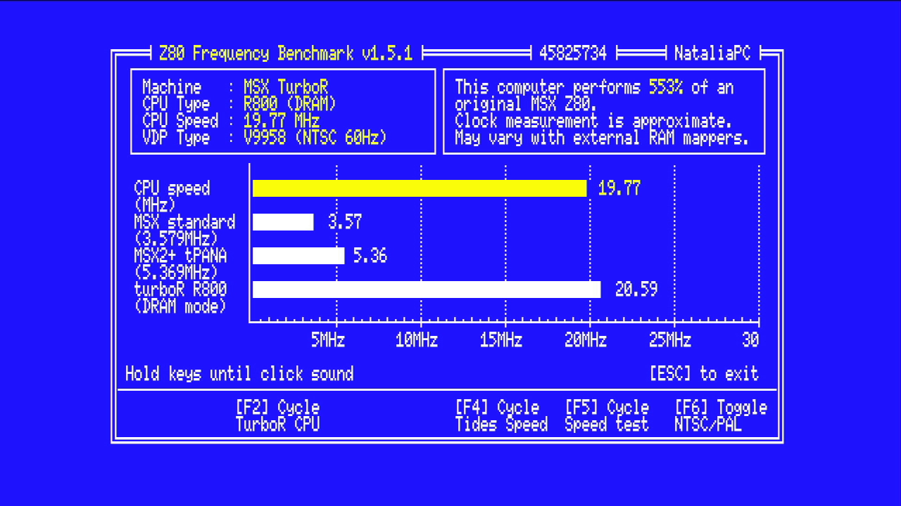

# 15. El perfil TR (Turbo R): la base limpia (fase 1) y el R800 con la BIOS del turbo R (fase 2)

*(Los perfiles **Turbo R** y **Turbo R V9990** se publican desde la Z1.4.0 y la Z1.4.1 y se bajan desde la placa: F12 → P → S. El capítulo conserva el orden en que se hicieron: los apartados 1 a 9 son la **fase 1**, la base sin R800; la **fase 2** (R800, S1990 completo, mapa de slots del FS-A1ST y la BIOS del turbo R) empieza en el apartado 10. Las carpetas `files/tr_fase…` y `bios/` que cita son del repositorio de desarrollo y no están en esta copia.)*



El perfil **TR** (`build.tcl … bit tr`, capítulo [07](07-construccion.md)) es la **base** sobre la que se montará un MSX turbo R de verdad (R800, S1990 completo, PCM, la BIOS de turbo R que aporte el usuario). La **fase 1** es solo la base: **arranca exactamente como el MSX2+ del estándar** (mismo pack de BIOS, mismo menú, SD, teclado y ratón USB, audio PSG/SCC/OPLL, V9968 por HDMI, F12 y companion) pero **sin** cuatro bloques grandes que el turbo R no lleva: geo3d, el V9990, el OPL4 y el Y8950. **Todavía no hay R800**: la CPU sigue siendo el Z80 (`G80a`) a 3,58 o 5,37 MHz.

## 1. Qué se quita y cuánto libera

| | Estándar (b10) | TR fase 1 |
|---|---|---|
| geo3d (9Dh/9Fh, espejo 8Dh/8Fh) | sí | **fuera** (`ENABLE_GEO3D` sin definir, como en Música y Dual) |
| V9990 (60h-6Fh): el chip `tiny9990`, su cliente de VRAM en la DDR, su puente a 720p (`msx2hdmi_v9990`), el inyector del ARM (`v9990_arm_port`) y los dos árbitros del GP1 | sí | **fuera** |
| OPL4: FM (C4h-C7h), PCM (7Eh/7Fh) y memoria de ondas (`wave_axi`, S_AXI_GP0) | sí | **fuera** (`ENABLE_OPL4FM` y `ENABLE_OPL4_WAVE` sin definir, como en Dual) |
| Y8950 / MSX-Audio: FM `jtopl2` (C0h/C1h), ADPCM-B (`y8950_adpcm`, `jt10_adpcmb`), su IRQ | sí | **fuera** (`ENABLE_Y8950*` sin definir) |
| PSG, PSG2 (12h), SCC, SCC+, OPLL (IKAOPLL), mezclador, WaveGame, cinta, RTC, Kanji, SD, USB, ratón, WiFi/UNAPI, F12 | sí | igual |
| V9968 por frame buffer en la DDR: pantalla completa, 4:3 con Scale3x (F12 → V), 60,000 Hz libres, overlay del F12 | sí | igual |

Cifras de la build (Vivado 2019.2, XC7Z020-2): ver el apartado 7.

## 2. El vídeo sin V9990

Hoy toda la salida HDMI pasa por `msx2hdmi_v9968`, que lleva el único codificador, y por el compositor `v9991_compose`, que elige por píxel entre el V9968 y el V9990 (modos 0 a 3 y el gestor de ventanas). El frame buffer del V9968 (la «ventana» de pantalla completa que da el 4:3 con Scale3x y el reloj libre a 60 Hz) es el módulo `v9990_fb`, que `msx2hdmi_v9968` instancia siempre. Por eso la solución es **dejar toda la tubería de vídeo del V9991 y quitarle solo el V9990**:

- `top_zynq.v` bajo `ENABLE_TR`: no hay `u_v9990` ni `u_v9arm` ni `u_msx2hdmi99`; sus salidas son constantes (un V9990 «de mentira», siempre transparente y fuera de imagen: `c_rgb99 = 0`, `c_ys99 = 1`, `c_in99 = 0`, `v99_win = 0`).
- `comp_mode = 0` fijo: el compositor se queda en el modo 0 (V9968 a pantalla completa). Con la entrada del V9990 constante, la síntesis lo deja en un cable: `rgb = rgb68`, `win_en = 1`, esquina (0, 0), escala x1, origen 0/0, que es lo que ya hacía el estándar en el modo 0 (29/10/2026). Las teclas Pausa y el campo de vídeo del buzón (`+0x2C`) no cambian nada.
- **GP1**: el único maestro es el frame buffer del V9968 (`fb68_*`), y va **directo** a `S_AXI_GP1`, sin árbitros (`axi_arb2` fuera de la lista de fuentes). El reloj del puerto sigue siendo `clk_86`.
- **GP0**: sin OPL4 ni `bwin_fb`, sin maestro (todo a cero, `bready` y `rready` a 1).
- **F12 / OSD**: el panel del companion sale por `iosys`/`textdisp_z` y se pinta como overlay dentro de `msx2hdmi_v9968` (`ovl_*`), **independiente del V9990**: sigue viéndose igual. Lo que depende del V9990 es solo el *escritorio vivo* (teclas V y B del menú, `v99desk.c`) y la ventana con el gestor de ventanas; en TR no existen (ver el apartado 4).
- Lo que se **pierde**: la tecla Pausa como selector V9968/V9990, «Video9000», la ventana con el gestor y el escritorio (V, B, D del menú), y la telemetría del V9990 (`+0x60`/`+0x64` a cero). El panel F12 y la OLED dicen «V9968».

## 3. Puertos

- **60h-6Fh** (V9990): sin dueño. Las lecturas devuelven **FFh salvo P#5 (65h), que devuelve FEh**. No es un capricho: el menú de A (`bios/src/v9991.asm`, teclas V y B de «Lanzar ROM») pinta el escritorio del V9990 con rellenos LMMV y, tras cada uno, **espera CE = 0** en el bit 0 de 65h con un bucle sin tope (`v9k_fill`). Con el bus flotante (FFh) ese bucle no acabaría nunca y el MSX se colgaría al pulsar V o B. Con FEh sale al primer intento y la ROM se lanza como con Intro. Una escritura a esos puertos no hace nada.
- **#45, bit 6 = 1**: «este core es el perfil TR» (el estándar y la Música devuelven 0; el Dual, el bit 7). Es el patrón de `dual_here` del menú: una versión futura del menú puede ocultar V/B (y avisar) con `in a,(#45)` / `bit 6`.
- **PSG en A0h-A3h** solo en TR (`psg_io_hit = bus_addr[7:2] == 101000b`; el estándar decodifica A0h-A7h, de modo que A4h-A7h son espejos suyos). Es la preparación del **PCM del turbo R en A4h/A5h** (y su estado) de la fase 4: ahí el PSG ya no contesta. En el estándar el PSG no cambia (el nombre `psg_io_hit` es un alias de la misma expresión de antes).
- **E4h-E7h** (S1990): sigue solo el temporizador E6h/E7h (`ENABLE_S1990_TIMER`); la identificación de turbo R y `CHGCPU` esperan a la fase 2.
- C0h/C1h (Y8950) y C4h-C7h/7Eh/7Fh (OPL4): sin respuesta (FFh). El menú de Ajustes sigue ofreciendo los canales del mezclador de MSX-Audio y OPL4 (sin sonido).
- Los contadores de latencia de memoria de la fase 0 (`memory_axi`, `MBOX+0xD8..0xFF`, puesta a cero con el bit 5 de `MBOX+0x1C`) siguen y no se tocan.

## 4. El companion sabe que es TR

El PL lo declara en la telemetría **`MBOX+0xC4`, bit 2** (`dbg_mailbox_axi.v` bajo `PERFIL_TR`; en los demás perfiles es el 0 de siempre; el banco `tb/run_mbox_tr.sh` lo comprueba con y sin la definición). Vale también con el perfil cargado por **JTAG**, donde `mxpf_id_activo()` no lo sabe (devuelve «», el perfil 1).

- `v99desk_inicio` (`v99desk.c`): si el bit está a 1, **no pinta el escritorio** (no hay V9990 al otro lado del anillo) y deja una línea en el log; la tecla V/B del menú se queda en un Intro.
- Página de información del F12 (`osd.c`, `osd_info.c`): la fila 19 dice **Perfil Turbo R** en lugar de «OPL4 YRW801 …» (no hay ROM de ondas que comprobar).
- Página Perfiles (`perfiles.c`): el id `TR` se enseña como «Turbo R» (para cuando el perfil se instale desde una tarjeta).
- El companion es **el mismo binario para todos los perfiles**: solo mira ese bit.

## 5. Construcción

`vivado -mode batch -source build.tcl -tclargs bit tr` (desde `fpga/zynq`). Fija `PERFIL_TR=1`, salidas con sufijo `_tr` (`msximus_zynq_tr.bit`, `util_tr.rpt`…) y proyecto aparte (`vivado_prj_tr`). Quita de la lista de fuentes: todo `fpga/v9990` (el chip, su cliente de VRAM, el inyector y `axi_arb2`), `msx2hdmi_v9990`, `fpga/opl3`, `opl4fm`, `ymf278b`, `opl4_pcm`, `jtopl`, `jt10`, `y8950_adpcm`, `adpcm_sdram`, `wave_axi` y geo3d. Se queda `video720/v9990_fb.v`, porque `msx2hdmi_v9968` lo instancia para su frame buffer. Los demás perfiles construyen con la lista de siempre (el estándar, Música y Dual no cambian: `PERFIL_TR` es una rama más de los mismos `ifdef`). Comprobado con una síntesis del estándar tras los cambios: `util_synth.rpt` y `util_synth_hier.rpt` **idénticos** (46.156 LUT, 37.060 registros, 131 tiles de BRAM) a los de la síntesis anterior a ellos.

## 6. Bancos

| Script | Qué comprueba |
|---|---|
| `tb/run_v9991_tr.sh` → `tb_v9991_tr.sv` (Icarus) | El compositor conectado como en TR (modo 0, `winreg` a 0, V9990 de mentira): cuatro cuadros con el raster libre, `rgb == rgb68` en todos los puntos, `mode_active` y `desk_free` a 0 y la ventana del puente del V9968 la de pantalla completa, con el ratón del gestor moviéndose y el botón pulsado |
| `tb/run_mbox_tr.sh` → `tb_mbox_tr.v` (Icarus) | Bit 2 de `+0xC4` = 1 con `-DPERFIL_TR` y 0 sin ella; el resto de bits de esa palabra (own, busy, tmo) y el mezclador de `+0xC0` no cambian |
| `arm/companion/tests/run_host_yrw801.sh` (gcc, WSL) | Ampliado con la fila 19 de la página de información en TR (en los dos idiomas). Sus cinco fallos de «la fila 20 deberia quedar en blanco» **ya estaban** (la beta puso ahí «V9968 completo») |

## 7. Recursos y tiempos

Vivado 2019.2, XC7Z020-2, `build.tcl … bit tr` (12 minutos de síntesis, implementación y bitstream), frente al estándar de la beta b10 (`util_impl.rpt` y `timing.rpt` de su build) y al estándar de esta rama con los contadores de latencia de la fase 0 («estándar tr0»):

| | Estándar b10 | Estándar tr0 | **TR fase 1** |
|---|---|---|---|
| LUT | 44.785 (84,18 %) | 45.111 (84,80 %) | **22.180 (41,69 %)** |
| Registros | 36.661 (34,46 %) | 37.059 (34,83 %) | **20.593 (19,35 %)** |
| Slices | 13.257 (99,68 %) | 13.276 (99,82 %) | **8.437 (63,44 %)** |
| BRAM (tiles) | 131 (93,57 %) | 131 (93,57 %) | **59 (42,14 %)** (52 RAMB36 + 14 RAMB18) |
| DSP48 | 31 | 29 | **9** |
| WNS / WHS (ns) | +0,523 / +0,036 | +0,409 / +0,036 | **+1,140 / +0,036** |
| Peor reloj (WNS) | | | `mA_54` +1,520 · `pD_86` +2,053 · `mC_74` +4,911 |

«All user specified timing constraints are met». Libera **22.605 LUT, 16.068 registros, 72 tiles de BRAM y 22 DSP** respecto a la b10; quedan libres **81 tiles de BRAM, 211 DSP y 31.020 LUT** para las fases siguientes. Lo que se llevó cada bloque (síntesis, jerarquía, LUT / registros / RAMB36 / RAMB18 / DSP):

| Bloque quitado | LUT | Registros | RAMB36 | RAMB18 | DSP |
|---|---|---|---|---|---|
| V9990 (`v9990_zynq`) | 8.336 | 5.784 | 32 | 1 | 0 |
| Puente del V9990 (`msx2hdmi_v9990`) | 1.429 | 610 | 16 | 0 | 2 |
| Inyector del ARM y los dos árbitros del GP1 | 154 | 120 | 0 | 0 | 0 |
| Compositor `v9991_compose` (con el modo fijo y el V9990 de mentira la síntesis lo reduce a un cable) | 1.281 | 808 | 0 | 0 | 0 |
| geo3d | 3.855 | 3.211 | 9 | 2 | 10 |
| OPL4 PCM (`opl4_pcm`) | 3.999 | 3.179 | 0 | 3 | 3 |
| OPL4 FM (`opl4fm`) | 1.164 | 911 | 0 | 5 | 1 |
| `wave_axi` | 41 | 127 | 0 | 0 | 0 |
| Y8950 FM (`jtopl2`) | 1.105 | 846 | 0 | 2 | 1 |
| Y8950 ADPCM (`y8950_adpcm` + `adpcm_sdram`) | 692 | 636 | 8 | 0 | 2 |

(El resto de la diferencia son el buzón, que pierde la FIFO del inyector, `msx2hdmi_v9968` y la lógica pegada que se queda sin consumidor.) Informes y bitstream: `files/tr_fase1/` (git-ignorado, con `MD5.txt`).

## 8. Prueba en placa (JTAG)

Con `hw_server` en marcha, desde PowerShell, en `fpga/zynq`:

```
cd <repo>\fpga\zynq; $env:BOOT_PROXY="1"; $env:BOOT_ELF="<repo>\files\tr_fase1\companion.elf"; $env:WAVE_ROM="none"; & D:\Xilinx\Vivado\2019.2\bin\xsdb.bat tools\boot.tcl "<pack_bios.bin>" "<repo>\files\tr_fase1\msximus_zynq_tr.bit"
```

(`hw_server.bat` aparte, como siempre; `WAVE_ROM="none"` porque no hay OPL4 y se ahorra cargar la YRW801.). Lo que debe verse: el arranque y el menú **igual que en el estándar**; teclado, ratón, SD y F12 como siempre; en F12 la fila de «MSX» dice **Perfil Turbo R** y «vídeo V9968»; V, B o Intro sobre una ROM la lanzan sin colgarse (V y B no pintan escritorio); **MSX-Audio y MoonSound no suenan ni se detectan**; geo3d tampoco.

## 9. Límites y siguientes pasos

- Sin R800, sin la BIOS de turbo R, sin PCM (A4h/A5h libres) y sin `CHGCPU`: fases 2 y 4.
- El menú todavía ofrece V, B (y el pie de página los anuncia). Hasta que haya una versión del menú que lea el bit 6 de `#45`, esas teclas se comportan como Intro.
- El perfil no se ha empaquetado como `.mxp` (instalación desde la tarjeta) ni tiene serie de OTA.
- Memoria libre del PL para las fases siguientes: ver el apartado 7.

---

# Fase 2: el R800, la S1990 y la BIOS del turbo R

La fase 2 pone en el perfil TR lo que le faltaba para ser un MSX turbo R: el **R800** (núcleo de rampa069/R800), la **S1990** completa (cambio de CPU, modo DRAM, F4h, A7h), el **mapa de slots del Panasonic FS-A1ST** y la **BIOS del turbo R que aporta el usuario** (no se redistribuye: copyright). Sin esa BIOS el perfil arranca como en la fase 1 (el MSX2+ del pack) pero con el R800 disponible por la S1990.

## 10. Las dos CPUs: `fpga/r800/` y `tr_cpu.v`

- **El núcleo** (`r800_cpu.v`, `r800_alu.v`, `r800_reg.v`, LGPL 2.1, de **rampa069/R800**, derivado del NextZ80 de Nicolae Dumitrache; cabeceras y `LICENSE-LGPL-2.1.txt` incluidos) hace un acceso de bus por reloj, el modelo de tiempos del R800, con MULUB/MULUW, SLL = SLA y las demás diferencias del R800 respecto al Z80.
- **`r800_bus.v` y `r800_timing.v`** son la traducción a Verilog (el original es VHDL) de `r800_bus.vhd` y `r800_timing.vhd` de la misma fuente: el primero convierte cada acceso en un ciclo T1/T2/T3 de bus tipo T80 con `WAIT_n`; el segundo cuenta el tiempo que gastaría un R800 de verdad (reglas de openMSX: página de DRAM de 256 B, ROM +1, slot externo +2, E/S de 6 ciclos en ciclo par, VDP a 62 ciclos, refresco 18 cada 223, MULUB 14 y MULUW 36 ciclos) y **frena** a la CPU con `stall` cuando va adelantada. Sin cambios de lógica; todo avanza solo con el habilitador.
- **Reloj**: **21,477 MHz = clk_54m × 35/88** como **habilitador de reloj** (`ce21`, un acumulador en `top_zynq.v`), no un reloj nuevo: el núcleo, el bus y el regulador viven en `clk_54m` y solo avanzan en los ciclos con `ce21 = 1` (separados 2 o 3 ciclos de 54 MHz). Frente a un `BUFGCE` evita un árbol de reloj más y deja el mismo dominio que el resto del bus; el coste es que sus caminos internos tienen **2 ciclos de 54 MHz**, que se declaran en `top_zynq.xdc` (`set_multicycle_path 2 -setup / 1 -hold` de `u_trcpu/u_b/*` y `u_trcpu/u_t/*` a sí mismos; la lógica de parada y cambio, que corre cada ciclo, sigue a un ciclo). Memoria de fase 0: aciertos 74 ns, fallos 414 ns al 0,32 %.
- **`tr_cpu.v`** pone el Z80 (`G80a`, instanciado por el top) y el R800 sobre el mismo bus.

### Cómo cambia de CPU un turbo R (y por qué no se copian registros)

Medido en openMSX con la BIOS del FS-A1ST (watchpoints sobre E4h/E5h/F4h): **las dos CPUs son independientes, cada una con sus registros y su PC**. El cambio solo **para una en un límite de instrucción y suelta la otra**, que sigue donde la dejó; la primera vez que se suelta el R800 arranca en **0000h** (como tras un reset: lee F4h, ve el bit de «ya arrancado» y sigue por el camino caliente). Por eso `CHGCPU` (0180h) apila todos los registros, guarda SP en FFFDh, escribe E5h y, en la otra CPU, restaura todo con pops: es la única forma de «conservarlos». En el arranque: el Z80 escribe E5h = 40h (R800) a mitad de un `OTIR` de 2 bytes; el R800 arranca en 0000; más tarde pide el Z80, que reanuda su `OTIR` y escribe el segundo byte (E5h = 60h).

`tr_cpu` lo hace así: manda `cur_r`; si la S1990 pide la otra (`want_r800 != cur_r`) pasa a **FWAIT**: la CPU que manda sigue hasta el siguiente **límite de instrucción** (el T1 de un M1 que no sigue a un prefijo CB/DD/ED/FD; DD/FD CB d op cuenta como una instrucción; un `HALT` del R800 también vale) y se queda parada con las señales fijas; entonces manda la otra, que estaba parada en su T1. La que no manda está parada y sin interrupciones. Tras el reset manda el Z80 y el R800 se para en su primer M1 (dirección 0000h).

- **R800**: se para con `CEN = 0` en el T1 (`r800_bus` se congela entero); el reloj es un habilitador, así que es exacto.
- **Z80 (G80a)**: el T80 avanza con parejas *clk_enable* (empieza el T-estado) / *clk_falling* (mitad). Se para **entre las dos** del T1 del M1 (`z_run` a 0 en `clk_enable` y `clk_falling`, que `top_zynq.v` calcula como `z_en_pre`/`z_fall_pre` y `z_run_w`) y, al reanudarlo, `tr_cpu` descarta el siguiente `clk_enable` y lo suelta: el siguiente pulso que ve es el *falling* que le faltaba. (Un primer intento reanudaba sin eso y el Z80 perdía el MREQ del M1 y se iba a 0038h: lo cazó el banco con el G80a real.)
- El **R800 no saca su «petición de refresco»** (`RFSH_n` del `r800_bus`, que solo mira `r800_timing`) al sistema: la DDR se refresca sola y esa señal baja en mitad de los accesos.

### Esperas del R800

Un acceso del R800 dura como mínimo 2 habilitadores (~93 ns) con los strobes puestos, y la memoria y la E/S del sistema van registradas a 54 MHz. `top_zynq.v` genera el `WAIT_n` del R800 con: las esperas de siempre (`bus_wait_n`, UART/red del ESP, V9968), **memoria** (`tr_wait_ram`: desde que el decodificador ya ve la petición hasta que `memory_axi` ha subido y bajado `ram_busy`, para lecturas y escrituras; un acierto cuesta ~7 ciclos de 54 MHz, un fallo, el de siempre más la DDR) y **E/S** (`tr_wait_io`: 8 ciclos de 54 MHz mínimo desde que baja IORQ, para cubrir los dispositivos que registran el bus a 27 MHz y el `WAIT` del V9968, que llega unos 65 ns tarde). Además `r800_timing` retiene las E/S a su instante exacto (`io_hold`). Esto es lo que la memoria (fase 3) puede mejorar.

## 11. La S1990 (`msx_s1990.v`, `ID = 2`)

Descrita en el [capítulo 02](02-puertos-es.md): E4h/E5h con **R#6** (bit 5 = CPU, **0 = R800**, y la lectura dice la CPU que manda de verdad; bit 6 = modo ROM/DRAM), el temporizador E6h/E7h, **F4h** (cerrojo que sobrevive al reset), **A7h** (pausa/LED) y la firma 03h/2Fh/8Bh. Los pedidos cruzan de 27 a 54 MHz con dos biestables (son niveles casi estáticos). El turbo de 5,37 MHz del Z80 (F11, `OUT #41`) sigue valiendo solo para el Z80; con el R800 mandando no hace nada.

## 12. El mapa de slots del FS-A1ST (`tr_rommap.v`) y el modo DRAM

Con la BIOS del turbo R en la DDR (`tr_map = 1`, que el top fija en cada reset a partir de `MBOX+0x1C` bit 6) el mapa pasa a ser el de la máquina de openMSX `Panasonic_FS-A1ST`:

| Slot | Páginas | Contenido | Origen |
|---|---|---|---|
| 0-0 | 0-1 (0000-7FFF) | BIOS + BASIC 4.0 | firmware 050000 (bloques de 8 KB 40-43); en modo DRAM, la RAM 030000 |
| 0-1 | | vacío | |
| 0-2 | 1 | MSX-MUSIC (`APRLOPLL`), sobre **nuestro OPLL** (7Ch/7Dh) | firmware 07C000 (62-63) |
| 0-3 | 1 | Lo que hay en el firmware en 048000 (36-37), un segmento de las aplicaciones (`WSXSEG29P1`, sin cabecera `AB`), no una ROM de apertura. En el `.mxp` va a FF | firmware 048000 (36-37) |
| 1, 2 | | cartuchos, como siempre (megaram, SCC...) | |
| 3-0 | 0-3 | **RAM de 2 MB** (128 segmentos de 16 KB, 7 bits de cada registro del mapper, FCh-FFh; apartado 28. El FS-A1ST real lleva 256 KB) | mapper, 0 a 1FFFFF |
| 3-1 | 0 | SUB-ROM MSX2+ | firmware 070000 (56-57); en modo DRAM, la RAM 038000 |
| 3-1 | 1-2 | driver kanji + BASIC 1 | firmware 074000-07BFFF (58-61); la página 1 en modo DRAM, la RAM 03C000 |
| 3-2 | 1-2 | **disco = nuestro Nextor 2.1.4** (kernel del pack + ventana de la SD), sin FDC falsa | pack |
| 3-3 | 0-3 (0000-FFFF) | **ROM del firmware con el mapper Panasonic de 8 KB** (aplicaciones del FS-A1ST) y **SRAM de 16 KB**; la megaram del 3-3 se oculta con `tr_map` | los 2 MB bajos del firmware (`tr_panasonic.v`, apartado 19) |

El kanji está en **D8h-DBh** (el de siempre; su fuente son los 256 KB del pack, que el companion pisa con `fs-a1st_kanjifont.rom`, mismo formato JIS1+JIS2). El VDP sale en 98h-9Bh sin espejos. Sin `tr_map`, el mapa es el estándar (menú, FM-BIOS en el 3-1, ROM UNAPI del ESP32 en el 0-2, logo en el 0-3, mapper de 2 MB y megaram en el 3-3).

**DDR**: el firmware (4 MB tal cual) vive en `ram_addr C00000-FFFFFF` = **0x0E400000-0x0E7FFFFF** (la mitad alta de la zona EXT de `memory_axi`, que nadie usaba; se lee por la misma caché). Los bloques que no son de 8 KB del mapa de arriba se leen por `tr_rommap`, que reutiliza el camino de la BIOS (`trm_req`).

**Modo DRAM** (R#6 bit 6 = 0; el reset deja el modo ROM): los **últimos 64 KB de la RAM** (1F0000-1FFFFF desde el apartado 28) son la copia de la BIOS que hace la propia BIOS, y las lecturas de la BIOS (0-0), la SUB-ROM y la primera mitad del driver kanji salen de ahí en lugar de la ROM; esa zona de la RAM es de **solo lectura** mientras dure (las escrituras por el mapper se ignoran). El orden de los bloques de la copia (MAIN 030000, SUB 038000, kanji 03C000) es el de PanasonicMemory de openMSX. El regulador de tiempo del R800 cuenta la BIOS en DRAM como RAM (0 esperas extra) y la ROM como +1.

## 13. La BIOS: en el `.mxp` o por JTAG

La BIOS llega en el `.mxp` del perfil (apartado 24) o por JTAG. La búsqueda en la TF2 se ha retirado.

Por **JTAG** (`tools/boot.tcl`): `TR_ROM=<ruta a fs-a1st_firmware.rom>` (y `TR_KANJI=<ruta a fs-a1st_kanjifont.rom>`) las cargan en la DDR y ponen el bit 6 en la misma escritura que `MSX_RUN` (`0x41`); el companion, al ver el bit 6 ya a 1, no busca nada y lo conserva.

## 14. Bancos y resultados

Todos con el firmware de openMSX **solo en local** (no se commitea ni se copia al repo).

| Banco | Qué comprueba | Resultado |
|---|---|---|
| `fpga/r800/sim/run_r800.sh` (Verilator + pasmo, WSL) | multest, pfxtest, blktest, iotest (con esperas aleatorias), inttest, halttest, io2test: el R800 de rampa069 con `r800_bus` + `r800_timing` + `ce21`, salidas idénticas a las del README del original | todos igual (inttest 912 interrupciones atendidas de 913 pedidas, halttest 2048 de 2048) |
| ídem, `timtest` | ciclos de R800 por instrucción (256 iguales entre dos marcas, incluye el refresco): MULUB, MULUW, NOP, LD A,(HL), INC HL, PUSH+POP | MULUB 14,8 (14 + refresco), MULUW 37,4 (36), NOP 1,07, LD A,(HL) 4,25 (fetch + dato con salto de página), INC HL 1,07, PUSH+POP 11,8 |
| ídem, `trtest` (con un núcleo R800 haciendo de Z80) | cada CPU **conserva sus registros** (AF BC DE HL IX IY, alternos, I, SP) tras Z80 → R800 → Z80 → R800; el R800 arranca en 0000; MULUB = 03A8 | `z OK`, `r OK`, 03A8 |
| `run_tr_xsim.sh` (xsim, **G80a real**) | lo mismo con el T80 de verdad parado y reanudado | `z OK`, `r OK`, 03A8 |
| `run_tr_stress.sh` (xsim, G80a real) | la misma tarea larga (400 iteraciones con prefijos CB, DD, FD, ED, E/S y registros alternos) por cada CPU, con cambios de CPU **al azar** cada 150-4000 ciclos | sin cambios: Z80 = E40A, R800 = E40A; con **1823 cambios**: ambos E40A |
| `run_msx.sh` + `dramtest` | mapa de slots y **modo DRAM** con un firmware sintético (`mk_fw.py`): en modo ROM se lee la ROM; en DRAM, la copia; la zona es de solo lectura; el reset vuelve a ROM | `DRAM OK` |
| ídem, `slottest` | 0-2 MSX-MUSIC, 0-3 apertura, 3-1 SUB-ROM y driver kanji, 3-2 vacío | `SLOTS OK` |
| `run_msx.sh <firmware> <kanji>` (la BIOS real del FS-A1ST, Verilator, 2,2 M ciclos de 54 MHz por segundo) | arranque de la BIOS sobre `tr_cpu` + R800 + S1990 + `tr_rommap` + mapper de 256 KB + un VDP/PPI/RTC/kanji mínimos en C++ | arranca igual que openMSX durante **más de 85 000 escrituras de E/S** (mismos puertos y mismos datos: F4h/A4h/A5h/A7h, E4h/E5h con los cambios de CPU 40h/60h/60h, mapper, PPI, VDP, RTC...) y **hace los mismos cambios de CPU en los mismos sitios**; sigue después con la ROM de apertura y el VDP; **no llega al `Ok`**: el VDP de juguete no tiene el motor de comandos ni sprites, la animación de apertura y la inicialización de pantalla toman otro camino |

## 15. Recursos y tiempos

Vivado 2019.2, XC7Z020-2, `build.tcl … bit tr` (la build entera, unos 12 minutos), frente a la fase 1:

| | TR fase 1 | **TR fase 2** |
|---|---|---|
| LUT | 22.180 (41,69 %) | **23.964 (45,05 %)** (+1.784: R800 con bus y regulador, `tr_cpu`, `tr_rommap`, esperas y S1990) |
| Registros | 20.593 | **21.130** |
| Slices | 8.437 (63,44 %) | **8.772 (65,95 %)** |
| BRAM (tiles) | 59 | **59,5** (el banco de registros del R800) |
| DSP48 | 9 | **10** (MULUB/MULUW) |
| WNS / WHS (ns) | +1,140 / +0,036 | **+0,153 / +0,059** |
| Peor reloj (WNS) | `mA_54` +1,520 | `mA_54` +0,153 · `pD_86` +0,889 · `mC_74` +5,959 · `mA_27` +22,915 |

«All user specified timing constraints are met». **El multiciclo es imprescindible**: sin él, los caminos internos del R800 (núcleo → regulador de tiempo → habilitadores) dan WNS −3,767 ns en 452 puntos; con el multiciclo en un `top_zynq.xdc` condicional no se aplicaba (el `if` sobre celdas vacías en la lectura), por eso va en un fichero propio, `top_zynq_tr.xdc`, que `build.tcl` añade solo en el perfil TR. Una segunda lección: el seguidor de prefijos de `tr_cpu` es **uno por CPU**; con uno solo, un camino R800 → `z_run` → CE del G80a (que corre en el flanco de bajada) daba −0,8 ns. Los avisos «not a valid startpoint» del multiciclo son de constantes y LUT de la jerarquía y no afectan. Informes y bitstream: `files/tr_fase2/` (git-ignorado, con `MD5.txt`).

**Regresión del estándar**: la síntesis del perfil estándar (`build.tcl synth`) con estos cambios da 46.262 LUT, 37.032 registros, 131 tiles de BRAM y 31 DSP, frente a 46.156 / 37.060 / 131 / 29 del commit de la fase 1 (resintetizado hoy para comparar): **no es idéntica** (+0,2 % de LUT, +2 DSP), aunque todo lo nuevo (`tr_map`, `trm_req`, `z_run_w`...) es constante en ese perfil; es el reordenado de la lógica que provocan las expresiones nuevas del top (`z_en_pre`, `mreg*m`). Sin implementar ni probar en placa; Música y Dual no se han resintetizado.

## 16. Prueba en placa (JTAG)

Con `hw_server` en marcha, desde PowerShell. **Con la BIOS** (las ROM de openMSX, solo locales; el companion de esta build y `WAVE_ROM=none` porque no hay OPL4):

```
cd <repo>\fpga\zynq; $env:BOOT_PROXY="1"; $env:BOOT_ELF="<repo>\files\tr_fase2\companion.elf"; $env:WAVE_ROM="none"; $env:TR_ROM="<openMSX>\share\machines\fs-a1st_firmware.rom"; $env:TR_KANJI="<openMSX>\share\machines\fs-a1st_kanjifont.rom"; & D:\Xilinx\Vivado\2019.2\bin\xsdb.bat tools\boot.tcl "<pack_bios.bin>" "<repo>\files\tr_fase2\msximus_zynq_tr.bit"
```

**Sin BIOS** (el MSX2+ normal con el R800 disponible; sin `TR_ROM` ni `TR_KANJI`): la misma línea sin esas dos variables (`Remove-Item Env:TR_ROM,Env:TR_KANJI`).

Qué debe verse con la BIOS: el arranque del turbo R (ROM de apertura con el logotipo y su animación), luego **MSX BASIC version 4.0 … Ok** (más el banner de Nextor/«Disk BASIC» de la SD, que es nuestro Nextor 2.1.4 en el 3-2); en F12, «Perfil Turbo R · BIOS OK». Con el teclado USB, `PRINT PEEK(&H2D)` da **3** (turbo R). Prueba de CPU y velocidad desde BASIC (CHGCPU está en 0180h; A = 0 Z80, 1 R800 ROM, 2 R800 DRAM):

```
10 FOR I=0 TO 2:A=&HC000+I*8
20 POKE A,&H3E:POKE A+1,I:POKE A+2,&HCD:POKE A+3,&H80:POKE A+4,1:POKE A+5,&HC9:NEXT
30 DEFUSR0=&HC000:DEFUSR1=&HC008:DEFUSR2=&HC010
40 X=USR0(0):T=TIME:FOR I=1 TO 5000:NEXT:PRINT "Z80      ";TIME-T
50 X=USR1(0):T=TIME:FOR I=1 TO 5000:NEXT:PRINT "R800 ROM ";TIME-T
60 X=USR0(0)
```
(Se espera que el R800 en ROM tarde varias veces menos que el Z80; el 5,37 MHz del F11 solo afecta al Z80.) El **modo DRAM** (`USR2`) pruébese al final: depende de que la BIOS haya copiado antes su ROM a los últimos 64 KB de la RAM; si no lo hizo se cuelga y un reset lo recupera. Con el R800 mandando, F11 no hace nada; el reset devuelve el mando al Z80. R800BEN no está en local.

Sin BIOS, desde BASIC se puede ver que el R800 corre el MSX2+ (`OUT &HE4,6:OUT &HE5,&H40` cambia de CPU y el R800 arranca en 0000h: reinicia el MSX; solo es útil para comprobar que la S1990 responde: `OUT &HE4,13:PRINT INP(&HE5)` = 3, `OUT &HE4,14` = 47, `OUT &HE4,15` = 139).

## 17. Estado, límites y riesgos

- **Hecho**: R800, cambio de CPU, S1990 (R#6, F4h, A7h), mapa de slots del FS-A1ST (menos el 3-3), modo DRAM, mapper de 256 KB con relectura, carga de la BIOS desde la TF2 y por JTAG, bancos.
- **No hecho**: la FDC (el mapper Panasonic del 3-3 está desde el apartado 19, sin probar en placa); el **PCM del turbo R (A4h/A5h)**, que sigue sin contestar; el **botón de pausa y el LED**; el arranque de la BIOS hasta el `Ok` **en simulación** (sí por JTAG); la ROM UNAPI del ESP32 y el menú no existen con `tr_map`; el kanji de 3-1 página 2 en DRAM (solo ROM, como en la máquina).
- **Riesgos**: (1) el tiempo con el R800 en vivo: los caminos internos van a 2 ciclos de 54 MHz (multiciclo); (2) un acierto de memoria cuesta ~1 habilitador de más que en un R800 real (la memoria, fase 3); (3) el cambio de CPU del Z80 depende del reparto enable/falling del G80a y del `M1 wait`: probado con el T80 real en xsim, pero no con todo el sistema a la vez; (4) la BIOS del turbo R en modo DRAM sin probar en placa.

## 18. Depuración en placa de la fase 2 (02/11/2026): por qué no llegaba al BASIC

Síntoma: con la BIOS del FS-A1ST sale el logo y el arranque se queda colgado (o se va por las ramas). Se añadió un **trazador de bus en el PL** (`tr_cpu.v`, solo perfil TR) y se encontraron **dos causas**, ambas por el R800 en el bus de un sistema pensado para el Z80:

1. **Registros que toman `cpu_dout` con un request registrado.** Los registros de subslot (`exp_slot0`, `exp_slotx`, escritura en FFFFh) capturan `cpu_dout` en clk_27m mientras `exp_slot*_req_w` (registrado, con el retardo de `xffh/xffl`) sigue activo 1-2 ciclos *después* de acabar el strobe de WR. El T80 mantiene DO hasta el ciclo siguiente; el R800 lo cambia nada más acabar el acceso (`LD (FFFF),A` seguido de `LD A,B` en `WRSLT`), de modo que el registro tomaba el dato nuevo, la página 3 pasaba a un subslot vacío, las lecturas daban FFh, `RET` iba a FFFFh y todo acababa en un bucle de `RST 38h` (que llena la pila con 39 00: el patrón «3900» de la RAM). Arreglo: `tr_cpu` mantiene el dato de escritura tras el strobe (`do_h`, `bus_do = wr ? r_do : do_h`).
2. **El cambio de banco del Nextor (escritura a 6000h) solo se capturaba en la fase del reloj de 3,58 MHz** (`bus_clk_3m6_27`): con el R800, la mayoría de las escrituras se perdían, el kernel ejecutaba otro banco (relleno de NOP) y se iba a una zona vacía. En TR la captura es incondicional; lo mismo para la escritura/lectura del búfer de sector (`sram_cs_w`).

Resultado (JTAG, `files/tr_fase2b/`, con la captura de OBS): arranca el turbo R, Nextor (sin tarjeta en la prueba: «Not ready reading drive A», `Y`, `A:\>`), y `basic` da **MSX BASIC version 4.0 … 25044 Bytes free … Nextor BASIC version 2.10 … Ok**.

Pendiente (misma familia, sin tocar): otros bloques cuya captura va con `clk_enable_3m6_27` (PSG, SCC/SCC+, RTC, megaram, WaveGame/menú) pueden perder accesos del R800 (audio, RTC); no impiden el arranque. Telemetría de depuración que queda: `MBOX+0x60..0x6F` (PC de la última M1 de cada CPU, última E/S, banderas, cambios de CPU), anillo de saltos en `+0x78..0xB7` y trazador de bus de 1024 eventos en `+0x1000` (congelado con M1 en FFFFh, 0038h=FFh o 24 NOP seguidos, o por JTAG con el bit 1 de `+0x1C`; `+0x2C` bit 0 = 1 vuelca en su lugar el trazador del VDP). `boot.tcl` acepta `BOOT_CTL_OR` para armar bits extra al arrancar.

### 18.1 Segunda tanda (03/11/2026): paradas a mitad de acceso y texto repetido con la SD

Lo que vio el autor con la tr_fase2b: con la SD el arranque de Nextor sale con caracteres repetidos («EERRROoooTTTT…») y acaba en «Not ready reading drive A»; sin SD el BASIC arranca, pero hay desorden en pantalla al hacer scroll («Okk»). Con el trazador de bus se vio que **la CPU emite dos veces el `OUT (98h)`** del mismo dato (`R98=4F R98=6B R98=6B`): no es el VDP ni su pegamento (`v9968_cpu_glue` se probó en Icarus con el WAIT del R800: 3000 accesos, 3000 transacciones) ni el nucleo (`run_intio.sh`: `OUT (98h)` y `OTIR` con INT periodica y esperas, todos los bytes una vez y en orden).

- **Causa encontrada y reproducida en simulación (SD):** `sd_dma` congela la CPU en cuanto ve `bus_idle`, justo despues del `OUT #47` que da la orden. Un Z80 tarda un T-state en empezar el siguiente M1; el R800 empieza el siguiente acceso 2 ciclos de clk despues. Si la parada (`CEN = 0`) le pilla con un acceso a medias, la DMA pasa a mandar en el puerto de RAM, pisa `ram_dout` (el dato que el R800 estaba a punto de tomar) y al reanudarse lee basura. `fpga/r800/sim/run_mem.sh` (R800 + `memory_axi` real + espera/dato del top, esclavo AXI en C++) lo reproduce: parada por DMA sin correccion = el programa se desboca; con la puerta, `0000` errores.
- **Arreglo:** `tr_cpu` recibe `frz_soft = dma_active | iosys_frz` y solo para al R800 **con los strobes de MREQ/IORQ sueltos** (`r_cen = ... & ~(frz_soft & r_idle)`); `frz` (la DMA ya manda en el puerto de RAM) deja de incluir el OSD. Para cuando `sd_dma` da `frz`, el R800 ya esta parado entre accesos.
- **No demostrado en placa** (la placa dejo de verse por JTAG durante esta tanda): el texto repetido SIN SD sigue sin explicacion cerrada; la hipotesis de «peticion por nivel» que repite el acceso en los perifericos quedo descartada para el VDP y para la RAM (banco de memoria con 3 latencias AXI: sin errores). Siguiente paso: cargar `tr_fase2c` y mirar con el trazador (se congela solo ante dos `OUT (98h)` seguidos iguales o una lectura de 002Dh del R800) si siguen apareciendo.
- `PEEK(&H2D)` = 0: en la DDR el firmware (0x0E45002D) y la copia DRAM (segmento 12 de la RAM, offset 2Dh) valen **03**; el 0 no viene de ahi. Pendiente de mirarlo en placa con el disparo «R800 lee 002Dh».

### 18.2 Tercera tanda (03/11/2026): SD en el arranque por JTAG, E/S del R800 y lecturas del VDP

- **«Not ready reading drive A» tras cargar por JTAG:** no era la DMA ni la SD, sino una carrera: `boot.tcl` soltaba la PL antes de que el companion detectase la tarjeta TF2. Ahora espera hasta 20 s a que el flag «tarjeta presente» de SDBOX (`BOOT_NOWAIT=1` lo salta). Con la tarjeta ya presente, Nextor lee la SD con el R800 (SDBOX: lecturas sin errores).
- **SP tras el reset:** el nucleo R800 ponia todos los registros a 0; un Z80/R800 real deja SP=FFFFh. El primer CALL escribia en FFFFh (registro de subslot). `r800_reg` recibe `RSTSP`.
- **Strobes de E/S:** `tr_cpu` enmascara IORQ/RD/WR del R800 hasta que `r800_timing` da `io_go`, y el WAIT lo tiene en cuenta (un solo pulso por acceso, a la hora exacta). `do_h` retiene el dato de escritura.
- **Lecturas del VDP:** con el trazador se vieron lecturas `IN (98h)` en rafaga que devolvian el dato anterior (retrasadas un byte) mientras las escrituras eran correctas; se probo alargar 8 ciclos de clk_54m el WAIT del VDP (`vdp_wait54_n`): **REGRESION**, el R800 se queda en un bucle `IN A,(99h) / AND 20h / JP Z` en 7A1Eh sin logo (borde azul, centro negro). Retirado en `tr_fase2e`; la build `tr_fase2d` (con ese cambio) no debe usarse.
- **No cerrado:** la verificacion en placa de que el texto ya no se corrompe con esta ultima build queda para el autor (no se pudo capturar la pantalla). Los perifericos con la fase del reloj de 3,58 MHz (PSG, SCC, RTC, megaram, WaveGame) siguen sin revisar para el R800.

### 18.3 Cuarta tanda (03/11/2026): IN (98h) con el dato anterior

- **Causa:** `tr_io_cyc` (la espera minima de E/S de 8 ciclos de clk_54m, `tr_wait_io`) usaba `ex_bus_iorq_n`, que `bus_iorq_disable` fuerza a 1 en los accesos al V9968. Con el VDP el R800 solo contaba con el WAIT del glue, que llega con 2FF + 2FF de retraso: tomaba el dato antes de que aterrizase (byte anterior en el 78 % de los cambios de valor; duplicados, letras perdidas y kana al hacer scroll o `dir`). Ahora usa `bus_iorq_n`. Medido con `tr_vdp_probe`: el strobe pasa de 4 a 12 ciclos de clk_54m y el dato aterriza antes de que el R800 lo tome.
- **Banco:** `fpga/r800/sim/run_vdp.sh` (R800 + glue + `vdp_cpu_interface` con dos relojes) no lo reproducia porque usaba el IORQ sin enmascarar; no detecta este fallo.
- **Pendiente:** la build SIN la sonda se cuelga en el arranque en el bucle `IN A,(99h) / AND 20h` de la BIOS (espera de HR); depende de la colocacion y no se entiende aun. El JTAG (DAP) de la Zynq se cae tras varios reprogramados seguidos de la PL.

### 18.4 El DAP de la Zynq se cae tras 2-3 cargas seguidas (03/11/2026)

- **Sintoma:** tras 2-3 `boot.tcl` seguidos sin quitar la corriente, `xsdb` solo ve `DAP (AHB AP transaction error, DAP status 0x30000021)` y `xc7z020`; `targets ARM*#0` no existe y el script abortaba (lineas 36/67). Ha pasado 5 veces, siempre en la 3.a carga desde el ultimo ciclo de alimentacion (y alguna vez a las 2). `hw_server` reiniciado y `rst -srst` no lo arreglan.
- **Lo que ya hacia boot.tcl** (hipotesis del coordinador, ya cubierta): parar los dos A9 antes de nada, parar el EHCI/GEM, SLCR desbloqueado, `FPGA_RST_CTRL = 0xF` (los masters AXI del PL en reset y drenando), level shifters a 0xA solo PS->PL durante `ps7_init`, y `ps7_post_config` (0xF + FCLK_RESET altos) despues de programar. Es decir, el PL ya estaba en reset y el companion parado cuando se reprograma; no era una transaccion AXI en vuelo en ese momento.
- **Lo que faltaba:** cuando el DAP ya esta caido, el script no llegaba a ese codigo (`targets ARM*#0` fallaba antes). Nuevo `BOOT_SAFE=1` (por defecto): si no hay ARM, hace `rst -system` por el DAP (receta del 28/09; `rst -srst` no basta) hasta 3 veces con 3 s de espera; y justo antes de `fpga -f` lee un registro del PS (`0xF8000B74`) y, si el bus AHB no responde, no programa y deja el DAP reseteado. `BOOT_SAFE=0` lo desactiva. **Sin probar en placa** (no se ha cargado nada desde que se escribio).
- **`fpga -no-revision-check`:** xsdb lo admite, pero solo salta la comprobacion de revision del dispositivo; la reconfiguracion por JTAG sigue pasando por PROG_B y por el PS, asi que no evita nada de esto.
- **Hipotesis sin comprobar:** la caida podria venir de un PL colgado (el cuelgue de la build en el bucle de espera de VR/HR) que deja el interconect AHB del PS bloqueado, no de la reprogramacion; coincidiria con que las caidas se dieron tras cargar builds que colgaban.

### 18.5 Cuelgue en el arranque: el R800 empezaba antes que el VDP (03/11/2026)

- **Sintoma:** en un arranque de cada tres (la build limpia, 5 de 5), la BIOS se quedaba en sus bucles `IN A,(99h) / AND 40h|20h` (7A40 / 7A1E) esperando VR/HR de S#2: el VDP devolvia un estado de retrazo fijo (VR siempre 0 o siempre 1; con S#0 en vez de S#2 en el otro caso). Dependia del arranque, no de la colocacion.
- **Descartado:** el WAIT del VDP (los 24 ciclos de espera minima no cambiaron nada), una mala escritura de la CPU (el anillo de bus del R800 es identico en un arranque sano y en uno colgado hasta el primer `IN`) y una interrupcion entre las parejas de `OUT 99h` (no hay entradas al 0038 en el anillo).
- **Arreglo:** `tr_cpu` no sale de reset hasta que `rst86_n` (el reset del V9968, sincronizado a `clk_54m`) lleva ~40 ms (2^21 ciclos) suelto: `tr_vdp_ready` en `top_zynq.v`. Con eso, 8 arranques seguidos sin cuelgue, `dir`, MM y scroll en BASIC limpios (build `files/tr_fase2g`).
- **No demostrado** el mecanismo exacto en el VDP (que escritura se pierde); se arreglo por el orden de arranque y se comprobo por repeticion.

### 18.6 Audio con el R800: que capturaba mal cada bloque (03/11/2026)

Revision de la captura del bus en `top_zynq.v` y de los chips, con la fase de 3,58 MHz (`clk_enable_3m6_27/54`) por un lado y el strobe del R800 (E/S: 8 ciclos de espera + 3 = ~12 ciclos de clk_54m, 220 ns; memoria: ~5 ciclos) por otro. El reloj de 3,58 MHz da un pulso cada 15,1 ciclos de clk_54m (279 ns).

| bloque | como captura | con el R800 |
|---|---|---|
| PSG YM2149 (A0h-A2h) | `BDIR/BC1` por nivel, registros en `clkHigh` = clk_54m (el `ENA` de 1,79 MHz solo gobierna la sintesis) | bien, cualquier strobe de >= 1 ciclo |
| SCC/SCC+ (9800h/B800h) | `scc_glue` a clk_54m y `scc_wave2`: escritura en el flanco de subida de `req` (`ff_req_dl`) a 27 MHz, sin `clkena` | bien: una escritura por strobe (banco: 128 de 128) |
| registros de banco Konami / megaram (`megaram_scc`) | nivel a clk_27m, sin gating | bien |
| RTC B4h/B5h | nivel a clk_27m (`clkena` solo cuenta segundos) | bien |
| mapper FCh-FFh, PPI A8h-ABh | nivel a clk_27m/54 | bien |
| SRAM del megarom y pagina del megarom | estaban en la ventana de 3,58 MHz | ya arreglados bajo `ENABLE_TR` (fase 2) |
| OPLL (7Ch/7Dh) y Y8950 (C0h/C1h) | `cs_n` por nivel, el chip lo muestrea solo en los pulsos de `cen` | **perdia escrituras**: el strobe de 12 ciclos no cubria ningun pulso en el 12,6 % de los casos |
| puertos de configuracion #40-#46 | `if (clk_enable_3m6_27)` | **perdia escrituras** (mismo mecanismo) |
| anillo del WaveGame/mensajes (92h/93h) | flanco evaluado solo en los pulsos | **perdia ordenes** |

- **Arreglo (uniforme, bajo `ENABLE_TR`):** `tr_wait_io` mantiene el strobe de E/S 36 ciclos (667 ns): cubre >= 2 pulsos, como un ciclo de E/S del Z80 (3-4 T). Un pulso unico de 1 ciclo habria sido peor (solo se vera si cae en un pulso de 3,58 MHz); lo que hace falta es que el strobe dure mas que un periodo. En el perfil estandar no cambia nada.
- **Simulacion:** `fpga/r800/sim/run_io.sh` (R800 real + las mismas esperas y strobes enmascarados que el top + modelos de captura por pulsos, por flanco y por nivel; OUT sueltos, OTIR, OUT al OPLL y LDIR a 9800h): con la espera de 8 ciclos, 104 de 824 escrituras a A0h/A1h/7Ch/7Dh no ven ningun pulso; con 36, 0 de 824. SCC: 128 de 128 en los dos casos, sin duplicados.
- **Placa (tr_fase3a):** PSG con el R800: `SOUND 0,254` da 442 Hz (nominal 440,4); el FM (`OUT 124/125`, instrumento 1) suena; 5 arranques seguidos sin cuelgue; `dir` limpio. **Sin probar:** SCC con un ROM (Nemesis 2, Salamander...), comparacion Z80 contra R800 con `CHGCPU`, y notas pegadas del FM (la capturadora de OBS es mono y la medicion de ráfagas por envolvente no es fiable).

### 18.7 FM (OPLL) con el R800 (03/11/2026)

- **Lo que hacia Aleste con tr_fase3a** (anillo de bus en modo solo E/S): por fotograma escribe todo el PSG a cero (volumenes 8-10 = 0: sin PSG) y una tanda al OPLL con los `OUT` seguidos: `7C:30 7D:70 7C:31 7D:A4 7C:11 7D:7F 7C:32 7D:A1 7C:33 7D:E0 7C:34 7D:0F 7C:35 7D:0F 7C:0E 7D:28`, a veces dos `7D` seguidos para la misma direccion. El OPLL esta en el slot 0-2 (MSX-MUSIC `APRLOPLL`) y recibe trafico: no es una perdida total; el audio medido por la capturadora (-15 dBFS, componentes de 100-300 Hz) es FM.
- **Causa probable:** el IKAOPLL recoge cada escritura con un sincronizador de varios pulsos de phiM (~1 us) y el latch del dato lo pisa la escritura siguiente si llega antes. Un Z80 las separa >= 3 us; el R800 con los `OUT` seguidos, < 1 us, y el chip real pide 12 ciclos de phiM tras la direccion y 84 tras el dato. Simulado con el IKAOPLL real (`fpga/r800/sim/run_opll.sh`, 15 pares x 3): sin separacion el audio de estado estable es otro (media |s| 1541 contra 3496 de referencia, pico 3840 contra 12000, 31 contra 77 cruces por cero); con `tr_opll_gate` (WAIT + strobe oculto al chip hasta cumplir 190/1290 ciclos de clk_54m) 3546 / 11475 / 71.
- **Descartado:** escritura duplicada por el strobe largo: el sincronizador del IKAOPLL limpia la peticion al recibir su propio acuse; con strobes de 36-45 ciclos (< 1 us) no se rearma.
- **Sin probar en placa:** Aleste con R800 y con Z80 (`CHGCPU`), medido con la capturadora. Pendiente tambien la deteccion del FM-PAC por el slot 3-3 (aqui el MSX-MUSIC esta en 0-2).

### 18.8 Cruce R800 (clk_54m) <-> V9968 (clk_86): auditoria CDC y arreglo estructural (04/11/2026)

El cuelgue de arranque en el bucle `IN A,(99h)` de la BIOS dependia de la colocacion (GAP_A=190: 0/4 arranques; 192: 3/4). `report_cdc` sobre la build 192 (`files/tr_fase4a/cdc_*.rpt`; el XDC pone los relojes en grupos asincronos, asi que estos cruces NO tienen restriccion de tiempo) lista, para R800 <-> VDP:

| senal | de -> a | como estaba | problema |
|---|---|---|---|
| strobe de lectura/escritura (`vdp_csr_n`, `vdp_csw_n`) | clk_54m -> clk_86 | **logica combinacional** (decodificacion de `bus_addr`, `iorq/rd/wr`, `ff_io_done`, mascara) -> sincronizador de 2 etapas del glue | CDC-10: un transitorio de la logica (el R800 cambia la direccion al acabar un acceso) puede llegar al sincronizador y dar una transaccion espuria; depende de la colocacion |
| direccion (`mode` = `bus_addr[2:0]`) | clk_54m -> clk_86 | salida combinacional del nucleo R800 (STAGE/FETCH/th), sin registro | CDC-15 (enable controlado); estable durante el strobe pero sin retencion explicita |
| dato de escritura (`cdo` = `cpu_dout`) | clk_54m -> clk_86 | idem (t2_reg y mux `do_h`) | idem |
| WAIT (`v68_wait86_n`) | clk_86 -> clk_54m | **combinacional** (4 registros del glue + nivel del strobe) -> 2FF | CDC-10: un transitorio soltaba el WAIT del R800 antes de tiempo |
| dato de lectura (`cdi_r`, 8 bits) | clk_86 -> clk_54m (`cpu_din`) | directo | CDC-4: bus de 8 bits sin sincronizar |
| INT del V9968 | clk_86 -> clk_54m | directo al nucleo | sin sincronizar |
| reset (`rst86_n`) | clk_54m -> clk_86 | 4 etapas | bien (CDC-13 solo por el SRL) |
| arranque/otros (`esp_boot_tmr`, trazadores) | clk_27m/clk_54m -> clk_86 | logica combinacional / sin ASYNC_REG | solo depuracion |

Arreglo (solo `ENABLE_TR`; el perfil estandar no cambia): al glue solo llegan **salidas de registros** de clk_54m: strobes filtrados (hay que verlos 3 ciclos seguidos; los reales duran >= 36), direccion y dato registrados; el WAIT se registra en clk_86 antes de cruzar y el sincronizador pasa a 3 etapas con `ASYNC_REG`; el dato de lectura pasa por 2 registros de retencion (`vdp_dout_q2`) y el WAIT sube >= 1 ciclo despues; la INT del VDP entra por 2 etapas (`tr_vint_s`). Los registros de sincronizacion del glue llevan `ASYNC_REG`. No se anaden `set_false_path` sobre datos; los grupos asincronos del XDC se quedan como estaban (un `set_max_delay -datapath_only` entre relojes de grupos asincronos lo anula `set_clock_groups`).

Prueba: tres colocaciones de la misma fuente (variando `GAP_D` del OPLL: 1290, 1292, 1294) y 28 de 28 arranques sin cuelgue (12, 8, 8; la tercera ademas con la INT sincronizada), frente a 0/4 y 3/4 antes. El mecanismo concreto del cuelgue (transitorio del strobe que desemparejaba una pareja de `OUT 99h`) es la causa mas probable; no se ha visto directamente.

**Aleste con el R800 (tr_fase3b/4a):** durante la carga de fase aparecen fotogramas con el fondo verde plano, la tabla de patrones como texto arriba y basura abajo; en juego estable (3200 capturas con la tercera colocacion) no. No se ha comparado con el Z80 (CHGCPU) ni con el openMSX; sospecha abierta: la separacion de 62 ciclos del R800 entre accesos al VDP (8,7 us, 2,9 veces la de un Z80) alarga las cargas de VRAM de la inicializacion de fase hasta que el juego las muestra a medias.

### 18.9 Aleste con el R800: lo medido hasta ahora (04/11/2026) y CHGCPU a mano

- **Cambio en caliente de CPU (comprobado en placa):** `OUT &HE4,6 : OUT &HE5,&H20` pasa al Z80 (`flags` de la telemetria 0x24, `cur_r` = 0) y `OUT &HE5,0` vuelve al R800 (0xA7). `msx_s1990` hace `cpu_r800 <= ~din[5]`: **bit 5 = 1 es Z80, bit 5 = 0 es R800**; el valor &H60 que se suponia para R800+DRAM tiene el bit 5 en 1 (= Z80 con DRAM). R800 con DRAM = &H00, R800 con ROM = &H40. Un bucle `FOR I=1 TO 4000:NEXT` de BASIC: 77 ticks de TIME con el R800, 424 con el Z80.
- **ISR con un OTIR a 98h en marcha** (`fpga/r800/sim/run_int3.sh`, separacion de 62 ciclos entre accesos al VDP): la interrupcion se acepta entre iteraciones; latencia hasta la primera E/S de la ISR de 2,7 a 13,9 us (mediana 7,7). El OTIR no retrasa la ISR.
- **Anillo del VDP con Aleste:** cada ISR es la misma secuencia fija: la de linea (INT en la linea 58 de nuestro contador de 31 kHz) hace `R#15=1, leer S#1, R#15=0, R#2=1Fh, R#23, R#8, R#0` y acaba 3,5 lineas despues (~58 us); la de cuadro (linea 463) hace lo mismo con R#2=3Fh, y empieza ~2 ms despues de la INT (el juego la tiene retenida con DI mientras carga VRAM). Un disparo en el anillo (`R2TRIG`, congela al escribir R#2 con un valor distinto de 1Fh/3Fh) no salto en 67 s de captura que incluian fotogramas rotos: los fotogramas rotos NO son por una escritura de R#2 inesperada.
- **Fotogramas rotos:** aparecen (fondo verde plano, tabla de patrones como texto arriba, basura abajo) al empezar la fase, con el R800 y no con el Z80 (el autor); en juego estable no se ven en 3200 capturas. En openMSX con el R800 no ocurre (el autor). Sin causa cerrada.
- **openMSX (medida de los ciclos entre accesos al VDP del R800): inconcluso.** El S1990 de openMSX se conmuta con `OUT (E5h),val` desde el programa de prueba (`debug write ioports` no basta), y el mismo bit 5 (0 = R800); las pruebas con breakpoints dejaban de dispararse tras cambiar de CPU. Con el Z80 del FS-A1ST: `OUT (99h),A` + `DJNZ` = 7,60 us por iteracion frente a 7,32 us con un puerto sin dispositivo (el VDP anade ~0,3 us). Falta repetirlo en R800.


### 18.10 Estado abierto y traspaso (04/11/2026)

Dos problemas siguen abiertos y no se han resuelto: **(A)** fotogramas rotos de Aleste con el R800 y **(B)** cuelgue de la BIOS tras un reset suave. Este apartado reúne lo necesario para continuar sin repetir trabajo. (Es el «traspaso» pedido como 18.9; el 18.9 ya existía con las medidas de Aleste.)

#### 1. Herramientas

Todo desde `fpga/zynq` con `D:\Xilinx\Vivado\2019.2\bin\xsdb.bat` (y `hw_server` aparte). En Git Bash hay que llamarlo con `cmd //c "…xsdb.bat tools\x.tcl args"`, porque PowerShell se come las llaves de `-type {…}`.

- **`tools/boot.tcl`**: carga pack, bit y companion. Variables: `BOOT_PROXY=1`, `BOOT_ELF=<elf>`, `WAVE_ROM=none`, `TR_ROM=<fs-a1st_firmware.rom>`, `TR_KANJI=<fs-a1st_kanjifont.rom>` (las dos viven en `<openMSX>\share\machines\`, nunca al repo). `BOOT_SAFE=1` (por defecto): recupera el DAP caído con `rst -system` y comprueba el bus AHB antes de programar el PL. `BOOT_CTL_OR=<n>`: bits extra de `MBOX+0x1C` en la misma escritura que `MSX_RUN` (2 = armar el trazador del VDP desde el arranque). `BOOT_NOWAIT=1`: no espera a que el companion vea la BIOS en la tarjeta. Ejemplo exacto en la sección 16. Ojo: **el nombre del bit va en el comando** (`files/tr_fase4a/msximus_zynq_tr.bit`); con un nombre mal puesto no carga nada y deja el bit anterior en la placa sin avisar más que con un `ERROR`.
- **El DAP se cae tras 3-5 cargas seguidas** (18.4): una carga por ciclo de alimentación; si falla, `taskkill hw_server` y `xsdb rsys.tcl` (`rst -system`).
- **`live.tcl`** (de la carpeta de trabajo de la sesión; copiar a `tools/`): lee `MBOX+0x60..0x6F` doce veces cada 300 ms: `pcR`, `ioA`, `busA`, `ioD`, `ext`, `cntR`, `flags`, `hits/miss`. **`flags`** = `{cur_r, fwait, halt_n, t_stall, io_hold, wait_sys, want_r800, dram_mode}`: `A3/A7/AF/B7/87` = manda el R800; `2x/3x` = Z80.
- **`tools/tel.tcl`**: telemetría general del buzón (`+0x40..`). **`tools/medir_latencia.tcl [segundos] [-leer|-clr]`**: contadores de latencia de memoria (`+0xD8..0xFF`, a cero con el bit 5 de `+0x1C`); hay que usar el MSX mientras mide.
- **`tools/msxreset.tcl [-cold]`**: reset del MSX solo (`MSX_RUN` 0→1), sin tocar PS ni PL. Con `-cold` pone a cero los 64 KB principales.
- **`tools/key.tcl`**: teclado HID por el buzón. `key.tcl RETURN ESC F11 …`, `-type {texto}`. El MSX ve un teclado **JIS** y `key.tcl` teclea como US: hay que sustituir el carácter US que produce el JIS deseado: `= → _`, `: → '`, `( → *`, `) → (`, `" → @`, `+ → :`, `& → ^`, `' → &`; la coma es el token `COMMA`. `typebas.py "línea" …` (carpeta de trabajo) lo hace solo.
- **Captura de OBS** (la capturadora HDMI la tiene OBS; nadie más puede abrirla): `PrintWindow` sobre la ventana `OBS 32…` con la fuente «Dispositivo» visible. Comando: `python -I grab.py N` (hace N capturas, imprime cuántas tienen más de un 5 % de verde plano, guarda `mid.png` y `glitch_*.png`). En PowerShell la captura es `[W]::PrintWindow($h,$dc,2)` sobre `(Get-Process obs64).MainWindowHandle` (ver `obs.ps1`). Detector de «fotograma roto»: región central con `G > R+40` y `G > B+40` en más del 50 %. Siempre `python -I` (un `dis.py` suelto en la carpeta sombrea módulos).
- **Bancos de simulación** en `fpga/r800/sim` (WSL Ubuntu-24.04, Verilator/iverilog/pasmo):
  - `run_r800.sh`: núcleo R800 + `r800_bus` + `r800_timing` con programas pasmo.
  - `run_mem.sh`: R800 contra la memoria real del PL (`memory_axi`), con latencia AXI variable.
  - `run_io.sh`: R800 contra modelos de captura de PSG/OPLL/config y SCC (umbral mínimo de E/S).
  - `run_vdp.sh`: `IN (98h)` en ráfaga contra el glue y `vdp_cpu_interface` reales con dos relojes.
  - `run_int.sh`: DI/EI frente a interrupciones asíncronas. `run_intio.sh`: INT + E/S larga (cada OUT sale una sola vez). `run_int3.sh`: latencia de la INT con un OTIR a 98h en marcha.
  - `run_opll.sh`: secuencia de un driver contra el IKAOPLL real con y sin `tr_opll_gate`.
  - `run_msx.sh`/`dbg_msx.sh`: arranque de la BIOS del FS-A1ST sobre `tr_cpu` + S1990 + mapa de slots. `run_tr_stress.sh`: cambio de CPU con el G80a real (xsim).
- **openMSX** (`openmsx.exe`): `-machine Panasonic_FS-A1ST -carta <rom>`; sin `-romtype` ni `set renderer SDL` (cuelga o da negro). Medidas por Tcl: `after time`, `machine_info time`, `screenshot -raw`. **Cómo se forzó el R800**: `debug write ioports` NO cambia la CPU; hay que ejecutar el `OUT` desde un programa en RAM (poke del código y `reg pc`): `OUT (E4h),6` y `OUT (E5h),00h` = R800, `20h` = Z80 (bit 5 = 1 es Z80). Los breakpoints dejan de dispararse tras el cambio: usar watchpoints (`debug set_watchpoint write_io 0xE5`) o sondear memoria. **Cómo se contaron fotogramas**: `cap.tcl` captura una PNG cada 16,6 ms de tiempo de máquina (2200 por prueba, `set throttle off`) y `an.py <carpeta>` cuenta las que tienen más de un 50 % de verde oscuro en el recuadro `[60:420, 60:580]`.

#### 2. Mapa de la telemetría del buzón (`MBOX = 0x1FF00000`)

| Offset | Contenido |
|---|---|
| `+0x1C` | control del MSX: `MSX_RUN`, bit 1 = congelar el trazador de bus por JTAG, bit 5 = poner a cero los contadores de latencia, bit 6 = `tr_bios` (BIOS cargada por JTAG/companion); `BOOT_CTL_OR=2` arma el trazador del VDP |
| `+0x2C` (`mb_vid_ctl`) | bit 0 = el volcado `+0x1000` es el del trazador del VDP (`vdp_trace`) y no el de bus (`tr_cpu`); bit 2 = `io_only` (el trazador de bus solo guarda E/S); bit 3 = `frz_req` (congelar); bit 4 = 4:3 + Scale3x; bit 6 = **`trc_clr`** (limpia el congelado `rfrz` y el anillo de saltos); bits 15:8 = secuencia del selector V9990 (no se usa en TR) |
| `+0x60..+0x6F` | `tel_a..tel_d` de `tr_cpu`: `a = {pc_r, pc_z}` (PC de la última M1 de cada CPU), `b = {io_a, a_live}` (última E/S y dirección viva), `c = {io_d, ext_flags, cnt_r}`, `d = {rfrz, 5'd0, twp, io_wr, sw_cnt, flags_q}` (`sw_cnt` = cambios de CPU mod 128) |
| `ext_flags` | `{tr_wait_ram, tr_wait_io, vdp_wait54_n, bus_wait_n, opl4pcm_wait_n, wait_uart, wait_net_n, tr_int_n}` |
| `+0x78..+0xB7` | anillo de saltos: 32 × 16 bits; 0..23 destinos de salto (no consecutivos), 24..27 últimas 4 escrituras a FCh-FFh (`{cpu, puerto, dato}`), 28..31 lo escrito y leído en FFFD/FFFE |
| `+0xD8..+0xFF` | latencia de memoria (`memory_axi`): ver `medir_latencia.tcl` |
| `+0x1000` (1024 × 32 bits) | trazador de bus (tipo en 31:30; el tipo 3 es E/S; CPU en 29, dirección 27:12, dato 11:4) o, con `+0x2C` bit 0, trazador del VDP (`evt` 31:29: 0 = W99, 1 = R99, 2 = W9B, 3 = INT+, 4 = INT-, 5 = VS, 6 = W98, 7 = UART; línea 28:20, dato 19:12, hcnt 11:0). La posición de escritura sale en `tel_d[25:16]` (bus) o `vtr_wp` (VDP): hay que rotar el volcado con ella; `vdpcap.tcl` NO lo hace y por eso sus volcados salen desordenados |
| `+0xC4` bit 2 | el PL es el perfil TR |

`vdp_trace` (`fpga/zynq/vdp_trace.v`, `TRACE_VRAM=1, CIRC=1, R2TRIG=1` en `top_zynq.v`) se congela con: `frz_in`, 60 lecturas seguidas de 99h (`r1_run`) o, con **`R2TRIG`**, una escritura a R#2 con un valor distinto de 1Fh/3Fh (`r2_bad`; Aleste solo usa esos dos). El ILA `tr_vdp_probe` se retiró; no está en el árbol.

**Limitaciones conocidas de la telemetría (leer antes de fiarse de ella):**
1. **El anillo de saltos y el trazador de bus llevan `frz=1` desde el arranque** (`rfrz` se pone 64 M1 después del 5.º cambio de CPU y no se limpia solo): tras un reset, esas tablas son **historia del arranque, no del estado actual**. La secuencia «0C3C FD9A 0038» vista con la BIOS colgada NO prueba una tormenta de interrupciones (0038 es el vector de la INT, 0C3C la rutina de interrupción de la BIOS y FD9A su gancho: es solo la última ISR del arranque). Hay que limpiarlo con `trc_clr` (`MBOX+0x2C` bit 6, flanco 0→1→0) y volver a armar.
2. `cntR` (`cnt_r`, M1 del R800 mod 65536) aparece **fijo (278)** aunque `pcR` cambie: no se ha investigado; no usarlo como prueba de que el R800 está o no ejecutando. `pcR`, `busA` y `flags` sí son vivos.
3. En el anillo de E/S, `ioD` guarda `bus_do` en el arranque del acceso: en un `IN` es el último dato **escrito** (`do_h`), no el leído; los «8C/AC» vistos en el bucle de espera de retrazo pueden ser eso y no el estado del VDP.
4. El trazador del VDP congelado por `r1_run` no sirve para ver un bucle de lecturas: se para a las 60 lecturas y lo que contiene es lo anterior.

#### 3. Hechos firmes de los dos problemas

**(A) Aleste con R800 (fotogramas rotos al empezar una fase):**
- Con el Z80 (`OUT &HE4,6: OUT &HE5,&H20`) en la placa **no** se rompe; con el R800 sí (Albert, con tr_fase4a).
- openMSX (FS-A1ST): con cartucho la CPU activa es **Z80** (7,557 µs por iteración del bucle de medida); sin él, R800 (8,637 µs). Con R800 forzado, Aleste corre 1900 fotogramas con **0 rotos** (y con Z80 también 0). Mismo espaciado de 62 ciclos entre accesos al VDP que el nuestro. Por tanto **el fallo es nuestro** (timing o CDC), no del juego.
- La BIOS real detecta el cartucho y pasa a Z80; nuestro lanzador (menú `launch_rom`, SofaRun/SofaROM) no cambia la CPU. SofaROM además **reinicia** la máquina para lanzar la ROM (dispositivo «OCM», slot 2), lo que choca con el problema B.
- Descartado: escritura de R#2 inesperada en la ISR (`R2TRIG` no saltó en 67 s con fotogramas rotos); latencia de la ISR durante un OTIR (`run_int3.sh`, correcta); el cruce CDC 54↔86 y los 28/28 arranques de tr_fase4a; la separación de escrituras al OPLL (probada en simulación). La ISR de Aleste: INT de línea en la línea 58 (R#2=1F, R#23, R#8, R#0, ~58 µs) y de cuadro en la 463 (R#2=3F), que empieza ~2 ms tarde porque el juego mantiene DI durante las cargas de VRAM.
- **Hipótesis que quedan** (sin medir): ciclos reales entre `OUT 99h` en R800 (medir con una rutina que escriba un flag en RAM, no con breakpoints, en openMSX y en la placa); interacción de la ráfaga de `OUT (98h)` del R800 con el prefetch de `vdp_cpu_interface` y con el `WAIT` registrado de tr_fase4a; pérdida de una INT de línea o de cuadro por la sincronización de `tr_vint_s` mientras la ISR lee el estado.
- Intento descartado: forzar Z80 al lanzar ROM por hardware (armar con el flanco del cerrojo de la megaram `mode_a[7]` o con un `OUT #40`, 4 s tras el reset). No pasó a Z80 con SofaRun y con el temporizador dejó «Disk I/O error in 0»: **revertido**. El parche viable es en el `launch_rom` del menú (`menu_main.asm`, ~línea 2607, repo privado): `OUT (E4h),6` y `OUT (E5h),20h` antes de llamar al INIT del cartucho.

**(B) Cuelgue del reset suave:**
- Reproducible con **`files/tr_fase4a/msximus_zynq_tr.bit`** (el ya commiteado) y con `msxreset.tcl` normal o `-cold`: pantalla negra para siempre. Tras el arranque por JTAG todo bien (DOS, SofaRun, R800 `A7`).
- Tras el reset el R800 manda (`flags` A3/A7/B7) y su `pcR` recorre 0C3C-0C4A de forma estable. Ese código es, casi seguro, una **copia en RAM de la rutina de la ROM en `0x7A38`** (reubicada a 0C38): selecciona S#2 (`OUT 99h,02h` y `8Fh`) y espera `VR` = 1 (bit 6) y luego `VR` = 0. No está verificado volcando la RAM.
- Descartado por lectura de código: el S1990 sí se reinicia (`cpu_r800 <= 0`, `ff_rom <= 1`, `indice <= 0`; solo `F4h` sobrevive, a propósito); `tr_cpu` también (`cur_r <= 0`, `fwait <= 0`); el V9968 y su glue cuelgan del mismo `bus_reset_n` (vía `rst86_n`, sincronizado en `clk_86`). Sobre la espera de 40 ms del VDP: `tr_vdp_ready` solo se arma tras el arranque en frío y no se rearma con el reset suave; no se ha comprobado que importe.
- **Hipótesis que quedan:** el bit `VR` (S#2) no llega a 1 tras el reset (VDP sin contar líneas, o lectura rancia por `vdp_dout_q1/q2`/`v68_wait_s` de tr_fase4a); la BIOS espera un VR que depende de un estado del VDP no reiniciado (R#9, R#0, R#1); o el camino «arranque caliente» de `F4h`, que el arranque en frío no ejercita.
- **Siguiente paso recomendado:** (1) limpiar `rfrz` con `trc_clr` y repetir el reset para ver el estado real del R800; (2) trazador del VDP armado (`BOOT_CTL_OR=2`) sin el disparo `r1_run` (quitarlo o poner `CIRC=0`) y volcarlo tras el reset rotado con el puntero, mirando si hay `VS` y si la línea avanza; (3) repetir con `files/tr_fase1/` (solo Z80, sin R800) para saber si el fallo es del perfil o de la base. Prueba de aceptación: `msxreset.tcl` ×5 → siempre menú/DOS.

#### 4. La regla del tR real (`r800_timing.v`) y dónde está en el PL

- `r800_timing.v` (traducción de rampa069/R800 con reloj de 54 MHz y `ce21`): captura de instrucción 1 ciclo (+1 al cruzar página DRAM de 256 B); acceso a datos 1 ciclo; ROM interna +1, slot externo +2; **E/S: 1 ciclo, esperar a ciclo par, 6 ciclos; puertos del VDP al menos 62 ciclos R800 (8,66 µs) entre accesos**; refresco 18 ciclos cada 223. (1 ciclo R800 = 3 × clk21m.) Retiene la E/S hasta su instante exacto (`t_io_go`/`io_hold`).
- `top_zynq.v` (perfil TR, bajo `ifdef ENABLE_TR`): `tr_io_cyc` (~4442: acceso de E/S en curso, con `bus_iorq_n`, no con `ex_bus_iorq_n`, que vale 1 en el VDP); `tr_ioc` (6 bits, cuenta el acceso); `tr_wait_io = (tr_io_cyc && tr_ioc < 36) || tr_op_wait` (~4454: mínimo de 36 clk54 para los periféricos lentos); `tr_opll_gate u_oplgate` (~4453; el módulo está al final de `r800_timing.v`: separación del YM2413 de **12 ciclos de phiM tras la dirección y 84 tras el dato**, es decir `GAP_A = 192`, `GAP_D = 1294` de clk54 y `HOLD = 36`; WAIT más un strobe oculto, con `o54_allow` y `opll_req_n` en ~4750); `tr_vdp_ready` (~4496: 2²¹ clk54, unos 38 ms de retraso del arranque para que el R800 no empiece antes que el VDP, ver 18.5); `tr_r_wait_n = tr_wait_base & ~tr_wait_ram & ~tr_wait_io` (~4460).
- Cruce R800↔VDP (tr_fase4a, 18.8): `vdp_dout_q1/q2` y `vdp_dout_m` (~2306: dato de lectura del VDP retenido y sincronizado); `v68_wait_s` (~1836: WAIT del VDP, 3 FF con `ASYNC_REG`); filtros `v68_csr_f`/`v68_csw_f` y `v68_mode_q`/`v68_cdo_q` (strobes y dirección/dato registrados antes de cruzar a `clk_86`); `tr_vint_s` (~4462: INT del VDP sincronizada a `clk_54m`; `tr_int_n = bus_int_n & tr_vint_s[1] & …`, ~4464). El glue es `fpga/src/v9968_cpu_glue.v` (`served`, `rd_pend`, `csr_s`/`csw_s`, `wait_n` combinacional) y el prefetch está en `vdp_cpu_interface`.
- S1990 (ID = 2, `fpga/src/msx_s1990.v`): E4h índice, E5h valor; R#6 bit 5 = CPU (**1 = Z80, 0 = R800**: `&H00`/`&H40` = R800, `&H20`/`&H60` = Z80), bit 6 = modo ROM/DRAM; la lectura de R#6 devuelve `{0, rom, z80, 5'd0}` con la CPU que manda de verdad; `F4h` sobrevive al reset; `A7h` pausa/LED.

### 18.11 Quinta tanda (04/11/2026): el cuelgue del reset suave (B) y los fotogramas rotos de Aleste (A)

#### B. Reset suave: causa cerrada y arreglo

Con la placa colgada tras un `msxreset.tcl` (tr_fase4a) se descongeló el trazador de bus (`trc_clr`), se volvió a congelar y se volcó rotado por el puntero (`tools/trsnap.tcl`). El R800 no estaba esperando VR: estaba en un **bucle de `RST 38h`**: `0038: JP 0C3C` → la rutina de interrupción de la BIOS (PUSH de todo) → `CALL FD9A` (gancho H.KEYI) → **`M1 FD9A = FFh`** (`ram=0`: la página 3 no es RAM) → `RST 38h` otra vez, con la pila cayendo por toda la memoria sin que nada la reciba. El «0C3C FD9A 0038» del anillo de saltos era, por tanto, el bucle vivo y no la última ISR del arranque.

Para ver cómo se llega ahí se parcheó por JTAG el `0038` de la BIOS en la DDR (ROM y copia DRAM) con un `HALT` y se repitió el reset con el trazador completo armado (`tools/trreset2.tcl`, que descongela solo el disparo `c99` mientras espera). La secuencia (BIOS del FS-A1ST, desensamblada de la ROM local):

1. Z80 en `0000`: `DI; JP 126B` → `IN A,(F4h)` = **80h** (bit 7 = arranque caliente, porque `F4h` sobrevivía al reset) → `LD A,80h; CALL 046A` = **CHGCPU(80h)** antes de haber seleccionado nada en la PPI (`A8h` = 0 tras el reset: la página 3 es el slot 0, sin RAM).
2. En `046A`: `PUSH AF; AND 7F; CP 3; POP AF` — el `PUSH` cae en `FFFEh/FFFDh` sin RAM y el `POP AF` devuelve **FFh**: A pasa de 80h a FFh. Los `PUSH` de todos los registros y `LD (FFFD),SP` se pierden igual.
3. `AND 83h` → C = 83h, `SLA C` → índice 6 → la tabla de `04E3h` (`60 60 | 40 60 | 00 60 | 00 00`) da la entrada `04E9h` = **00h, 00h**: `OTIR` a `E5h` escribe **00h = R800 + modo DRAM** (en vez del 60h = Z80 del camino frío).
4. El R800 arranca en `0000`, hace el mismo camino caliente (IN F4h = 80h, CHGCPU(80h), POP AF = FFh, IN E5h = 00h → B = 1, OTIR escribe de nuevo 00h: no hay cambio) y sigue en `04B9`: `LD SP,(FFFD)` = **FFFF** (lee FFh), `POP` de todo (FFh), `EI`, **`RET` a FFFFh** → `M1 FFFF = FFh` = `RST 38h` → bucle del punto anterior. Pantalla negra.

En el camino frío (`F4h` bit 7 = 0) la BIOS no llama a CHGCPU hasta tener RAM en la página 3 y todo va bien (28 de 28 arranques). openMSX pone `F4h` a 0 en su `reset` y arranca siempre por el camino frío (medido con watchpoints: tras `reset`, `126B` → `OUT (F4h),20h` → `E5h` = 40h, 60h, 60h). El camino caliente de la BIOS solo puede funcionar si la página 3 sigue siendo RAM tras el reset, cosa que la PPI reiniciada no da; con `F4h` a 0 no se entra en él.

**Comprobación antes de tocar el RTL:** parcheando por JTAG el `JR z,127A` de `1270h` por un `JR 127A` (camino frío siempre; `tools/trpatch.tcl`), `msxreset.tcl` arrancó al DOS **5 de 5** con la misma tr_fase4a.

**Arreglo (RTL, solo `ID = 2`, es decir, el perfil TR):** `msx_s1990.v` pone `f4_reg` a 0 con `reset_n` (antes «sobrevivía al reset, a propósito»). Además, por robustez, en `top_zynq.v` bajo `ENABLE_TR` el G80a sale del reset junto con `tr_cpu` (`z_rst_tr = tr_vdp_ready`): si el Z80 corriera durante los ~40 ms de `tr_vdp_ready`, una petición de cambio de CPU de la S1990 llegaría con `tr_cpu` aún en reset y se perdería. El perfil estándar no cambia (`z_rst_tr = 1`, `ID = 0`).

Herramientas nuevas en `tools/`: `trsnap.tcl` (foto del trazador de bus, descongela/congela/vuelca rotado y con los bits de decodificación de slot), `trreset.tcl` y `trreset2.tcl` (reset suave con el trazador armado; la 2 descongela los disparos automáticos mientras espera), `trpatch.tcl` (bytes en la DDR), `ramdump.tcl` (los 256 KB del mapper), `live.tcl` (la telemetría viva, copiada de la sesión anterior) y `vdpsnap.tcl` (trazador del VDP circular, ver A). Ojo con el anillo de bus: `trc_clr` no borra las entradas viejas; si la captura nueva tiene menos de 1024 eventos, el resto del volcado es basura anterior (se distingue por el tipo de evento o por la CPU).

Telemetría: `io_d` (`MBOX+0x6C` bits 31:24) guarda ahora en un `IN` el dato **leído** (el `cpu_din` del último ciclo del strobe), no el último escrito; `vdp_trace` admite `MBOX+0x2C` bit 5 = **sin eventos de VRAM** (1024 eventos de registros = decenas de cuadros) y el disparo `R2LATE` (se para 300 eventos después de una escritura de R#2 entre las líneas 80 y 430 del contador).

#### A. Aleste con el R800: causa cerrada y arreglo

**Reproducción.** Con la tr_fase5a (misma lógica del R800 que la 4a) y la secuencia `A:\>` → `sr` → Aleste → Start → SPACE, capturando con OBS desde el lanzamiento (`grab_all.py`, ~21 fotogramas/s): **24 fotogramas rotos de 1300** en el primer arranque de la fase, agrupados en los 6 s siguientes al inicio (437-568) y alguno después; el mismo juego **con el Z80** (`OUT &HE4,6:OUT &HE5,&H20` desde BASIC antes de `sr`; el Z80 se mantiene a través del lanzamiento de SofaROM): **0 de 1000**. Lo que muestra un fotograma roto (hoja `rotos1.png` de la sesión): las primeras filas con la pantalla correcta (0, 1 o 6 filas según el fotograma) y, de ahí abajo, la **otra página** del juego: la del marcador, que debajo de su fila de texto solo tiene la tabla de nombres de inicialización (0..FFh: por eso se ve la fuente «0123456789ABCDEF…COMPILE»), verde y basura.

**Lo que hace el juego (trazador del VDP, `vdpsnap.tcl`, sin eventos de VRAM):** interrupción de cuadro (INT a la línea 463 de nuestro contador) → ISR: lee S#0 y S#1, `R#2 = 3Fh` (página del marcador), R#23, R#8, `R#19 = 8` (interrupción de línea), `R#0 = 16h` (IE1), R#5, R#6, R#14; interrupción de línea (línea 58) → `R#2 = 1Fh` (página del juego), R#23 = scroll, R#8, `R#0 = 06h`. Al empezar la fase, cada cuadro lanza además una cola de **HMMM** (R#17 = 20h y 15 bytes por 9Bh, el último D0h) y sondea CE en S#2 (R#15 = 2, IN 99h, R#15 = 0) hasta la línea ~320; el resto del cuadro es lógica en RAM sin tocar el VDP.

**Con el Z80** (traza `vdpz80b.txt`): la ISR de cuadro lee S#0 **2 líneas** después de la INT (465) en todos los cuadros, también en plena cola de HMMM. **Con el R800** (`vdp1.txt`, disparo `R2LATE`): la INT llega a la 463 y el primer `IN (99h)` de la ISR sale **en la línea 45 del cuadro siguiente en un caso y en la 82 en el siguiente (107 y 144 líneas de 31,8 µs: 3,4 y 4,6 ms después)**; los `R#2 = 3Fh` caen en las líneas 48 y 84, ya dentro de la zona visible (que empieza en la ~42): la parte superior se pinta con la página de juego (el 1Fh del cuadro anterior) y el resto con la del marcador. En el segundo caso la interrupción de línea de ese cuadro ni llega a producirse (R#19 se escribe en la 86, pasada la línea 8).

**Descartado por el camino:** no es la aceptación de la INT (banco `run_int3.sh` con OTIR, y los nuevos con `LDIR` y copia byte a byte: 2-6 µs), ni una sección DI del juego (el Z80, con el mismo código, atiende en 2 líneas), ni el espaciado de 62 ciclos en sí: openMSX lo tiene igual (medido desde BASIC con el R800 activo: `IN A,(99h)` + `DJNZ` = **8,63 µs** por vuelta, PPI 1,90 µs). Y ojo con la referencia anterior «openMSX con R800 forzado: 1900 fotogramas, 0 rotos»: esas capturas (`fr2_r800`) **nunca llegaron a la fase** (0 fotogramas con verde); con el R800 forzado (a pelo con `OUT (E5h)` o con CHGCPU(2) desde el título) Aleste se queda en el título en openMSX y no acepta la barra. La BIOS real arranca los cartuchos con el **Z80** (watchpoints en E5h: 40h/60h/60h en el arranque, R800 solo al entrar en BASIC/DOS a los 8,3 s); en nuestra placa el juego va en R800 porque SofaROM lo lanza desde el DOS, donde ya manda el R800.

**Causa:** `r800_timing.v` guardaba la marca de tiempo del último acceso al VDP en 16 bits (`ff_lvdp`) y aplicaba la regla de los 62 ciclos con `$signed(ff_lvdp + 62 - t_io) > 0`. Si el hueco sin tocar el VDP cae entre 32.830 y 65.598 ciclos de R800 (4,6 a 9,2 ms), la resta da la vuelta, sale positiva y el siguiente acceso (el primer `IN (99h)` de la ISR, tras la lógica de RAM del juego) se retiene hasta el ciclo 65.598: **hasta 32.768 ciclos, 4,6 ms**, el retraso máximo que se ve en las trazas. La ISR se acepta a tiempo; es su primera E/S la que llega tarde.

*Corrección del 04/11 (una primera redacción y el commit 599b6f1 decían otra cosa):* la retención máxima no es de 9,2 ms y los retrasos medidos son 3,4 y 4,6 ms, no «7 y 9 ms» (se había contado mal la línea). Tampoco es cierto que «Verilator evalúa la expresión a 32 bits»: comprobado con un módulo de prueba, Verilator e iverilog dan lo mismo. El banco no lo veía porque `r800_sys.v` no tenía la retención de E/S de `tr_cpu` (`r_io_mask`): el acceso acababa antes de que llegase `io_hold`, el regulador no lo anotaba y `ff_lvdp` no cambiaba nunca. Con esa retención (`-DIO_MASK`, ya en `run_r800.sh`) **el regulador antiguo reproduce el fallo**: huecos de 38.822, 47.674, 53.315, 59.251 y 65.166 ciclos → el acceso tarda 26.784, 17.914, 12.274, 6.338 y 422; fuera de la ventana, 20. El nuevo: 20 en todos.

**Arreglo:** `ff_lvdp` se sustituye por `ff_vage`, la edad del último acceso al VDP en ciclos de R800 **saturada en 127**; la regla solo se aplica mientras `ff_vage < 62` (`w_lvdp62 = ff_e + 62 - ff_vage`). Banco nuevo `vdpgap` en `run_r800.sh` (OUT (99h) tras huecos de ~26k/52k/78k/91k ciclos, con `-DIO_MASK`: 17-19 ciclos). Regresión: `timtest` igual (MULUB 14,8, MULUW 37,4, NOP 1,07, LD A,(HL) 4,25, PUSH+POP 11,8), `run_int3.sh` 1,5-5,6 µs, `run_vdp.sh` 0 lecturas rancias.

#### Resultado en placa: `files/tr_fase5a/`

Build `build.tcl … bit tr` con los dos arreglos (WNS +0,238 ns, WHS +0,034, restricciones cumplidas; 24.061 LUT, 21.550 registros; el companion es el de tr_fase4a; `MD5.txt` y `LEEME.txt` con la línea de carga). Cargada por JTAG (`BOOT_SAFE=1`, sin caída del DAP en las dos cargas de la sesión):

- **B:** `msxreset.tcl` ×8 (dos con `-cold`) → DOS 8 de 8 (más 5 de 5 con la build intermedia 5a1, solo el arreglo B); 9 de 9 arranques de este bit sin cuelgue (1 JTAG + 8 resets). Observación aparte: tras un reset hecho desde el juego lanzado por SofaROM el DOS llega con la pantalla azul sin el texto de bienvenida (funciona: `dir` lo pinta; desde el DOS el reset muestra el texto); no se ha investigado, parece cosa de SofaRun/AUTOEXEC.
- **A:** Aleste con el R800 (`flags` A3): 1300 capturas de OBS desde el lanzamiento, 545 en la fase (unos 26 s con el inicio y la carga de fase): **0 fotogramas rotos** (antes, 24 de 1300 con la misma secuencia).

**Queda abierto:** (1) el perfil estándar no se ha resintetizado tras estos cambios (todo va bajo `ENABLE_TR`/`ID = 2`, salvo el puerto `no_vram` de `vdp_trace`, que en el estándar queda conectado a un bit sin uso); (2) la decisión de fondo de `F4h`: en la máquina real el camino caliente de la BIOS exige RAM en la página 3 tras el reset, cosa que no sabemos cómo resuelve el FS-A1ST; hemos adoptado el comportamiento de openMSX (reset = camino frío, con la animación del logo); (3) la BIOS real arranca los cartuchos con el Z80 y SofaROM los lanza con la CPU que mande en el DOS (R800): si se quiere imitar a la máquina real, el cambio va en el lanzador (`launch_rom` del menú o la opción de CPU de SofaRun), no en el PL; (4) la referencia openMSX con R800 sigue sin existir para Aleste (con el R800 forzado el juego no sale del título en openMSX); (5) la pantalla azul sin texto tras un reset desde el juego.

---

## 19. El slot 3-3: el mapper Panasonic con la ROM del firmware y su SRAM (04/11/2026, `tr_panasonic.v`)

> **Retirado en `files/tr_fase6b/` (apartado 22):** el 3-3 es ahora la ROM del ESP; `tr_panasonic.v`, su banco y las aplicaciones HIRO ya no están. Este apartado queda como referencia del mapper (el código, en el historial: `9aa4fc9`).

El 3-3 del FS-A1ST es la ROM de 2 MB del firmware vista a través del mapper **PANASONIC** de la máquina `Panasonic_FS-A1ST` de openMSX (`<ROM id="FS-A1ST"><mappertype>PANASONIC</mappertype><sramsize>16</sramsize><sram-mirrored>false</sram-mirrored>`, bloques 0-255 de 8 KB, `<mem base="0x0000" size="0x10000"/>`): ocupa **las cuatro páginas** del 3-3 (0000-FFFF) y cada ventana de 8 KB tiene su registro de banco. Dentro están las aplicaciones del FS-A1ST (31 segmentos de 16 KB con cabecera `WSXSEGnnPp`; el arranque es `WSXSEG00P1`, con el `AB` y el INIT 411Eh en el bloque 0), no el MSX-DOS 2 (vive en la ROM de disco del 3-2, bloques 48-55, y aquí lo sustituye Nextor) ni el BASIC. `tr_panasonic.v` lo implementa. El código fuente de openMSX no está en local (solo `share/`), así que el modelo sale de la configuración XML y, sobre todo, **del uso que hace el propio firmware** (sus rutinas de cambio de banco, desensambladas de la ROM): donde algo no se puede deducir de ahí se dice.

### 19.1 Registros

| Acceso | Efecto |
|---|---|
| escritura **6000-7FEF** | bits 7-0 del banco de una región; la región sale de A12-A10: 6000→0 (0000-1FFF), 6400→1 (2000-3FFF), 6800→2 (4000-5FFF), 6C00→3 (6000-7FFF), 7000→4 (8000-9FFF), **7800→5 (A000-BFFF)**, 7400→6 (C000-DFFF), 7C00→7 (E000-FFFF) |
| escritura **7FF8** | bit i = **bit 8** del banco de la región i |
| escritura **7FF9** | control: el firmware escribe **10h** siempre y **14h** (bit 2) justo antes de leer los registros |
| lectura **7FF0-7FF7** | bits 7-0 del banco de la región 0-7, **solo con control bit 2 = 1** (con 10h son bytes de la ROM) |
| lectura **7FF8** | bit i = bit 8 del banco de la región i. **Siempre**, no solo con el bit 2: el firmware hace lee-modifica-escribe sobre 7FF8 con control = 10h |
| resto | lectura/escritura del banco que haya en la región |

Banco **0-255** = ROM: el bloque de 8 KB número `banco` de los 2 MB bajos del firmware (en la DDR, `ram_addr C00000-DFFFFF`, 0x0E400000 + banco × 8 KB; la mitad alta de los 4 MB es FFh y no se usa). Banco **256-257** = la **SRAM de 16 KB** (bloque `banco − 256`; se puede escribir; arranca a FFh). Banco **≥ 258**: hueco, lee FFh y no escribe. Tras el reset **todos los bancos valen 0 y el control 0**: el bloque 0 se ve en todo el 3-3 y la cabecera `AB` (INIT 411Eh) está en 4000h. FFFFh no es del 3-3 (es el registro de subslot del slot 3). Una escritura a 6000-7FEF es siempre de registro, aunque la región 3 tenga la SRAM.

**Qué fija el firmware**: las páginas de 16 KB se cambian **por pares de registros** (6000+6400 para 0000-3FFF, 6800+6C00 para 4000-7FFF, **7000+7800 para 8000-BFFF**) con banco 2n y 2n+1 y las máscaras de 7FF8 `FC`, `F3` y `CF` (bits 0-1, 2-3 y **4-5**); eso fija que 7800 es la región 5 y no la 6. El arranque de 411Eh escribe 1 en 6C00, 2Ch en 7000 y 2Dh en 7800, salta a 6C80h (ROM 2C80h) y de ahí a 803Eh (ROM 58000h + 3Eh) y a BB00h (ROM 5BB00h, la segunda mitad del segmento 2Ch/2Dh): un par contiguo en 8000-BFFF. **7400 y 7C00 (regiones 6 y 7) no los escribe ninguna rutina de la ROM** (se buscó `LD (7400),A` y `LD (7C00),A`) y su orden es una suposición (el natural). La lectura de 7FF6 que aparece en la ROM es del FM-BIOS (07C000), no del mapper.

### 19.2 Mapa de bloques del firmware (los 2 MB bajos)

| Bancos (8 KB) | En el fichero | Contenido |
|---|---|---|
| 0-39, 64-127, 160-191 | 000000-04FFFF, 080000-0FFFFF, 140000-17FFFF | segmentos de aplicaciones `WSXSEG00`-`WSXSEG30` y datos (el bloque 0 es el arranque del 3-3); 36-37 = ROM de apertura (FFh en este fichero) |
| 40-43 | 050000-057FFF | BIOS + BASIC 4.0 del 0-0 (no por el mapper: va por `tr_rommap`) |
| 44-47 | 058000-05FFFF | `WSXSEG20P2` y `WSXSEG16P2` (el INIT de 411Eh carga los bancos 2Ch/2Dh en 8000-BFFF) |
| 48-55 | 060000-06FFFF | ROM de disco con MSX-DOS 2 (en el 3-2 la sustituye Nextor) |
| 56-61, 62-63 | 070000-07BFFF, 07C000-07FFFF | SUB-ROM + driver kanji + BASIC 1 (3-1), MSX-MUSIC (0-2) |
| 128-159, 192-255 | 100000-13FFFF, 180000-1FFFFF | FFh |
| 256-257 | — | SRAM de 16 KB (no está en el fichero) |

### 19.3 Implementación

Módulo nuevo `fpga/r800/tr_panasonic.v` (lo añade `build.tcl` a la lista del perfil TR), instanciado en `top_zynq.v` junto a `tr_rommap` y con su misma convención: decodifica `s3 && e3[3]` (slot 3, subslot 3), sin FFFFh ni refresco, y **registra `req`/`addr` un ciclo después del strobe**.

- **ROM**: `addr = {3'b110, banco[7:0], A12-A0}` por el mismo camino de la BIOS: el top une `trr_req | trp_req` en `trm_req` y escoge `trm_addr`; el dato vuelve por `ram_dout` y la espera del R800 es la de memoria (`ram_busy`).
- **SRAM**: 16 K × 8 en 4 RAMB36 (lectura registrada, escritura por nivel mientras dura el strobe: es idempotente), inicializada a FFh. Los **registros, la SRAM y el hueco no pasan por la DDR**: `tr_panasonic` da `rd` + `dout` un ciclo después del strobe y el top los toma en `cpu_din` justo detrás de `trm_req`. Eso es un ciclo más que la lectura del registro de subslot (FFFFh), así que sale además `wait_o` (ciclos 1 y 2 tras el strobe; se suelta solo aunque el strobe siga, porque si no el R800 esperaría a un strobe que él mismo mantiene) y el top lo suma a `tr_wait_ram`. El Z80 no lo necesita (el G80a espera mucho más que eso).
- **Reset**: bancos y control a 0 con `bus_reset_n`; la SRAM no se borra y **no es persistente** (BRAM: se pierde al apagar; no hay equivalente del `fs-a1st.sram` de openMSX).
- **Sin `tr_map`** (perfil TR sin BIOS) el módulo calla y el 3-3 sigue como siempre.

### 19.4 Bancos

| Banco | Qué comprueba | Resultado |
|---|---|---|
| `fpga/r800/sim/run_panasonic.sh [firmware]` (Icarus, WSL; `tb_panasonic.v`) | `tr_panasonic` contra un **modelo de referencia aparte** (tareas y funciones, sin pipeline, escrito a partir de la tabla 19.1) con una ROM sintética o con los 2 MB bajos del firmware real: reset, la secuencia de 411Eh, registros de lectura con control 10h/14h, SRAM en 100h/101h, hueco, las 8 regiones, que no responda en otro subslot/slot, sin `tr_map`, en FFFFh ni en refresco, y **60 000 operaciones aleatorias** con strobes de 1 a 6 ciclos; comprueba también que `wait_o` cubre hasta que el dato está en `cpu_din` y se suelta | **PASS** con las dos ROM (28 445 lecturas, 33 918 escrituras, 13 506 servidas sin DDR, 0 errores); con 7800→región 6 da 4128 errores |
| `run_panasonic_msx.sh` (`pantest.asm` + `mk_fw_pan.py`, Verilator sobre `tr_msx.v`, que ahora lleva `tr_panasonic`) | **código de CPU de verdad, dos veces: con el Z80 y, tras el cambio de la S1990, con el R800**: un banco por región en su ventana de 8 KB, bytes de ROM en 7FF0 con control 0, registros 7FF0-7FF7/7FF8 con 14h, SRAM (100h/101h, el mismo bloque desde dos regiones, FFh de arranque, hueco 102h), bancos altos de ROM y FFFFh como registro de subslot | `Z.` y `R PAN OK`; con 7800→región 6, o sin `wait_o`, no llega al final |
| `run_msx.sh <firmware> <kanji>` con `TRAP=411E` y `TRAP=803E` (la BIOS real) | el arranque del FS-A1ST llega al INIT del 3-3 (el mapper sirve la cabecera `AB`) a los 96,3 M de ciclos de 54 MHz y, tras `JP 6C80` (banco 1 en 6000 por 6C00), salta a `803E` (banco 2Ch en 8000 por 7000): `…F399→411E 416E→6C80 6C80→803E` | alcanzado |
| `slottest`, `dramtest` | siguen igual con `tr_panasonic` en el mini top | `SLOTS OK`, `DRAM OK` |

### 19.5 `CALL CHGCPU` y compañía: no están en esta ROM

El encargo suponía que el 3-3 trae una extensión de BASIC con `CALL CHGCPU`/`CALL PCMPLAY`. **No es así**: en los 4 MB del fichero no aparece ninguna de las cadenas `CHGCPU`, `GETCPU`, `PCMPLAY`, `PCMREC` ni `R800` (mayúsculas, minúsculas ni con el bit 7 del último carácter). La cabecera del bloque 0 del 3-3 es `AB`, INIT 411Eh y STATEMENT, DEVICE y TEXT a 0; el segmento con STATEMENT 404Dh (bancos 12-13) solo reconoce las cadenas `HIRO` y `hiro`; la extensión del 3-1 (STATEMENT 41ABh) trae `PALETTE`, `CLS`, `GAKCNV`, `JIS`, `SJIS`, `KANJI`...; la del 0-2 es el MSX-MUSIC. `CHGCPU`, `GETCPU`, `PCMPLAY` y `PCMREC` son **entradas de la BIOS** (0180h, 0183h, 0186h, 0189h), no sentencias de BASIC: un `Syntax error` con `CALL CHGCPU(0)` es lo esperable también en un FS-A1ST de verdad, y se usan por `DEFUSR`/`USR` (apartados 16 y 18.9). Lo que el 3-3 aporta es el arranque del firmware (las aplicaciones del FS-A1ST) y la SRAM.

### 19.6 Recursos, tiempos y lo que falta

Vivado 2019.2, XC7Z020-2, `build.tcl … bit tr` (síntesis y bitstream en unos 8 minutos), salida en `files/tr_fase4c/` (bit, `companion.elf` de la 4a sin cambios, `timing.rpt`, `util_impl.rpt`, `MD5.txt`, `LEEME.txt`):

| | otra build del perfil | **con `tr_panasonic`** |
|---|---|---|
| LUT | 24.071 (45,25 %) | **24.061 (45,23 %)** (el módulo son ~200 celdas; la diferencia es ruido de colocación) |
| Registros | 21.558 | **21.656** (+98: los 8 bancos de 9 bits, el control y el pipeline) |
| Slices | 9.060 (68,12 %) | **9.105 (68,46 %)** |
| BRAM (tiles) | 60,5 | **64,5** (+4: la SRAM de 16 KB = 4 RAMB36) |
| DSP48 | 10 | 10 |
| WNS / WHS (ns) | +0,260 / +0,055 | **+0,340 / +0,036**, 0 endpoints fallando |
| Peor reloj | | `mA_54` +0,340 · `pD_86` +1,734 · `mC_74` +5,542 · `mA_27` +21,181 |

«All user specified timing constraints are met»; los avisos críticos son los mismos 100 de siempre (201 líneas de `CRITICAL WARNING` en ambos logs). Vivado avisa de que la salida de la SRAM no lleva el registro opcional del bloque (`Synth 8-7053`): no cuenta, el dato ya se registra en el módulo.

**Sin probar en placa** (la tiene otro agente): que el firmware real llegue más allá del INIT 411Eh en el 3-3 con el R800 y con el Z80, que las aplicaciones del FS-A1ST (menú de arranque del firmware) se vean, el tiempo de las lecturas de la SRAM (`wait_o`) con el R800 en vivo, y la elección de 7400/7C00 para las regiones 6 y 7 (ninguna rutina de la ROM las usa). Sin resolver: la SRAM no es persistente. El arranque de la BIOS real en simulación solo se ha seguido hasta `803E` (la trampa para ahí); hasta el `Ok` no llega en simulación, como en el apartado 14.

### 19.7 Fusión en `perfil/tr` y prueba en placa (04/11/2026, `files/tr_fase5b/`)

`git merge perfil/tr-33` (d87fb78 + e55b06b: la telemetría de latencia de `memory_axi` y sus palabras del buzón solo con `PERFIL_TR`) sobre la 5a; el único conflicto fue este documento. Los bancos del 3-3 pasan tras la fusión (`run_panasonic.sh` con el firmware real: 28.445 lecturas, 33.918 escrituras, 0 errores, PASS; `run_panasonic_msx.sh`: `R PAN OK`). El `wait_o` de dos ciclos encaja con la espera de memoria del R800: entra en `tr_wait_ram`, arranca un ciclo después del strobe (el R800 no muestrea WAIT hasta ≥ 2) y el dato se mantiene por nivel mientras dura el strobe.

**Cómo se entra en las aplicaciones del firmware.** En un FS-A1ST real el menú del firmware («Panasonic», con 1-6 procesador de textos, 7 PCM, 8 A1 Cockpit, 9 selección de E/S, 0 BASIC) sale al arrancar con el interruptor frontal del firmware activado (en openMSX, `set firmwareswitch on`: aparece a los ~14 s) o desde BASIC con **`CALL HIRO`** (STATEMENT del segmento 404Dh). Nosotros no tenemos ese interruptor: `basic` desde el DOS y `CALL HIRO`. El firmware pasa por sí mismo al **R800 en modo ROM** (`flags` A2/B6) nada más entrar: las aplicaciones corren siempre en el R800, no se pueden comparar con el Z80. (Corrección: una primera redacción decía que el menú de openMSX no aceptaba teclas por script. Era un error del script: `keymatrixdown` recibe una máscara de bits, no un número de bit.)

**Lo que falló y se arregló (tres cosas, ninguna del 3-3 en sí):**

1. **`CALL HIRO` colgado** (VDP «muerto»: sin transacciones, INT fija, bucle en `7A40` esperando VR o `0038` en tormenta): solo ocurrió tras un cambio de CPU «a pelo» (`OUT &HE5,&H20` para forzar el Z80, que deja al R800 aparcado fuera de CHGCPU: el firmware llama a CHGCPU(1) y el R800 reanuda en mitad del intérprete) o tras mi propia rutina de prueba de la SRAM (ENASLT en la página 1 sin restaurar el subslot del slot 3). Tras un reset limpio, `CALL HIRO` funcionó 6 de 6 (4 seguidos con el trazador del VDP armado). Regla práctica: el cambio de CPU con `OUT E4h/E5h` solo vale para software que nunca llama a CHGCPU (Aleste); para lo demás, CHGCPU por `0180h`.

2. **Texto kanji corrupto en los diálogos de las aplicaciones** (p. ej. el diálogo de la app 8 con kanji sin sentido). Reproducido desde BASIC: 32 bytes del kanji ROM (`OUT 216,20: OUT 217,30` + `INIR` de D9h): con el Z80 `08 13 20 40 88 60 00 FC 00 00 00 20 A0 20…`, con el R800 bytes de otro carácter intercalados (y en un bucle continuo de INIR, directamente otro carácter). Con `INP` sueltos desde BASIC (lento) el R800 lee bien. Traza de bus del bucle: cada `INI` reescribe `ED B2`, lee D9h y escribe en (HL); el dato leído ya es el malo. **Causa:** `kanji.v` toma `adr` y `dbo` **en vivo** mientras su `req` (registrado a 27 MHz) sigue a 1 **un ciclo después** de acabar el strobe; el T80 mantiene dirección y dato ese ciclo, el R800 ya tiene en el bus la dirección del acceso siguiente: con A0 = 0 el `OUT (D9h)` se reaplicaba como `OUT (D8h)` (puntero a otro carácter) y en los `IN` del INIR la paridad de (HL) rompía el handshake del puntero. Es la misma familia del `do_h` de la fase 2 (18), pero con la dirección. Arreglo (`top_zynq.v`, solo `ENABLE_TR`): el kanji recibe `kanji_adr_q`/`kanji_dbo_q`, registrados a 27 MHz a la vez que `req`. El RTC y el PSG decodifican sin registrar (`assign`) y no lo sufren.

3. Dos cosas que salieron por el camino y se dejan porque no estorban: **`tr_cpu` retiene el reloj del R800 8 ciclos de clk_54m tras cada E/S** (los decodificadores registrados a 27 MHz siguen con su petición viva al empezar el siguiente acceso), y **la espera de memoria `tr_ram_done` solo cuenta un `ram_busy` que sube con la petición** (la bajada del busy de la operación anterior, p. ej. la escritura en (HL) del INI aún en vuelo, daba la lectura por hecha). Ninguna de las dos era la causa del kanji; `run_mem.sh`, `run_io.sh` y `trtest` siguen igual.

**SRAM del 3-3:** rutina en RAM (`sram_w.txt`/`sram_r.txt` de la sesión): ENASLT del 3-3 (8Fh) en la página 1, banco 256 en 4000-5FFF (`6800h ← 0`, `7FF8h ← 04h`), escribe 55h/AAh en 4000h/4001h y los relee: **85 170**; tras un `msxreset` los relee igual (**la SRAM persiste al reset suave**; al cargar la PL por JTAG vuelve a FFh: 255 255).

**Resultado en placa con la build final (`files/tr_fase5b/`, bit `7224941a…`, WNS +0,586 / WHS +0,027, 24.171 LUT, 21.675 registros, 64,5 BRAM):** 9 de 9 arranques (1 JTAG + 8 resets, uno `-cold`); `msxreset.tcl` ×5 → DOS con texto; `dir`; `CALL HIRO` → menú, app 8 (アクセサリ: 電卓・時計・時刻), app 9 (入出力セレクト) y app 1 (処理確認) legibles con el R800; SRAM 85/170 antes y después del reset; INIR del kanji con el R800 = Z80; Aleste con el R800: 1300 capturas, 628 en la fase, 0 rotos.

**Queda abierto:** las aplicaciones en sí (procesador de textos, PCM) no se han usado más allá de sus diálogos de entrada; la referencia visual de openMSX de esos diálogos (no se llegó a sacar); la SRAM no es persistente al apagar; el perfil estándar sigue sin resintetizar tras los cambios de hoy (todos bajo `ENABLE_TR`).

## 20. ¿Por qué los cartuchos corren en Z80 en un turbo R real y en R800 en nuestra placa? (04/11/2026, análisis; sin cambios de código)

**Cómo lo decide la BIOS del FS-A1ST** (openMSX, condiciones en `0180h`/`046Ah` durante el arranque, con y sin el cartucho de Aleste): **no hay ninguna detección de cartucho**. La secuencia es la misma en los dos casos: a los 0,6 s `CHGCPU(1)` (R800 ROM, para la animación del logo) y a los 1,9 s `CHGCPU(0)` (Z80), las dos desde `7916h`; después la BIOS hace la búsqueda de cartuchos (cabecera «AB» en 4000h/8000h de cada slot) **en Z80** y llama a su INIT; el INIT de un juego no vuelve, así que se queda en Z80 para siempre. Sin cartucho el arranque sigue y es la **ROM de disco del 3-2** (`4AAEh: CALL 518Dh` → `CHGCPU(82h)` = R800 DRAM + LED, a los 8,6 s, con la página 1 en el 3-2) la que pone el R800; en nuestra placa hace lo mismo el **Nextor** del 3-2, con su rutina `518Dh` (`F992h`/`F98Fh`: 81h u 82h). *(Corrección: una primera redacción lo atribuía a una rutina `6B21h` del 3-1; era un desensamblado del bloque equivocado. Lo correcto sale de la pila y del subslot en el momento de la llamada.)* Es decir: *el R800 se elige tarde, al arrancar BASIC/DOS; los cartuchos simplemente se ejecutan antes*.

**Por qué en nuestra placa Aleste acaba en R800.** Con la BIOS del turbo R cargada (`tr_map = 1`) **el menú del MSXimus no existe** (`bios_req`, `subrom_logo_req`, `menu2_req` y la megaram del 3-3 van con `!tr_map`: el 3-1 es la SUB-ROM/kanji y el 3-3 el mapper Panasonic). Hoy el único lanzador de ROM con la BIOS del tR es **SofaRun desde el DOS**, y SofaROM hace lo mismo que `launch_rom` del menú (`bios-msxnano-msximus/src/menu_main.asm:2599`: «DIRECT boot, no hardware reset… switch pages 1+2 to slot 2 and CALL the cartridge INIT»): salta al INIT **sin pasar por el arranque de la BIOS**, con la CPU que mande en ese momento, que en el DOS es el R800 (lo eligió el 3-1 al arrancar). Comprobado: si antes de `sr` se pone el Z80, Aleste corre en Z80 (18.11, A). O sea, el caso es el (a) del encargo: el lanzador se salta la fase de la BIOS; no es (b) ni (c), porque la BIOS no mira cabeceras para elegir CPU, ni (d). En un turbo R real con SofaRun pasa exactamente lo mismo (por eso SofaRun tiene la opción «R800 mode» para turbo R; aquí no aparece porque detecta el MSXimus como OCM por los puertos conmutados: «OCM settings: CPU speed» no es la CPU del tR).

**Qué se puede hacer.**
- *Mecanismo de la BIOS, sin parche*: no es aplicable, porque ningún lanzador nuestro pasa por la búsqueda de cartuchos de la BIOS (y la BIOS tampoco «decide» por cabecera).
- *Parche en `launch_rom` del menú* (solo con `#45` bit 6 = 1): `CHGCPU(0)` por `CALSLT` a `0180h` del 0-0 antes de `CALL INIT`, con forzado a R800 por tecla o sufijo `[R800]`. **Hoy no se puede probar en placa**: con `tr_map` el menú no está mapeado; sin `tr_map` (BIOS MSX2+) la CPU ya es el Z80 y el parche no actúa. Queda para cuando el menú del MSXimus conviva con la BIOS del tR.
- *Desde el DOS* (lo que hay hoy): `CHGCPU.COM` (lo hace otro agente en `tools/chgcpu/`) con el Z80 antes de `SR`: SofaROM conserva la CPU que manda, y Aleste corre en Z80; el benchmark de BASIC/DOS sigue en R800 si se vuelve con `CHGCPU 1`/`2`. Nunca con `OUT &HE5` a pelo (18.11/19.7).
- Fuentes del menú: no se publican (llevan ROMs con copyright).

## 21. PLAN: el menú del MSXimus con la BIOS del turbo R (04/11/2026, antes de implementar)

### 21.1 Cómo arranca el menú en el perfil estándar

- **Dónde vive**: en el pack, el menú es una ROM de 32 KB con cabecera «AB» en **el slot 3-1**: la página 1 (4000-7FFF) es la ventana «fm + logo + boot menu» del pack (0x6C000; en la DDR 0x76C000, `subrom_logo_req`, que cubre las páginas 0-1 del 3-1: página 0 = SUB-ROM 0x68000) y la página 2 (8000-BFFF) es la «2.ª página del menú» (pack 0x70000, DDR 0x770000, `menu2_req`). El 3-0 es la RAM, el 3-2 Nextor y el 3-3 la megaram (`config_enable_megaram3`). El logo de marca es otra ROM de 16 KB en el **0-3** (pack 0x7C000, magic `LG`; `bios_req` es la BIOS MSX2+ del 0-0).
- **Cómo entra**: la BIOS MSX2+, en su búsqueda de cartuchos (en Z80, claro), encuentra «AB» en 4000h del 3-1 y llama a su INIT (`p1_init`, `.org #4760`): el menú pone la página 2 en su propio slot con `ENASLT` (id **`SD_SLOT_31 = #87`, fijo en el fuente**), limpia C000-E7FF, muestra el logo del 0-3 si lo hay (`RDSLT #8C` y magic `L`, por CALLF), premonta la SD y entra en el navegador. Nextor (3-2) se inicializa *después* en la misma búsqueda.
- **Cómo sale**: «Arrancar sistema» deja `BOOT_FLAG = #99` y hace `RET` al retorno de la BIOS; la búsqueda sigue (3-2 = Nextor) y arranca el DOS/BASIC; si la BIOS vuelve a llamar al INIT (2.º pase), el flag hace que vuelva a retornar sin menú. **Lanzar una ROM** (`launch_rom`, línea 2607): carga la ROM en la megaram, limpia el VDP, copia `boot_stub` a #E000 y **sin reset** pone las páginas 1-2 en el slot 2, fija el mapper por SWIO y llama al INIT del cartucho como haría la BIOS (si vuelve, encadena H.STKE). FileHunter va por el UART del ESP (puertos 06h/07h), no por la ROM UNAPI.
- **Supuestos de Z80**: ninguno de tiempo (las esperas son por `EI/HALT`, CHSNS/CHGET y cuadros: `JOY_RPT_DELAY` en frames; la SD por SDBOX con estado). Lo que sí hay son **ids de slot fijos**: `#87` (menú, 14 usos), `#8B` (Nextor 3-2), `#83` (RAM 3-0), `#8C` (logo 0-3), `#02` (megaram, slot 2).

### 21.2 Cómo encaja en el mapa FS-A1ST del perfil TR

| Slot | TR hoy | Con el menú |
|---|---|---|
| 0-0 | BIOS tR (firmware 050000 / DRAM) | igual |
| **0-1** | **vacío** | **el menú: página 1 = pack 0x6C000 (DDR 0x76C000), página 2 = pack 0x70000 (DDR 0x770000)**, servidas por `tr_rommap` como el resto del firmware (`trm_req`) |
| 0-2 / 0-3 | MSX-MUSIC / ROM de apertura del tR | igual (el logo `LG` del 0-3 desaparece: el tR ya pone su animación; el menú lo comprueba por magic y no lo llama) |
| 1, 2 | cartuchos / megaram (slot 2) | igual: `launch_rom` sigue lanzando en el slot 2 |
| 3-0 / 3-1 / 3-2 / 3-3 | RAM / SUB-ROM+kanji+BASIC1 / Nextor / Panasonic | igual |

**Orden de arranque del tR** (openMSX, con Aleste): logo en R800 de 0,6 a 1,9 s (`CHGCPU` desde `7916h`, antes de la búsqueda) → búsqueda de cartuchos **en Z80** → el INIT del cartucho a los 4,9 s (0-1 va antes que 1 y 2 y que 3-x: el menú entra después del logo del tR y antes de Nextor, como en el estándar) → si nadie se queda el control, el disco del 3-2 (Nextor en la placa) elige el R800 a los 8,6 s.

### 21.3 Decisión: opción A (el menú como cartucho en el 0-1)

Es el mecanismo del propio tR (la BIOS lo arranca como a cualquier cartucho, en Z80), no toca la BIOS tR, no toca la S1990 ni `tr_cpu`, y el pack **no cambia de formato**: solo se reensambla el menú. La B (trasladar el enganche tras el logo) exigiría tocar la secuencia de la BIOS tR, que no es nuestra.

**Cambios:**
1. **PL** (`tr_rommap.v`, solo con `tr_map`): `s0 && e0[1] && pg == 1` → `addr = 24'h76C000 | a[13:0]`; `pg == 2` → `24'h770000 | a[13:0]` (dato por `ram_dout`, espera `tr_wait_ram`, regulador: +1 como ROM interna). Nada más en el top.
2. **Menú** (`menu_main.asm`, rama `perfil-tr` del repo privado, un solo binario para los dos perfiles): el id del slot del menú deja de ser la constante `#87` y pasa a la variable **`MENU_SLOT` (#E892, zona #E800+ que el INIT conserva)**, que `p1_init` fija leyendo `#45` bit 6 (`in a,(#45)`, patrón `dual_here`): TR → **`#84`** (0-1), si no `#87`; los 14 `ld a, SD_SLOT_31` pasan a `ld a,(MENU_SLOT)`. El resto de ids (#8B, #83, #02, #8C) valen igual en el tR.
3. **CPU al lanzar** (`boot_stub`): como la BIOS tR llama al menú en Z80, `launch_rom` lanza en **Z80 por defecto sin hacer nada** (idéntico al tR real). **Forzado a R800**: etiqueta **`[R800]`** en el nombre del fichero (la misma familia que `[ASCII16]`/`[SCC]`, que ya manda sobre el análisis): si el nombre la lleva y `#45` bit 6 = 1, el `boot_stub` llama a **CHGCPU (`0180h`, página 0 de la BIOS, que está mapeada; A = 1 = R800 modo ROM**, el DRAM exige la copia que la BIOS hace más tarde) justo antes del `jp (hl)` al INIT. Se elige la etiqueta y no una tecla porque queda guardada con el fichero (como los mappers), no hay teclas libres documentadas al lanzar y en el tR real no existe tal tecla. Desde el DOS no cambia nada (CHGCPU.COM, otro agente).
4. **Pack**: `tools/hacer_packs.py` con `MSXIMUS_BIOS_PRIV` apuntando al repo privado (rama `perfil-tr`), como en la b10; los packs salen en `bios-msxnano-msximus/packs/zynq/…` y el nuevo va como primer argumento de `boot.tcl`.

**Riesgos**: (a) el menú asume que la página 0 es la BIOS MSX2+ en algún punto (rutinas BIOS por dirección: ENASLT/RDSLT/CALSLT/WRTVDP/INIT32 son las mismas en la tR; se revisa al probar); (b) `BOOT_FLAG`/2.º pase: la BIOS tR también vuelve a llamar a los INIT de 8000h; (c) el 0-1 entra en la búsqueda antes que 1 y 2: igual que el estándar a efectos prácticos (en ambos los slots 1/2 están vacíos al arrancar); (d) F12/OSD no cambian. Prueba: arranque al menú 8/8, navegar, lanzar Aleste → Z80 (CHGCPU.COM lo dice), `[R800]` → R800, FileHunter con red, Arrancar sistema → DOS y BASIC, F12, `msxreset` ×5, Aleste 10 s sin rotos en los dos modos.

### 21.4 Implementación y prueba en placa (04/11/2026, `files/tr_fase6a/`)

**Dos desviaciones del plan.** (1) La fuente del menú de la Zynq es **`bios/src` del repositorio de desarrollo** (no se publica), no el `src/` del repo privado (`6cf55a7`, línea Tang: sin V9991, disquetera ni música; 1.183 líneas de diferencia, y el pack de la Zynq lleva lo de aquí). En el repo privado solo van los packs, rama `perfil-tr`. (2) `MENU_SLOT` se fija leyendo `#45` **con el dispositivo `48h` seleccionado** (sin él, el puerto no es el del core y el estándar podía leer un bit 6 falso).

**Cambios:** `tr_rommap.v` (0-1 = menú: páginas 1 y 2 = DDR 0x76C000 y 0x770000); `menu_main.asm`, `e7_rutinas.asm`, `test_menu.asm` (`MENU_SLOT` #E892, `R800_REQ` #E893, `menu_p2`; etiqueta `[R800`; CHGCPU(1) en `boot_stub`). `tr_rommap` lee **00h en 4018h-401Fh del 0-1**, para que quien busque la firma `APRLOPLL` encuentre el MSX-MUSIC del 0-2 y no la ventana del menú, que la lleva. *Precaución, no arreglo*: el commit 504e73b la da como causa de un cuelgue y **no lo era**.

**Cuelgue tras ESC:** pantalla azul y `RST 38h` en bucle. Era la **megaram**: la ROM cargada por el menú sigue en la DDR (también tras cargar la PL por JTAG), la BIOS la encuentra en el slot 2 y la arranca con un mapper que no toca. Con `tools/clear_megaram.tcl` antes del reset, ESC llega al DOS. Es el comportamiento documentado de ese script (un ROM cargado «se queda allí como un cartucho»), no algo del perfil TR.

**Forzar el R800:** `[R800]` en el nombre largo, **puesto desde el PC**: MSX-DOS rechaza `[` en los nombres («Invalid pathname»). En placa se probó escribiendo la etiqueta **en la RAM del menú por JTAG** sobre el nombre de Aleste, sin tocar la SD; lo que no se ha probado es un fichero real con esa etiqueta en la tarjeta. El modo **DRAM** (A = 2 u 82h) queda como mejora: exige la copia de la BIOS y gasta 4 segmentos del mapper (12-15, 64 KB de 256 KB).

| Prueba (bit `ff7fd267…`, pack `1e49ac11…`, WNS +0,403 / WHS +0,043) | Resultado |
|---|---|
| Arranque al menú | 8 de 8: JTAG + 7 `msxreset` (uno `-cold`), Z80 (`flags` 24), siempre con la megaram limpia |
| Navegar | lista con nombres largos, entrar en `FHUNT`, ayuda (H). Ojo: ESC dentro de una carpeta arranca el sistema |
| Salir | ESC → DOS en **R800 DRAM** (`flags` A7), `basic`, `call system` |
| Aleste sin etiqueta | **Z80** (`flags` 24): 450 capturas, 140 en fase, 0 rotos (y 900/447/0 con el pack anterior, que solo difiere en la selección del `48h`) |
| Aleste con `[R800` | **R800 ROM** (`flags` B6/A6): 450 capturas, 170 en fase, 0 rotos (y 900/492/0) |
| OSD (`tools/osd.tcl`) | «Perfil Turbo R · BIOS OK»; al apagarlo sigue todo |
| **Perfil estándar** (bit `V9991h` del 28/10 + este pack) | menú, Aleste con ASCII16, ESC → DOS con red (SNTP). Sin más regresión: 1 arranque y 1 reset |

Las capturas son de 12 a 21 por segundo: se muestrea el vídeo, no se ve cada fotograma. Eso vale también para los «0 rotos» de 18.11. La CPU en juego sale de la telemetría (`flags`), no de `CHGCPU.COM`.

**Queda abierto:**
- **FileHunter y `W` (WiFi) no funcionan con la BIOS del tR**: usan la ROM del ESP en el 0-2, que aquí es el MSX-MUSIC. `F` pide la búsqueda y vuelve a la lista sin hacer nada; `W`, igual. No se cuelgan. Por lo mismo no hay UNAPI en el DOS. Se resolvería poniendo la ROM del ESP en un subslot propio y `ESP_SLOT` en variable; el 3-3 es candidato (Albert admite perder las aplicaciones HIRO). Sin hacer, pendiente de decisión.
- **Aleste sale como Konami-SCC** y con ese mapper la pantalla se queda en negro; hay que pulsar `M` hasta ASCII16 (o `[ASCII16]` en el nombre). Es la heurística del menú, independiente de la CPU.
- Lanzar una ROM deja la megaram cargada: un reset la relanza, o cuelga si el mapper no es el suyo.
- `CALL HIRO` colgado (19.7): la explicación por el cambio de CPU «a pelo» es una **hipótesis**; lo medido es que no se repitió tras un reset limpio.

## 22. La ROM del ESP en el 3-3 y la velocidad del R800 (04/11/2026, `files/tr_fase6b/`)

### 22.1 ROM del ESP en el 3-3

**Antes de quitar el firmware Panasonic:** en openMSX, del arranque hasta BASIC, de 147 puntos de código que escriben en el 3-3, 140 son de su propio código y 7 son sondeos de RAM de la BIOS (`AA`/`55`/`41`). Comprobado hasta BASIC, no con cada programa posible.

**Cambios (bajo `tr_map`):** `tr_rommap` sirve el pack 0x78000 (DDR 0x778000) en la página 1 del 3-3. `tr_panasonic` desaparece: BRAM de 64,5 a 60,5 tiles. En el menú, `ESP_SLOT` pasa a variable (#E894), fijada en `p1_init` como `MENU_SLOT`: `#88` (0-2) en el estándar y `#8F` (3-3) en TR. La cabecera del ESP no engaña a la búsqueda de cartuchos (`AB`, INIT 4010h, sin firma `APRLOPLL`).

**La trampa:** el INIT del ESP hace `RST 30h` a CHGMOD, que deja DI, y a continuación espera cuadros con `HALT`. En el estándar corre antes del menú y normalmente no toma ese camino; en el 3-3 corre después y el Z80 se quedaba en `M1 49B8h` para siempre (medido). `tr_rommap` sirve otros bytes solo en TR, sin tocar el pack: `4034h` = `CALL 005Fh` + `EI` (los mismos 4 bytes) e INIT desviado a un stub `EI` + `JP 4010h` en `7000h` (relleno de `C9h`). El stub no se ha demostrado necesario; no estorba. No escribir el stub al final de la ROM: ahí está la cadena de versión.

### 22.2 Reset con una ROM cargada

El cerrojo `mode_a` ya se borra con el reset, en TR y en el estándar (mismo `megaram.v`). Lo que sobrevive es el **contenido** de la megaram, en la DDR. En TR la BIOS llega al slot 2 tras el menú y arranca esa ROM con el mapper de encendido: el Z80 se pierde (trazas: ejecuta datos de `09C8h`). Arreglo (`tr_mega_on`, solo TR): lecturas de la megaram ocultas desde el reset hasta la **primera escritura real** en ella. Un primer intento la destapaba con el SWIO y no servía.

Resultado: lanzar Aleste → reset → menú → ESC → DOS, 3 de 3 (Z80, R800, Z80).

**El estándar se comporta distinto y no se ha tocado:** con una ROM cargada, el reset sale al menú, pero ESC vuelve al menú en lugar de ir al DOS. Igual con el pack anterior (`v38`, 1 ejecución) y con este (3 ejecuciones). En una de las tres de este pack la pantalla seguía en negro 22 s tras el reset y luego convergió; sin explicar.

### 22.3 Velocidad: Z80BENCH

**Cómo mide** (fuente v1.3.1, `msx_z80bench`): cronometra un bucle fijo contando interrupciones de línea del VDP. Mide CPU contra VDP, así que también depende de la frecuencia de cuadro. Mismo binario en las dos columnas, copiado de la RAM de la placa mientras corría.

| Modo | openMSX FS-A1ST | Placa | Desviación |
|---|---|---|---|
| Z80 | 3,57 MHz (contador 772) | 3,59 MHz (768) | +0,6 % |
| R800 ROM | 20,45 MHz (133) | 19,71 MHz (138) | −3,6 % |
| R800 DRAM | 20,45 MHz (133) | 19,71 MHz (138) | −3,6 % |

Respecto al Z80 de cada uno, el R800 de la placa queda cerca de un 4,2 % por debajo. Sin causa medida. Hipótesis sin comprobar: aciertos de memoria justos para un ciclo y fallos de caché. Ojo: openMSX no es la máquina real, y `r800_timing` usa otra regla de refresco (18 cada 223, medida de un tR real, frente a 25 cada 210 de openMSX): si la nuestra acierta, parte de la diferencia es de openMSX. Hace falta un valor de un turbo R real. Los 12,56 MHz (351 %) que Albert vio con la `tr_fase2g` no se han vuelto a medir.

### 22.4 Prueba en placa (bit `6e733ef6…`, pack `72e6e09f…`, WNS +0,208 / WHS +0,036, 24.213 LUT, 21.575 registros, 60,5 BRAM)

| Prueba | Resultado |
|---|---|
| Arranque al menú | `msxreset` ×5 (uno `-cold`), 5 de 5 |
| ESC → DOS, `basic`, OSD | bien; DOS en R800 DRAM |
| UNAPI en el DOS | el SNTP de `AUTOEXEC` resuelve y pone la hora (visto con la 6b3) |
| `W` | abre la configuración del ESP, conectado al punto de acceso |
| FileHunter | la búsqueda devuelve 46 resultados. **Sin probar la descarga**, para no escribir en la SD |
| `A:\CHGCPU` | lee y cambia a Z80, R800 ROM y R800 DRAM; `flags` coincide (visto con la 6b3) |
| `Aleste [ASCII16] [R800].rom` (fichero real) | ASCII16 sin pulsar `M`, R800 ROM; 500 capturas, 251 en fase, 0 rotos |
| Aleste original (`M M`) | Z80; 500 capturas, 203 en fase, 0 rotos |
| SofaRun | lanza Aleste en R800 DRAM |
| Estándar (bit `V9991h` + este pack) | menú, `W`, FileHunter, Aleste con etiqueta (sigue en Z80: sin tR no hay R800) |

**Queda abierto:** causa del −3,6 %; descarga de FileHunter; ESC con ROM cargada en el estándar (22.2); Aleste sin etiqueta detectado como Konami-SCC, que es la heurística común a todos los perfiles y no se ha tocado.

## 23. Limpieza para la beta (`tr_fase7a`)

La producción ya no lleva el trazador del `tr_cpu`, la sonda de `vdp_trace`, `u_vtrace`, los contadores de `memory_axi` ni la latencia del buzón. Todo eso queda detrás de `TR_DEBUG` (`TR_DEBUG=1 ... build.tcl`; el banco `tb/run.sh` lo define). El bit 2 de `+0xC4` y `tr_bios` siguen bajo `PERFIL_TR`: son funcionales.

| | `tr_fase6b` | `tr_fase7a` |
|---|---|---|
| Bit | `6e733ef6` | `4ae68bd9` |
| WNS / WHS | | +0,069 / +0,021 ns |
| LUT / FF / BRAM | | 23 438 / 20 365 / 58,5 |

**Probado en placa (producción):** DOS con el pack N3 del repositorio privado de BIOS y la SD de Nextor 3 (SNTP por la red), `CHGCPU` dice R800 DRAM, Z80BENCH 1.5.1 da 19,77 MHz como antes de limpiar; con el pack de `tr_fase6b`, menú, Aleste `[ASCII16] [R800]` hasta el título, reset → menú. `live.tcl` da `flags=00`.

**Vídeo negro de la 6b4:** no se ha reproducido. Apareció con el bit `6e733ef6` y `pack_bios_msximus_nextor3.bin` del repositorio privado de BIOS, con el MSX corriendo (la VRAM mostraba el BASIC), en la misma tanda de ~15 cargas JTAG que terminó con el DAP caído (`0x30000021`). Tras el ciclo de alimentación, el mismo bit da imagen con los dos packs, y la producción también. Sin causa; sospecha, no medida: estado degradado de la placa tras muchas cargas. Si vuelve, mirar el DAP antes que el diseño.

**Ojo:** `packs/msximus/nextor-3.0.0-beta2/` del repo privado arranca sin menú en TR: es la línea Tang. El pack de TR se hace aparte (apartado siguiente).

## 24. El perfil TR como `.mxp` (`tr_fase7b`)

El `.mxp` lleva el `.bin`, la parte del firmware que el perfil lee y Nextor 3. Se instala y se carga como los demás (panel F12, `perfiles.tcl`, OTA). **Solo existe en el repo privado**: `tools/hacer_perfil_tr.py` lo genera desde el firmware, y aquí solo están el formato y el código que lo carga. El repo público ya no lleva las sumas SHA-1 de la BIOS en el código, y el banco `tests/tr_host` usa datos inventados.

| Bloque | DDR | Tamaño |
|---|---|---|
| BIOS | 0x0E450000 | 32 KB |
| SUB, driver kanji, BASIC1, MSX-MUSIC | 0x0E470000, 74000, 78000, 7C000 | 16 KB cada uno |
| Slot 0-3 a FF (no es del firmware) | 0x0E448000 | 16 KB |
| Nextor 3 (la ventana del pack de la Zynq) | 0x10F40000 | 128 KB |

Del firmware van **96 KB de 4 MB**. Fuera: el resto del firmware (no se lee) y la fuente kanji (idéntica byte a byte a la del pack). El 0-3 se probó vacío en placa: el arranque es igual y el logotipo es de la BIOS. Va a FF porque sin bloque la DDR daría lo que dejara la megaram, y podría parecer un cartucho.

**Formato:** `.bin | bloques | tabla | pie` (`tr_bios.c`). El campo «bytes del .bin» cuenta todo lo descomprimido, así que SHA-256, zlib, instalación y manifiesto OTA no cambian. Límites: 4 MB − 4 KB descomprimido, 3,5 MB guardado (el TR son 2,77 MB y 0,90 MB).

**Carga:** `carga_` separa el `.bin` de los bloques y `perfil_cargar` los copia con el MSX parado, antes de la PCAP, y pone el bit 6 del buzón. Destinos permitidos: la zona de la BIOS y la ventana de Nextor. Lo que había en la ventana se guarda en el companion (128 KB de `.bss`) y se repone al cargar otro perfil; también se borra el bit 6. El bit 6 puesto por `boot.tcl` no se toca.

**La SD:** con este perfil el MSX arranca Nextor 3, y una SD con el `NEXTOR.SYS` de 2.1.4 no le sirve. Una SD de Nextor 3 no sirve al perfil estándar con pack 2.1.4.

**Probado en placa** con bit `4ae68bd9`, partiendo del perfil estándar por JTAG, SD de Nextor 3:

| Prueba | Resultado |
|---|---|
| Instalar en TF1 y cargar | 0,55 s y 0,48 s; arranca hasta el menú |
| Del menú a Nextor 3 | `ver` 3.0 beta 2, red por el ESP (SNTP) |
| `CHGCPU` | R800 DRAM |
| `DRVTEST 3-2 -t` | responde bien; sin número de serie (*Query not implemented*) |
| Escritura con R800 | Aleste de 256 KB copiado dos veces en `TEST`; la segunda copia se lanza desde el menú con ASCII16 y llega a la introducción |
| `CHKDSK A:` sin `/F` | sin errores de espacio; da por etiquetas de volumen las entradas de nombre largo, como hace con cualquier SD escrita desde el PC |
| SofaRun | carga Aleste en la megaram (SofaROM, dispositivo OCM, ASCII16) y lo arranca |
| `W` en el menú | configuración del ESP |
| File-Hunter | busca, descarga un Nemesis de 128 KB, lo escribe en `FHUNT` y se juega |
| TR → Música → TR | la ventana queda igual byte a byte al Nextor de cada uno |

**Sin probar:** BOOT.bin autónomo con perfil al encender y la instalación por OTA (el banco en el PC sí).

## 25. Temporización del R800: dos efectos (`tr_fase8a`)

Z80BENCH 1.5.1, modo R800 DRAM. La referencia real es la de Natalia (Mem 8bit, turbo R); la frecuencia y Mem 16bit reales están pendientes de medir en un GT.

| Test | tR real | openMSX | Antes | Con 25/210 y salto de página |
|---|---|---|---|---|
| Mem 8bit (kB/s) | 1255 | 1255 | 1355 | 1261 |
| Mem 16bit (kB/s) | sin medir | 1934 | 2062 | 1942 |
| Frecuencia (MHz) | sin medir | 20,59 | 19,77 | 19,7 |

- **Memoria demasiado rápida:** era el modelo. Tenía 18 ciclos de refresco cada 223 y no hacía salto de página tras un salto tomado. El VHDL original atribuía el 18/223 a un tR real, pero el dato de Natalia encaja con openMSX. Ahora son 25/210 con espera a ciclo par y salto de página tras un salto tomado.
- **Frecuencia baja:** no es el modelo, es el suelo del núcleo. El bucle `DEC HL / CP H / JP NZ` cuesta 7 ciclos con las reglas de openMSX (8,0 con refresco), pero el núcleo con bus tipo Z80 a 21,48 MHz no baja de 8,38: 20 T son 6,67 ciclos, y el resto es espera de bus. Cambiar el modelo no mueve esta cifra. La memoria DDR no es la causa: en ese bucle casi todo son aciertos de caché.
- **Opción aparcada hasta medir el GT:** mover el núcleo a 27 MHz con el modelo en 21,48. El suelo bajaría a unos 6,9 ciclos (estimado) y mandaría el modelo.

`fpga/r800/sim/run_mem.sh` con un programa de los tres bucles reproduce la placa: 1355 y 2063 kB/s antes del cambio, y 8,38 ciclos frente a 8,33 en placa.

**Regresión:** `timtest` NOP 1,19 y MULUB 15,1 (suben por el refresco); `vdpgap` 20-21; `run_vdp` 0 errores; `run_io` 0 perdidos con el umbral real; `run_int3` mediana 2,9 µs; `run_opll` sin cambios en strobes. En placa: 4 arranques (JTAG y 3 resets, uno en frío), Nextor 3, Aleste con R800 hasta el juego. Bit `c70f39dd`, WNS +0,555 ns, 23 427 LUT, 58,5 BRAM.

## 26. Que no nos detecten como OCM (commit aparte, se puede quitar)

Z80BENCH, `SR.COM` y `SROM.COM` usan el patrón de la E/S conmutada: `OUT 40h,id / IN 40h`, y comparan con el id invertido (D4h da 2Bh). En TR, leer 40h con D4h u 08h elegido devuelve FFh. Los dispositivos siguen respondiendo en 41h-4Fh, y el menú y el driver no leen 40h. 08h también se oculta porque, si no, Z80BENCH dice «MSX TurboR (Panasonic)», y un turbo R real sale sin marca.

| | Antes | Ahora |
|---|---|---|
| Z80BENCH | MSX TurboR (OCM/MSX++), con la opción F3 de OCM | MSX TurboR, sin F3 |
| SofaROM | Device: OCM | Device: ESE SCC, slot 2, 2048 KB |
| Ajustes de SofaRun | | turboR settings, CPU mode (la sección OCM sale siempre) |

**SofaRun sigue cargando ROM**, ahora como ESE SCC. Pero trata ese dispositivo como una flash y anota la ROM en `SETTINGS\SROM.FLH`: si se relanza la misma ROM tras un reset no la vuelve a cargar y la pantalla se queda en cian. Con «Forget last flashed ROM» o borrando `SROM.FLH` carga bien. Comprobado borrando el fichero; la opción del menú no la he probado. La causa concreta (`tr_mega_on` oculta la megaram hasta la primera escritura y SofaROM no escribe) es una deducción, sin medir.

**Probado (bit `def700b2`, WNS +0,894):** menú, Aleste con R800, DOS, panel F12 (Perfil Turbo R, BIOS OK). El panel dice Z80 a 3,58 MHz con el MSX en R800: sin arreglar.

## 27. PCM del turbo R (`tr_fase8b`)

`fpga/r800/tr_pcm.v`, con el comportamiento de `MSXTurboRPCM` de openMSX: A4h lee el contador de 15,7 kHz (3.579.545 / 228) y al escribir toma la muestra y lo pone a 0 sin mover la fase. A5h: BUFF, MUTE, FILT, SEL, SMPL y COMP. Con BUFF = 1 el DAC toma la muestra en el siguiente tick. Con MUTE = 0 no la toma y calla todo el sonido; el reset no silencia. No hay micrófono: la entrada vale 80h, COMP = 80h >= valor.

Entra por el sitio del ADPCM del Y8950, que TR no tiene, y usa su canal 4 del mezclador. La etiqueta del menú pasa a `AUDIO/PCM` en todos los perfiles: el menú en castellano no tiene sitio para más (quedan 3 bytes). La nota de prueba de ese canal sigue siendo la del Y8950 y en TR no suena.

| Prueba (tono de 437,5 Hz, capturadora HDMI) | RMS | Frecuencia |
|---|---|---|
| Sin sonido | 2 | |
| `CALL PCMPLAY` del BASIC | 16 334 | 440 Hz |
| `PCMPLAY.COM` 1.13 | 12 077 | 440 Hz |
| Canal 4 a 8/8, 4/8, 0/8 | 16 700, 8 391, 2 | |
| PSG, volumen 15 | 14 057 | 445 Hz |
| PSG con `OUT 165,0` / `OUT 165,3` | 2 / 14 057 | |

`INP(165)` da 131, igual que openMSX. Los dos reproductores van en R800 DRAM.

`CALL PCMPLAY` no aparece como texto en el firmware, pero funciona, y hay código con `IN/OUT A4h` en 0x56FBC, dentro de la BIOS del 0-0 que lleva el `.mxp`. La primera medida daba silencio porque el programa BASIC aún llenaba la tabla, no por un fallo.

**Nivel:** el pico PCM/PSG es 1,54 en placa y 2,39 en openMSX. Subirlo saturaría: con muestra de amplitud 100/128 el pico ya es 25 665 con la ganancia actual. Se queda así; el canal 4 lo ajusta.

**Sin probar:** juegos que usen PCM (no hay ninguno en la SD) y grabación.

Bit `b67f902c`, WNS +0,548 ns.

## 28. OPL4 completo y mapper de 2 MB (`tr_fase8c`)

**OPL4:** FM y wave activos en TR, con `wave_axi` y la YRW801 como en los demás perfiles. El Y8950 sigue fuera. En el panel F12 la fila es `Turbo R · BIOS · YRW801`. Separar el FM no compensa: son 1190 LUT (2 % del chip) y ninguna BRAM, frente a 3971 LUT del wave.

**Mapper:** los registros usan 7 bits y se releen como `{1, reg[6:0]}`. La BIOS copia al modo DRAM en los segmentos **fijos FCh-FFh** (`3E FC / D3 FE`, firmware 0x503D8 y 0x73F1C), que con 7 bits caen en los últimos 64 KB de la RAM, como en openMSX. Se han movido allí las lecturas de `tr_rommap` y la protección de escritura. `r800_timing` y la caché no dependen del tamaño. Los 2 MB de 0x10800000 ya estaban reservados, igual que en el estándar.

| | Resultado |
|---|---|
| RAM | BIOS «Main RAM: 2048 Kbytes»; `LOGIN`: mapper 3-0 de 2048 |
| Arranques | JTAG y 3 resets, uno en frío, al menú |
| Z80BENCH 1.5.1 | MSX TurboR, R800 DRAM; 19,7 MHz, Mem 8bit 1261, Mem 16bit 1943 |
| Aleste con R800 | por el menú, hasta el juego |
| VGMPlay 1.4 | `SONYC.VGZ` y `BOM.VGZ` en R800, RMS 6442 y 7102; Albert confirma de oído que suena bien. Con 256 KB daba «Not enough memory» |
| MBWave 1.17 | arranca en R800; en la SD no hay ninguna canción `.MWM` para reproducir |
| Tonos | FM 2455, wave 8118 (igual que Música), PCM 16 695, PSG 14 057 |

Bit `03f4194a`, WNS +0,541 ns, WHS +0,036, 28 550 LUT, 62,5 BRAM, 20 DSP.

**`SROM.FLH` y SofaRun:** `tr_mega_on` se activa ahora con cualquier escritura en el rango de la megaram, también a los registros de banco. Relanzar la misma ROM tras un reset ya funciona, sin que SofaROM la cargue de nuevo. Reset, menú, ESC y DOS siguen bien con una ROM cargada. **Tras apagar** la DDR se pierde y `SETTINGS\SROM.FLH` sigue en la SD: hay que borrar `SETTINGS` antes de lanzar SofaRun (se ha comprobado que la recrea, con `SR.SST` y `SROM.FLH`). Sus dos ficheros tienen nombres 8.3, así que no quedan entradas huérfanas. Albert probó Salamander por SofaRun como ESE SCC, con doble SCC: funciona.

**Sin probar con este bit:** el `.mxp` (el mecanismo se probó con `4ae68bd9`, apartado 24), el `BOOT.bin` y la OTA.

### Megaram oculta hasta la primera carga (`tr_mega_on`, corregido el 05/11/2026)

Con la BIOS del turbo R, la megaram no responde a lecturas desde el reset hasta que algo la carga. Si no, la BIOS arrancaría como cartucho lo que quedó en la DDR. Cuenta como carga una escritura de la CPU o una DMA a la zona de la megaram (desde 200000h). Antes contaba solo la escritura de la CPU, y el menú carga por DMA: con ROM de 4088 KB o más nadie más escribía y el slot 2 leía FFh (Z1.4.0).

**Aviso sobre este capítulo:** desde c02f361 el perfil TR lleva el OPL4 completo. Lo que digan las primeras secciones sobre «sin OPL4» es anterior a ese cambio.

## 30. Perfil TRV: el TR con V9990 y NEO-16 de 16 MB (05/11/2026)

`build.tcl … bit trv` compila el TR con el V9990 del estándar y la megaram de 16 MB (`TR_V9990` y `NEO16_16M`). Lleva R800, OPL4, MSX-Music y PCM, y no lleva MSX-Audio ni geo3d. Es el perfil que necesita Monkey Island 2 de Maggoo. Su id es `TRV` y en el panel sale como «Turbo R V9990».

**Diferencias con el TR:**
- El compositor, la ventana, la tecla Pausa y el escritorio del V9990 son los del estándar. Todo lo que el TR quita va ahora bajo `TR_SIN_V9990`.
- `+0xC4` del buzón: el bit 2 sigue diciendo «perfil TR» y el bit 8 dice «con V9990». El companion mira los dos.

**R800 y V9990:**
- Los puertos 60h-6Fh no llevan la regla de los 62 ciclos, que en `r800_timing.v` es solo de 98h-9Bh, como `VDPIODelay` en openMSX.
- El WAIT se registra en `clk_86` y cruza por 3 etapas. El dato de lectura lleva 2 registros y la INT se registra y cruza por 2 etapas, como el V9968 en la fase 4a.
- El strobe del R800 dura al menos 36 ciclos de 54 MHz, y `v9990_cpu_glue` presenta un solo acceso por strobe.

**WAIT del Z80:** en TRV se registra a `clk_54m`. Con el R800 al mando, `bus_addr` sale de su ALU y llegaba a `Wait_s` del T80 en medio ciclo, y ese camino no cerraba.

**Megaram de 16 MB:** `ram_addr` pasa a 25 bits y los 8 MB altos van a 0x0C000000. El firmware del tR no se mueve. Los registros NEO también responden en 9000h-BFFFh, porque Monkey Island 2 los usa ahí.

**Limitaciones:** el camino de Y8950 sigue fuera, y `report_cdc` aún avisa de `RESO` hacia `v99_disp_s` (CDC-10), que es igual en el estándar y solo decide el modo del compositor.

## 31. El R800 tras un HALT largo: la interrupción entraba hasta 4,4 ms tarde (12/11/2026, Z1.4.9)

**Lo que se vio en placa (Z1.4.4 y Z1.4.8, perfil TRV):** en *Ghosts'n Goblins* V9990 (ASM Team, 2020, la ROM de 2 MB), el scroll del mapa que sale al morir va a saltos. En el perfil normal va fino. Mantener pulsado el 1 al lanzarlo no cambiaba nada.

**Por qué solo en TR/TRV.** El juego mira el byte 002Dh de la BIOS y, si es 3 (turbo R), llama a `CHGCPU` con A = 81h (R800 en modo ROM, con el LED). Lo hace desde su INIT (ROM 0x06DF: `LD A,(002Dh) / CP 2 / JR Z / CP 3 / JR NZ / LD A,81h / CALL 0180h`), así que en los perfiles TR corre en R800 lance el menú en Z80 o no (en openMSX, FS-A1ST con GFX9000: `CHGCPU(81h)` a los 5,71 s). En un MSX2+ busca el turbo de Panasonic (`OUT 40h,08h` / `IN 40h` = F7h) y corre en Z80. El 1 al arrancar no influye: el menú ya lanza en Z80 y el juego cambia luego.

**El bucle del juego** es `LD A,(C0BCh) / OR A / JR NZ / EI / HALT / EI / XOR A / LD (C0BCh),A ...`, en IM 2 con la tabla en ED00h-EE00h (todo EEh) y la rutina en EEEEh → 7EB3h: `IN A,(66h) / AND 7 / OUT (66h),A / BIT 0,A`, y si es la VBLANK escribe R#17-R#24 (el scroll) y suma uno a C0BCh. Solo tiene activa la interrupción de VBLANK del V9990 (R#9 = 01h); la del VDP está apagada (R#1 = 50h). En openMSX escribe el scroll 10-30 µs después de cada VBLANK, a 1 píxel por cuadro.

**El fallo, en `r800_timing.v`.** El regulador lleva dos cuentas de 16 bits: `ff_e` (ciclos de R800 transcurridos) y `ff_v` (los que habría gastado un R800 de verdad). En el HALT el núcleo no hace ciclos de bus, así que `ff_v` se queda quieto y `ff_e` sigue. Pasados 32.768 ciclos (4,6 ms) la resta con signo `ff_e − ff_v` da la vuelta y el R800 parece **adelantado**. En su siguiente M1 (el INTA de la interrupción que lo despierta) `w_stall` lo retenía hasta que `ff_e` alcanzaba a `ff_v`: hasta 65.536 ciclos (9,2 ms). El juego pasa unos 14 ms por cuadro en el HALT, así que la ISR entraba de 0 a 4,4 ms tarde, distinto en cada cuadro, y escribía el scroll ya con la pantalla pintándose. Con el Z80 no pasa, porque no tiene regulador. Es el mismo tipo de fallo que el de `ff_lvdp` del 04/11 (apartado 18), en otra cuenta.

**Arreglo:** cuando el retraso pasa de 8.192 ciclos (1,1 ms, solo en esperas largas: HALT, la DMA de la SD, el OSD abierto), `ff_v` se lleva a `ff_e − C_LIM` y la cuenta del refresco (`ff_lref`) vuelve a empezar, como al arrancar el R800. Por debajo de ese umbral no cambia nada. Una primera versión acotaba el retraso a `C_LIM` en todos los ciclos y cambiaba el crédito de la regla de los 62 ciclos del VDP: en `run_vdp.sh` pasaba de 23,7 a 30,4 ciclos por `IN (98h)`. Por eso se descartó.

**Banco nuevo: `fpga/r800/sim/run_trv_isr.sh`.** Pone `tb_trv_isr.sv` y `trv_isr.asm` contra el V9990 entero, con el cableado de `top_zynq.v` bajo `TR_V9990`:

- `tr_cpu` entero;
- el decode de 60h-6Fh y `v9990_arm_port`;
- el WAIT registrado en `clk_86` con 3 etapas, el dato con 2 registros y el strobe mínimo de 36 ciclos;
- la INT registrada con 2 etapas;
- el `v9990_zynq` con su caché de VRAM contra un esclavo AXI de mentira.

Corre el patrón del juego y comprueba en cada VBLANK tres cosas: que la interrupción se procesa una sola vez, que R#17-R#24 son los que escribió la CPU y la latencia INT → INTA.

| Versión | Latencia INT → INTA |
|---|---|
| Antes del arreglo | 1,0 / 1,9 / 2,7 / 3,6 / 4,4 ms, y vuelta a empezar (`TB_FAIL`) |
| Con el arreglo | 111-148 ns en los 14 cuadros, también con esperas de memoria al azar y otra fase de relojes (`TB_OK`) |

Las lecturas y escrituras del V9990 iban bien en los dos casos. Los bancos de antes (`run_r800.sh` con `halttest`, `inttest` y `timtest`, `run_int.sh`, `run_int3.sh`, `run_intio.sh`, `run_io.sh`, `run_mem.sh`, `run_vdp.sh` y `run_opll.sh`) dan **exactamente la misma salida** con el regulador de antes y con el nuevo.

**Además, el panel F12 dice qué CPU manda:**

- `+0x68` del buzón en los perfiles TR: bit 15 = `tr_r800_cur`, bit 14 = modo DRAM de la S1990; antes eran ceros.
- `osd_info.c` pinta «CPU R800 ROM» o «CPU R800 DRAM» en lugar de «Z80 3,58 MHz».
- Con el panel abierto la CPU está parada, y la línea dice la que mandaba al abrirlo.

**Sin probar en placa.**
